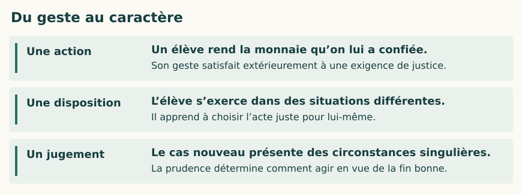

# Philosophie — Aristote et la vertu · Sélection internationale 2022 · Corrigé guidé

*Corrigé rédigé par IA, non officiel. Signalez toute erreur.*

**Rédaction** · GPT-6.2 Astra Ultra · vitesse non renseignée

**Révision (tour 1)** · GPT-6.2 Astra Ultra · vitesse non renseignée

Écrit du 7 février 2022, de 14 h à 16 h. Aristote, *Éthique à Nicomaque*, livre II, chapitre 1, traduction de Jules Tricot.

## Préparation aux quatre questions

**Pour la première**, partez de la question de l’ouvrage. Si le bonheur demande une activité selon la vertu, il faut expliquer comment nous acquérons la disposition qui rend cette activité possible. Ce lien au livre I donne sa fonction à la présentation de l’auteur.

**Pour la deuxième**, refaites les deux comparaisons du passage dans l’ordre. Quel changement la répétition échoue-t-elle à produire chez la pierre ? Quel changement réussit-elle à produire chez le musicien ? La réponse fait apparaître pourquoi la vertu peut être acquise alors que la possibilité de l’acquérir appartient à notre nature.

**Pour la troisième**, changez de chapitre. Distinguez le mode d’acquisition, présenté en II, 1, de la définition donnée en II, 6. Pour vérifier la place du choix, comparez deux actes identiques vus de l’extérieur, l’un effectué sous surveillance et l’autre choisi pour lui-même.

**Pour la quatrième**, suivez un seul exemple. Dans un secours apporté à une personne en difficulté, quelles actions antérieures ont formé le caractère ? À quel excès et à quel défaut s’expose l’agent ? Que doit-il discerner ici et maintenant ? Vous attribuez ainsi un rôle différent à l’habitude, à la médiété et à la prudence.

## 1. Aristote et son œuvre

Aristote (384–322 av. J.-C.) naît à Stagire, fréquente l’Académie de Platon à Athènes et fonde ensuite sa propre école au Lycée. Son œuvre étudie aussi bien les raisonnements par lesquels nous démontrons que les changements de la nature, les êtres vivants ou les formes de gouvernement. Ces recherches exigent des méthodes différentes. Au début de l’*Éthique à Nicomaque*, Aristote invite à ne pas exiger des affirmations concernant l’action humaine la même exactitude que des démonstrations mathématiques. Les circonstances dans lesquelles il est beau et juste d’agir peuvent varier. Elles appellent une enquête dont les conclusions nous aident à bien agir.

L’*Éthique à Nicomaque* cherche en quoi consiste le bonheur, *eudaimonia*, fin que nous choisissons pour elle-même. Le livre I le rapporte à une activité de l’âme selon l’excellence, exercée dans une vie accomplie. Dès lors, il importe de savoir comment quelqu’un devient capable d’exercer cette activité. Au livre II, le passage du sujet traite précisément de la formation du caractère. On comprend par là son lien avec la *Politique*. Les lois et l’éducation publique donnent aux citoyens certaines habitudes, pour le meilleur ou pour le pire. Le philosophe interroge donc ensemble le choix personnel et les conditions collectives de son apprentissage.

## 2. Vertus intellectuelles et vertus éthiques

La distinction d’ouverture regarde à la fois ce qui se perfectionne et la manière dont on le perfectionne. Les excellences intellectuelles sont des excellences de la pensée. Elles permettent par exemple de démontrer, de saisir des principes ou de bien délibérer. L’enseignement contribue pour une large part à les former. Un élève reçoit une explication, s’exerce à en suivre les raisons et finit par juger par lui-même. Le temps et l’expérience restent nécessaires, tout particulièrement dans les choses pratiques. Les excellences éthiques concernent le caractère, notre manière de désirer, d’éprouver les passions et d’agir. On peut expliquer le courage en classe et rester incapable de soutenir la crainte raisonnablement lorsque le danger survient. Ce sont les façons d’agir répétées qui forment ici la disposition correspondante.

Pour éclairer la différence entre une disposition acquise et une propriété naturelle, Aristote évoque la pierre. Dans la physique qu’il présuppose, la pierre se porte naturellement vers le bas. La lancer des milliers de fois en l’air ne lui apprendra pas à monter d’elle-même. Or un être humain peut devenir plus juste, ou plus injuste, en prenant l’habitude de se conduire de telle ou telle manière. Le même raisonnement exclut l’idée que la vertu contredise notre nature. Un être entièrement incapable d’apprendre n’acquerrait rien en s’exerçant. La pierre ne devient pas plus apte à monter au dixième lancer. Chez l’apprenti, en revanche, le dixième essai hérite des neuf précédents et transforme sa manière de faire. Voilà en quel sens une capacité reçue de la nature peut être perfectionnée par l’habitude. La comparaison avec le musicien précise le processus. Celui qui joue aujourd’hui en apprenti acquiert, par ce jeu même et les corrections qu’il reçoit, la manière de jouer qu’il pourra exercer demain en musicien.

## 3. La définition de la vertu morale

> [!INDICATION]
> Relisez l’indication entre parenthèses après la question 3. Formulez la différence entre « comment devient-on juste ? » en II, 1 et « qu’est-ce qu’agir en personne juste ? » en II, 4 et II, 6. Testez cette différence en racontant deux façons de rendre exactement la même somme.

Le chapitre 1 explique la genèse des vertus. Le sujet précise que la définition demandée se trouve ailleurs. Au livre II, chapitre 6 (1106b–1107a), Aristote rassemble les caractères de l’excellence morale qu’il avait commencé par décrire séparément. La vertu morale est une disposition stable à choisir, située dans une médiété relative à nous, que détermine la raison comme le ferait la personne prudente. Chaque élément distingue la vertu d’une conduite qui n’en aurait que l’apparence.

Une disposition, *hexis*, qualifie la manière dont l’agent se tient ordinairement à l’égard de ses passions et de ses actes. Une peur soudaine est un affect. Être capable d’éprouver la peur est une faculté. Le courage est une certaine manière de redouter et d’affronter, dans telles circonstances, ce qui mérite de l’être. Le choix délibéré, *prohairesis*, importe parce que la vertu engage l’agent dans le principe de son acte. Supposons que deux commerçants rendent exactement la monnaie. Le premier ignore qu’il a rendu la somme juste. Le second connaît la somme et la rend pour éviter un blâme. Les pièces sont les mêmes sur le comptoir. La manière dont chacun a pris sa décision nous empêche pourtant de conclure qu’il est juste. Pour agir en homme juste, il doit savoir ce qu’il fait, choisir l’acte pour lui-même et agir à partir d’une disposition ferme. Cette distinction du livre II, chapitre 4, résout une difficulté du passage. Le débutant peut accomplir sous la conduite d’un autre des actions justes avant de posséder le caractère dont elles procèderont plus tard.

## 4. Trois notions

### a. L’habitude

L’habituation, *ethismos*, est le processus par lequel les actes répétés façonnent le caractère. Le plaisir ou la peine que l’on éprouve à les accomplir aide à mesurer l’avancement de l’éducation. L’apprenti généreux peut d’abord regretter l’argent qu’il donne. Avec l’exercice, il apprend à se réjouir de l’usage approprié de ce bien. Toute répétition ne produit donc pas une vertu. La cithare du passage en donne un modèle. On forme son oreille en jouant et en corrigeant son jeu. Un musicien qui répète sans cesse la même fausse note peut aussi s’y accoutumer. De même, plusieurs dons accomplis par vanité peuvent affermir le désir d’être admiré. Le rôle de l’éducateur est notamment d’ordonner ces expériences jusqu’à ce que l’élève puisse discerner et choisir.

### b. Le juste milieu

La médiété, *mesotēs*, se détermine entre un excès et un défaut relatifs à une passion ou à un acte. Devant un danger réel, s’enfuir en laissant les autres exposés et affronter sans discernement un péril inutile peuvent être deux manières opposées de manquer le courage. Le milieu ne s’obtient pas en calculant la moyenne de deux quantités de peur. Il dépend de ce qu’il convient de craindre, des personnes en jeu, du moment et du motif de l’action. « Relatif à nous » n’autorise donc pas chacun à retenir ce qui lui plaît. La réponse demande des raisons ajustées à la situation. Aristote ajoute que certaines actions, telles que le vol, sont déjà désignées comme mauvaises. On ne chercherait pas la bonne quantité de vol.

### c. La prudence

La prudence, *phronēsis*, appartient aux vertus intellectuelles et concerne l’action. Au livre VI, Aristote la rapporte à la capacité de bien délibérer sur ce qui est bon pour la vie humaine. Le prudent saisit les particularités pertinentes d’une situation et juge comment agir. Deux personnes ont reçu la même formation à la générosité. L’une rencontre quelqu’un qui a besoin d’un secours immédiat, l’autre quelqu’un qui demande à disposer d’une somme à une fin injuste. Donner également aux deux serait appliquer une règle avec aveuglement. La vertu morale donne au désir sa juste orientation, la prudence détermine dans le cas concret comment la réaliser. La seule habileté pourrait aussi bien servir une mauvaise fin. L’unité du désir éduqué et de la raison pratique achève ainsi de rendre compte de ce que l’exercice des actes peut former.

[Énoncé](https://www.ens.psl.eu/sites/default/files/philo-ecrit-sil2022-4.pdf) · [Rapport du jury](https://www.ens.psl.eu/sites/default/files/rapport-philo-sil2022.pdf)
