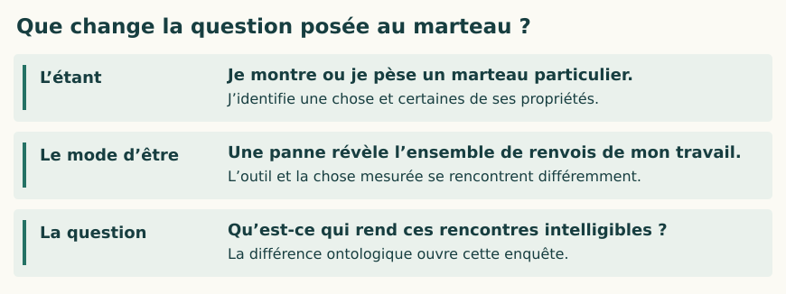

# Philosophie — La différence ontologique chez Heidegger. Sens, enjeux, limites · Oral PSL 2022 · Corrigé brut

*Corrigé rédigé par IA, non officiel. Signalez toute erreur.*

**Rédaction** · GPT-6.2 Astra Ultra · vitesse non renseignée

**Révision (tour 1)** · GPT-6.2 Astra Ultra · vitesse non renseignée

Le 8 février 2022, le jury attribue cet exposé au candidat 2. Le rapport indique une heure de préparation, puis quinze minutes de présentation et quinze minutes d’entretien.

## Exposé

À un visiteur qui demande ce qu’est un marteau, je peux indiquer où en acheter un, nommer ses matériaux et faire voir son emploi. Qu’ai-je fait comprendre si je me suis borné à lui tendre cet objet ? J’ai désigné un étant, quelque chose qui est. Je n’ai pas encore explicité ce qui me permettait, selon les moments, de rencontrer en lui une masse de fer, un outil approprié ou un souvenir de famille. La différence ontologique, chez Heidegger, est la différence de l’être et de l’étant. Sa difficulté tient à ce que les deux termes ne se laissent pas montrer séparément. Il faut d’abord préciser le sens de la distinction, puis examiner ce qu’elle change à la pratique de la philosophie et jusqu’où l’on est en droit de lui assigner un pouvoir d’élucidation.

### Le sens d’une différence qui n’oppose pas deux choses

Un étant peut être un outil, un nombre, un animal, un être humain. Heidegger reprend au début d’*Être et Temps* (1927) la question du sens de l’être. Il ne propose pas d’ajouter à l’inventaire de toutes les choses une chose particulièrement éminente que l’on désignerait par une majuscule. Si nous en faisions un objet à côté des objets, il faudrait encore demander en quel sens cet objet lui-même *est*. La question que l’on tentait d’éclairer serait seulement revenue un étage plus haut. L’être n’est pas davantage, chez Heidegger, la classe la plus vaste obtenue en retirant aux choses leurs particularités. Cette opération supposerait que nous sachions déjà comment elles comptent pour nous comme des étants.

Revenons au marteau. Tant que je travaille, il s’efface le plus souvent dans le geste de fixer la planche. Je le rencontre à partir d’un ensemble de renvois, au clou, à l’ouvrage, à la personne qui doit s’en servir. S’il se casse ou devient introuvable, toute l’organisation dont je dépendais se révèle par son interruption. Je peux aussi considérer son poids et sa longueur en laissant de côté la tâche à accomplir. Dans les deux cas, je puis avoir affaire au même objet matériel. L’analyse distingue pourtant l’être de l’outil disponible dans un usage et la présence d’une chose examinée pour ses propriétés. La disponibilité dans l’usage et l’observation d’une chose pour ses propriétés sont deux façons de rencontrer un étant. Leur contraste donne accès à la question ontologique sans définir à lui seul la différence de l’être et de l’étant. Le marteau reste un exemple d’étant dont nous avons à expliciter le mode de rencontre.

### Les enjeux pour celui qui questionne

On pourrait objecter que, pour savoir ce qu’est un marteau, les connaissances du physicien et de l’artisan suffisent. Heidegger ne cherche pas à fournir une meilleure mesure de la masse ni une technique d’assemblage concurrente. Il demande ce qui rend possible l’abord d’une chose sous tel ou tel rapport. Une science délimite son domaine en se donnant un type d’objet, des opérations susceptibles de le mettre à l’épreuve et des critères qui font compter une réponse comme valide. Elle peut évidemment les examiner et les améliorer. Mais étudier une réalité en tant que mesurable suppose déjà une intelligence, même implicite, de ce qui peut apparaître comme un étant mesurable. La différence ontologique ouvre l’enquête sur cette compréhension préalable, ordinairement oubliée au profit de ce qu’elle permet de connaître.

Pourquoi *Être et Temps* prend-il alors pour point de départ le *Dasein*, l’être que nous sommes ? Parce qu’en vivant celui-ci se rapporte déjà à son être et à celui des autres choses. Celui qui ne possède aucun vocabulaire philosophique sait néanmoins se comporter autrement envers un ami qui a promis de venir et un objet qui manque à sa place. Une compréhension préalable de l’être travaille dans ces différences pratiques. La dégager ne revient pas à faire de la conscience individuelle l’auteur souverain de tout ce qui existe. Le Dasein se découvre toujours déjà engagé dans un monde, des occupations, un langage qu’il n’a pas commencé par créer.

Il importe ici de ne pas confondre deux différences. Un marteau et un tournevis se distinguent par leur forme et leurs usages. Une enquête sur ces deux étants demeure ontique, même si elle aboutit à une règle générale sur les outils. Demander à partir de quoi quelque chose peut m’apparaître comme un outil fait porter l’analyse sur un mode d’être. Et la différence ontologique désigne une distinction encore plus générale, entre tout étant et son être. Le vocabulaire technique remplit son office si l’on peut montrer à son interlocuteur à quelle question nouvelle il oblige à répondre.

Le projet d’une ontologie fondamentale consiste à porter cette compréhension à l’explicitation. La temporalité y prend un sens décisif. Une possibilité à réaliser oriente ce que je fais maintenant et la manière dont je reprends des habitudes acquises. Une conception qui ramènerait tout être à une présence entièrement disponible sous le regard laisserait inexpliqué le mode d’être de cet existant qui se projette. Plus tard, Heidegger interrogera aussi l’histoire de la métaphysique occidentale et sa tendance à chercher dans un étant suprême le fondement de tous les autres. Cette autre étape de la réflexion prolonge le diagnostic d’un oubli de la différence, tout en déplaçant l’attention vers les manières historiques dont l’être se découvre et se dérobe.

### Les limites et ce qu’une objection doit viser

La première difficulté est méthodologique. Puisque nous ne pouvons comparer l’être et l’étant comme deux objets indépendamment disponibles, comment établir qu’une interprétation de l’être est meilleure qu’une autre ? Heidegger assume un mouvement circulaire, nous partons d’une compréhension déjà à l’œuvre et nous la reprenons à partir des phénomènes qu’elle permet de voir. Ce cercle peut être fécond si les descriptions sont assez précises pour que le lecteur puisse les éprouver et leur opposer d’autres expériences. Une invocation de l’oubli de l’être qui croirait se dispenser de toute description deviendrait au contraire difficile à discuter. L’exemple de l’outil, avec les objections qu’il admet, a plus de force qu’une formule isolée sur l’Être.

Une autre limite concerne la priorité accordée à la question ontologique. Levinas demande, notamment dans *Totalité et Infini*, ce que deviendrait une relation à autrui dont on ferait d’abord une manière de comprendre son être. Le visage qui me requiert peut m’obliger avant toute décision sur les catégories dans lesquelles je pourrais le saisir. L’objection ne transforme pas Heidegger en penseur pour qui autrui serait un simple objet. *Être et Temps* analyse expressément l’être-avec. Elle déplace la question de priorité. Même si la différence de l’être et de l’étant permet d’élucider les conditions d’apparition d’une personne, l’obligation de lui répondre reçoit-elle de cette élucidation son sens premier ?

La différence ontologique interdit ainsi de croire qu’il suffirait de trouver une chose ultime pour avoir compris tout ce que signifie être. Elle est féconde chaque fois qu’elle nous oblige à décrire ce qui demeurait implicite dans notre manière de rencontrer un étant. Elle reste discutable au point où cette interrogation revendique une priorité sur toutes les autres, notamment sur la responsabilité que la rencontre d’une personne fait déjà peser sur nous.

## Questions d’entraînement pour l’entretien

**L’être serait-il une propriété commune à tous les objets ?** Une propriété distingue en général des choses qui la possèdent de celles qui ne la possèdent pas. La question heideggérienne concerne la compréhension préalable qui permet déjà de rencontrer un quelconque étant et d’en énoncer une propriété.

**Pourquoi parler du bris d’un outil ?** La panne interrompt une opération qui allait de soi et fait apparaître les renvois à un monde pratique. Elle ne nous fait pas voir l’être comme une chose cachée à l’intérieur du marteau. Elle transforme ce qui devient descriptible dans notre rencontre avec lui.

**Le physicien qui pèse le marteau doit-il devenir philosophe pour que sa mesure soit juste ?** La justesse du résultat relève de l’instrument et des conditions de mesure. L’enquête philosophique vient poser une question distincte sur le mode de présence qu’exige cette manière de rencontrer l’outil. L’autonomie de la mesure constitue une limite à ce qu’on peut attendre d’une réponse ontologique.

[Énoncé](https://www.ens.psl.eu/sites/default/files/philo-oraux-sil2022.pdf) · [Rapport du jury](https://www.ens.psl.eu/sites/default/files/rapport-philo-sil2022.pdf)
