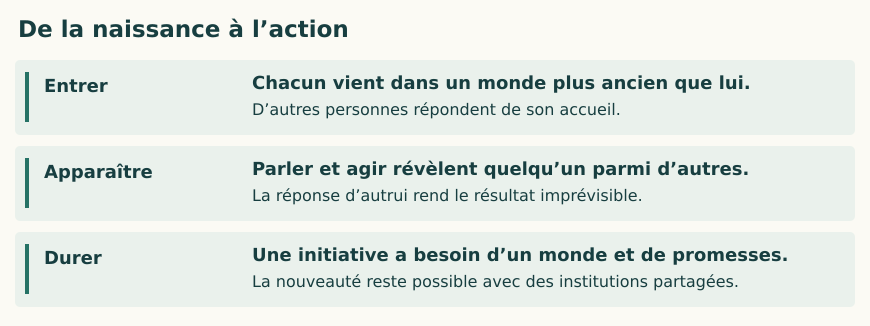

# Philosophie — La natalité chez Hannah Arendt. Sens, enjeux, limites · Oral PSL 2022 · Corrigé guidé

*Corrigé rédigé par IA, non officiel. Signalez toute erreur.*

**Rédaction** · GPT-6.2 Astra Ultra · vitesse non renseignée

**Révision (tour 1)** · GPT-6.2 Astra Ultra · vitesse non renseignée

Le 8 février 2022, le jury attribue cet exposé au candidat 4. Le rapport indique une heure de préparation, puis quinze minutes de présentation et quinze minutes d’entretien.

## Préparer les quinze minutes d’exposé

Placez sur le brouillon trois verbes, naître, apparaître et commencer. Dites ce que les adultes peuvent faire pour un enfant et ce qu’ils ne peuvent décider à sa place lorsqu’il prendra à son tour la parole. Ce passage donne son sens politique au concept.

Pour construire l’objection finale, reprenez l’exemple d’une assemblée dont certains habitants sont matériellement absents. Leur capacité de commencer et la possibilité concrète de s’y présenter sont deux questions distinctes. Cette différence permet de discuter la portée sociale de l’analyse d’Arendt.

**Mettre la réponse à l’épreuve.** Pour éprouver la limite de l’idée, imaginez que la proposition de l’habitante exclue d’emblée d’autres personnes de l’assemblée. Elle peut être inédite et pourtant détruire les conditions de la liberté politique. Dites alors à quelle fin sert la distinction entre une capacité de commencer, la valeur d’une initiative déterminée et les conditions matérielles qui permettent à d’autres de lui répondre.

## Exposé

Un nouveau membre entre pour la première fois dans une assemblée déjà constituée. Son nom figure dans le registre, une place lui est réservée, mais rien de cela ne permet de prévoir ce qu’il va dire. S’il prend une initiative, les autres peuvent la poursuivre, la contester ou lui donner un sens qu’il n’avait pas voulu. Pourquoi Hannah Arendt associe-t-elle cette capacité politique au fait d’être né ? La *natalité* désigne à la fois une condition commune, chaque être humain commence une vie dans un monde plus ancien que lui, et la possibilité d’un commencement qui dépend de quelqu’un. Il faut comprendre le passage de l’une à l’autre, examiner ce qu’il change à la pensée de la liberté, puis demander à quelles conditions les nouveaux venus peuvent effectivement prendre part au monde.

### Le sens de la natalité

Dans *Condition de l’homme moderne*, Arendt distingue le travail, l’œuvre et l’action. Le travail répond au renouvellement cyclique des besoins de la vie. L’œuvre produit des objets et des institutions relativement durables qui contribuent à former un monde. L’action, associée à la parole, engage parmi d’autres une initiative dont on ne peut déduire tous les effets d’un modèle préalable. La venue au monde d’un enfant touche aux trois dimensions. Il faut lui donner de quoi vivre, lui aménager une place parmi des choses qui durent et se préparer à rencontrer en lui un être dont l’avenir n’est pas la simple reproduction du nôtre.

La natalité ne désigne donc ni le taux des naissances dans un pays ni une exaltation d’une puissance biologique. Certains faits se produisent à une date nouvelle sans rien inaugurer au sens politique. Inversement, une personne âgée qui prend aujourd’hui la parole pour la première fois dans une affaire publique peut exercer la capacité humaine dont sa naissance est la condition. Arendt reprend à Augustin la distinction d’un commencement lié à la venue de quelqu’un. Nous avons eu un début qui ne résultait pas de nos actes. Nous pouvons à notre tour devenir les initiateurs de quelque chose dont d’autres auront à faire l’expérience.

Arendt rapproche l’entrée parmi les autres par la parole et l’action d’une seconde naissance. Le rapprochement suppose une différence. La première fois, le nouveau venu est d’abord confié aux soins d’autrui. La seconde fois, quelqu’un apparaît aux autres à travers ce qu’il fait et dit. Son apparition peut révéler *qui* il est au-delà de *ce qu’*un état civil, une profession ou un ensemble de qualités permettent déjà de répertorier. Une initiative qu’aucune personne n’assumerait publiquement manquerait cette forme d’apparition.

### L’enjeu politique, une liberté qui commence parmi d’autres

La liberté risque d’être comprise exclusivement comme la souveraineté d’une volonté qui obtiendrait exactement ce qu’elle a décidé. Or cette représentation convient mal à un monde d’êtres pluriels. Devant une inondation, des habitants peuvent proposer pour la première fois un débat sur la manière dont est aménagée la rivière qui traverse leur commune. Une personne en prend l’initiative. D’autres apportent une mémoire des lieux, des objections, le récit d’usages oubliés. La délibération qui se forme est bien un événement dont quelqu’un a été l’auteur au sens où il a commencé. Elle n’est pas son produit comme une table achevée est le produit de l’artisan qui l’a construite selon un plan.

L’imprévisibilité de l’action n’est donc pas simplement notre ignorance provisoire de causes que des calculs parfaits révéleraient un jour. Celui à qui je m’adresse est lui-même capable de commencer quelque chose. Il peut répondre autrement que je ne l’attendais, et la chaîne des réponses déplace la portée du premier geste. La natalité permet ainsi de penser une liberté inséparable de la pluralité humaine. Un monde où la nouveauté ne serait admise qu’à condition de se conformer à un programme connu d’avance ne lui laisserait guère de place.

Deux nouveautés peuvent apparaître le même jour dans la ville. Une horloge neuve se met à sonner selon son programme et une habitante propose pour la première fois de déplacer l’assemblée au bord de la rivière. Toutes deux interrompent une habitude. Pourtant seule la seconde s’adresse à des personnes susceptibles de répondre et d’infléchir ce qu’elle inaugure. Le critère politique de la nouveauté ne tient donc ni à sa date ni à son succès assuré. Une proposition rejetée peut révéler qui l’a portée et appeler des réponses auxquelles son auteure n’avait pas pensé. La natalité désigne une ouverture de cette sorte dans un monde partagé.

La faculté de commencer porte cependant aussi le risque d’effets irréversibles. Agir engage les autres, parfois contre leur volonté. Arendt prête au pardon et à la promesse une valeur particulière. Le pardon peut libérer les personnes de l’enchaînement des réactions à un acte. Les faits accomplis demeurent, mais une autre relation peut commencer. La promesse ménage une relative stabilité entre plusieurs personnes sans supprimer toute initiative future. Reprenons la discussion sur la rivière. Si personne ne consent à respecter une décision ou à revenir sur un tort, la multiplication des initiatives peut tourner à l’impuissance. La natalité ouvre une faculté politique, elle ne dispense nullement des pratiques qui la rendent habitable.

### Les limites d’une politique du commencement

Tous les commencements ne sont pas bons du seul fait qu’ils sont nouveaux. Une mesure qui exclurait une partie des habitants de l’assemblée pourrait constituer, elle aussi, une nouveauté. On ne peut donc tirer de la natalité une approbation inconditionnelle de tout ce qui rompt avec le passé. La question politique décisive est plutôt de savoir si le monde dans lequel nous agissons laisse à une pluralité réelle de nouveaux venus la possibilité de commencer. Sans lieu durable, sans libertés publiques et sans interlocuteurs disposés à reconnaître une voix, la capacité existe en principe et peut pourtant ne trouver aucune scène d’apparition.

Le problème de l’éducation en fournit une autre épreuve. Dans « La crise de l’éducation », Arendt place les adultes devant une double responsabilité. Un enfant a besoin que quelqu’un lui présente un monde antérieur à lui et en réponde. Ce monde a lui-même besoin que ceux qui viennent puissent un jour y introduire quelque chose d’inattendu. Faire de la jeunesse le simple moyen de réaliser le projet politique des adultes lui retirerait cette faculté. Abandonner les jeunes à la seule injonction d’inventer les priverait inversement d’une langue, de savoirs et d’objets communs dans lesquels leur initiative pourrait avoir du sens.

On peut enfin demander ce que la distinction entre entretien de la vie et action publique laisse dans l’ombre. Le soin, le temps accordé à l’enfance, les conditions matérielles qui permettent à des adultes de venir à une assemblée ne sont pas distribués également. Les traiter comme un arrière-plan toujours disponible risquerait de rendre invisibles ceux qui le construisent et parfois d’exclure leur propre voix du monde politique. Cette objection pousse à examiner les conditions concrètes de l’apparition, sans effacer la distinction entre faire vivre et commencer à agir parmi des égaux. La natalité a ainsi une portée précise. Elle rappelle qu’aucun monde transmis ne peut épuiser d’avance ce que feront ceux qui viennent, mais qu’il appartient aux vivants de rendre cette ouverture effective.

## Questions d’entraînement pour l’entretien

**Qu’advient-il si personne ne répond à une initiative ?** L’action ne peut s’accomplir sur le modèle d’un objet fabriqué à soi seul. Son isolement peut révéler la défaillance d’un espace commun, et non une disparition de la capacité de commencer chez la personne qui agit.

**Pourquoi conserver un monde si l’on valorise les commencements ?** Sans durabilité, une initiative n’aurait rien à reprendre ou à transformer et personne avec qui la partager. La difficulté éducative consiste à transmettre ce monde assez solidement pour que l’on puisse aussi le modifier.

**Pourquoi la natalité peut-elle concerner une personne qui n’aura pas d’enfants ?** Chez Arendt, la naissance désigne la condition de tout nouvel arrivant. Celui-ci peut ensuite paraître par sa parole et son action dans un monde plus ancien que lui. Cette capacité tient à sa venue et aux relations où il peut agir, indépendamment de toute décision de devenir parent.

[Énoncé](https://www.ens.psl.eu/sites/default/files/philo-oraux-sil2022.pdf) · [Rapport du jury](https://www.ens.psl.eu/sites/default/files/rapport-philo-sil2022.pdf)
