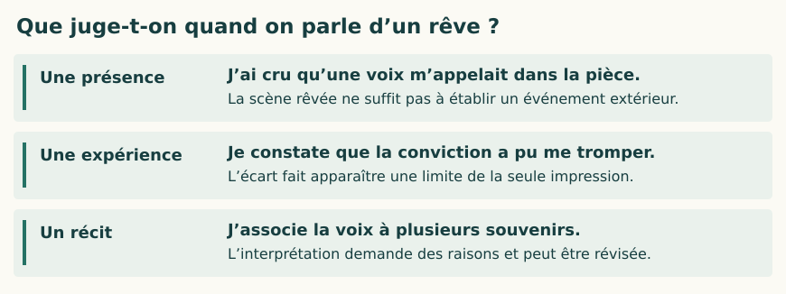

# Philosophie — Le rêve, source d’erreur ou de vérité ? · Oral PSL 2022 · Corrigé guidé

*Corrigé rédigé par IA, non officiel. Signalez toute erreur.*

**Rédaction** · GPT-6.2 Astra Ultra · vitesse non renseignée

**Révision (tour 1)** · GPT-6.2 Astra Ultra · vitesse non renseignée

Le 8 février 2022, le jury attribue cet exposé à la candidate 1. Le rapport indique une heure de préparation, puis quinze minutes de présentation et quinze minutes d’entretien.

## Préparer les quinze minutes d’exposé

Partez d’une phrase que chacun pourrait prononcer, « j’ai entendu un appel ». Dites-la comme témoignage sur un événement extérieur, puis comme récit d’une expérience vécue. La distinction des deux objets du témoignage donne à la première partie son problème.

Pour les deux suivantes, gardez un verbe d’enquête différent, *éprouver* avec Descartes et *interpréter* avec Freud. Le jury peut demander à quelle condition une lecture du rêve pourrait être révisée. Préparez un exemple où un souvenir nouveau conduirait à préférer une interprétation plus précise.

**Mettre la réponse à l’épreuve.** Dans la dernière minute, revenez à l’appel entendu. Distinguez une affirmation sur la chambre, une affirmation sur l’expérience vécue et une hypothèse sur la signification de la voix. Demandez pour chacune ce qui pourrait la confirmer ou la faire abandonner. Cette comparaison vous permettra de conclure sur les deux termes du sujet.

## Exposé

Je me réveille persuadé d’avoir entendu quelqu’un appeler mon nom. Il suffit d’un instant pour que je m’aperçoive que la pièce est vide. Qu’y avait-il de faux dans ce rêve ? Quelque chose a bien eu lieu, j’ai éprouvé une surprise et dirigé mon attention vers une voix. L’erreur semble commencer lorsque je passe de cette expérience au jugement qu’une personne m’a effectivement appelé. La différence paraît facile à rétablir au réveil, mais pendant le rêve je ne disposais pas de ce point de comparaison. Il faut donc examiner séparément le crédit qu’on peut accorder à ce que le rêve représente, l’usage qu’on peut faire de l’expérience d’avoir été trompé et la vérité que l’on serait en droit d’attribuer à une interprétation du rêve.

### 1. Une impression présente peut être prise pour la présence d’une chose

Une erreur suppose une prétention au vrai. Si une forêt apparaît dans un tableau, le peintre n’a pas commis une erreur simplement parce qu’aucun arbre ne pousse derrière la toile. Le cadre signale au spectateur qu’une autre manière de rapporter ce qu’il voit à la réalité est de mise. Or le rêve se passe souvent d’une marque équivalente. Dans une chambre rêvée, je ne regarde pas ma table comme la représentation d’une table. J’y cherche le livre que j’y ai laissé, quitte à m’étonner de ne pas le trouver. Des tâches et des préoccupations tout ordinaires me font habiter un monde dont les conditions échappent pourtant à la vérification. Le rêve est donc une source d’erreur en un sens rigoureux, il favorise l’assentiment à une présence que sa vivacité ne suffit pas à établir.

Le rêve d’une chute peut m’effrayer même si, une fois éveillé, je sais assurément n’avoir pas quitté mon lit. Dire alors que tout était faux serait trop rapide. La peur éprouvée durant le rêve est réelle comme expérience. Le témoignage « j’ai rêvé qu’on m’appelait » peut, lui aussi, être exact. Il faut distinguer ce qui est représenté, l’acte de se le représenter et le jugement qu’un événement extérieur lui correspond. L’illusion consiste à franchir le passage entre les deux derniers sans s’apercevoir qu’il demandait une justification. Voilà pourquoi invoquer la bizarrerie de certains rêves ne fournit pas un critère assez sûr. Pour me tromper, il suffit que, ne serait-ce qu’un instant, la scène m’ait semblé familière et praticable.

### 2. L’épreuve du rêve instruit sur ce qui peut faire preuve

Dans la première des *Méditations métaphysiques*, Descartes prend pour exemple le fait de se croire ici, habillé, assis près du feu. Il a déjà eu en songe des états semblables, alors qu’il était couché ailleurs. Deux précisions changent la valeur de cet argument. Descartes ne se contente pas d’énumérer les extravagances du songe. Il retient des situations dans lesquelles aucune étrangeté ne lui a permis de soupçonner immédiatement l’illusion. Il ne conclut pas non plus que sa veille actuelle soit nécessairement un rêve. Il demande ce qui rend certaine une perception particulière lorsqu’une expérience passée a montré qu’elle pouvait avoir une semblable apparence sans le même objet.

Ainsi la déception procure un savoir qu’aucune des images du rêve ne contenait à elle seule. Elle apprend à ne pas fonder une certitude sur l’intensité présente d’une impression. Le monde de la veille offre des moyens autrement solides d’examen. Je peux revenir sur les circonstances d’une action, la relier à un passé dont je me rappelle les étapes et confronter mon témoignage à celui d’autres personnes. Même le doute cartésien, lorsqu’il est conduit plus loin, permet d’atteindre quelque chose qu’il n’est pas nécessaire d’attendre du réveil. Si je doute à cet instant de mon état, il faut au moins qu’il y ait un sujet qui accomplit cet acte. Le rêve est ici source de vérité au sens où l’on peut en tirer une épreuve critique. Ses images ne sont pas devenues pour autant un oracle plus sûr que les perceptions de la veille.

### 3. Que peut apprendre l’interprétation d’un rêve ?

Supposons que le bruit entendu dans le rêve ait effectivement correspondu à une sonnerie qui retentissait dans la chambre. Au réveil, un enregistrement permet de le constater. L’événement extérieur était bien réel. Cette réussite occasionnelle justifie-t-elle la confiance que je mettais dans la voix rêvée ? Elle confirme qu’un bruit a eu lieu, mais la scène où j’identifiais une personne pouvait être inventée. Il faut distinguer la coïncidence heureuse et une bonne raison d’affirmer. C’est précisément parce que certaines images rejoignent parfois le réel que le problème de leur valeur de preuve est difficile.

Le rêve peut encore nous instruire sur la vie de celui qui rêve. Le déplacement est important. Tout à l’heure la question était de savoir s’il y avait effectivement quelqu’un à la porte. Je peux maintenant demander quel appel j’attendais, à quel souvenir cette intonation me fait penser ou pourquoi l’absence de réponse m’a surpris. Freud, dans *L’Interprétation du rêve*, distingue le contenu manifeste dont le rêveur fait récit et les pensées latentes que l’interprétation tente de reconstruire. Plusieurs souvenirs peuvent se condenser en un seul personnage. L’intensité affective peut se déplacer d’un élément important de la vie éveillée vers un détail apparemment secondaire du songe. Dès lors, une scène invraisemblable comme compte rendu du monde peut devenir significative comme transformation de pensées et de désirs.

Cette proposition n’autorise pas un interprète à attribuer d’avance un sens unique à un objet rêvé. Dans la démarche freudienne, les associations de celui qui a fait le rêve comptent, ainsi que la façon dont ses souvenirs et ses pensées éclairent des détails précis. Même ainsi, le récit se forme après coup et plusieurs lectures peuvent rester ouvertes. L’intérêt philosophique de cette difficulté est de faire apparaître une dernière condition de la vérité. Pour qu’une interprétation soit instructive, il faut pouvoir dire quels éléments la soutiennent et ce qui ferait préférer une autre lecture. Une histoire séduisante qui expliquerait aussi bien n’importe quel détail risquerait de reproduire, chez l’interprète, l’assentiment trop rapide que nous reprochions au rêveur.

Le rêve est donc source possible d’erreur lorsqu’il fait prendre une apparition pour un événement réel. Il devient source de vérité lorsque nous interrogeons ce passage ou lorsque nous traitons son récit comme une expression à interpréter. Dans les deux cas, la vérité exige une opération qui modifie notre rapport à ce que nous avons éprouvé. Refuser de croire qu’un appel a réellement retenti n’empêche pas de comprendre enfin pourquoi l’on était si prêt à l’entendre.

## Questions d’entraînement pour l’entretien

**Une vérité mathématique découverte en rêve deviendrait-elle suspecte ?** L’origine d’une idée et ses raisons de validité sont distinctes. Un raisonnement entrevu en rêve peut être repris à l’état de veille. Sa démonstration décidera alors de la proposition.

**Peut-on savoir que l’on rêve au moment du rêve ?** L’expérience dite du rêve lucide montre que l’adhésion au monde rêvé varie. Ce cas limite confirme la distinction entre la poursuite d’une représentation et le jugement que l’on porte sur elle.

**Un rêve qui se réalise devient-il un bon moyen de prévoir ?** Si seul le cas réussi est retenu parmi de nombreuses images dissemblables, la rencontre laisse intacte la question du hasard. Il faudrait disposer de critères antérieurs de reconnaissance, d’une série de cas et de raisons de s’attendre à un résultat. Une concordance singulière peut être vraie sans établir une faculté de prédiction.

[Énoncé](https://www.ens.psl.eu/sites/default/files/philo-oraux-sil2022.pdf) · [Rapport du jury](https://www.ens.psl.eu/sites/default/files/rapport-philo-sil2022.pdf)
