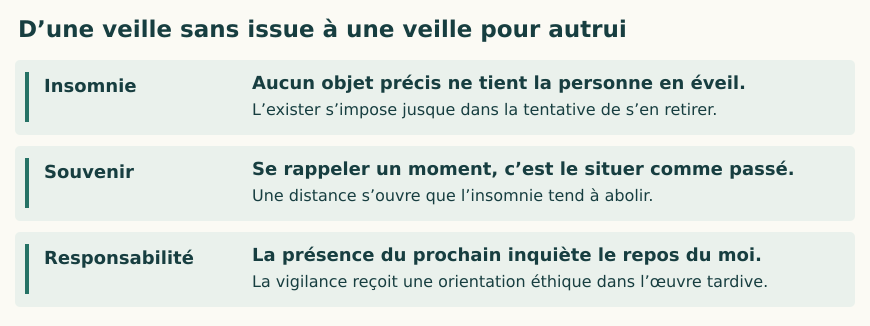

# Philosophie — Levinas et l’insomnie · Sélection internationale 2022 · Corrigé brut

*Corrigé rédigé par IA, non officiel. Signalez toute erreur.*

**Rédaction** · GPT-6.2 Astra Ultra · vitesse non renseignée

**Révision (tour 1)** · GPT-6.2 Astra Ultra · vitesse non renseignée

Écrit du 7 février 2022, de 14 h à 16 h. Emmanuel Levinas, *Le Temps et l’Autre*, conférences de 1946–1947, édition PUF de 1983, p. 27.

## 1. Levinas et ses principales œuvres

Emmanuel Levinas (1906–1995), né à Kaunas, formé à Strasbourg puis à Fribourg, introduit auprès du public français la phénoménologie de Husserl et discute très tôt la pensée de Heidegger. Sa *Théorie de l’intuition dans la phénoménologie de Husserl* date de 1930. L’attention phénoménologique à la manière dont quelque chose se donne à vivre demeure décisive chez lui, y compris lorsqu’il en déplace l’usage. Dans le texte proposé, par exemple, la nuit d’insomnie intéresse le philosophe par ce qu’elle fait éprouver du rapport entre l’exister et celui qui l’assume.

*De l’existence à l’existant* (1947) étudie le surgissement d’un existant dans un exister anonyme. Les conférences réunies dans *Le Temps et l’Autre*, d’où vient l’extrait, demandent comment le temps et l’altérité peuvent ouvrir l’existence que le sujet assume seul. *Totalité et Infini* (1961) développe le thème du visage d’autrui, dont la présence met en question les pouvoirs du moi. *Autrement qu’être ou au-delà de l’essence* (1974) radicalise cette recherche en pensant la subjectivité comme responsabilité pour autrui, antérieure au libre choix d’une obligation. Ces ouvrages permettent de suivre le déplacement de la vigilance, du registre de l’existence impersonnelle vers celui de la responsabilité. Les lectures talmudiques de Levinas, recueillies en plusieurs volumes, constituent un autre versant de son œuvre.

## 2. Le présent « soudé au passé »

### a. Expliquer la phrase

Dans la vie ordinaire, un moment devient passé. Je peux revenir sur ce que j’ai fait hier, le raconter ou le laisser s’estomper en m’occupant à autre chose. Il reste mien tout en étant à distance. Le présent inaugure une perspective depuis laquelle je le reconnais comme passé. L’insomnie décrite par Levinas atteint cette articulation elle-même. Ce qui vient de se passer pèse sur l’instant actuel sans pouvoir être regardé depuis un commencement nouveau. À peine ai-je éprouvé que je veille que cette même vigilance occupe encore tout le champ. Le présent hérite de ce qui précède, mais l’héritier ne peut prendre congé de l’héritage.

L’image de la soudure précise cette expérience. Les deux moments qu’un observateur distinguerait sur une horloge tendent à n’en former qu’un dans l’épreuve de la veille. La pensée que la nuit ne finira pas décrit la manière dont elle est vécue au présent. Au matin, la personne pourra dater le moment où la nuit s’est achevée. Au milieu de la nuit, savoir que l’horloge avance ne l’aide pourtant pas à se soustraire à la veille. Levinas distingue ainsi la durée mesurable d’une nuit et le sentiment présent d’être incapable d’en sortir. Un souvenir serait déjà une libération parce qu’il supposerait cette petite distance grâce à laquelle on peut dire « cela a eu lieu ». Un volet claque dans la rue. Il y a désormais un avant et un après ce bruit, même si la veille reprend aussitôt. Le texte attribue précisément à de tels événements extérieurs ce que cette veille n’arrive plus à produire par elle-même.

### b. Le rapprochement avec Bergson

Bergson, en particulier dans l’*Essai sur les données immédiates de la conscience*, s’oppose à une représentation du temps vécu comme une série d’instants séparés et interchangeables. Une note de mélodie garde présentes celles qui l’ont précédée. Si l’on entendait chaque note toute seule, on n’entendrait plus la phrase musicale. Les deux auteurs permettent donc de comprendre comment le passé peut agir dans le présent sans que nous ayons à en invoquer délibérément le souvenir. Le temps vécu ne se reconstitue pas par la simple addition des positions de l’aiguille d’une horloge.

La comparaison devient instructive au point où elle cesse de valoir. Pour Bergson, l’interpénétration des moments fait que chacun modifie la qualité de la durée entière. Deux passages de la même phrase musicale peuvent avoir une coloration différente parce que l’écoute a déjà une histoire. Si la dernière note d’une mélodie change, les premières prennent après coup une autre couleur. Le passé se conserve assez pour que cette nouveauté soit sensible. La soudure décrite par Levinas signifie au contraire que l’héritage du passé enlève à celui qui veille la possibilité d’un renouvellement. La nuit est éprouvée comme une persistance sans issue. Attribuer à Levinas la simple thèse bergsonienne de la continuité ferait disparaître ce qui intéresse ici sa description, une adhérence que le sujet subit et dont il voudrait pouvoir se dégager.

## 3. L’« il y a »

L’expression prend pour modèle une proposition impersonnelle comme « il pleut ». Le « il » grammatical ne nomme personne qui accomplirait l’action. Levinas cherche de même à faire concevoir l’insistance de l’exister avant ou en deçà de son appropriation par un existant déterminé. Imaginons que tous les objets familiers s’effacent dans l’obscurité. On croit avoir imaginé le néant. Il reste pourtant cette présence anonyme de la nuit, le fait que cela continue, même si l’on ne peut dire *ce qui* est là. Dans *De l’existence à l’existant*, cette expérience aide à penser la différence entre l’existence et l’existant qui se pose en elle.

L’insomnie est dite « semblable » à cet exister impersonnel. Levinas ne demande pas de prendre un état physiologique particulier pour une démonstration de ce qui aurait précédé le monde. Il décrit une situation dans laquelle s’affaiblit un pouvoir que nous attribuons ordinairement au sujet, celui de se retirer, d’interrompre sa participation et de trouver dans le sommeil un refuge à soi. Qui veille lorsque je n’ai plus la maîtrise de mon attention et qu’aucun objet n’appelle cette vigilance ? Il semble que l’existence même veille. Ce serait une erreur de faire de l’« il y a » une immense chose en soi, tapie derrière les êtres. Le substantif donnerait à l’anonymat même la consistance et l’identité d’un être. L’expression « sans-soi » du passage empêche ce contresens. C’est précisément la difficulté de faire émerger un soi de cet exister que les textes de cette période interrogent.

## 4. L’avenir de la vigilance

Dans la première description, l’insomniaque se découvre tenu à la veille sans but, malgré l’effort qu’il ferait pour se retirer. La suite de l’œuvre ne consiste pas à donner une valeur morale à la privation de sommeil. Il faut distinguer le trait qui demeure, l’impossibilité pour le moi de se refermer entièrement sur soi, et la transformation décisive de ce qui le tient éveillé. Dans *Totalité et Infini*, la présence du visage d’autrui interrompt la suffisance d’une conscience qui voudrait réduire tout ce qu’elle rencontre à ses objets de connaissance. Le visage se donne à la fois dans sa vulnérabilité et comme une mise en question de mes pouvoirs à son égard. Cette mise en question possède déjà une orientation. Elle vient d’autrui et me concerne.

*Autrement qu’être* approfondit cette dimension de passivité. Mes connaissances et mes décisions supposent un sujet qui en prend l’initiative. Ma responsabilité peut au contraire être engagée par le besoin d’autrui avant que j’aie décidé de m’en charger. Une personne m’appelle au moment où je m’apprête à rentrer chez moi. Je peux ensuite délibérer sur la réponse appropriée ou même refuser de répondre. Pourtant, dès que l’appel m’a concerné, la situation n’est plus celle d’un moi qui n’aurait encore aucun compte à rendre. La vigilance désigne alors une exposition au prochain que le retour réflexif sur ma bonne conscience ne suffit pas à clore.

L’essai « De la conscience à la veille », recueilli dans *De Dieu qui vient à l’idée* (1982), permet de formuler la différence avec précision. Dans la première expérience, je voudrais pouvoir me retirer. Dans la seconde, ce que j’ai déjà compris et fait pour l’autre demeure susceptible d’être remis en question par lui. Une conscience peut se satisfaire d’avoir identifié la situation et de savoir ce qu’elle a fait. La veille éthique est susceptible d’inquiéter jusqu’à cette satisfaction. Ai-je prêté assez d’attention à celui qui m’appelait ? Ai-je tenu compte des autres qui ont aussi besoin de justice ? Le maintien de l’éveil reçoit ici un sens presque opposé à l’étouffante uniformité du premier passage. La veille anonyme privait le sujet de toute issue en le rivant au même. La veille pour autrui l’arrache à sa propre suffisance parce qu’un autre compte pour lui. Ce déplacement explique comment le même mot peut soutenir, d’une œuvre à l’autre, une question nouvelle.

[Énoncé](https://www.ens.psl.eu/sites/default/files/philo-ecrit-sil2022-1.pdf) · [Rapport du jury](https://www.ens.psl.eu/sites/default/files/rapport-philo-sil2022.pdf)
