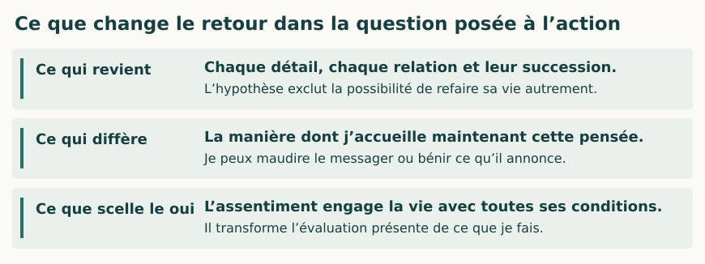

# Philosophie — Nietzsche et l’éternel retour · Sélection internationale 2022 · Corrigé guidé

*Corrigé rédigé par IA, non officiel. Signalez toute erreur.*

**Rédaction** · GPT-6.2 Astra Ultra · vitesse non renseignée

**Révision (tour 1)** · GPT-6.2 Astra Ultra · vitesse non renseignée

Écrit du 7 février 2022, de 12 h à 14 h. Friedrich Nietzsche, *Le Gai Savoir*, livre IV, § 341. Le feuillet imprime « § 381 ».

## Préparation aux quatre questions

**Situer l’extrait.** Dans la première réponse, rattachez le procédé choisi, la parole du démon, à l’usage de l’aphorisme. L’écart de numérotation se vérifie directement dans le texte du livre IV. [Le Gai Savoir, § 341](https://fr.wikisource.org/wiki/Page:Nietzsche_-_Le_Gai_Savoir,_1901.djvu/296)

**Tester le même.** Imaginez que l’on vous offre de revivre une excellente journée avec le souvenir acquis depuis. Le démon accorderait-il cette modification ? Sa réponse négative permet de préciser pourquoi la question du retour engage toutes les conditions de la vie et jusqu’à la réaction présente.

**Faire travailler l’image du sceau.** Cherchez le sujet grammatical du verbe « apposer ». Ce geste appartient à celui qui répondrait au démon. Il faut donc expliquer une approbation possible, puis rendre compte de sa portée temporelle. Une démonstration physique de l’éternité manquerait ces deux exigences.

**Distinguer les quatre définitions.** Pour chaque terme, identifiez sa fonction. Le nihilisme décrit une crise, le dernier homme en figure une issue possible, le surhomme indique un dépassement et la généalogie est une méthode d’enquête et d’évaluation. Leur attribuer ces places évite de les transformer en quatre synonymes du refus de la morale.

## 1. Nietzsche et son œuvre

Friedrich Nietzsche (1844–1900), philologue de formation et professeur à Bâle, part dans *La Naissance de la tragédie* d’une enquête sur les Grecs, leur art et leur rapport à la souffrance. Dans *Le Gai Savoir* puis *Ainsi parlait Zarathoustra*, il demande ce que vaudraient nos façons de connaître, de juger et d’espérer une fois ébranlée la croyance en un ordre moral du monde garanti par Dieu. *Par-delà bien et mal* et *La Généalogie de la morale* examineront notamment l’origine et la valeur de nos évaluations. La variété des formes d’écriture participe de l’enquête. Un lecteur qui examinerait de loin des propositions abstraites n’apercevrait pas toujours ce que sa propre manière de réagir révèle de ses valeurs. Ici, le texte lui adresse la parole et lui fait imaginer sa rencontre avec un démon.

La scène du démon se reconnaît dès l’ouverture du § 341 du *Gai Savoir*. « Le poids formidable » est le titre que lui donne Henri Albert dans l’édition française de 1901. Ce numéro permet de retrouver le texte à la fin du livre IV. L’aphorisme suivant met en scène le départ de Zarathoustra. L’épreuve qui nous est adressée à la deuxième personne se situe ainsi au seuil d’une nouvelle forme de présentation philosophique.

## 2. Le sens de l’éternel retour

Le démon demande d’imaginer que toute cette vie reviendra une infinité de fois. Ce serait mal entendre son propos que de se représenter un second essai où nous pourrions corriger nos maladresses, ou un cycle des saisons dont seuls les grands types d’événements se répéteraient. Le texte s’attarde sur une araignée, la lumière entre les arbres et l’instant même de l’annonce. Leur place dans la succession reviendrait avec chacun des événements qu’elle relie. Le détail de l’araignée impose une condition rigoureuse à la réponse. Si elle revenait un soir plus tôt, ou si je reconnaissais le démon en me souvenant d’une première annonce, l’enchaînement aurait changé. Le retour comprend donc jusqu’à mon ignorance de l’avoir déjà vécu.

La forme hypothétique du récit est essentielle à la question. L’aphorisme n’expose aucun calcul physique qui permettrait de conclure que l’univers a effectivement cette structure. Il demande ce qu’une pensée de cette portée nous ferait, si elle prenait sur nous tout son poids. Une action que j’accepte pour en finir avec elle pourrait-elle être voulue encore, sans que sa répétition me conduise enfin à un autre monde ? À supposer que je maudisse le démon, je découvre ce qui, dans ma façon de vivre, dépend de l’espoir que cela passe et ne revienne jamais. À supposer que je le bénisse, je m’aperçois capable d’un autre rapport à ce qui m’échoit. Entre les deux réactions s’ouvre le travail même d’une transformation des valeurs.

L’expérience est plus difficile qu’une invitation à multiplier les instants agréables. Il se pourrait que je veuille infiniment revivre une joie et refuse toutes les conditions qui l’ont rendue possible. Or le démon apporte une histoire avec ses enchaînements. La question touche ainsi à l’*amor fati*, l’amour de ce qui advient, que Nietzsche évoque dans le même livre. Une résignation dirait que, de toute façon, on ne peut faire autrement. L’affirmation à laquelle l’aphorisme appelle éventuellement le lecteur changerait le rapport de son vouloir au nécessaire. Elle lui permettrait de dire oui là où il supportait seulement. Le conditionnel laisse ouverte la question de savoir jusqu’où un être donné est capable de le faire.

## 3. Le « sceau ultime et éternel »

> [!INDICATION]
> Testez le mot « sceau » avec deux réponses au démon. La première personne croit à sa prédiction, mais la déplore. La seconde voudrait que sa vie revienne ainsi. Laquelle pourrait apposer sa marque ? Sur quoi, exactement, porterait son accord ?

Un sceau ratifie. Celui qui l’appose prend à son compte le document entier auquel il vient donner sa marque. L’adjectif « ultime » fait entendre qu’on cesse de demander à une instance supérieure de justifier la vie ou de promettre que ses insuffisances seront réparées ailleurs. L’adjectif « éternel » précise l’ampleur de l’assentiment. Ce que je voudrais, dans cette hypothèse, je le voudrais avec toutes ses conditions et dans l’infinité des retours. L’image d’un sceau ajoute quelque chose à la simple prévision. Je pourrais croire que ma vie doit revenir et m’en désoler. Apposer ma marque, ce serait m’en reconnaître responsable jusque dans les détails que je voudrais effacer du récit. Cet acte même d’approbation reviendrait à son tour. Il n’y a aucun juge qui se placerait en dehors du temps pour certifier après coup la valeur de ma vie.

La métaphore clôt une question adressée au lecteur. Elle mesure la force d’une affirmation possible et ne constate pas que chacun la possède. Imaginons une promesse pénible à tenir. Si je n’envisage ma fidélité que comme le prix provisoire d’une récompense ultérieure, l’annonce du retour de chaque moment de l’effort m’effraiera peut-être. Si j’en viens à vouloir aussi cet effort, mon évaluation présente aura changé, alors même qu’aucune circonstance passée ne sera effacée. Voilà comment une idée qui représente le retour du même peut transformer celui auquel elle s’adresse.

## 4. Quatre concepts

### a. Le nihilisme

Le nihilisme désigne un processus de dévaluation des valeurs les plus hautes. Les fins qui donnaient sens à l’existence perdent leur force obligatrice et la question « pourquoi ? » ne rencontre plus de réponse assurée. La mort de Dieu, chez Nietzsche, nomme une crise de ce régime des valeurs qui atteint aussi des croyances morales apparemment sécularisées. On peut en conclure que rien ne vaut la peine, ou chercher quelles forces avaient institué ces valeurs et quelles nouvelles évaluations sont possibles. L’éternel retour met vivement en jeu cette alternative. Une vie jugée sans valeur, répétée à l’infini, devient le poids le plus intolérable.

### b. Le dernier homme

Dans le prologue de *Zarathoustra*, le dernier homme représente une réponse à cette crise. Il s’est aménagé un petit bonheur de sécurité, de confort et de conformité. Sa satisfaction le dispense de créer et de se dépasser. Le trait décisif tient moins à un manque de plaisirs qu’à une réduction de ses aspirations. La foule de la scène réclame ce dernier homme, alors que Zarathoustra l’avait offert comme une perspective inquiétante. Le ressort dramatique donne à saisir l’attrait réel de cette façon de vivre.

### c. Le surhomme

Le surhomme, *Übermensch*, figure dans cette même œuvre la possibilité d’un dépassement de l’humain tel qu’il est présentement constitué par ses valeurs. Il est lié à la fidélité à la terre et à la capacité d’inventer des manières d’évaluer après la perte d’une garantie transcendante. On en manquerait le sens en le mesurant à la force physique, au rang social ou à l’appartenance biologique. La question de l’aphorisme permet de comprendre l’exigence de transformation qu’il implique. Celui qui ne peut aimer son existence qu’à la condition d’en sortir demeure dépendant de l’idéal même qu’il prétend avoir dépassé.

### d. La généalogie des valeurs

Une généalogie reconstruit les conditions historiques, affectives et sociales dans lesquelles une manière d’évaluer est devenue dominante. Elle examine en même temps quelle forme de vie cette évaluation favorise ou appauvrit. Dans la première dissertation de *La Généalogie de la morale*, Nietzsche distingue ainsi l’opposition du bon et du mauvais, issue d’une affirmation de soi, de l’opposition du bien et du mal dans laquelle le ressentiment joue un rôle créateur. Prenons un même jugement de « bonté ». Vient-il de celui qui affirme spontanément sa manière de vivre ou de celui qui commence par condamner celle de son adversaire ? La ressemblance des mots cache deux manières de fabriquer une valeur. L’enquête sur leur provenance ouvre alors la question de leur valeur pour la vie. Il reste à demander ce qu’elle fait faire et devenir à ceux qui l’emploient. L’aphorisme du démon accomplit pour le lecteur une épreuve complémentaire. Il lui fait éprouver, dans sa propre réaction, la forme de vie à laquelle il tient effectivement.

[Énoncé](https://www.ens.psl.eu/sites/default/files/philo-ecrit-sil2022-2.pdf) · [Rapport du jury](https://www.ens.psl.eu/sites/default/files/rapport-philo-sil2022.pdf)
