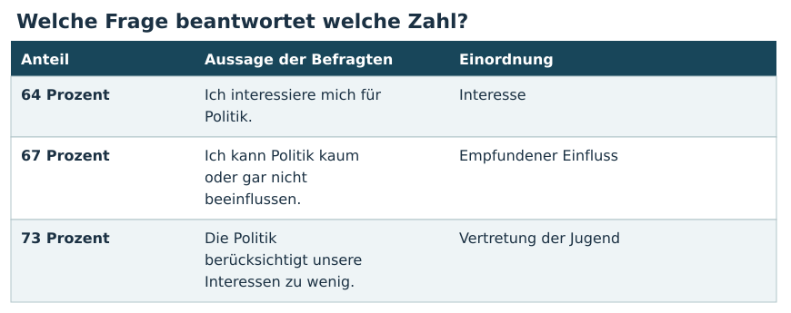
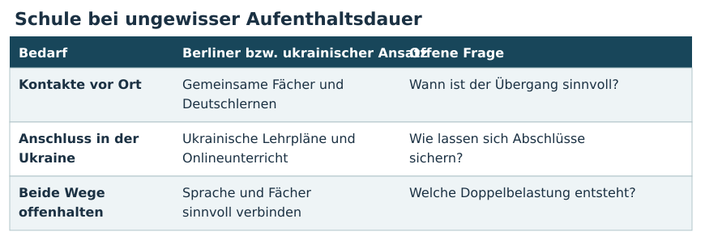

# ENS Rennes · D-E · Allemand (oral) 2022 — Corrigé guidé

*Corrigé rédigé par IA, non officiel. Signalez toute erreur.*

**Rédaction** · GPT-6.2 Astra Ultra · vitesse non renseignée

Le rapport (p. 4) atteste trois titres. Nous avons retrouvé et lu les trois articles originaux en allemand. Le rapport ne reproduit aucune des feuilles distribuées et ne délimite aucun extrait. Les exposés analysent les publications originales. Les notices indiquent pour chacune ce que l’ENS permet d’attribuer au billet. Les relances sont des exercices proposés.

## Billet 1 — Meinung: Deutschlands klare Kante gegen Putins Russland

**Périmètre du billet.** Le rapport (p. 4) attribue ce texte à Manuela Kasper-Claridge (Deutsche Welle, 27 février 2022). Son exemple d’introduction (p. 2) confirme que l’épreuve portait sur la réaction de Berlin à l’invasion de l’Ukraine et sur les annonces d’Olaf Scholz. Cette introduction est rédigée par le jury. L’original consulté est un éditorial. Les arguments économiques et les observations sur la population russe ci-dessous figurent dans la publication de presse. Leur présence dans la feuille d’examen reste indéterminée.

**Vortrag zum Original.** Was bedeutete es für die deutsche Regierung, wenige Tage nach dem russischen Angriff auf die Ukraine öffentlich eine neue Haltung einzunehmen? Manuela Kasper-Claridge beantwortet die Frage am 27. Februar 2022 in einem Kommentar der Deutschen Welle. Sie begrüßt die Regierungserklärung von Olaf Scholz vor dem Bundestag. Schon die Formulierung „klare Kante“ im Titel verrät ihr Urteil: Aus ihrer Sicht war der bisherige Kurs zu zögerlich.

Zunächst richtet sie den Blick auf die Menschen, für die das deutsche Signal bestimmt ist. Für die Ukraine zeigt es die Bereitschaft, politische Unterstützung in konkrete Hilfe zu übersetzen. Für die baltischen NATO-Staaten bekräftigt es die Verlässlichkeit Deutschlands als Bündnispartner. Die Autorin erinnert zugleich an die deutsch-russische Aussöhnung und an Menschen in Russland, die gegen den Krieg protestieren. Das macht ihre Unterscheidung zwischen der russischen Regierung und der Bevölkerung besonders wichtig.

Im zweiten Schritt nimmt sie die deutsche Öffentlichkeit in den Blick. Scholz hatte zusätzliche Mittel in Höhe von hundert Milliarden Euro für die Bundeswehr angekündigt. Die Autorin sieht darin eine erhebliche politische und finanzielle Verpflichtung. Wirtschaftliche Sanktionen können auch die sanktionierenden Länder belasten. Sie nennt mögliche Engpässe und steigende Energiepreise. Einen möglichen Ausfall russischer Gaslieferungen behandelt sie als Risiko aus damaliger Sicht. Die Regierung müsse erklären, welche Kosten sie erwartet und wie sie diese bewältigen will.

Für mich liegt das Interessante gerade in der Verbindung von Zustimmung und Forderung. Ein Kommentar kann eine politische Entscheidung ausdrücklich begrüßen und zugleich verlangen, dass ihre Folgen offen diskutiert werden. Die wiederholte Ungeduld der Autorin gegenüber früherem Zögern verstärkt die Dringlichkeit. Ob die angekündigten Maßnahmen ihre Ziele erreichen, kann sie am Tag der Rede noch nicht wissen. Ihre Überzeugung vom politischen Signal und ihre wirtschaftlichen Prognosen besitzen daher einen unterschiedlichen Stellenwert.

> [!INDICATION]
> Sagen Sie „Scholz kündigte an“, wenn Sie seine Rede wiedergeben. Verwenden Sie „Die Autorin befürchtet“, wenn es um mögliche Folgen geht. Das Verb trennt ein belegtes Ereignis von einer Prognose.

**Warum spricht die Autorin die Menschen in Russland gesondert an?** Sie verweist auf Proteste und erinnert an die Geschichte der Aussöhnung. Kritik am Handeln der Regierung kann mit Solidarität gegenüber denen vereinbar sein, die den Krieg ablehnen.

**Kann ein solcher Kommentar der Regierung zugleich helfen und widersprechen?** Öffentliche Zustimmung kann Rückhalt schaffen. Wer den Preis der Entscheidung benennt, verlangt aber auch Rechenschaft. Gerade das gehört zu einer demokratischen Debatte.

## Billet 2 — Interessiert, engagiert, resigniert

**Périmètre du billet.** Le jury écrit « nach Sophie Garbe » (Der Spiegel, 5 avril 2022, p. 4 du rapport). L’original de la rubrique *Studie zu Jugend und Politik* porte bien le titre cité. « Nach » signale que le support est établi d’après Garbe. Les paragraphes retenus, les coupes et d’éventuelles reformulations restent inconnus. Les chiffres ci-après proviennent de l’article de presse et de l’étude publiée par la Vodafone Stiftung. Nous distinguons la population décrite par chaque chiffre.

**Vortrag zum Original.** Jugendliche können sich für Politik interessieren und zugleich das Gefühl haben, keinen Einfluss zu besitzen. Auf dieser Spannung beruht Sophie Garbes Spiegel-Artikel vom 5. April 2022. Sie verbindet Angaben zur Wahlbeteiligung mit einer Befragung von mehr als zweitausend 14- bis 24-Jährigen im Auftrag der Vodafone Stiftung. Der dreiteilige Titel beschreibt verschiedene Haltungen, die bei derselben Generation nebeneinander vorkommen können.

Garbe beginnt mit der vergleichsweise stark gestiegenen Beteiligung der unter Dreißigjährigen an der Bundestagswahl. Für die Deutung dieses Einstiegs muss man die Gruppen auseinanderhalten. Die jüngsten Teilnehmer der anschließend besprochenen Befragung waren vierzehn und konnten bei dieser Wahl noch gar nicht abstimmen. Ihr politisches Interesse kann sich beispielsweise in Gesprächen, Demonstrationen oder der Beschäftigung mit Klimapolitik äußern. Die Autorin verweist außerdem darauf, dass das Interesse je nach Bildungshintergrund unterschiedlich ausgeprägt ist.

Warum steht dennoch „resigniert“ im Titel? Viele Befragte hatten den Eindruck, dass ihre Interessen zu wenig berücksichtigt würden. Etwa zwei Drittel sahen kaum Möglichkeiten, die Politik zu beeinflussen. Wer eine Demonstration besucht, fordert womöglich gerade deshalb eine Veränderung, weil die bisherigen Entscheidungen unzureichend erscheinen. Umgekehrt kann eine dauerhafte Erfahrung der Wirkungslosigkeit dazu führen, dass jemand sich zurückzieht. Die Umfrage zeigt das Ausmaß eines Empfindens. Sie verfolgt keine individuelle Entwicklung vom Protest zum Rückzug.

Im letzten Teil fragt Garbe, was den Kontakt erleichtern könnte. Jüngere Abgeordnete könnten Lebenslagen ins Parlament tragen, die dort wenig sichtbar sind. Instagram oder YouTube können einen ersten Zugang eröffnen. Eine hohe Zahl von Followern sagt allerdings nur wenig darüber aus, ob Vorschläge von Jugendlichen in Entscheidungen einfließen. Wer bei einer kommunalen Anhörung konkrete Vorschläge sammelte und später die Entscheidungen begründete, würde Beteiligung auch für die jungen Menschen selbst überprüfbar machen. Wichtig ist schließlich der Erhebungszeitpunkt: Die Antworten stammen aus dem Herbst 2021. Sie belegen keine Reaktion auf den russischen Angriff vom Februar 2022.

> [!INDICATION]
> Berichten Sie die Werte einzeln, jeweils mit einer Aussage: „64 Prozent interessieren sich …“, „67 Prozent haben den Eindruck …“. Die beiden Anteile lassen sich weder addieren noch als Anteil derselben Personen ausweisen.

**Bedeutet Unzufriedenheit mit der Politik, dass die Befragten Demokratie ablehnen?** Sie kann aus einem Anspruch an demokratische Mitsprache entstehen. Eine Antwort über das Funktionieren der bestehenden Institutionen beantwortet die Frage nach einer prinzipiellen Ablehnung der Demokratie nicht.

**Was würde den Erfolg einer Jugendbeteiligung zeigen?** Neben der Zahl der Teilnehmenden würde ich erfassen, wie viele Vorschläge öffentlich beantwortet, umgesetzt oder mit nachvollziehbarer Begründung abgelehnt wurden.

## Billet 3 — Debatte über Unterricht für Geflüchtete: Sollen ukrainische Kinder ins deutsche Schulsystem integriert werden?

**Périmètre du billet.** Le rapport (p. 4) donne le titre, la signature de Swantje Unterberg et la date du 25 mars 2022. Ces éléments correspondent à l’article original du Spiegel, dont nous avons consulté le texte. Le jury rappelle par ailleurs (p. 2) que l’éducation relève des Länder. Il ne précise pas si les exemples berlinois, le témoignage final sur les cours en ligne ou les chiffres locaux figuraient sur le billet.

**Vortrag zum Original.** Wo soll ein Kind zur Schule gehen, wenn niemand weiß, wie lange es am neuen Wohnort bleiben wird? Swantje Unterberg stellt am 25. März 2022 im Spiegel zwei Antworten auf diese Frage vor. Die deutsche Bildungsministerin Bettina Stark-Watzinger befürwortet eine schnelle Aufnahme ukrainischer Kinder in deutsche Schulen. Die ukrainische Generalkonsulin in Hamburg, Iryna Tybinka, betont die Kontinuität der ukrainischen Schullaufbahn. Beide argumentieren im Interesse der Kinder, legen aber unterschiedliche mögliche Zukunftswege zugrunde.

Die Ministerin weist darauf hin, dass die Familien auf eine rasche Rückkehr hoffen, der Aufenthalt aber länger dauern könnte. In Berlin lernen neu angekommene Kinder in Willkommensklassen Deutsch. In einzelnen Fächern wie Musik oder Sport können sie schon früher mit anderen Kindern zusammenkommen. Die Generalkonsulin warnt ihrerseits davor, den Anschluss an den ukrainischen Lehrplan und die eigene Sprache zu verlieren. Gerade vor einem Abschluss kann eine Unterbrechung schwerwiegende Folgen haben. Seit der Pandemie stehen in der Ukraine digitale Unterrichtsangebote zur Verfügung, die manche Kinder aus Deutschland weiter nutzen.

Unterberg ergänzt den Streit der beiden Politikerinnen um die Ebene der Umsetzung. Die Bundesministerin äußert einen politischen Wunsch, während die Länder die Schule organisieren. Berlin prüfte unter anderem, wie ukrainischsprachiger Unterricht gestärkt und wie in einzelnen Prüfungssituationen verfahren werden könnte. Eine Prüfung verschiedener Möglichkeiten ist noch keine allgemeine Regel. Ebenso belegt das geschilderte Beispiel eines Onlineunterrichts, dass er in einem konkreten Fall stattfand. Es sagt wenig über den Zugang aller Kinder aus.

Ich halte einen beweglichen Übergang für sinnvoll. Regelmäßige Kontakte in der deutschen Schule können Isolation verringern. Gleichzeitig sollte ein Jugendlicher kurz vor einer ukrainischen Prüfung die Möglichkeit haben, den Anschluss zu halten. Eine Lösung verlangt Abstimmung zwischen Familie, Lehrkräften und Schulen. Zwei vollständige Schultage übereinanderzulegen würde das Problem lediglich den Kindern übertragen. Die Frage ist deshalb auch, wer Verantwortung dafür übernimmt, Lernziele und Stundenpläne aufeinander abzustimmen.

> [!INDICATION]
> Geben Sie jedem Vorschlag einen Akteur und einen Stand: Die Ministerin „sprach sich für … aus“, die Konsulin „plädierte für …“, die Berliner Verwaltung „prüfte …“. Das ergibt eine präzise Antwort auf die Frage nach den Kompetenzen.

**Wer entscheidet über den Schulalltag?** In Deutschland tragen die Länder die Verantwortung für das Schulwesen. Das Land Berlin kann daher seine Willkommensklassen organisieren. Die Kultusministerkonferenz ermöglicht Abstimmung zwischen den Ländern.

**Woran könnte man einen passenden Übergang erkennen?** Das Kind sollte im Unterricht mitarbeiten und soziale Kontakte aufbauen können. Zugleich muss geklärt sein, was es für einen möglichen Schulabschluss oder eine Rückkehr braucht. Das kann für eine Siebenjährige anders aussehen als für einen Jugendlichen im Abschlussjahr.

[Rapport](https://www.ens-rennes.fr/medias/fichier/rapport-du-jury-lve-allemand-oral-d-e-2022_1668097981733-pdf) · [Intitulés attestés](https://www.ens-rennes.fr/medias/fichier/rapport-du-jury-lve-allemand-oral-d-e-2022_1668097981733-pdf#page=4) · [Original 1 · Deutsche Welle](https://www.dw.com/de/meinung-deutschlands-klare-kante-gegen-putins-russland/a-60934448) · [Original 2 · Der Spiegel](https://www.spiegel.de/politik/deutschland/jugend-und-politik-zukunftsaengste-und-demokratie-verdrossenheit-vodafone-studie-a-cf38ae4d-c338-4ee6-b7a5-cea5e33eebd2) · [Original 3 · Der Spiegel](https://www.spiegel.de/panorama/bildung/bildungsministerin-bettina-stark-watzinger-will-ukrainische-kinder-in-deutsches-schulsystem-integrieren-a-296601a0-dfe6-45a5-9199-652e45e6cf73) · [Déclaration de Scholz au Bundestag](https://www.bundesregierung.de/breg-de/suche/regierungserklaerung-von-bundeskanzler-olaf-scholz-2008606) · [Étude Hört uns zu!](https://www.vodafone-stiftung.de/wp-content/uploads/2022/04/Jugendstudie-2022_Vodafone-Stiftung.pdf)
