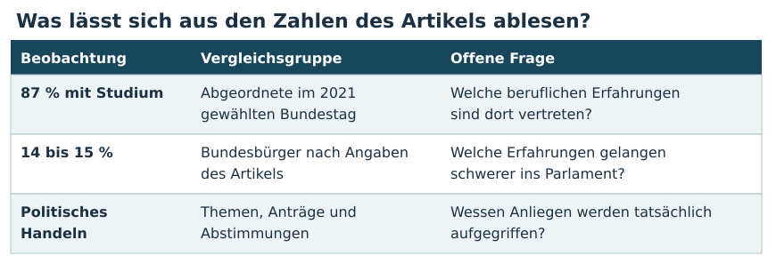

# ENS Rennes · D-E · Allemand 2022 — Corrigé brut

*Corrigé rédigé par IA, non officiel. Signalez toute erreur.*

**Rédaction** · GPT-6.2 Astra Ultra · vitesse non renseignée

## I. Version

La déportation de Stanisław Zalewski par les nazis se lit encore aujourd’hui sur le haut de son bras gauche : 156569. Zalewski était un résistant polonais. Jusqu’à ce que la Gestapo l’arrête. Et qu’il devienne un numéro. Au camp de concentration d’Auschwitz-Birkenau, il a vu des gens mourir à ses côtés. […]

Zalewski a survécu. Aujourd’hui âgé de 96 ans, il milite en tant que président de l’Association polonaise des anciens détenus politiques des prisons et camps de concentration nazis. Lorsqu’il a appris que l’Allemagne projetait de créer un lieu de mémoire pour les victimes polonaises du nazisme, il s’est d’abord montré sceptique. « Je suis opposé à l’érection de monuments », dit-il. « Sauf s’il s’agit de monuments qui survivront à nos générations. Alors seulement, ils rempliraient leur fonction. »

Aujourd’hui, Zalewski est déçu. À ses yeux, le monument prévu à Berlin sert « des objectifs de politique immédiate ». « Ce ne sont ni les dépôts de gerbes ni les beaux discours commémoratifs qui garderont vivant le témoignage », dit-il. […]

Le projet montre combien les relations politiques entre la Pologne et l’Allemagne restent difficiles aujourd’hui. Et combien le travail de mémoire peut se révéler compliqué. En octobre 2020, le Bundestag a décidé d’ériger en Allemagne un lieu de mémoire dédié aux victimes polonaises du nazisme. Il s’agissait de créer à Berlin un « lieu de mémoire et de rencontre » qui rende justice « à la singularité de l’histoire germano-polonaise ». […] Il doit commémorer les victimes de l’occupation allemande en Pologne de 1939 à 1945. Les historiens estiment leur nombre à environ six millions. […]

Des voix critiques redoutaient une « nationalisation » du lieu de mémoire. Et certains pays se sont sentis laissés de côté. Ainsi l’ambassadeur d’Ukraine en Allemagne a demandé qu’un monument distinct soit érigé en mémoire des victimes ukrainiennes du nazisme.

## II. Thème

Die Erinnerung an die große Inflation von 1923 ist in Deutschland noch sehr lebendig. Viele Familien bewahren bis heute wertlose Fünfzig-Millionen-Mark-Scheine aus der Zeit der Weimarer Republik auf.

Die Angst vor dem Abstieg ziehe sich durch alle sozialen Schichten, erklärt Daniel Veit, Wirtschaftswissenschaftler an der Universität Augsburg. „Wir stehen an einem paradoxen Wendepunkt. Im Durchschnitt waren die Deutschen noch nie so wohlhabend, das Pro-Kopf-Einkommen hat einen Höchststand erreicht. Zugleich spüren sie aber, dass das Modell, dem sie ihren Wohlstand verdanken, ins Wanken gerät.“ […]

Im Deutschen lässt das Wort „Schuld“ auch an Scham denken. Und Sparsamkeit gilt im Land Angela Merkels weiterhin als eine der höchsten Tugenden. Seit 2008 hat die Kanzlerin mehrfach auf die „schwäbische Hausfrau“ verwiesen. Schwaben ist eine Region, die sich über Teile Bayerns und Baden-Württembergs erstreckt.

Ihr Leitsatz lässt sich so zusammenfassen: „Geld, das man nicht hat, gibt man nicht aus.“ Im Jahr 2009 wurde eine als „Schuldenbremse“ bezeichnete Regelung ins Grundgesetz aufgenommen. Sie begrenzt das Haushaltsdefizit des Bundes auf 0,35 Prozent des Bruttoinlandsprodukts, wurde jedoch ausnahmsweise ausgesetzt, um dem enormen Finanzbedarf infolge der Corona-Pandemie gerecht zu werden.

## III.1. Mit welchen Argumenten begründen manche Politiker und Beobachter ihre Kritik an der hohen Akademikerquote im Bundestag?

Die Kritiker wenden sich nicht gegen ein Studium als solches. Sie fragen, welche Erfahrungen bei politischen Entscheidungen fehlen, wenn fast alle Beteiligten einen ähnlichen Bildungsweg gegangen sind. Nach den Angaben im Artikel hatten 87 Prozent der Abgeordneten des 2021 gewählten Bundestags studiert, in der Bevölkerung dagegen nur etwa 14 bis 15 Prozent. Ein Parlament kann also zahlreiche juristisch oder wirtschaftlich geschulte Mitglieder haben und trotzdem nur selten jemanden hören, der jahrelang am Fließband gearbeitet hat.

Der SPD-Abgeordnete Josip Juratovic macht das an seinem Berufsweg deutlich. Als ausgebildeter Mechaniker, früherer Arbeiter und Betriebsrat kennt er die Unsicherheit eines niedrigen Einkommens und die Art, wie Kollegen im Betrieb über Politik sprechen. Dieses Wissen kann dabei helfen, die praktischen Folgen eines Gesetzes zu erkennen. Außerdem kann ein Abgeordneter Menschen glaubwürdig ansprechen, die sonst den Eindruck haben, ihre Lage spiele in Berlin keine Rolle. Ein Gespräch mit einem Kollegen, dem man vertraut, liefert mitunter andere Informationen als eine Statistik.

Die im Artikel angeführte Studie ergänzt dieses Argument. Wer zu einer im Parlament selten vertretenen Gruppe gehört, greift deren Anliegen besonders zu Beginn des Mandats häufig auf. Dadurch können Themen auf die Tagesordnung kommen, die eine homogene Fraktion übersehen hätte. Der Effekt bleibt allerdings nicht bei allen über die gesamte Laufbahn bestehen. Die Kritik behauptet also nicht, ein Hochschulabsolvent könne Arbeitnehmer grundsätzlich nicht vertreten. Sie richtet sich gegen eine Zusammensetzung, bei der bestimmte Perspektiven immer wieder erst von außen an das Parlament herangetragen werden müssen.

*240 mots.*

## III.2. Inwiefern sollte Ihrer Meinung nach das Parlament ein exaktes Spiegelbild der Gesellschaft sein?

Ein Parlament sollte der Gesellschaft in seiner Offenheit möglichst nahekommen, aber keine statistisch genaue Kopie ihrer Zusammensetzung sein. Ein Beispiel zeigt den Unterschied. Wenn in einer Debatte über Pflege niemand aus eigener Erfahrung weiß, wie ein Nachtdienst organisiert ist, können wichtige Folgen eines Gesetzes unerkannt bleiben. Eine Pflegekraft im Ausschuss könnte Fragen stellen, an die andere Mitglieder nicht gedacht haben. Sie wäre jedoch nicht verpflichtet, in jeder Frage dieselbe Meinung zu vertreten wie alle anderen Beschäftigten ihres Berufs.

Ein exaktes Spiegelbild wäre schon deshalb schwer herzustellen, weil Menschen zugleich mehreren Gruppen angehören. Eine junge Mutter kann Ärztin, Mieterin und Mitglied einer sprachlichen Minderheit sein. Welche Eigenschaft soll über ihren Platz im Parlament entscheiden? Auch innerhalb jeder Gruppe bestehen politische Konflikte. Wahlen müssen den Bürgern die Möglichkeit lassen, zwischen unterschiedlichen Programmen zu wählen und eine Partei abzuwählen, wenn sie ihre Versprechen nicht einhält.

Trotzdem darf der Hinweis auf das freie Mandat nicht verdecken, dass der Zugang zur Politik ungleich verteilt ist. Wer im Schichtdienst arbeitet, hat weniger Gelegenheit, abends an jeder Parteisitzung teilzunehmen. Transparente Nominierungsverfahren, Kinderbetreuung und eine verlässliche Freistellung könnten Kandidaturen aus verschiedenen Lebensbereichen erleichtern. Öffentliche Anhörungen würden zusätzlich Erfahrungen einbeziehen, die kein Abgeordneter selbst mitbringt. Entscheidend wäre für mich, ob unterschiedliche Menschen tatsächlich kandidieren können und ob ihre Argumente in den Beratungen eine nachvollziehbare Antwort erhalten. Das lässt sich an konkreten Entscheidungen besser prüfen als an einer perfekten Übereinstimmung sämtlicher Prozentzahlen.

*232 mots.*

[Sujet](https://www.ens-rennes.fr/medias/fichier/sujet-allemand-d-e-e-crit-2022_1657700558255-pdf) · [Rapport](https://www.ens-rennes.fr/medias/fichier/rapport-du-jury-lve-allemand-ecrit-d-e-2022_1668097892794-pdf)
