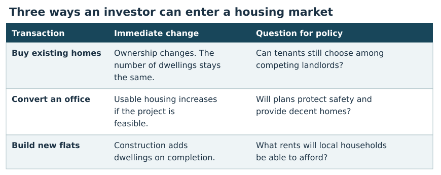

# ENS Rennes · D-E · Anglais 2022 — Corrigé brut

*Corrigé rédigé par IA, non officiel. Signalez toute erreur.*

**Rédaction** · GPT-6.2 Astra Ultra · vitesse non renseignée

## I. Version

En 1973, dans l’arrêt *Roe contre Wade*, la Cour suprême a fixé une limite. La Constitution, avait-elle déclaré, ne permettait pas aux États d’interdire les avortements avant que le fœtus ne puisse survivre hors de l’utérus.

Mercredi, lorsque la Cour examinera la plus importante affaire relative à l’avortement depuis une génération, l’une des questions centrales sera de savoir si sa majorité conservatrice est prête à effacer cette limite. L’affaire porte sur une loi du Mississippi qui interdit la plupart des avortements après quinze semaines, bien avant que le fœtus ne soit viable.

La Cour pourrait revenir entièrement sur l’arrêt *Roe*, ce qui permettrait aux États d’interdire l’avortement à n’importe quel stade. Mais certains juges au moins pourraient souhaiter trouver le moyen de valider la loi du Mississippi sans renverser expressément l’arrêt *Roe*. Ils devraient alors abandonner le seuil de viabilité et le remplacer par un autre critère permettant de fixer la limite à quinze semaines.

Les avocats du Mississippi, dont l’argument principal était que rien dans la Constitution ne justifiait de fixer une quelconque limite, ont tout de même avancé deux arguments subsidiaires. Selon eux, la Cour pourrait modifier un autre critère existant, qui interdit toute « entrave excessive » à l’exercice du droit à l’avortement. Elle pourrait ainsi autoriser le seuil de quinze semaines en faisant valoir qu’à ce stade une nette majorité des avortements ont déjà eu lieu. Ou bien, ont-ils écrit, la Cour pourrait simplement valider la loi du Mississippi et remettre à plus tard l’épineuse question du choix d’une nouvelle limite.

Aucun des deux arguments n’était sérieux, ont répliqué les avocats de l’unique clinique du Mississippi pratiquant des avortements. « L’État ne propose, pour remplacer le seuil de viabilité, aucun critère capable de garantir durablement le droit à l’avortement », ont-ils écrit.

## II. Thème

The AUKUS alliance attracted considerable attention when it was announced in September. On Monday, 22 November, it took concrete form as Australia formally committed to acquiring nuclear-powered submarines under the joint defence programme with Britain and the United States.

Australian Defence Minister Peter Dutton signed an agreement with British and American diplomats allowing their countries to exchange “naval nuclear propulsion information”. It is the first agreement to have been signed and made public since the three countries announced that they were joining forces in response to growing strategic tensions between the United States and China in the Pacific.

The alliance had come with Australia's cancellation of a major deal to buy twelve conventionally powered French submarines worth 90 billion Australian dollars (55 billion euros), causing a lasting rift between Paris and Canberra.

The agreement will help Australia complete an eighteen-month study into the acquisition of submarines, Mr Dutton said in Canberra after the signing ceremony with Michael Goldman, the US chargé d’affaires, and Victoria Treadell, the British High Commissioner to Australia.

## III.1. How legitimate are concerns about private companies buying up rental houses?

It is quite reasonable for tenants to ask who owns their homes and whether they have somewhere else to go if the rent rises. A large investor purchasing an entire development may remove opportunities for individual buyers or acquire considerable bargaining power in one neighbourhood. Residents also have reason to worry about maintenance and security of tenure if a fund intends to sell the properties quickly. A low national market share offers little comfort to a family whose realistic alternatives are all owned by the same landlord.

However, the evidence presented in the article hardly supports blaming these companies for the housing crisis as a whole. The author reports that even Blackstone, Spain’s largest residential landlord, owns only one per cent of the national stock. Rents may already have been rising in precisely the cities that attracted institutional investment. The fact that a fund enters an expensive market does not establish that it caused prices to rise there.

A final distinction concerns what the investor pays for. Buying an existing block merely transfers ownership. Financing the conversion of an empty office into flats can add homes close to jobs, although the new rents may be beyond many residents’ means. Tenants therefore have legitimate concerns about conduct, affordability and local concentration. Those concerns are strongest when purchases narrow the choices available to households. They are a much weaker argument against investment that increases the number of safe homes in an area where vacancies are scarce.

*244 mots.*

## III.2. To what extent and why should governments regulate the presence of private equity in real estate?

Governments should regulate private equity where its behaviour threatens tenants or competition, while preserving the possibility of investing in additional housing. A rule based entirely on the legal identity of the owner would be a poor starting point. A badly maintained flat poses the same danger whether it belongs to a multinational fund or an individual landlord. Minimum standards, inspections and a prompt procedure for challenging unlawful evictions should therefore apply across the rental market.

Some measures should address risks specific to large investors. An ownership register that identifies the companies ultimately controlling each block would allow a competition authority to detect concentration concealed behind separate subsidiaries. When a fund plans to buy most of the affordable flats within commuting distance of a major employer, the authority should investigate the effects on tenants and be able to attach conditions or prevent the acquisition. The relevant market is the area in which tenants could realistically find another home.

Governments should also examine the alternative to each investment. A blanket tax on new rental construction could deter a pension fund from financing an office conversion that no smaller developer can afford. Conversely, reserving subsidised housing for its intended occupants can keep public resources from simply increasing private asset values. Authorities could publish the number of additional homes completed, rents charged and evictions recorded before revising their rules. Regulation should ultimately be judged by what happens to available homes and the people living in them, including those who cannot yet afford to move in.

*251 mots.*

[Sujet](https://www.ens-rennes.fr/medias/fichier/sujet-anglais-d-e-e-crit-2022_1657700601752-pdf) · [Rapport](https://www.ens-rennes.fr/medias/fichier/rapport-du-jury-lve-anglais-e-crit-d-e-2022_1681912988606-pdf)
