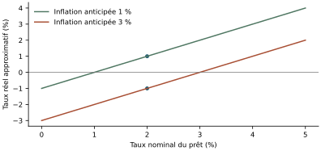
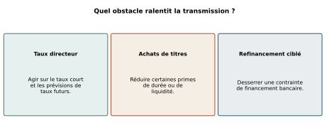

# ENS Rennes D-E — Composition d’ordre économique 2022 · Corrigé guidé

*Corrigé rédigé par IA, non officiel.*

**Rédaction** · GPT-6.2 Astra Ultra · vitesse non renseignée

## La politique monétaire conventionnelle a-t-elle encore un avenir ?

### Introduction

> [!INDICATION]
> Situer les dates du printemps 2022, puis définir l’instrument par son canal de transmission.

En mars 2022, la Réserve fédérale porte sa cible de taux des fonds fédéraux dans une fourchette de 0,25 à 0,50 %. Quelques jours auparavant, la Banque centrale européenne a maintenu son taux de dépôt à −0,50 % tout en annonçant le profil de ses achats d’actifs pour le deuxième trimestre. Deux économies sorties de la crise financière et frappées par la pandémie emploient donc au même moment un vocabulaire de taux et de bilans. L’avenir de la politique conventionnelle ne se lit pas dans le seul signe du taux directeur. [Réserve fédérale, 16 mars 2022](https://www.federalreserve.gov/newsevents/pressreleases/monetary20220316a1.htm) · [BCE, 10 mars 2022](https://www.ecb.europa.eu/press/pr/date/2022/html/ecb.mp220310~2d19f8ba60.en.html)

La politique monétaire conventionnelle agit principalement en pilotant le prix de la liquidité à court terme, puis, par transmission, les conditions de financement de l’économie. Les mesures dites non conventionnelles mettent notamment l’accent sur la taille ou la composition du bilan, sur des prêts ciblés ou sur une communication explicite de la trajectoire future des instruments. La distinction est fonctionnelle. Un refinancement bancaire ordinaire appartient à la boîte à outils usuelle, tandis qu’un refinancement exceptionnel de très longue durée conditionné au crédit cherche à agir sur un autre obstacle.

La question est donc de savoir si les transformations révélées depuis 2008 ont privé le taux directeur de son efficacité, ou si elles ont surtout réduit le domaine dans lequel il suffit à lui seul. Le taux demeure un instrument puissant quand la transmission fonctionne. Les crises ont toutefois créé des raisons persistantes de le combiner avec d’autres outils.

### I. Le taux court conserve une prise sur les décisions privées

#### A. Du règlement entre banques au prix du crédit

> [!INDICATION]
> Suivre un prêt du bilan d’une banque jusqu’au projet réel qu’il finance.

Une banque commerciale qui accorde un crédit crée généralement un dépôt. Lorsque son client paie dans une autre banque, le règlement final requiert des réserves de banque centrale. Le taux de ces réserves et les conditions auxquelles les banques peuvent emprunter ou placer leurs liquidités orientent le marché monétaire. Dans un système à réserves abondantes, la rémunération des réserves peut ancrer le taux court même sans en restreindre chaque jour la quantité.

Le lien avec l’économie réelle comporte plusieurs étapes. Un crédit à taux variable peut se renchérir rapidement, un prêt immobilier à taux fixe seulement lors de sa souscription ou de son renouvellement. Le ménage compare le coût de l’emprunt avec les services du logement. L’entreprise compare le rendement anticipé d’une machine avec son coût de financement. Quand les dépenses ralentissent alors que les capacités de production sont données, l’ajustement porte souvent d’abord sur les commandes et l’emploi, puis sur les salaires et les prix.

Le taux pertinent est réel. Avec des anticipations d’inflation de 3 %, un taux nominal de 2 % correspond approximativement à un taux réel de −1 %. Si les anticipations baissent à 1 % à taux nominal identique, le taux réel monte vers 1 %. Le taux affiché au guichet de la banque centrale et la restriction effectivement ressentie par un emprunteur peuvent ainsi évoluer en sens différents.

#### B. La crédibilité étend l’effet d’une décision d’aujourd’hui

> [!INDICATION]
> Séparer le taux spot, les taux futurs anticipés et la prime de terme.

Un emprunteur sur dix ans se soucie de toute la suite des conditions financières. Un taux long peut s’interpréter comme une moyenne des taux courts futurs anticipés, augmentée d’une prime de terme. Une décision qui révèle une réaction durable de la banque centrale aux tensions de prix peut donc infléchir les taux longs avant plusieurs décisions effectives. Ce canal dépend de la compréhension du mandat et des perspectives de croissance. Une hausse entièrement anticipée peut avoir peu d’effet au moment même de l’annonce.

Le canal du change et celui des bilans complètent la transmission. Toutes choses égales, une hausse des taux domestiques peut soutenir le change et modérer les prix importés. Un renchérissement du financement et une baisse des prix d’actifs peuvent en retour diminuer les garanties. Ces canaux varient entre pays, avec la devise d’endettement et la solidité du système bancaire. Une règle uniforme sur les effets d’un point de taux serait ainsi trompeuse.

La reprise de l’inflation au sortir de la pandémie fait ressortir l’intérêt de l’instrument. Un taux peut être relevé sans attendre l’extinction complète d’un portefeuille d’obligations de longue durée. Mais une pénurie d’énergie ou de composants ne disparaît pas parce que le crédit devient cher. L’enjeu est de limiter une diffusion durable de l’inflation sans comprimer davantage que nécessaire la production.

### II. Les limites du taux appellent un dosage durable des instruments

#### A. La borne effective et les ruptures de transmission

> [!INDICATION]
> Envisager deux pannes distinctes, la borne du taux court et le défaut de transmission aux emprunteurs.

Quand le taux nominal est déjà très bas, les agents peuvent détenir des actifs liquides faiblement rémunérés, y compris du numéraire sous réserve de ses coûts de conservation. La borne effective n’est donc pas exactement zéro. Des taux légèrement négatifs sont possibles, comme le montre la zone euro, mais ils rencontrent des limites de répercussion et de fonctionnement bancaire. Si le taux réel compatible avec l’emploi et la stabilité des prix descend encore, le taux directeur peut ne plus suffire à relancer la dépense.

La crise de 2008 a aussi montré qu’un taux bas et un crédit abondant ne sont pas synonymes. Une banque qui craint des pertes, manque de capital ou ne trouve plus de financement à terme peut réduire ses prêts. Des entreprises fragiles paient une prime qui augmente davantage que le taux sans risque ne baisse. Dans une union monétaire, des conditions très différentes peuvent se développer selon les pays. La transmission se rompt alors au-delà du premier maillon, même si le taux interbancaire suit la banque centrale.

Dans ces cas, l’achat d’obligations longues retire du risque de duration au marché et peut réduire la prime de terme. Une modification de la composition des actifs accepte ou acquiert des instruments dont le financement s’est asséché. Un crédit ciblé à long terme cherche à desserrer une contrainte bancaire. Un engagement conditionnel sur les taux futurs cherche à influencer les anticipations. Ces mécanismes ont une efficacité variable. Ils n’agissent pas tous en créant automatiquement une dépense réelle à chaque euro de réserves supplémentaire.

#### B. Un instrument de premier rang dans un cadre élargi

> [!INDICATION]
> Pour chaque obstacle attribuer un outil, un canal et un risque.

Les achats massifs ont aussi des contreparties. Ils modifient les prix relatifs des titres, exposent le bilan public à des risques et peuvent encourager la recherche de rendement. La promesse de taux durablement bas n’a d’effet que si elle est crue, mais un engagement trop rigide devient coûteux lorsque l’inflation change de régime. La banque centrale doit pouvoir expliquer les conditions qui la feront ajuster ses interventions.

Une stratégie cohérente commence par un diagnostic. Quand l’inflation de demande dépasse durablement la cible et que le système bancaire transmet les décisions, le taux directeur fournit un signal transversal et réversible. Quand une prime de liquidité menace un compartiment du marché, une action ciblée peut restaurer le fonctionnement sans chercher à soutenir toute la demande. La politique prudentielle peut limiter la hausse du levier plutôt que d’imposer au seul taux directeur de remplir simultanément tous les objectifs.

L’orientation monétaire dépend aussi du budget et de l’offre. Une aide temporaire à des ménages exposés à l’énergie répond à une question distributive qu’un taux unique ne sait pas résoudre. Une dépense généralisée peut, au contraire, prolonger une tension de demande. Au printemps 2022, la coexistence d’une inflation élevée, de chocs d’offre et de trajectoires distinctes des deux côtés de l’Atlantique plaide pour une normalisation conditionnelle plutôt que pour la promesse d’un calendrier universel.

### Conclusion

> [!INDICATION]
> Distinguer la survie d’un instrument et sa capacité à suffire à toute situation.

La politique conventionnelle a un avenir dès lors que les taux pilotés influencent les taux réels, les anticipations et le crédit. La décennie ouverte en 2008 en a précisé les conditions. Proximité de la borne effective, segmentation financière et chocs d’offre rendent parfois utile un outil de bilan, de communication ou de stabilité financière. L’avenir du taux directeur dépend donc de sa place dans une stratégie cohérente et de la capacité de l’autorité monétaire à dire quel obstacle chaque instrument doit lever.

[Sujet distribué](https://www.ens-rennes.fr/medias/fichier/sujet-economie-e-crit-2022_1657700483173-pdf) · [Rapport du jury](https://www.ens-rennes.fr/medias/fichier/rapport-de-jury-economie-ecrit-d-e-2022_1668097825151-pdf)
