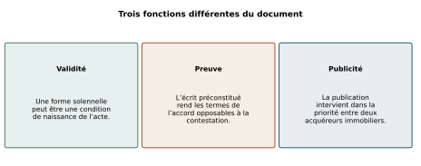
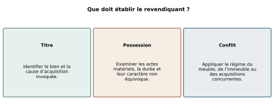

# ENS Rennes D-E — Droit civil 2022 · Corrigé guidé

*Corrigé rédigé par IA, non officiel.*

**Rédaction** · GPT-6.2 Astra Ultra · vitesse non renseignée

## Les preuves du contrat et de la propriété

### Introduction

> [!INDICATION]
> Partir du même bien successivement objet d’une vente et d’une revendication.

Un acheteur produit un contrat de vente signé pour réclamer la remise d’un tableau. Quelques années plus tard, un tiers lui réclame la toile, affirmant qu’elle avait été volée avant cette vente. Le même écrit intervient dans les deux litiges. Dans le premier, il faut établir ce que les parties ont convenu. Dans le second, il faut déterminer à qui appartient le bien. Même authentique, le papier signé par deux personnes ne suffit pas nécessairement à faire du vendeur le propriétaire.

Le contrat est un accord de volontés destiné à produire des obligations. La propriété est un droit réel qui s’exerce sur une chose et peut provenir d’un contrat, d’une succession, de l’accession ou de la prescription. Celui qui réclame l’exécution d’une obligation doit la prouver, et celui qui se prétend libéré doit justifier le fait qui a éteint sa dette (Code civil, art. 1353). Celui qui revendique un bien doit établir son droit contre celui qui l’en prive. Dans les deux cas le risque de la preuve détermine l’issue lorsque le juge demeure dans le doute. [Article 1353](https://www.legifrance.gouv.fr/codes/article_lc/LEGIARTI000032042341/2022-04-01)

L’article 1358 permet en principe la preuve par tout moyen à moins que la loi n’en dispose autrement. Pourquoi l’écrit peut-il être requis pour démontrer un accord et pourtant ne pas être décisif pour revendiquer un bien acquis par ce même accord ? La préconstitution d’un titre répond à une exigence commune de sécurité, mais la nature de ce que le juge doit établir commande des limites et des moyens de substitution différents.

### I. Le titre organise la sécurité de la preuve, avec une portée différente selon l’objet du litige

#### A. La préconstitution du contrat établit un engagement et son contenu

> [!INDICATION]
> Distinguer le seuil de l’acte et la règle contre ou outre le contenu d’un écrit.

Deux contractants savent ordinairement, dès l’échange des consentements, quelles obligations ils entendent assumer. Il leur est possible de conserver un document commun plutôt que de laisser au juge le soin de départager des souvenirs tardifs. Pour un acte juridique portant sur une somme ou une valeur excédant 1 500 euros, l’article 1359 et l’article premier du décret du 15 juillet 1980 exigent en principe un écrit sous signature privée ou authentique. Un acte portant exactement sur 1 500 euros ne dépasse pas ce seuil. Il existe une règle distincte pour prouver contre ou outre un écrit établissant un acte juridique, même en dessous du seuil. Le demandeur ne peut écarter l’exigence en réduisant sa demande ou en la fractionnant artificiellement.

Cet écrit est en principe exigé pour la preuve et non pour la validité. Une vente consensuelle peut donc être valablement conclue verbalement, alors même qu’une partie peinera à en faire établir les termes en justice. Certains actes solennels exigent au contraire une forme à peine de nullité, telle normalement la donation entre vifs reçue par notaire. Dans un contrat synallagmatique sous signature privée, la pluralité d’originaux selon les intérêts distincts relève de la discipline probatoire de l’article 1375, avec les adaptations prévues pour l’écrit électronique. La loi attache en outre une force particulière aux faits que l’officier public déclare avoir personnellement accomplis ou constatés dans l’acte authentique.

Le support ne détermine pas à lui seul la force de l’instrument. Un écrit électronique peut avoir la même valeur que l’écrit papier sous réserve que son auteur puisse être dûment identifié et son intégrité garantie (art. 1366). La signature identifie son auteur et manifeste son consentement (art. 1367). Une capture isolée qui ne permet de retrouver ni expéditeur ni contexte ne joue donc pas nécessairement le rôle d’un contrat signé. Le juge distingue admissibilité du procédé et force de conviction de la pièce.

#### B. Le titre de propriété soutient un droit opposable au-delà du seul accord

> [!INDICATION]
> Changer de litige en introduisant le véritable propriétaire ou un second acquéreur.

Dans une vente translative de propriété, le titre établit une cause d’acquisition. Entre vendeur et acheteur, l’accord sur la chose et le prix peut réaliser le transfert sous réserve des exceptions légales ou conventionnelles. Contre un tiers qui se dit véritable propriétaire, le demandeur doit également justifier que son auteur avait un droit à transmettre. Exiger qu’il reconstitue sans interruption la propriété depuis son origine conduirait à une preuve pratiquement impossible.

Pour les immeubles, l’acte notarié et la publicité foncière documentent l’origine et la continuité des transmissions. L’article 1198 règle un conflit particulier entre acquéreurs successifs tenant leurs droits d’une même personne. Pour le même immeuble, celui qui a publié le premier son titre authentique d’acquisition est préféré s’il est de bonne foi, même si son droit est postérieur. Pour le même meuble corporel, l’article privilégie, sous condition de bonne foi, celui qui a pris possession le premier. Ce sont des règles de priorité. Elles ne font pas du fichier immobilier un registre garantissant absolument que tout droit inscrit existe. [Article 1198](https://www.legifrance.gouv.fr/codes/article_lc/LEGIARTI000032041283/2022-04-01)

Le tiers peut aussi invoquer la situation créée par le contrat, notamment pour apporter la preuve d’un fait (art. 1200). Un titre, les titres des auteurs, une occupation ancienne ou des actes d’entretien peuvent converger. À l’inverse, une carte cadastrale a surtout une fonction fiscale et une carte grise identifie le titulaire d’un certificat administratif de circulation. Aucune ne tranche nécessairement, à elle seule, le droit civil de propriété. Le vendeur d’une automobile peut être propriétaire sans être la seule personne mentionnée au certificat, tout comme un loueur peut demeurer propriétaire d’un véhicule utilisé par un tiers. [Sécurité routière, questions sur l’immatriculation](https://www.securite-routiere.gouv.fr/sites/default/files/2020-10/faq_reglementaire_droit_de_l%27immatriculation_v2.pdf)

### II. L’absence de titre se surmonte tantôt par des preuves de l’accord, tantôt par des faits de possession

#### A. La loi aménage la preuve lorsque les parties n’ont pas pu conserver l’instrument

> [!INDICATION]
> Tester l’impossibilité, puis le commencement de preuve et l’élément qui le corrobore.

L’exigence de l’écrit perdrait sa justification si elle rendait toute revendication impossible à une partie matériellement ou moralement empêchée de s’en procurer un. L’article 1360 vise cette impossibilité, l’usage de ne pas établir d’écrit et la perte du titre par force majeure. Une relation familiale peut expliquer l’absence de reconnaissance écrite, mais ne dispense pas automatiquement le demandeur. Il doit établir les circonstances concrètes qui rendaient la demande d’un document réellement difficile.

L’article 1361 permet de suppléer l’écrit par l’aveu judiciaire, le serment décisoire ou un commencement de preuve par écrit corroboré par un autre moyen. Le commencement doit notamment émaner de celui qui conteste l’acte ou de son représentant et rendre vraisemblable ce qui est allégué (art. 1362). Pour une avance de 3 000 euros, un virement prouve une remise de fonds, sans établir à lui seul l’obligation de remboursement. Un message de l’emprunteur reconnaissant le prêt, corroboré par les circonstances du virement et les premiers remboursements, peut former une démonstration beaucoup plus forte.

Les tiers ne disposent normalement pas de l’écrit contractuel. Lorsqu’ils invoquent l’acte comme fait à l’appui de leur propre droit, ils ne sont pas placés dans la même situation que les parties qui pouvaient préconstituer leur preuve. Il faut également distinguer l’acte dont naît l’obligation des faits de son exécution ou du paiement, qui se prouvent selon leurs règles propres. Toutes ces voies visent toujours à convaincre le juge d’un accord déterminé, de son contenu ou de sa réalisation.

#### B. La possession peut attester et parfois faire acquérir la propriété elle-même

> [!INDICATION]
> Séparer la possession simple, la détention et la possession qui fait prescrire.

Le possesseur accomplit matériellement des actes sur le bien en se comportant comme titulaire. Un locataire détient les lieux mais reconnaît normalement la propriété de son bailleur. Les quittances de loyer, loin de servir nécessairement sa revendication, peuvent donc attester la précarité de sa détention. La nature des actes et l’intention avec laquelle ils s’accomplissent comptent davantage que le simple nombre d’années d’occupation.

La prescription acquisitive fait de ces faits un mode d’acquisition (art. 2258). Une possession continue et non interrompue, paisible, publique, non équivoque et à titre de propriétaire est exigée (art. 2261). En matière immobilière le délai de droit commun est de trente ans. Celui qui acquiert de bonne foi et par juste titre peut bénéficier du délai de dix ans prévu par l’article 2272. Témoignages de voisins, clôtures anciennes, exploitation régulière ou actes matériels peuvent alors servir à établir les éléments de possession. Le reçu fiscal seul ne les établit pas tous. Une fois les conditions acquises, le revendiquant dispose d’un mode originaire de propriété sans devoir reconstruire toute la chaîne des ventes.

Pour les meubles corporels, l’article 2276 énonce qu’en fait de meubles possession vaut titre. Il facilite la preuve et, dans les conditions attachées à une possession utile et de bonne foi, protège l’acquisition de celui qui a traité avec un non-propriétaire. La chose perdue ou volée peut cependant être revendiquée pendant trois ans à partir de la perte ou du vol. Selon les conditions de l’article 2277, un possesseur ayant acheté sur certains marchés ou chez un marchand de choses pareilles peut prétendre au remboursement du prix. Voici pourquoi, dans l’exemple du tableau, il fallait interroger le possesseur et les circonstances de la circulation de l’œuvre, en plus du contrat de vente.

### Conclusion

> [!INDICATION]
> Conclure en nommant pour chaque litige le fait ou le droit à établir.

Un écrit peut imposer ses termes entre les parties et constituer, dans un autre procès, un indice parmi plusieurs du droit réel acquis. Les aménagements de la preuve contractuelle répondent à la difficulté de préconstituer ou de conserver une trace du consentement. Les règles de la possession répondent à un problème supplémentaire, la sécurité des acquisitions et la consolidation d’une situation de fait. Le juge doit donc identifier le droit invoqué, les personnes en présence et la fonction donnée à chaque pièce avant de lui attribuer une force probante.

[Sujet distribué](https://www.ens-rennes.fr/medias/fichier/sujet-droit-civil-2022_1657700500403-pdf) · [Rapport du jury](https://www.ens-rennes.fr/medias/fichier/rapport-du-jury-droit-civil-ecrit-d-e-2022_1668097839467-pdf)
