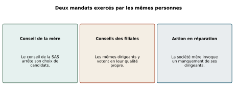
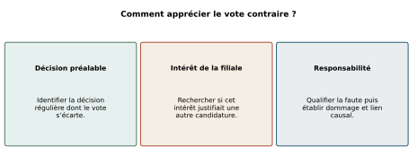

# ENS Rennes D-E — Droit commercial 2022 · Corrigé brut

*Corrigé rédigé par IA, non officiel.*

**Rédaction** · GPT-6.2 Astra Ultra · vitesse non renseignée

## Commentaire de Cass. com., 22 mai 2019, n° 17-13.565 — Le vote d’administrateurs de la mère dans les filiales

### Introduction

Une personne peut siéger au conseil d’une société mère puis voter, le même jour, au conseil de l’une de ses filiales. Le premier conseil a arrêté une stratégie. Le second délibère dans l’intérêt d’une personne morale distincte. Lorsqu’une même décision est soumise aux deux organes, le dirigeant doit-il reconduire son premier vote ou exercer à nouveau son jugement ? La chambre commerciale tranche une difficulté de gouvernance des groupes par un arrêt de cassation du 22 mai 2019.

La SAS Safa et Cimchaux contrôlent ensemble trois filiales. Le conseil de Safa, le 27 juin 2014, approuve à la majorité les candidatures de deux actionnaires à plusieurs fonctions de direction dans ces filiales. Deux administrateurs de Safa votent ensuite contre ces nominations aux conseils des filiales. Ils sont eux-mêmes élus aux postes. Safa leur demande des dommages-intérêts pour manquement à la loyauté envers elle. La cour d’appel de Bordeaux, le 13 février 2017, estime que le défaut de respect d’une décision collective régulière et non abusive suffit à caractériser le manquement. Les administrateurs forment un pourvoi.

Au visa des articles L. 227-8 et L. 225-251 du Code de commerce, la chambre commerciale casse pour défaut de base légale et renvoie à Poitiers. Le juge du fond aurait dû rechercher si la décision de la mère était contraire à l’intérêt social des filiales. Il faut donc rendre compatibles la liberté de vote, la loyauté due à la mère et l’existence d’intérêts sociaux distincts. L’arrêt tire d’abord du cumul des fonctions une obligation de cohérence, puis il fixe à cette obligation la limite de l’intérêt de chaque filiale. [Arrêt du 22 mai 2019](https://www.legifrance.gouv.fr/juri/id/JURITEXT000038567404)

### I. La loyauté envers la mère peut rendre fautif un vote divergent dans la filiale

#### A. Une responsabilité personnelle adossée aux fonctions de direction

Safa est une SAS. Le visa de l’article L. 227-8 rend applicables à ses dirigeants les règles de responsabilité prévues pour les dirigeants de société anonyme. L’article L. 225-251 énumère les infractions aux dispositions applicables, violations des statuts et fautes de gestion susceptibles d’engager la responsabilité envers la société ou envers les tiers. L’arrêt ne cite aucune clause des statuts qui aurait transformé chaque nomination en exécution d’un mandat de vote. L’enjeu est le comportement des administrateurs au regard des obligations de leur charge.

La demanderesse est Safa. Elle prétend avoir subi un dommage en raison du vote de ses propres administrateurs dans d’autres sociétés. Cette configuration distingue son action de celle d’un actionnaire isolé qui voudrait faire imposer ses préférences personnelles, ou d’une action contestant la nomination elle-même. Les demandeurs au pourvoi sont ici les administrateurs dont le comportement est critiqué. L’arrêt ne juge pas la validité des délibérations des filiales et n’annule pas directement leur élection.

La Cour rappelle d’entrée de jeu que l’administrateur exerce en principe librement son vote dans l’intérêt de la société. Cette liberté est fonctionnelle. Le conseil est un organe délibérant appelé à apprécier les intérêts en présence. Elle n’autorise pas à utiliser un second mandat pour faire échec, à seule fin de servir sa carrière, à une orientation collectivement arrêtée dans le cadre du premier. Que les intéressés aient finalement obtenu les postes convoités rend leur intérêt personnel plausible, sans dispenser de la recherche exigée par l’arrêt.

#### B. L’existence d’une décision collective de la mère fonde une exigence de cohérence

Le motif de principe ne soumet pas en permanence tous les votes en filiale aux désirs d’un actionnaire de contrôle. Il vise le cas où le conseil de la mère a déjà voté une décision et où un administrateur de la mère siège ensuite au conseil de la filiale. Il existe alors un intérêt légitime de la première société à ce que ses dirigeants ne neutralisent pas sa décision dans l’organe où elle doit trouver un prolongement. La divergence peut traduire une déloyauté envers la personne morale qui a confié la première fonction.

La règle se comprend dans une organisation dont la direction effective dépend de plusieurs conseils. Sans elle, une majorité obtenue à la mère pourrait être rendue inopérante par ses propres administrateurs sans justification tirée de leur autre charge. Elle ne crée toutefois ni personnalité juridique du groupe ni pouvoir de la société mère de nommer elle-même les dirigeants des sociétés contrôlées. Les conseils de ces sociétés continuent de délibérer conformément à leurs compétences.

La loyauté en cause doit aussi être distinguée d’un abus de majorité au sens du droit des assemblées. Le grief d’un administrateur n’est pas apprécié par le seul constat qu’une décision de la mère était adoptée régulièrement et sans abus. Cette appréciation éclaire la position de la mère. Elle laisse ouverte la question, juridiquement différente, de l’obligation de chacun dans la filiale.

### II. L’autonomie de l’intérêt social de la filiale borne le devoir de cohérence

#### A. Le mandat dans la filiale conserve une finalité propre

Une société contrôlée demeure, en principe, une personne morale distincte. Les actifs, engagements, autres associés et créanciers de chacune ne se confondent pas avec ceux de Safa. Le fait que le groupe puisse gagner à une nomination n’établit donc pas que chacune des trois filiales y ait intérêt. L’attendu de principe réserve expressément l’hypothèse dans laquelle suivre la décision arrêtée à la mère serait contraire à l’intérêt de la filiale.

L’administrateur qui siège au second conseil doit pouvoir en tenir compte. Il ne suffirait pas d’invoquer un désaccord personnel ou l’existence d’un candidat qu’il préfère. Il faut des circonstances relatives à la société concernée, par exemple les compétences requises pour la diriger, un conflit concret ou des conséquences défavorables que la nomination pourrait lui faire subir. Les faits distribués ne prouvent pas que de telles circonstances existaient. La cassation impose de les examiner parce que cette question avait été soumise aux juges.

La réserve a aussi une conséquence pour les personnes qui ne siègent pas au conseil de la mère. Les autres associés souscrivent au capital d’une société déterminée, les créanciers se fient à son patrimoine et à sa gestion. Une priorité systématique de l’orientation de la mère ferait supporter à cette collectivité les conséquences de décisions arrêtées ailleurs. L’arrêt maintient la possibilité d’une politique commune compatible avec chacun des intérêts sociaux en cause, sous le contrôle du juge.

#### B. Le défaut de base légale impose une vérification concrète sans préjuger du résultat

Le raisonnement des juges bordelais s’arrêtait au caractère régulier de la décision prise à la majorité. Il manquait une constatation indispensable pour appliquer correctement les textes de responsabilité. La Cour de cassation ne substitue pas une appréciation des nominations à celle du conseil. Elle censure l’insuffisance des motifs et remet les parties dans l’état antérieur à l’arrêt d’appel pour un examen devant la cour de Poitiers. Le rapport de jury évoque Poitiers dans sa présentation. Le dispositif distribué distingue sans ambiguïté Bordeaux, juridiction dont la décision est cassée, et Poitiers, juridiction de renvoi.

Devant le juge du fond, il faudra apprécier séparément, si nécessaire, la situation des différentes filiales et les fonctions concernées. Si la décision de la mère leur était contraire, le vote divergent ne peut caractériser une faute par le seul effet du désaccord. Si elle leur était compatible, la loyauté envers Safa peut justifier que le refus soit retenu comme faute. L’indemnisation sollicitée requiert encore un préjudice de Safa et un lien causal. La cassation de toutes les dispositions de l’arrêt d’appel ne prononce ni condamnation définitive ni exonération définitivement acquise.

La portée de la solution est donc plus précise qu’un choix général entre unité et autonomie du groupe. Elle fournit un ordre d’examen au juge et une discipline de décision aux administrateurs qui cumulent des mandats. Les débats des conseils, les motifs relatifs à chaque société et les effets des choix sont autant d’éléments susceptibles de rendre ce contrôle effectif.

### Conclusion

Dans les circonstances de l’arrêt, la loyauté rend normalement exigible une cohérence de vote avec la décision de la mère. Cette règle ne saurait toutefois obliger un dirigeant à méconnaître l’intérêt de la société au conseil de laquelle il vote. La décision donne à cette limite une traduction contentieuse. Avant de condamner les administrateurs, le juge doit examiner l’intérêt des filiales, puis les conditions propres de leur responsabilité envers la mère.

[Sujet distribué](https://www.ens-rennes.fr/medias/fichier/sujet-droit-commercial-2022_1657700515089-pdf) · [Rapport du jury](https://www.ens-rennes.fr/medias/fichier/rapport-du-jury-droit-commercial-ecrit-d-e-2022_1668097859379-pdf)
