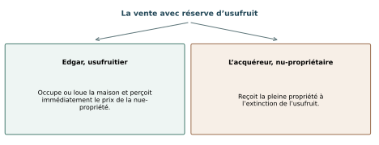
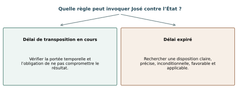
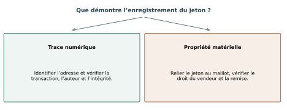

# ENS Rennes D-E — Droit (oral) 2022 · Corrigé guidé

*Corrigé rédigé par IA, non officiel.*

**Rédaction** · GPT-6.2 Astra Ultra · vitesse non renseignée

Le fascicule présente 24 tirages. Chaque numéro reprend une question de cours et un cas autonome, traités dans le droit en vigueur à la session. Les numéros reproduisent ceux des pages distribuées.

L’index de la session donne le sujet. Aucun rapport spécifique à cet oral de droit n’y a été retrouvé.

## Sujet 01 — La preuve des faits juridiques et l’accident d’Adèle

*Fascicule, page 1.*

> [!INDICATION]
> Énumérer les trois faits à établir avant de discuter la conduite du véhicule.

### Question théorique

Le fait juridique est un agissement ou un événement auquel la loi attache des effets de droit (art. 1100-2 du Code civil). À celui qui réclame l’exécution d’une obligation d’en prouver le fait générateur (art. 1353). La preuve est en principe libre (art. 1358). Témoins, constatations médicales, présomptions et photographies sont discutés contradictoirement. Des régimes spéciaux peuvent aménager ce que la victime doit établir.

### Application au cas

Adèle, piétonne de 57 ans, a été blessée par une automobile. La loi du 5 juillet 1985, articles 1 à 3, exige un accident de la circulation, l’implication du véhicule et un dommage corporel imputable à l’accident. Le contact relaté établit normalement l’implication. Constat, témoignages et certificat permettent d’établir les circonstances et l’étendue des lésions. Aucune preuve d’un excès de vitesse ou d’une faute du conducteur n’est exigée. Le jeune âge du conducteur et l’utilisation sans autorisation intéressent les recours et la garantie, sans supprimer le droit à indemnisation de la piétonne. À cet âge, seule sa faute inexcusable, cause exclusive de l’accident, ou la recherche volontaire du dommage pourraient respectivement exclure ou faire obstacle à cette indemnisation. Aucun fait du dossier ne les suggère.

## Sujet 02 — Le droit à l’image et la surveillance de la cour

*Fascicule, page 2.*

> [!INDICATION]
> Distinguer la prise de vue, la conservation et la publication éventuelle.

### Question théorique

L’article 9 du Code civil et l’article 8 de la Convention européenne des droits de l’homme protègent l’image et la vie privée. Une personne identifiable contrôle en principe la captation et l’utilisation de son image, selon le lieu et les circonstances. Consentir à une publication déterminée ne vaut pas autorisation générale. En cas de diffusion, le juge met en balance la protection de la personne et la liberté d’expression, en considérant notamment la contribution à un débat d’intérêt général et les conditions de la prise de vue.

### Application au cas

Jeanne peut décrire une surveillance systématique de ses fréquentations dans une cour d’immeuble et des prises de vue de tous les passants. Il faut établir si elle est elle-même identifiable, la vue offerte depuis la fenêtre, la nature des lieux, la conservation et l’usage des clichés. Même sans publication, épier durablement les allées et venues peut atteindre sa vie privée. Sa notoriété et le sachet découvert à proximité ne confèrent aucun pouvoir général de surveillance au voisin. Jeanne peut demander au juge civil la cessation des prises, une mesure adaptée sur les images et des dommages-intérêts. L’article 9 permet au juge des référés d’ordonner en urgence des mesures de protection. Chacun de ses amis agit pour ses propres droits.

## Sujet 03 — L’abus de propriété, le coq et les cloches

*Fascicule, page 3.*

> [!INDICATION]
> Identifier séparément chaque source de bruit, le défendeur et le juge.

### Question théorique

L’article 544 reconnaît au propriétaire le droit de jouir et disposer de son bien dans les limites légales. L’exercice d’une prérogative peut devenir fautif, notamment lorsque l’acte, dépourvu d’utilité, est accompli dans l’intention de nuire (arrêt Clément-Bayard, 3 août 1915). Sur le fondement de la responsabilité civile, il faut établir abus, dommage et causalité. En 2022, le trouble anormal du voisinage repose sur un principe jurisprudentiel autonome et n’exige pas la preuve d’une intention.

### Application au cas

Le chant dès deux heures du matin doit être documenté par sa fréquence, son intensité et sa durée, en tenant compte du milieu rural. Romane peut solliciter un aménagement du poulailler et, si l’anormalité est établie, cessation ou indemnisation. Le patrimoine sensoriel des campagnes reconnu en 2021 ne dispense pas de cet examen. L’antériorité d’une activité agricole répondant à l’ancien article L. 113-8 du Code de la construction peut être opposée sous conditions, notamment sa conformité et sa poursuite dans les mêmes conditions. Pour les sonneries, distinguer l’usage cultuel de la sonnerie civile de l’horloge, vérifier arrêté municipal, usages locaux et intensité nocturne. Demander au maire une limitation horaire puis, en cas de refus, saisir le juge administratif des mesures de police relevant de la commune. Aucun remède uniforme ne vaut pour les deux sources.

## Sujet 04 — Le démembrement et la vente de la nue-propriété

*Fascicule, page 4.*

> [!INDICATION]
> Représenter les droits d’Edgar avant la vente, après la vente et après son décès.

### Question théorique

L’usufruit confère l’usage du bien et le droit d’en percevoir les fruits à charge d’en conserver la substance (art. 578 et 582). Le nu-propriétaire dispose de son droit grevé par l’usufruit. Il peut le céder, mais l’acquéreur doit respecter la jouissance de l’usufruitier. L’usufruit viager s’éteint au décès de son titulaire (art. 617). La pleine propriété se reconstitue alors chez le nu-propriétaire.

### Application au cas

Edgar vendrait par acte authentique la nue-propriété contre un prix disponible pour financer son aide à domicile. Il doit se réserver expressément l’usufruit viager, qui lui permet d’occuper la maison ou d’en percevoir des loyers s’il part. Un droit d’habitation aurait une portée plus étroite. La valeur du droit vendu dépend notamment de la valeur de l’immeuble et de la jouissance conservée. La vente ne fournit aucun service d’aide par elle-même. Vérifier l’évaluation, les modalités de paiement, les charges d’entretien et les grosses réparations (art. 605 et 606), ainsi que son consentement libre. Au décès l’usufruit disparaît. Edgar ne pourra plus vendre seul la pleine propriété si ses besoins augmentent.

## Sujet 06 — La loi nouvelle et le procès de Rose

*Fascicule, page 5.*

> [!INDICATION]
> Inscrire successivement la date des faits, l’entrée en vigueur éventuelle et le jugement.

### Question théorique

L’article 2 pose la non-rétroactivité de la loi civile. En principe le contrat demeure soumis à la loi en vigueur à sa formation, y compris pour ses effets futurs convenus, sous réserve des dispositions transitoires, de certains effets légaux et de l’application immédiate d’une règle nouvelle que justifie son dispositif. Il faut identifier le fait générateur, la date de conclusion et l’effet litigieux. Seule l’entrée en vigueur donne effet à une réforme annoncée.

### Application au cas

Le cas de Rose relève du droit pénal dans le temps. Le juge vérifie d’abord si, en février, sa prescription et la consommation correspondaient aux conditions de l’expérimentation licite décrite. Si elles étaient remplies, le fait reproché ne constitue pas l’usage illicite poursuivi. À supposer l’infraction constituée à cette date, l’article 112-1 du Code pénal applique la loi de fond plus douce aux faits antérieurs sans condamnation passée en force de chose jugée. Si la dépénalisation hypothétique entre en vigueur avant le jugement de décembre et couvre les faits, Rose ne peut être condamnée de ce chef. Une proposition, même déposée et annoncée, demeure sans effet. Ce scénario relève de l’hypothèse donnée par le sujet de 2022.

## Sujet 07 — La règle de droit et le décompte du congé

*Fascicule, page 6.*

> [!INDICATION]
> Compter deux semaines sur un calendrier en distinguant jours écoulés et jours habituellement travaillés.

### Question théorique

La règle de droit prescrit ou autorise des comportements, définit des compétences et organise des sanctions publiques. Elle est en principe générale et impersonnelle, y compris si elle vise une catégorie professionnelle. Une règle impérative s’impose aux intéressés. Une règle supplétive complète leur volonté. La généralité ne préjuge ni du caractère impératif ni de la date d’entrée en vigueur.

### Application au cas

Le texte fictif de 2022 fixe son entrée en vigueur au 1er janvier 2025. Il ne confère donc pas en septembre 2022 le droit nouveau de vingt-huit jours qu’invoque M. F. L’accord peut accorder un avantage dès septembre dans le respect du droit alors applicable, notamment du congé légal en vigueur depuis 2021 (25 jours calendaires en naissance simple, outre le congé de naissance, avec une période obligatoire et des règles de fractionnement). Une stipulation qui réduit ces garanties ou impose un fractionnement incompatible doit être écartée dans cette mesure. M. F. travaille cinq jours par semaine d’après le scan. Deux périodes de quatorze jours calendaires correspondent ensemble à vingt-huit jours calendaires, ordinairement vingt jours de travail. Si le texte promet des jours ouvrés, le résultat change. Lire l’unité et les conditions de prise de chaque texte. En 2025 la même comparaison devra être refaite au regard du régime nouveau.

## Sujet 08 — La hiérarchie des normes et deux directives

*Fascicule, page 7.*

> [!INDICATION]
> Repérer le sens de « pour l’avenir » puis la date limite de transposition.

### Question théorique

La Constitution organise les compétences internes. L’article 55 place les traités régulièrement introduits au-dessus de la loi sous les conditions prévues, et l’article 88-1 fonde la participation à l’Union. Dans le champ de l’Union, le juge national assure la primauté du droit applicable et laisse inappliquée la loi nationale incompatible. Un règlement et une directive n’ont cependant pas le même effet. La directive lie quant au résultat et appelle en principe une transposition.

### Application au cas

José oppose à l’autorité de poursuite la directive fictive du 25 juin. L’ancienne exclusion française était admise. Il faut donc déterminer si la nouvelle interdiction des exclusions pour l’avenir atteint cette mesure existante ou seulement les nouvelles exclusions, et si la loi du 29 juin en institue une. Il manque le délai de transposition et la date des faits. Une fois ce délai expiré, l’intéressé peut invoquer contre l’État une disposition claire, précise et inconditionnelle qui lui est favorable. Le juge recherche une lecture conforme puis, si les conditions sont réunies, écarte le texte national incompatible, avec renvoi préjudiciel au besoin. Avant l’échéance l’État doit s’abstenir de compromettre gravement le résultat. Cette obligation ne crée pas d’emblée une autorisation individuelle. Une directive ne peut à elle seule fonder ou aggraver une condamnation pénale.

## Sujet 09 — Les deux règlements et le domaine de la loi

*Fascicule, page 8.*

> [!INDICATION]
> Classer chacun des trois projets dans les rubriques de l’article 34.

### Question théorique

En droit français, le pouvoir réglementaire exécute la loi et intervient de façon autonome hors du domaine de l’article 34 de la Constitution (art. 21 et 37). Ses actes sont contrôlés par le juge administratif. En droit de l’Union, le règlement est un acte de portée générale, obligatoire dans tous ses éléments et directement applicable dans chaque État membre (art. 288 TFUE). Le nom commun aux deux instruments ne confère pas au décret français le rang d’un règlement européen.

### Application au cas

Les principes fondamentaux des obligations civiles et commerciales et du droit du travail relèvent de la loi, comme la détermination des délits et des peines qui leur sont applicables. La réforme des contrats de 2016 a emprunté la voie d’une habilitation et a depuis été ratifiée. Le gouvernement ne peut en modifier seul par décret les matières législatives, ni supprimer de la même façon les peines d’emprisonnement des délits visés. Il peut déposer un projet de loi ou solliciter une habilitation précise et temporaire pour prendre des ordonnances (art. 38). Les modalités purement réglementaires restent de sa compétence. L’indignation des députés est donc juridiquement fondée pour les modifications de fond décrites.

## Sujet 10 — Le domicile et l’achat de l’ordinateur

*Fascicule, page 9.*

> [!INDICATION]
> Partir de la qualité de l’acheteur et du lieu concret de remise.

### Question théorique

Le domicile est le lieu du principal établissement d’une personne (art. 102). Il la rattache juridiquement à un lieu, même lorsqu’elle réside provisoirement ailleurs. Un changement suppose habitation réelle et intention d’y fixer son principal établissement. Pour une personne morale, le siège détermine ordinairement le lieu où elle demeure en procédure. Une élection de domicile conventionnelle ne neutralise pas les règles impératives de compétence.

### Application au cas

Karl semble acheter comme consommateur auprès d’un professionnel. Identifier l’entité vendeuse sur la facture, qui peut être le magasin ou la tête de réseau. Outre le domicile du défendeur, l’article 46 du Code de procédure civile ouvre en matière contractuelle le lieu de livraison effective de la chose. La remise au magasin nantais justifie Nantes. L’article R. 631-3 du Code de la consommation ouvre aussi le lieu où le consommateur demeurait lors du contrat ou du fait dommageable. Une clause territoriale n’est opposable selon l’article 48 CPC qu’entre personnes ayant toutes contracté en qualité de commerçant, et sous condition de présentation apparente. Karl peut donc écarter la clause imposant La Réunion et, pour cette vente de 800 euros, saisir la juridiction civile compétente à Nantes. Le démontage allégué relève de la preuve au fond.

## Sujet 11 — La chose jugée, l’appel et la preuve du paiement

*Fascicule, page 10.*

> [!INDICATION]
> Classer les trois événements que sont le jugement, sa mise à exécution et la production de la pièce.

### Question théorique

L’article 1355 du Code civil lie la chose jugée aux mêmes parties agissant en la même qualité, pour la même demande fondée sur la même cause. Dès son prononcé, le jugement qui tranche une contestation a autorité sur ce qu’il décide dans son dispositif (art. 480 CPC). Il acquiert force de chose jugée quand il n’est plus susceptible d’un recours suspensif. L’exécution provisoire peut en permettre l’exécution auparavant.

### Application au cas

La restitution de la machine avant la fin de l’appel peut procéder de l’exécution provisoire, en principe de droit pour les décisions actuelles. Vérifier le jugement et l’éventuelle demande d’arrêt de cette exécution. En appel, Amélie peut produire ses justificatifs de paiement au soutien des prétentions soumises à la cour (art. 563 CPC). Il faut les communiquer contradictoirement et distinguer l’ancien prix payé de l’augmentation revendiquée. L’article 1193 exige en principe un accord ou une cause légale pour modifier le contrat. Devant la Cour de cassation, le contrôle porte sur les erreurs de droit de la décision attaquée. Une quittance nouvelle destinée à refaire l’appréciation des faits intervient trop tard. Une cassation pourrait, suivant le moyen recevable, renvoyer le litige à une cour de fond.

## Sujet 12 — La tutelle et les achats de Julia

*Fascicule, page 11.*

> [!INDICATION]
> Distinguer les droits du titulaire de la carte, ceux de l’acheteuse et l’objet de chaque restitution.

### Question théorique

La tutelle suppose une altération médicalement constatée empêchant la personne de pourvoir seule à ses intérêts et un besoin de représentation continue (art. 425 et 440). Nécessité, subsidiarité et proportionnalité commandent une mesure individualisée. Une proche peut saisir le juge avec le certificat circonstancié d’un médecin inscrit sur la liste du procureur. Une curatelle ou une autre mesure peut suffire selon les facultés constatées.

### Application au cas

Il faut distinguer les actes selon l’âge. À sa minorité, Julia pouvait accomplir seule les actes courants à conditions normales. Une acquisition spéculative de 200 euros avec la carte maternelle appelle un examen de son caractère courant et de son éventuelle lésion. La hausse à 1 700 euros affaiblit l’argument d’un préjudice économique. À sa majorité, les achats engagent en principe Julia. Pour les annuler pour insanité d’esprit il faut établir le trouble au moment de chaque acte (art. 414-1). Une protection ultérieure n’annule pas automatiquement les opérations. L’article 464 prévoit des conditions propres pour certains actes dans les deux ans précédant la publicité du jugement. La mère peut faire valoir les prélèvements sans autorisation et ses droits sur les fonds, sans s’approprier pour autant les achats appartenant à sa fille. Une restitution consécutive à la nullité obéit notamment à la limite du profit retiré par le mineur ou le majeur protégé (art. 1352-4).

## Sujet 13 — L’imprévision et la convention pour Paul

*Fascicule, page 12.*

> [!INDICATION]
> Comparer la destination annoncée de la somme à une éventuelle condition expresse.

### Question théorique

L’article 1195 permet à la partie qui n’avait pas accepté le risque d’un changement imprévisible rendant l’exécution excessivement onéreuse de demander une renégociation. Elle continue à exécuter pendant celle-ci. En cas d’échec, les parties peuvent convenir d’une résolution ou saisir ensemble le juge pour adapter le contrat. À défaut d’accord dans un délai raisonnable, l’une d’elles peut lui demander de le réviser ou d’y mettre fin. Le mécanisme est en principe aménageable par contrat.

### Application au cas

La stipulation de 450 euros doit être interprétée selon la commune intention (art. 1188). La mère recevait l’argent pour la subsistance et l’éducation de Paul lorsqu’il vivait chez elle. Si le versement était subordonné à cette prise en charge, le père peut soutenir que la condition a cessé d’être remplie. La seule mention de la destination de la pension ne prouve pas nécessairement cette condition. Un changement de résidence peut être discuté sous l’angle de la disparition d’un élément essentiel (art. 1186), mais la subsistance de l’enfant reste nécessaire et des charges peuvent rester à la mère. Rien n’établit les conditions d’imprévision ni une faculté automatique de suspension après quatre mois. Le père peut solliciter une modification amiable ou judiciaire et produire les justificatifs de prise en charge. La convention ou son éventuelle force exécutoire doit être vérifiée. L’énoncé borne ici l’analyse au contrat.

## Sujet 14 — L’information précontractuelle et le tableau

*Fascicule, page 13.*

> [!INDICATION]
> Identifier ce que chacune savait le jour de la vente, indépendamment de la valeur de la toile.

### Question théorique

La partie qui connaît une information déterminante pour le consentement de l’autre doit l’en informer si celle-ci l’ignore légitimement ou fait confiance à son cocontractant (art. 1112-1). L’information a un lien direct et nécessaire avec le contrat ou la qualité des parties. L’estimation personnelle de la valeur est exclue. Celui qui prétend qu’une information lui était due le prouve, puis l’autre démontre l’avoir fournie. Une réparation est possible et l’annulation suppose un vice du consentement.

### Application au cas

Les parties avaient accepté un doute centenaire sur l’attribution. L’article 1133 empêche de transformer en erreur la simple réalisation de l’aléa accepté. L’expertise négative sollicitée peu avant la vente apporte toutefois une information précise sur cet aléa que le professeur connaissait. L’acheteuse peut établir par le rapport et les circonstances que, si elle avait su, elle aurait renoncé ou contracté à des conditions substantiellement différentes. Le prix faible signale l’incertitude sans autoriser la dissimulation intentionnelle d’une information décisive. Le dol par réticence (art. 1137) rend l’erreur excusable et permet la nullité relative avec restitution du tableau et des 5 000 euros. Le juge appréciera aussi la valeur et les limites propres à l’avis de l’expert. Un manquement non intentionnel peut ouvrir réparation du préjudice prouvé.

## Sujet 15 — L’obligation naturelle et les gains promis

*Fascicule, page 14.*

> [!INDICATION]
> Qualifier les deux paroles à leurs dates respectives puis examiner la preuve de chaque créance.

### Question théorique

Un devoir de conscience envers autrui peut produire une obligation civile lorsque son auteur promet de l’exécuter (art. 1100). Son exécution volontaire n’est pas sujette à répétition (art. 1302). Il faut caractériser le devoir personnel et la volonté de s’engager. Une courtoisie, un projet de cadeau et une donation formelle obéissent à des régimes différents. Le paiement spontané et la contrainte judiciaire ne se déduisent pas des mêmes faits.

### Application au cas

Au dîner, Jessica promet à chacune 1 000 euros si elle gagne. Le contexte peut traduire une plaisanterie ou une intention libérale, sans mise commune ni service des amies. Après le tirage, l’engagement précis de payer dès réception peut, si le juge y trouve la volonté d’accomplir un devoir de conscience envers chacune, rendre la promesse exigible une fois les fonds reçus. La mauvaise grâce et les neuf mois écoulés ne tranchent pas la qualification. Chacune devra prouver la teneur et le sérieux des paroles. Sa créance individuelle de 1 000 euros est en principe sous le seuil de preuve écrite. À défaut de devoir caractérisé, une simple promesse de donation non passée en la forme requise par l’article 931 et non exécutée par remise ne suffit pas normalement à obtenir paiement.

## Sujet 16 — L’inexécution et la réfection de la salle de bains

*Fascicule, page 15.*

> [!INDICATION]
> Tester séparément le délai promis, le projet approuvé et le rôle de chacun.

### Question théorique

L’article 1217 ouvre, suivant les circonstances, exception d’inexécution, exécution en nature, réduction du prix, résolution et réparation. Les sanctions compatibles peuvent se cumuler. Comparer la prestation promise à la prestation reçue et vérifier la mise en demeure requise selon le remède. Les dommages-intérêts supposent une inexécution imputable, un dommage et une causalité, sous réserve de la force majeure.

### Application au cas

Lysiane a contracté avec le décorateur. Elle doit produire projet approuvé, échantillons, devis et échéance. Des couleurs conformes au choix convenu et techniquement réussies ne caractérisent pas, par le seul changement de goût, une inexécution. Un écart démontré ou un manquement au conseil peut engager le décorateur, notamment pour les prestations qu’il a fait exécuter. Deux mois de retard constituent un grief distinct si le délai était contractuel. La maladie du sous-traitant ne libère le cocontractant que si les conditions strictes de l’article 1218 sont réunies, y compris l’impossibilité de substitution ou de mesures appropriées. La cliente doit justifier son préjudice malgré ses vacances. Contre le sous-traitant, hors lien contractuel direct, elle peut invoquer une faute lui ayant causé un dommage (art. 1240), y compris un manquement contractuel qui l’aurait lésée. L’absence de malfaçon et de dommage prouvé réduit ses chances.

## Sujet 18 — Les ordonnances et la transposition tardive

*Fascicule, page 16.*

> [!INDICATION]
> Vérifier deux calendriers indépendants, celui de la directive et celui de l’habilitation.

### Question théorique

L’article 38 permet au gouvernement, pour exécuter son programme, de demander au Parlement, pour un délai limité, l’autorisation de prendre des mesures du domaine de la loi. L’ordonnance, prise en Conseil des ministres après avis du Conseil d’État, entre en vigueur à publication. Elle devient caduque si le projet de ratification n’est pas déposé dans le délai fixé. La ratification doit être expresse. Avant celle-ci l’ordonnance est attaquable comme acte administratif, avec un régime particulier de QPC pour ses dispositions législatives depuis l’expiration de l’habilitation.

### Application au cas

La directive fictive laisse aux États le choix de la forme de transposition (art. 288 TFUE). Une ordonnance peut donc porter les dispositions législatives si une habilitation suffisamment précise et en cours le permet. Le gouvernement peut aussi prendre les mesures réglementaires relevant déjà de sa compétence. Il ne peut s’auto-habiliter à cause des élections. Au 17 mars 2022, l’obligation de transposition intégrale à temps est méconnue si les règles internes existantes ne satisfont pas déjà le texte. Transposer rapidement fait cesser le manquement pour l’avenir, sans effacer le retard ni ses suites éventuelles. Une disposition précise et inconditionnelle peut après l’échéance être invoquée à l’encontre de l’État. Une directive seule ne crée pas d’obligation directement opposable à un commerçant privé dans un litige entre particuliers.

## Sujet 19 — L’écrit électronique, le jeton et le maillot

*Fascicule, page 17.*

> [!INDICATION]
> Dessiner trois liens distincts entre adresse numérique, vendeur identifié et objet matériel.

### Question théorique

L’écrit s’entend d’une suite intelligible de signes quel qu’en soit le support (art. 1365). L’écrit électronique a même force que le papier lorsque son auteur peut être identifié et que son intégrité est garantie (art. 1366). La signature identifie celui qui l’appose et manifeste son consentement (art. 1367). Une technique particulière peut concourir à ces preuves sans emporter à elle seule l’adhésion du juge à toutes les affirmations inscrites.

### Application au cas

Thomas doit relier la transaction au maillot matériel, identifier le cédant et démontrer que celui-ci avait qualité pour le lui transférer. Un jeton non fongible atteste potentiellement l’attribution d’un enregistrement à une adresse. La chaîne n’atteste seule ni l’identité civile derrière l’adresse ni l’exactitude de l’inscription initiale. Le paiement en cryptomonnaie est un indice d’échange. Contrat, identification de l’objet, remise et possession de bonne foi peuvent étayer la propriété mobilière (art. 2276, avec son exception pour perte ou vol). Enfin, posséder l’objet physique ne donne pas un monopole général sur son image. Thomas doit préciser si l’agence détient ou utilise le maillot matériel, ou diffuse une image, et quelle atteinte ou quel trouble anormal lui cause cet usage. Aucun droit du joueur n’est transféré par la seule vente.

## Sujet 20 — Le droit d’habitation de la compagne de Jean

*Fascicule, page 18.*

> [!INDICATION]
> Comparer pour chaque titre sa durée, la perception d’un loyer et le sort du droit au décès de Jean.

### Question théorique

Les droits d’usage et d’habitation se règlent par leur titre puis, à défaut, par les articles 625 et suivants. L’habitation procure un droit réel personnel de se loger dans la limite des besoins du titulaire et de sa famille. Il ne peut être ni cédé ni loué (art. 634). L’usufruit autorise plus largement la perception des fruits et, sous conditions, la location. Ces droits peuvent être constitués viagers.

### Application au cas

Un bail réellement consenti à un loyer donne un droit personnel d’occupation. Le décès du bailleur ne le résilie pas (art. 1742), mais les règles de durée et de congé ne garantissent pas nécessairement une occupation à vie. Un usufruit viager au profit de la compagne lui permettrait d’habiter ou louer même après la mort de Jean, les enfants recevant une propriété grevée jusqu’à l’extinction du droit. Un droit viager d’habitation répond plus étroitement à son seul besoin de logement. Si Jean est bien seul propriétaire, il peut le constituer par donation immobilière authentique, avec publicité, ou par testament prenant effet au décès. Vérifier la quotité disponible et la réserve des descendants. Les libéralités excessives exposent à réduction. Le concubinage ne confère pas à la compagne le droit viager au logement du conjoint survivant.

## Sujet 21 — Le changement de prénom d’Hortensia

*Fascicule, page 19.*

> [!INDICATION]
> Identifier le demandeur majeur et les pièces attestant un usage durable d’Hortense.

### Question théorique

L’article 60 permet de demander un changement de prénom à l’officier d’état civil du lieu de résidence ou de naissance. Un intérêt légitime est requis. Pour le mineur, le représentant légal agit et l’accord personnel de l’enfant de plus de treize ans est nécessaire. Si l’officier estime l’intérêt insuffisant, il saisit sans délai le procureur. L’opposition du procureur peut être portée devant le juge aux affaires familiales.

### Application au cas

Hortensia, 19 ans, dépose elle-même sa demande. Elle peut produire des attestations précises des moqueries et de l’usage habituel et durable d’Hortense, sur des documents d’études, auprès de proches et dans la vie courante. La préférence subjective seule peut être insuffisante. Les parents ne disposent plus d’un pouvoir de veto. Examiner la donation de la tante séparément. Une condition remplie lors de l’attribution initiale du prénom n’impose pas à l’enfant devenu majeur de le conserver. Si elle prétend le rattacher à vie à ce prénom, la portée et la validité de la condition doivent être appréciées notamment au regard de l’ordre public (art. 900), ainsi que ses éventuels effets entre donateur et donataires. Cette stipulation ne retire pas à Hortensia le droit de saisir l’état civil.

## Sujet 22 — L’enclave et l’accès en camping-car

*Fascicule, page 20.*

> [!INDICATION]
> Distinguer accès automobile ordinaire et besoins du véhicule particulier.

### Question théorique

Un fonds enclavé n’a sur la voie publique aucune issue ou une issue insuffisante pour sa desserte normale. L’article 682 autorise son propriétaire à réclamer un passage suffisant, à charge d’une indemnité proportionnée au dommage. Le tracé emprunte en principe le trajet le plus court tout en recherchant l’endroit le moins dommageable (art. 683). Si l’enclave résulte d’une division, le passage doit d’abord être demandé sur les terrains de cette division, sauf impossibilité d’y établir un passage suffisant (art. 684).

### Application au cas

La parcelle arrière est détachée du jardin de l’ami. Vérifier si elle dispose d’une autre issue suffisante et sa destination normale, notamment la possibilité d’y bâtir et d’y accéder en véhicule. Le droit à une desserte automobile normale d’une habitation peut être reconnu. Il n’en résulte pas une largeur ou un rayon de braquage automatiquement adaptés à ce camping-car. Dimensions, pente, accès de secours, contraintes du fonds avant et fréquence d’utilisation permettront d’apprécier le besoin. La promesse se borne aux conditions légales. Une formule orale généreuse, sans largeur convenue, est fragile. Les acquéreurs peuvent faire mesurer et fixer par acte avant la vente tracé, largeur, usages, entretien et indemnité, ou demander ultérieurement au juge la détermination du passage nécessaire.

## Sujet 23 — Le contenu licite et certain et la vente d’une étoile

*Fascicule, page 21.*

> [!INDICATION]
> Lire l’offre commerciale avant de donner un sens juridique au mot « propriété » du certificat.

### Question théorique

Le contrat doit avoir un contenu licite et certain (art. 1128). Ni ses stipulations ni son but ne peuvent déroger à l’ordre public (art. 1162). La prestation présente ou future doit être possible et déterminée ou déterminable sans nouvel accord (art. 1163). Un contrat onéreux dont la contrepartie est illusoire ou dérisoire dès la formation peut être annulé (art. 1169). Il faut établir quelle prestation les parties avaient réellement convenue.

### Application au cas

Le certificat ne démontre aucun droit préexistant du vendeur sur l’étoile. Le traité de l’espace de 1967, article II, prohibe l’appropriation nationale des corps célestes. Aucune procédure de vente ou de publicité reconnue ne confère ici une propriété privative opposable sur cet astre. Si Alex a payé pour ce transfert réel, la prestation promise est impossible à fournir, ou le vendeur a vendu un bien qui ne lui appartenait pas. Alex peut demander annulation et restitution du prix, voire invoquer une présentation trompeuse selon la publicité. Si l’offre annonçait clairement une dénomination purement symbolique dans un registre privé et la remise du certificat correspondant, cette prestation de service est possible et peut avoir été exécutée. La déception seule n’ouvre pas automatiquement droit au remboursement.

## Sujet 24 — Le déséquilibre significatif et l’arrivée tardive

*Fascicule, page 22.*

> [!INDICATION]
> Qualifier juridiquement les trois personnes avant d’examiner le sort du prix.

### Question théorique

Issu de la réforme du droit commun, l’article 1171 permet de réputer non écrite une clause créant un déséquilibre significatif dans un contrat d’adhésion. Dans sa version applicable aux actes conclus depuis octobre 2018, le contrôle vise la clause non négociable déterminée à l’avance par l’une des parties. Il exclut l’objet principal et l’adéquation du prix à la prestation. La sanction vise la clause, et le contrat peut subsister. Articuler ce droit commun avec les régimes spéciaux qui régissent effectivement la relation.

### Application au cas

Vérifier qui a contracté, quels termes ont été portés à la connaissance d’Antoine, et si la clause lie la plateforme ou le bailleur. La remise en location immédiate et la rétention de tout prix après dix minutes peuvent créer un avantage disproportionné, surtout si le bien a été reloué et si le propriétaire était averti. L’organisation des arrivées peut toutefois justifier une heure limite. Le montant conservé, l’absence de délai de grâce et les possibilités réelles de prévenir comptent. Le déplacement professionnel invite à vérifier la qualité de consommateur au regard de la finalité du contrat et du rôle de l’employeur. À défaut de régime spécial, l’article 1171 peut servir si ses conditions existent. Une clause pénale manifestement excessive peut être modérée (art. 1231-5) si elle a cette nature. Le retard du train ne constitue pas automatiquement une force majeure. Produire billet, message et confirmation de réservation. L’employeur peut attester les faits, sa qualité pour agir dépend de sa position au contrat.

## Sujet 25 — La stipulation pour autrui, le porte-fort et le bail

*Fascicule, page 23.*

> [!INDICATION]
> Tester séparément mandat, engagement personnel et promesse du fait d’un tiers.

### Question théorique

Dans une stipulation pour autrui, le promettant s’engage envers le stipulant à fournir une prestation au tiers bénéficiaire, titulaire d’un droit direct (art. 1205 et suivants). Le porte-fort promet quant à lui le fait d’un tiers (art. 1204). Le tiers conserve son indépendance. Si le fait promis manque, le promettant peut devoir des dommages-intérêts. En cas de porte-fort de ratification, la ratification produit effet rétroactif à la date de l’engagement.

### Application au cas

Alice a accepté en principe de partager un logement. Rien n’établit qu’elle a accepté ce loyer, donné mandat à Mathilde de signer ce bail à ce prix ou créé une apparence légitime de pouvoir. Elle reste en principe libre de refuser. Mathilde s’est-elle personnellement engagée à louer, a-t-elle garanti la signature d’Alice ou seulement annoncé un projet conditionnel à l’accord de sa camarade ? Vérifier les mots échangés, le prix, les autres conditions et l’acceptation du propriétaire. Une promesse ferme du fait d’Alice peut engager Mathilde à réparer le préjudice démontré en cas de refus. Une simple négociation ne rend pas dû le loyer, et la solidarité ne se présume pas. Les éléments donnés ne révèlent pas de stipulation conférant à Alice une obligation.

## Sujet 27 — La capacité, le mandat et la maison d’Hubert

*Fascicule, page 24.*

> [!INDICATION]
> Examiner d’abord la capacité d’exprimer une volonté puis la manière de la constater.

### Question théorique

Toute personne physique peut contracter sauf incapacité prévue par la loi (art. 1145 et 1146). Le consentement requiert un esprit sain au moment de l’acte (art. 414-1 et 1129). Un handicap moteur, le grand âge et le placement en établissement ne suffisent pas à établir l’insanité. Pour les majeurs protégés, assistance ou représentation dépend de la mesure et de l’acte. La vente d’un immeuble est un acte de disposition.

### Application au cas

Jean-Christophe ne peut vendre au seul titre de fils et le silence du propriétaire ne donne pas mandat exprès de vendre (art. 1988). Si Hubert comprend et veut la vente, un notaire peut recueillir sa volonté et constater dans l’acte authentique son impossibilité physique de signer. Vérifier un éventuel mandat et sa portée. Si les troubles cognitifs empêchent une volonté valable, il faut rechercher la mesure proportionnée, certificat médical à l’appui, puis obtenir les pouvoirs et autorisations requis. Pour le logement du majeur protégé, l’article 426 exige une autorisation judiciaire ou familiale selon le régime et, pour l’acte ayant pour finalité l’accueil en établissement, un avis médical spécifique. L’entrée antérieure en établissement ne transfère aucun droit de propriété. Un autre enfant peut être consulté, notamment dans une habilitation familiale, mais l’accord d’une sœur ne remplace ni celui d’Hubert capable ni celui de l’autorité compétente.

## Sources

[Fascicule officiel](https://www.ens-rennes.fr/medias/fichier/annales-e-preuve-orale-de-droit-d-e-2022_1668101846031-pdf)

[Code civil](https://www.legifrance.gouv.fr/codes/texte_lc/LEGITEXT000006070721/2022-06-01/) · [Code de procédure civile](https://www.legifrance.gouv.fr/codes/texte_lc/LEGITEXT000006070716/2022-06-01/) · [Code de la consommation](https://www.legifrance.gouv.fr/codes/texte_lc/LEGITEXT000006069565/2022-06-01/) · [Code pénal](https://www.legifrance.gouv.fr/codes/texte_lc/LEGITEXT000006070719/2022-06-01/) · [Code du travail](https://www.legifrance.gouv.fr/codes/texte_lc/LEGITEXT000006072050/2022-06-01/) · [Code de la santé publique](https://www.legifrance.gouv.fr/codes/texte_lc/LEGITEXT000006072665/2022-06-01/) · [Constitution de 1958](https://www.legifrance.gouv.fr/loda/id/JORFTEXT000000571356/) · [Article 288 TFUE](https://eur-lex.europa.eu/legal-content/FR/TXT/?uri=CELEX%3A12012E288) · [Loi du 5 juillet 1985](https://www.legifrance.gouv.fr/loda/id/JORFTEXT000000693454/)
