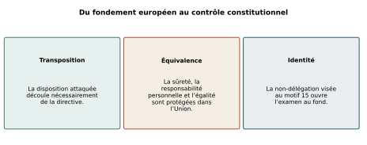
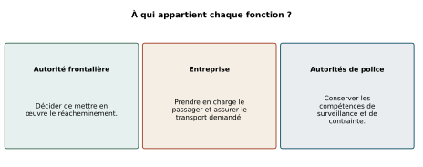

# ENS Rennes D-E — Droit public 2022 · Corrigé brut

*Corrigé rédigé par IA, non officiel.*

**Rédaction** · GPT-6.2 Astra Ultra · vitesse non renseignée

## Commentaire de Cons. const., 15 octobre 2021, n° 2021-940 QPC, Société Air France — L’obligation de réacheminer et l’exercice de la force publique

### Introduction

Qui décide du retour d’une personne à laquelle l’entrée en France a été refusée, et qui assure le transport ? La compagnie aérienne Air France soulève cette distinction en contestant la loi qui l’oblige à ramener certaines personnes à la demande des autorités frontalières. Si un passager refuse, la compagnie craint que la charge du voyage et la responsabilité de son inexécution ne fassent d’elle, en pratique, un agent de police. Or le législateur français a transposé une obligation européenne. Identifier la prérogative en cause détermine donc aussi quel juge peut la contrôler.

Le Conseil d’État renvoie la QPC le 9 juillet 2021 (n° 450480). Le Conseil constitutionnel en est saisi le 15 juillet en application de l’article 61-1 de la Constitution. Dans leurs versions applicables au litige, les anciens articles L. 213-4 et L. 625-7, 1°, du code de l’entrée et du séjour des étrangers et du droit d’asile imposent un réacheminement aux entreprises de transport aérien ou maritime et prévoient une amende maximale de 30 000 euros pour manquement. Le Conseil recentre la question sur les seuls mots « est tenue de ramener » de l’article L. 213-4. L’association nationale d’assistance aux frontières pour les étrangers, admise à intervenir dans cette limite, rejoint le grief fondé sur l’article 12 de la Déclaration de 1789. Le dispositif tranche la constitutionnalité de ces mots. Il ne statue sur aucune sanction individuelle. [Décision n° 2021-940 QPC](https://qpc360.conseil-constitutionnel.fr/2021-10-15/decision-2021-940-qpc-15-octobre-2021)

Le Conseil peut-il examiner une obligation que la directive impose au législateur, au motif qu’elle transférerait une compétence de police à une entreprise ? Il l’admet au titre de l’identité constitutionnelle de la France, puis déclare le texte conforme. La nouveauté tient autant à l’ouverture du contrôle qu’à sa limite concrète. Il faut suivre d’abord la sélection des griefs opérants, puis la distinction entre prérogative publique et prestation de transport.

### I. La fidélité à l’obligation européenne restreint les griefs dont le Conseil peut connaître

#### A. La portée exacte de la transposition commande celle du contrôle

Le texte national concerne le ressortissant d’un État tiers auquel l’entrée a été refusée. Le transporteur doit, sur demande de l’autorité, le ramener au point où il a commencé à utiliser le moyen de transport de l’entreprise ou, si cela est impossible, dans l’État ayant délivré son document de voyage ou dans un autre lieu où il peut être admis. Il serait inexact de décrire une reconduite nécessaire vers le pays de nationalité. Le débiteur, le fait qui déclenche son obligation et la nature du service sont définis. Les motifs 10 à 12 reconstituent l’origine de cette obligation dans l’article 26 de la convention d’application de Schengen puis dans la directive 2001/51/CE du 28 juin 2001.

L’article 88-1 de la Constitution fonde l’exigence constitutionnelle de transposition. Ici, la disposition attaquée tire les conséquences nécessaires de prescriptions européennes précises et inconditionnelles. Examiner le choix du législateur au regard de chaque garantie française reviendrait à faire dépendre l’exécution de la directive d’une nouvelle appréciation du même choix par le juge national. La qualification au motif 12 est essentielle. Une marge de choix laissée par le droit de l’Union ouvrirait une question différente pour les options proprement nationales. La Cour de justice conserve, le cas échéant sur renvoi préjudiciel, le contrôle des droits fondamentaux protégés dans l’Union.

Cette répartition diffère du contrôle de conventionnalité d’une loi. Air France demande l’examen d’un texte législatif au regard de la Constitution. Le Conseil ne vérifie pas en QPC si la directive est valide au regard des traités. L’article 88-1 lui commande d’identifier ce qui procède nécessairement du droit de l’Union avant de décider s’il existe une garantie constitutionnelle qu’il lui appartient encore de défendre.

#### B. L’identité constitutionnelle permet un contrôle ciblé de la non-délégation

Le motif 9 ménage une réserve pour la règle ou le principe inhérent à l’identité constitutionnelle de la France, sauf consentement du constituant. Le motif 13 exige que la règle invoquée ne trouve pas de protection équivalente en droit de l’Union. La supériorité de la Constitution dans l’ordre interne ne fournit donc pas à elle seule une compétence générale en faveur du Conseil. La technique rappelle la recherche d’une garantie équivalente par le Conseil d’État dans l’arrêt *Arcelor* du 8 février 2007. L’acte contesté et la voie de droit diffèrent toutefois, puisque le juge administratif examinait alors un décret de transposition.

Air France invoquait le droit à la sûreté et l’article 66 de la Constitution, la responsabilité personnelle à propos d’une inexécution imputable au passager, et l’égalité devant les charges publiques à propos du coût laissé à l’entreprise. Le Conseil constate au motif 14 que les trois garanties sont protégées par le droit de l’Union. Il n’en examine donc pas le bien-fondé. En revanche, il reconnaît au motif 15 comme inhérente à l’identité constitutionnelle l’interdiction de déléguer à des personnes privées les compétences de police administrative générale inhérentes à l’exercice de la force publique nécessaire à la garantie des droits. Une atteinte éventuelle à cette interdiction suffit pour ouvrir l’examen. Il reste à établir si le texte l’enfreint.

### II. La consécration du principe laisse subsister l’obligation matérielle du transporteur

#### A. La garantie de l’article 12 s’attache à la nature de la compétence confiée

Selon l’article 12 de la Déclaration, la force publique est instituée pour l’avantage de tous. En tirer un principe de non-délégation revient à protéger l’attribution même du pouvoir. Un prestataire qui agirait convenablement ne pourrait pas, par sa diligence, remédier à l’attribution à une entreprise privée d’une prérogative que la Constitution réserve à l’autorité publique. La jurisprudence administrative avait déjà protégé les attributions de police, notamment dans *Ville de Castelnaudary* du 17 juin 1932. Le motif 15 confère à cette exigence précisément délimitée une fonction supplémentaire dans le dialogue entre ordres juridiques.

Le Conseil distingue deux actes dont la proximité matérielle pourrait prêter à confusion. Refuser l’entrée et décider de mettre en œuvre le réacheminement relèvent exclusivement de l’autorité compétente à la frontière. La société ne décide ni de l’admission ni de l’opportunité de faire partir la personne. Une fois requise, elle prend en charge le passager et assure le voyage. La loi peut ainsi associer une entreprise à l’exécution matérielle d’une décision sans l’investir du pouvoir de la prendre. La qualification dépend des compétences effectivement confiées, et la contrainte économique créée par une amende ne suffit pas à transférer un pouvoir sur autrui.

#### B. La conformité est acquise parce que la surveillance et la contrainte demeurent publiques

Le motif 17 traite la difficulté la plus sérieuse de la compagnie. Une obligation de résultat pourrait, si elle était interprétée excessivement, conduire à lire dans le transport une obligation de surveiller ou de contraindre. Le Conseil juge que la disposition n’a ni cet objet ni cet effet. Ces mesures relèvent des seules autorités de police. Il préserve aussi la faculté propre du commandant de bord de débarquer une personne présentant un danger pour la sécurité, la santé, la salubrité ou le bon ordre de l’aéronef, prévue à l’article L. 6522-3 du code des transports. Assurer la sécurité du vol et mettre en œuvre une décision de police des frontières répondent à deux fonctions juridiques distinctes.

Cette lecture stricte permet de rejeter aussi le grief d’incompétence négative affectant l’exigence tirée de l’article 12. Les mots contestés définissent une charge de transport dont le Conseil borne précisément les effets. Il ne juge ni que tout concours d’une entreprise à une activité de police est permis, ni que toute amende serait légalement justifiée dans n’importe quelles circonstances. Le juge de l’application garde à connaître d’une éventuelle méconnaissance de la répartition ainsi rappelée. La difficulté pratique, soulevée par l’entreprise et l’association, explique l’importance de cette qualification alors même que le dispositif prononce une conformité.

### Conclusion

La société ne fait pas écarter son obligation. Elle obtient néanmoins une réponse qui précise ce qu’aucune autorité ne peut en déduire. Le législateur peut imposer d’assurer le déplacement demandé. La décision de réacheminement et l’exercice des prérogatives de police restent attribués à l’autorité publique. L’identité constitutionnelle opère ici comme une garantie de compétence dont la portée apparaît dans les motifs de la décision de conformité.

[Sujet distribué](https://www.ens-rennes.fr/medias/fichier/sujet-droit-public-2022_1657700525822-pdf) · [Rapport du jury](https://www.ens-rennes.fr/medias/fichier/rapport-du-jury-option-droit-public-d-e-2022_1674657418520-pdf)
