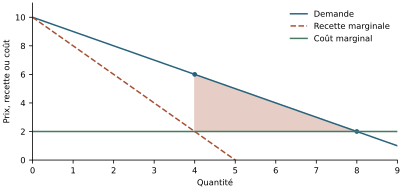
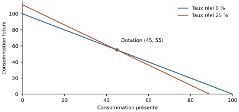
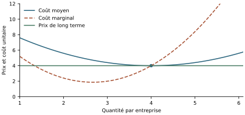
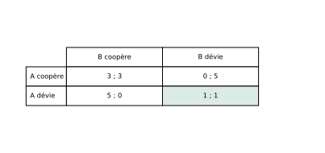
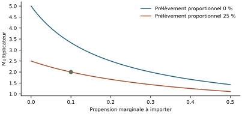

# ENS Rennes D-E — Économie (oral) 2022 · Corrigé guidé

*Corrigé rédigé par IA, non officiel.*

**Rédaction** · GPT-6.2 Astra Ultra · vitesse non renseignée

Le fascicule énumère 24 sujets. Le rapport prévoit trente minutes de préparation, dix minutes environ d’exposé et quinze à vingt minutes de questions. Les développements ci-dessous proposent une argumentation à exposer et les relances servent d’exercices.

## Sujet 1 — Faut-il défendre la concurrence à tout prix ?

> [!INDICATION]
> Calculer la perte sèche avant d’introduire le cas du réseau et celui de l’invention.

Mettre en concurrence les entreprises empêche qu’un vendeur puisse durablement relever son prix en réduisant la quantité. Avec une demande P = 10 − Q et un coût marginal de 2, le prix concurrentiel permet huit échanges. Un monopole qui égalise recette marginale et coût marginal n’en réalise que quatre à un prix de 6. Les quatre transactions perdues auraient pourtant produit un avantage supérieur à leur coût. La politique de concurrence protège ainsi le processus de rivalité et, sous ces hypothèses, le surplus total.

Un réseau où le coût fixe est énorme et le coût marginal faible peut toutefois coûter plus cher s’il est dupliqué. L’accès réglementé à l’infrastructure peut alors rendre possible une rivalité dans les services en aval. Une invention requiert parfois une exclusivité temporaire pour financer sa mise au point. On comparerait la perte de concurrence, les gains vérifiables et un moyen moins restrictif de les obtenir. La concentration ou le succès d’une firme ne suffisent pas à établir un abus.

**Relance.** Faut-il protéger un concurrent moins efficace ?

Le maintien d’une entreprise précise n’est justifié que s’il contribue à un objectif établi. Une sortie due à l’innovation et une éviction destinée à fermer le marché n’ont pas les mêmes effets.

## Sujet 2 — A quoi sert l’égalité épargne investissement ?

> [!INDICATION]
> Commencer par un stock invendu puis comparer les ajustements de quantité et de taux.

En économie fermée, en négligeant les variations de stocks dans la distinction entre investissement prévu et réalisé ou en les incluant dans I, l’identité Y = C + I + G et l’épargne nationale S = Y − C − G donnent S = I. C’est une égalité *ex post* entre grandeurs mesurées de façon cohérente, pas l’assertion que les intentions des ménages et des entreprises coïncident à tout revenu. Un stock invendu compte dans l’investissement réalisé, même si le producteur ne souhaitait pas le constituer.

Si les ménages réduisent simultanément leurs achats pour épargner davantage, les stocks gonflent d’abord. Puis les entreprises peuvent réduire la production et le revenu. Dans une lecture keynésienne, la variation du revenu adapte l’épargne aux projets d’investissement. Dans une lecture où capacité et prix sont flexibles, le taux réel peut contribuer à coordonner les projets. En économie ouverte, l’écart entre épargne nationale et investissement correspond au solde courant sous les conventions cohérentes. Un pays où S = 19 et I = 23 mobilise quatre unités d’épargne nette du reste du monde.

**Relance.** Une hausse de l’épargne désirée garantit-elle quatre points d’investissement de plus ?

Non. Les entreprises peuvent ne pas modifier leurs projets et le revenu peut baisser. L’identité comptable impose l’égalité finale appropriée, elle ne décrit pas seule la causalité.

## Sujet 3 — Optimum de Pareto et bien être

> [!INDICATION]
> Construire deux répartitions toutes deux efficaces mais très différentes pour la personne la moins dotée.

Une allocation est efficace au sens de Pareto lorsqu’il est impossible d’améliorer la situation d’au moins une personne sans dégrader celle d’une autre. Deux allocations très inégales peuvent satisfaire ce test. Distribuer toutes les ressources à une personne peut être efficace dans un exemple à un seul bien strictement apprécié par tous, puisque tout transfert lui retire quelque chose. Le critère indique ainsi des améliorations incontestées au regard des préférences, mais laisse non classées de nombreuses situations.

Le premier théorème du bien-être rattache, sous ses hypothèses, l’équilibre concurrentiel à cette efficacité. Le second précise sous des hypothèses supplémentaires, notamment de convexité, comment redistribution initiale et décentralisation par les prix pourraient être distinguées. En pratique, transferts forfaitaires parfaits, information suffisante et marchés couvrant toutes les conséquences d’un acte font souvent défaut. Juger le bien-être collectif requiert alors de nommer l’arbitrage distributif et de documenter l’effet des instruments. L’efficacité de Pareto fournit une frontière du possible, pas le choix social du point à atteindre.

**Relance.** Une réforme dont les gagnants pourraient indemniser les perdants est-elle une amélioration de Pareto ?

Pas si l’indemnisation reste hypothétique et que certains perdent effectivement. La distinction entre gain total et compensation réalisée est décisive.

## Sujet 4 — Quelles sont les conséquences de l’information asymétrique

> [!INDICATION]
> Dater le fait caché par rapport à la signature et choisir ensuite la réponse institutionnelle.

Une asymétrie d’information existe lorsqu’une partie observe un fait pertinent que l’autre ne connaît pas. Avant le contrat, la sélection adverse peut entretenir une spirale de retrait. Un acheteur de voitures d’occasion prêt à payer seulement la qualité moyenne décourage le vendeur du bon véhicule. La qualité moyenne des véhicules proposés baisse alors avec le prix acceptable. Un marché peut se contracter alors qu’existent des échanges mutuellement avantageux.

Après le contrat, une action mal observable crée un aléa moral. L’assureur qui indemnise une perte ne peut toujours vérifier l’effort de prévention. Une franchise rend une partie du risque à l’assuré mais limite aussi l’assurance de personnes prudentes. Garantie, certification et menu de contrats fournissent des réponses distinctes. Il faut comparer le coût du signal, sa crédibilité, le risque résiduel et les exclusions éventuelles. Plus d’information n’est utile que si elle est pertinente et vérifiable et si les parties comprennent comment l’utiliser.

**Relance.** Pourquoi une garantie peut-elle distinguer deux qualités ?

Si les pannes sont moins probables pour le produit fiable, la garantie lui coûte moins cher. Un vendeur médiocre peut ne pas avoir intérêt à imiter cette offre.

## Sujet 5 — L’explication du chômage involontaire

> [!INDICATION]
> Décrire une entreprise sans débouché et une entreprise qui ne parvient pas à recruter.

Un chômeur involontaire souhaite travailler aux conditions de rémunération en vigueur sans trouver de poste. La définition fait porter l’analyse sur le rationnement des emplois et la coordination des décisions. Une entreprise qui prévoit peu de ventes n’embauchera pas uniquement parce que le coût du travail baisse. Si toutes diminuent les salaires, la demande des ménages peut aussi diminuer. Une baisse de salaire réel utile dans un marché partiel peut donc avoir un effet différent dans l’économie entière.

La rigidité nominale est un mécanisme possible, mais elle n’épuise pas le diagnostic. Un salaire d’efficience peut être choisi par l’entreprise pour retenir ou motiver ses salariés, même si d’autres personnes accepteraient moins. Les frictions d’appariement permettent la coexistence d’emplois vacants et de chômage. L’action pertinente dépend alors des faits. Peu d’offres dans la plupart des secteurs suggèrent une insuffisance de demande, beaucoup d’offres non pourvues dans certaines qualifications justifient d’étudier l’information, la formation et les conditions de travail.

**Relance.** L’existence d’emplois vacants prouve-t-elle que tout chômage est volontaire ?

Non. Une offre peut exiger une qualification ou une mobilité inaccessible au demandeur. Les agrégats ne disent pas si chaque emploi peut être pourvu par chaque personne sans coût.

## Sujet 6 — Choix économiques et arbitrage intertemporel

> [!INDICATION]
> Tracer le budget sur deux dates, puis introduire une limite d’emprunt.

Choisir aujourd’hui peut limiter ce que l’on pourra consommer demain. Avec deux dates, revenus Y₁ et Y₂, un accès sans friction au prêt et à l’emprunt au taux réel r impose C₁ + C₂/(1+r) = Y₁ + Y₂/(1+r). Épargner une unité de consommation présente permet d’acheter 1+r unités futures. À un optimum intérieur, le taux marginal de substitution intertemporelle égale ce prix relatif. Une hausse de r rend la consommation future relativement moins chère mais modifie aussi le revenu des prêteurs et des emprunteurs.

La décision dépend donc de la préférence pour le présent, des revenus attendus et de la situation financière. Un étudiant dont le revenu futur est élevé peut souhaiter emprunter sans que la banque lui accorde le prêt. Sa consommation courante réagit alors fortement à une bourse, contrairement à la prédiction d’un lissage parfait. Le même raisonnement éclaire une entreprise qui compare le coût présent d’une machine aux recettes futures actualisées. Le risque, la liquidité et les effets sur des tiers empêchent cependant de résumer toutes les décisions à un unique taux observé.

**Relance.** Un relèvement du taux incite-t-il nécessairement tout épargnant à épargner plus ?

L’effet de substitution va dans ce sens, mais un prêteur peut atteindre une cible future avec moins d’épargne grâce au rendement accru. Sa réponse totale est ambiguë.

## Sujet 7 — Le retour de l’inflation ?

> [!INDICATION]
> Distinguer clairement la hausse initiale du prix de l’énergie et son effet sur les taux d’inflation ultérieurs.

Au printemps 2022, la remontée des prix s’est imposée après une longue période de faible inflation dans la zone euro. Reprise des consommations, tensions d’approvisionnement et hausse du prix de l’énergie avaient déjà exercé des pressions en 2021, avant l’invasion de l’Ukraine en février 2022. L’inflation est une hausse durable du niveau général des prix. Un choc relatif sur le gaz fait d’abord monter un prix, puis l’indice agrégé selon son poids. La poursuite de l’inflation dépend de la répétition ou de la propagation du choc.

Il faut suivre inflation totale, contributions sectorielles, salaires, marges et anticipations. Si le prix d’un bien augmente une fois puis reste stable, sa contribution au taux annuel disparaît après douze mois, bien que son niveau reste élevé. Une politique monétaire plus restrictive peut limiter la propagation par la demande mais ne produit pas de gaz. Des aides ciblées peuvent protéger les ménages exposés tout en limitant un soutien général à la demande. Le « retour » est observable dans les prix, son caractère permanent reste une hypothèse à tester à la date du concours.

**Relance.** Pourquoi une désinflation ne restitue-t-elle pas à elle seule le pouvoir d’achat perdu ?

Les prix augmentent seulement moins vite. Pour une quantité achetée donnée, il faut aussi regarder l’évolution des revenus nominaux et la structure spécifique de la consommation.

## Sujet 8 — Les déterminants de la croissance

> [!INDICATION]
> Passer du flux d’investissement au stock de capital, puis du stock à la production.

À court terme, produire plus peut consister à utiliser une capacité existante. Une progression durable du produit potentiel mobilise quantité de travail, capital productif et productivité. Dans le modèle de Solow, une accumulation supérieure accroît le capital par travailleur, mais les rendements décroissants font converger vers un niveau plus élevé plutôt que vers une hausse éternelle du taux de croissance par tête. Le progrès technique est déterminant sur le sentier de long terme du modèle.

L’investissement dans l’éducation, les infrastructures et la recherche peut modifier l’efficacité des facteurs. La connaissance est en partie non rivale et ses gains dépassent parfois ceux de l’investisseur. Il faut pourtant que les entreprises puissent adopter les procédés, que les salariés disposent des compétences et que les institutions permettent de financer des projets incertains. Une décomposition comptable du PIB ne suffit pas à prouver une cause. Un résidu de productivité peut refléter mesure imparfaite, réorganisation, meilleure allocation ou innovation. Comparer investissement brut et net, croissance totale et par tête, et effets environnementaux complète le diagnostic.

**Relance.** Une hausse de 10 % de l’investissement implique-t-elle une croissance supérieure de 10 % ?

Non. L’investissement est un flux qui accroît le stock après dépréciation. L’effet sur la production dépend du capital initial, des autres facteurs et du rendement du projet.

## Sujet 9 — Anticipations et politiques économiques

> [!INDICATION]
> Rejouer une même annonce selon qu’elle constitue une surprise ou une règle connue.

Une décision économique modifie les choix avant sa mise en œuvre si elle change ce que les agents attendent du futur. Un ménage anticipant une hausse temporaire d’impôt peut étaler sa consommation ; un investisseur qui attend une baisse des ventes peut renoncer aujourd’hui à une machine. Les anticipations adaptatives révisent une prévision d’après les erreurs passées. Les anticipations rationnelles utilisent l’information pertinente disponible dans le modèle sans exclure une erreur due à un choc inattendu.

La critique de Lucas explique pourquoi une corrélation issue d’une politique ancienne peut changer quand la règle change. Si une relance nominale est systématiquement anticipée, elle ne produit pas nécessairement les effets réels observés après des surprises. Cela n’implique pas l’impuissance de toute politique annoncée. Des prix rigides, des contraintes de crédit ou un engagement crédible sur les taux futurs peuvent transmettre des effets au présent. Le gouvernement doit donc préciser son instrument, l’information dont disposent les agents et les raisons de croire à l’annonce. Une promesse incompatible avec des décisions futures prévisibles a peu de portée.

**Relance.** Une prévision rationnelle est-elle toujours exacte ?

Non. Elle est formée à partir de l’information disponible et du modèle pertinent. Un choc imprévisible peut produire une erreur, sans biais systématique exploitable connu à l’avance.

## Sujet 10 — Contrainte externe et conduite de la politique économique

> [!INDICATION]
> Comparer deux pays au même déficit extérieur, dont un seul emprunte en sa propre monnaie.

La contrainte externe désigne les limites que la balance des paiements, les conditions de financement et le régime de change imposent à une politique. Une relance budgétaire accroît la demande, dont une partie porte sur les importations. Dans une économie qui emprunte en monnaie étrangère, une dépréciation renchérit en outre la valeur domestique des dettes. Il faut distinguer ce risque de bilan d’un déficit courant qui finance des équipements capables d’accroître les recettes futures.

Avec change fixe et forte mobilité des capitaux, un taux domestique durablement inférieur au taux étranger compatible avec le risque exerce une pression sur les réserves. Défendre la parité réduit la liberté de la politique monétaire. En change flexible, l’ajustement du cours amortit certains chocs et peut renchérir les importations. Dans l’union monétaire, il n’existe pas de parité nationale à dévaluer et le taux commun peut convenir inégalement aux membres. La réponse dépend des échéances, de la devise de dette, des capacités productives et de la coordination entre partenaires.

**Relance.** Le solde commercial doit-il être nul chaque année ?

Un déficit soutenable peut financer une activité rentable. La question porte sur l’usage des ressources, la capacité future de financement et le risque d’une interruption brutale des entrées de capitaux.

## Sujet 11 — Le pouvoir de marché

> [!INDICATION]
> Distinguer le prix, la marge sur coût marginal et le profit net après coûts fixes.

Le pouvoir de marché est la capacité de maintenir profitablement un prix au-dessus du coût marginal ou d’influer sur d’autres conditions d’échange. Il dépend de la sensibilité de la demande à la firme, des produits de substitution, des barrières à l’entrée et du pouvoir des acheteurs. Une grande part d’un marché mal défini n’est pas une preuve suffisante. Deux vendeurs peuvent se livrer une vive concurrence si leurs produits sont proches, ou maintenir de fortes marges si leurs clients changent difficilement de fournisseur.

Pour une entreprise qui choisit un prix uniforme avec une demande décroissante, la quantité optimale intérieure égalise recette marginale et coût marginal. La marge relative est d’autant plus grande, toutes choses égales par ailleurs, que la demande adressée à l’entreprise est moins élastique en valeur absolue. Le gain de la firme n’est pas à lui seul une perte pour la collectivité. Le dommage statique vient notamment des échanges mutuellement avantageux que le prix élevé empêche. Un droit exclusif peut aussi soutenir un investissement fixe. Le jugement dépend de la possibilité d’entrée, de la durée, de l’innovation et de la capacité d’exclusion.

**Relance.** Pourquoi le prix élevé d’un médicament ne prouve-t-il pas à lui seul une rente ?

Il faut connaître le coût marginal, les coûts fixes de recherche, les alternatives, les risques et la protection réglementaire. Ces données éclairent des questions différentes de rentabilité et de pouvoir de marché.

## Sujet 12 — Le « pacte de stabilité » a-t-il encore un intérêt aujourd’hui ?

> [!INDICATION]
> Lire la clause dérogatoire comme une disposition du cadre avant d’en juger l’efficacité.

Le pacte de stabilité et de croissance vise à coordonner des budgets nationaux dans une monnaie commune, avec surveillance et procédures correctives. Les références de 3 % du PIB pour le déficit et 60 % pour la dette ne constituent pas des lois économiques universelles. Une difficulté budgétaire nationale peut produire des effets sur ses partenaires et le financement commun. Une règle peut rendre les engagements prévisibles, mais un plafond identique appliqué en pleine récession peut imposer un ajustement qui fait chuter la production.

Au printemps 2022, la clause dérogatoire générale activée en 2020 autorisait des écarts temporaires face à la grave récession. Le pacte n’avait pas cessé d’exister. Cette expérience révèle l’utilité d’une règle capable d’absorber les circonstances exceptionnelles et la difficulté de décider quand revenir à une trajectoire ordinaire. Une cible structurelle atténue la procyclicité, mais dépend d’une production potentielle non directement observable. L’examen de la trajectoire de dette et des coûts d’intérêt complète les chiffres annuels. Le débat utile porte sur une coordination crédible qui préserve stabilisation et investissement, en rendant explicites les conditions d’exception.

**Relance.** Pourquoi le déficit courant peut-il se creuser sans nouvelle dépense votée ?

Les recettes baissent en récession et certaines prestations augmentent automatiquement. Le solde observé doit être distingué de l’impulsion discrétionnaire.

## Sujet 13 — Le niveau d’activité naturel

> [!INDICATION]
> Expliquer comment un écart de production peut se fermer parce que l’activité se redresse ou parce que le potentiel baisse.

Le niveau naturel d’activité désigne, dans le modèle examiné, le niveau compatible avec l’équilibre des marchés lorsque les ajustements nominaux ne créent plus d’écart temporaire de production. Il dépend du travail, de la productivité, du capital, des institutions de fixation des salaires et des marges. Il ne correspond donc ni à un maximum physique ni à une situation nécessairement souhaitable. Un pouvoir de marché qui renchérit les prix à salaire donné peut réduire l’emploi et la production compatibles avec cet équilibre.

La différence entre production effective et production de référence est un écart de production. Lors d’une crise de demande, une partie des capacités peut rester inutilisée et la stabilisation rapprocher les deux niveaux. Une fermeture durable d’entreprises ou la perte de compétences peut aussi réduire la production future de référence, mécanisme d’hystérèse. Cette référence ne s’observe pas directement. Une méthode statistique qui prolonge une tendance et une méthode qui estime facteurs et productivité peuvent diverger, surtout en fin de période. Un seul chiffre incertain ne peut dicter mécaniquement le degré de relance.

**Relance.** Naturel et socialement optimal sont-ils synonymes ?

Non. Une économie peut être à son équilibre de prix flexibles tout en souffrant de monopoles, d’externalités ou de défauts d’appariement.

## Sujet 14 — Le rôle du marché interbancaire pour la création du monétaire

> [!INDICATION]
> Inscrire le crédit, le dépôt et le règlement entre deux banques dans cet ordre.

Quand une banque accorde un crédit, elle inscrit un prêt à son actif et un dépôt au passif. Si son client paie un fournisseur client d’une autre banque, la première doit régler la seconde en monnaie centrale. Le marché interbancaire permet de prêter des réserves entre établissements et de gérer les écarts de liquidité. Il ne transfère pas automatiquement au client des dépôts préalablement recueillis euro pour euro. Un virement entre deux banques redistribue les réserves sans en créer globalement.

La possibilité et le prix du refinancement influencent pourtant le crédit. Si les banques doutent de la solvabilité de leurs partenaires, elles peuvent conserver leurs liquidités. Même une banque possédant des prêts de bonne qualité peut alors supporter un coût de financement élevé. La banque centrale fournit la monnaie de règlement et peut organiser des opérations de refinancement aux conditions qu’elle fixe. L’existence des réserves n’élimine pas les besoins de fonds propres, l’examen des emprunteurs, la rentabilité et la demande de prêts. Le jugement sur une banque exige de distinguer liquidité et solvabilité.

**Relance.** Un prêt interbancaire augmente-t-il le total des réserves bancaires ?

Il change leur répartition entre deux établissements. La création nette de réserves dépend d’opérations au bilan de la banque centrale.

## Sujet 15 — Le modèle classique est-il toujours d’actualité ?

> [!INDICATION]
> Comparer une perte durable de capacité et une baisse temporaire des achats à capacité inchangée.

Dans une représentation classique stylisée, les prix et salaires flexibles coordonnent les marchés et la production réelle dépend des facteurs et des techniques, tandis que la monnaie agit principalement sur les grandeurs nominales à long terme. Ce cadre donne un repère pour étudier rareté, incitations et allocation intertemporelle. Une réduction durable de la capacité énergétique peut, par exemple, limiter la production malgré une demande forte. Une expansion nominale ne recrée pas immédiatement cette ressource.

Le modèle est moins adapté pour expliquer l’ajustement immédiat lorsque salaires et prix sont fixés pour plusieurs périodes, que la finance est contrainte ou que tous les projets dépendent de ventes déprimées. Une baisse de la demande peut produire du chômage involontaire sans baisse rapide des prix. La question empirique est donc celle de l’horizon et des mécanismes dominants, pas celle d’une succession d’écoles définitivement périmées. Les modèles contemporains combinent souvent choix intertemporels et rigidités nominales. Ils retrouvent certains résultats classiques à prix flexibles tout en laissant une place à la stabilisation à court terme.

**Relance.** Que signifie la neutralité monétaire dans ce cadre ?

Une variation proportionnelle de la quantité nominale de monnaie et des prix peut laisser les grandeurs réelles inchangées à l’équilibre de long terme. Elle n’implique pas l’absence de tout effet transitoire.

## Sujet 16 — « Je suppose que tout le monde est keynésien dans les tranchées » (robert Lucas, 2008)

> [!INDICATION]
> Interpréter la métaphore par une défaillance économique précise, puis discuter le passage de l’exception à la règle.

La formule attribuée à Robert Lucas dans le fascicule oppose le temps de l’urgence à celui de la doctrine. En 2008, une rupture du crédit et un effondrement simultané des dépenses rendaient plausible une chute des ventes puis de l’emploi. Une injection de demande ou une assurance collective contre l’arrêt des paiements pouvait empêcher que l’ajustement individuel de précaution n’aggrave le dommage collectif. Cet argument dépend de capacités inutilisées, de rigidités et de défaillances de coordination identifiables.

Il serait excessif d’y voir la disparition de la critique de Lucas. Une intervention exceptionnelle dans une crise inattendue ne renseigne pas directement sur les effets d’une règle permanente que chacun anticiperait. Un soutien à la liquidité, une garantie et un programme durable de dépense ne sont d’ailleurs pas le même instrument. La garantie peut calmer les retraits aujourd’hui tout en encourageant trop de risque demain si aucune contrepartie ne l’accompagne. La question est de concevoir une action crédible dans les deux états du monde, avec capacité de réaction, conditions de retrait et répartition explicite des risques. La citation ouvre une enquête sur les circonstances, elle ne démontre aucun multiplicateur.

**Relance.** Une action efficace en crise est-elle nécessairement efficace en période de plein emploi ?

À forte sous-utilisation, une hausse de demande peut augmenter surtout la production. À capacité saturée, elle peut surtout relever les prix ou déplacer d’autres usages.

## Sujet 17 — « La monnaie est une chose trop sérieuse pour la confier aux banques centrales. » M. Friedman

> [!INDICATION]
> Relier la citation à une proposition monétariste datée avant d’examiner les limites du pilotage automatique.

La formule attribuée par le sujet à Milton Friedman se comprend comme une critique du pouvoir discrétionnaire sur une institution essentielle. La monnaie assure paiement, unité de compte et réserve de valeur. Une décision de taux modifie les conditions de crédit et agit avec des délais variables. Si l’autorité tente de corriger chaque fluctuation à partir d’informations révisées tardivement, elle peut amplifier le cycle. Une règle prévisible, comme la croissance régulière d’un agrégat dans la proposition monétariste, cherche à limiter ces erreurs.

Le choix de l’agrégat suppose cependant un lien suffisamment stable avec la demande et les prix. Une modification des moyens de paiement ou une panique peut rendre la règle rigide coûteuse. Il faut alors distinguer délégation des instruments et choix démocratique du mandat. Une banque centrale indépendante peut expliquer comment elle remplit un objectif défini par la collectivité et rendre compte des écarts. Un prêteur en dernier ressort peut aussi avoir besoin de distinguer un besoin de liquidités et une insolvabilité. J’aboutirais à une discrétion encadrée par des objectifs, une justification publique et des règles d’intervention, plutôt qu’à une opposition absolue entre règle et banquier central.

**Relance.** Une règle de taux et une règle de quantité de monnaie sont-elles équivalentes ?

Elles ne réagissent pas de la même manière à un déplacement de la demande de monnaie. Stabiliser une quantité peut laisser varier fortement le taux et inversement.

## Sujet 18 — Les déterminants de la fonction de consommation

> [!INDICATION]
> Comparer une prime exceptionnelle à une hausse de salaire jugée permanente.

La fonction keynésienne simple C = C₀ + cYd, avec 0 < c < 1, relie consommation et revenu disponible courant. Si c = 0,75 et si les autres paramètres restent fixes, un revenu supplémentaire de 100 augmente les achats de 75. Il s’agit d’une propension marginale. La propension moyenne C/Yd dépend en outre du terme autonome et peut différer fortement pour deux niveaux de revenu. Ce modèle est utile pour suivre la propagation d’un choc, surtout lorsque les ménages peuvent peu emprunter.

Les approches du revenu permanent et du cycle de vie font dépendre le choix de l’ensemble des ressources anticipées. Une prime isolée et une hausse durable du salaire ne produisent pas nécessairement la même dépense immédiate. Patrimoine, âge, incertitude, taux réel et accès au crédit modifient aussi l’arbitrage. Un ménage à court de liquidités peut consommer une part importante d’un transfert ponctuel, tandis qu’un ménage qui redoute de perdre son emploi accroît son épargne de précaution. À la suite de restrictions sanitaires, une hausse des dépôts peut traduire à la fois inquiétude et impossibilité d’acheter certains services. Les données agrégées ne permettent pas seules de trancher.

**Relance.** Un taux d’épargne élevé prouve-t-il que les ménages souhaitent moins consommer à long terme ?

Il peut refléter un revenu temporaire élevé ou une occasion de consommation empêchée. Il faut distinguer projets futurs, évolution de patrimoine et contraintes présentes.

## Sujet 19 — L’équilibre concurrentiel à long terme

> [!INDICATION]
> Placer coût moyen et coût marginal sur le même diagramme et marquer les entrées de firmes.

Dans une branche concurrentielle, chaque firme prend le prix comme donné. À l’intérieur d’un intervalle où elle produit, elle choisit une quantité pour laquelle prix et coût marginal coïncident si l’optimum est intérieur. À court terme elle peut couvrir ses coûts variables tout en ne couvrant pas ses coûts fixes. À long terme, entrée et sortie ajustent le nombre de firmes lorsque la technologie est accessible et qu’aucune barrière ne protège les producteurs établis.

Avec firmes identiques et coûts moyens en U, la libre entrée conduit, dans le modèle standard à prix des facteurs constants, à l’égalité entre prix, coût marginal et minimum du coût moyen. Le profit économique nul inclut la rémunération normale du capital et du travail de l’entrepreneur. Un profit comptable positif n’est donc pas une réfutation directe. Si un facteur rare est possédé par quelques entreprises ou si les coûts d’entrée sont irrécupérables, une rente ou des écarts durables peuvent subsister. Une hausse de demande entraîne d’abord prix et profits, puis l’arrivée et l’expansion de capacités. Le rythme de ces phases explique la différence entre une observation ponctuelle et l’équilibre de long terme.

**Relance.** Pourquoi une entreprise resterait-elle si le profit est nul ?

Ses coûts économiques incluent déjà la rémunération normale de ses facteurs. Elle obtient autant que dans la meilleure possibilité concurrente, sous les hypothèses du modèle.

## Sujet 20 — Comment faire partie de l’Union Economique et Monétaire ?

> [!INDICATION]
> Distinguer les critères de convergence du traité et les propriétés économiques d’une zone monétaire optimale.

L’Union économique et monétaire associe coordination économique et monnaie unique pour les États de la zone euro. La question de l’adoption ne se réduit pas à fixer son taux de change un jour donné. Le rapport de convergence examine la stabilité des prix, la soutenabilité des finances publiques, la stabilité du change au sein du mécanisme MCE II et la convergence des taux d’intérêt à long terme. Il faut aussi vérifier la compatibilité juridique nationale, notamment le statut de la banque centrale, avec les traités.

Le critère de change exige au moins deux ans dans le mécanisme sans tensions graves et sans dévaluation de la parité centrale à l’initiative de l’État. Les références de déficit et de dette s’insèrent dans l’examen des finances publiques, avec les conditions prévues par les textes. Ces critères mesurent une convergence nominale. Une convergence des productivités, des cycles et des capacités d’absorption des chocs n’en découle pas automatiquement. Une fois le change national abandonné, mobilité, ajustement des revenus et mécanismes de partage du risque deviennent importants. En 2022 on distinguera la participation actuelle d’un État, les évaluations préalables et l’adoption effective ultérieure de l’euro.

**Relance.** Le change fixe contre l’euro suffit-il à devenir membre ?

Non. Le mécanisme de change est un critère parmi d’autres. L’évaluation institutionnelle et juridique précède la décision d’adoption au niveau de l’Union.

## Sujet 21 — Ressources communes et biens publics

> [!INDICATION]
> Faire varier la rivalité tout en gardant l’exclusion difficile.

Une ressource commune est rivale et difficilement excluable. Prendre de l’eau dans une nappe réduit ce qui reste disponible pour les autres usagers. Un bien public pur est non rival et non excluable. Un habitant supplémentaire bénéficie de l’alerte diffusée par une sirène sans en priver les autres. La difficulté commune est de faire apparaître la totalité des conséquences d’une décision individuelle. Ses effets sont différents. Une ressource commune risque d’être surexploitée tandis qu’un bien public risque d’être produit en quantité insuffisante.

Dans la nappe, chaque prélèvement procure un gain privé alors que l’épuisement réduit les possibilités collectives. Des règles de prélèvement, des droits d’usage et une surveillance acceptée par les membres peuvent préserver le stock. Pour l’alerte, chacun peut espérer que les autres financent le service et en profiter ensuite. Un financement obligatoire ou une organisation collective peut résoudre le problème. L’accès peut d’ailleurs changer avec la technique et les institutions, et la non-rivalité peut disparaître en présence de congestion. La bonne question est donc de savoir qui peut être exclu, à quel coût et à partir de quel niveau d’usage l’un prive l’autre.

**Relance.** Un lac public est-il un bien public pur ?

Son statut juridique n’en décide pas. La vue sur le lac peut être peu rivale, la pêche l’est puisque chaque poisson capturé manque aux autres.

## Sujet 22 — Le dilemme du prisonnier

> [!INDICATION]
> Montrer les deux meilleures réponses de chaque joueur avant de comparer les équilibres et les gains collectifs.

Deux producteurs ont chacun intérêt à accroître une production polluante si l’autre se restreint, mais ensemble ils préféreraient des restrictions réciproques. Une matrice illustrative donne 3 chacun si les deux coopèrent, 1 chacun s’ils font défection, et 5 au défecteur contre 0 au coopérant en cas de désaccord. Pour chaque action adverse, faire défection rapporte plus. La double défection est un équilibre de Nash et les deux gagneraient à passer à la coopération mutuelle. L’inefficacité vient ici de la structure des incitations, pas d’une incompréhension des gains.

Une interaction répétée peut permettre une coopération conditionnelle si les comportements sont observables, les participants assez patients et l’avenir assez important. Avec une fin certaine et des hypothèses fortes, le raisonnement à rebours peut néanmoins défaire la coopération. Une institution qui contrôle les engagements ou change le coût de la défection peut également modifier l’issue. Ces applications exigent de vérifier les gains. Deux magasins qui s’entendraient sur des prix élevés peuvent résoudre leur propre problème de coopération en nuisant aux consommateurs. Un résultat meilleur pour les joueurs du modèle n’est pas toujours meilleur pour la collectivité.

**Relance.** Un accord verbal change-t-il nécessairement l’équilibre du jeu à un seul tour ?

S’il n’engage personne et ne change ni les gains ni l’information pertinente, l’incitation individuelle à dévier reste présente.

## Sujet 23 — Structures de marché et efficacité

> [!INDICATION]
> Choisir un critère d’efficacité et faire varier uniquement la structure ou le type de compétition.

La structure d’un marché influence les décisions sans les déterminer à elle seule. Sous concurrence parfaite, prix et coût marginal coïncident sous les hypothèses du modèle. Sous monopole avec demande décroissante, l’entreprise uniforme choisit la quantité qui égalise recette et coût marginaux et peut renoncer à certains échanges efficaces. Dans un oligopole, la réaction dépend de la variable stratégique. Un même duopole peut produire des marges différentes selon la différenciation, les capacités, le choix des prix ou celui des quantités.

Il faut ensuite distinguer efficacité productive, allocative et dynamique. Une usine de réseau peut produire à moindre coût qu’un émiettement de petits réseaux. Un monopole libéré de la pression concurrentielle peut inversement réduire ses efforts de productivité. Une protection temporaire peut financer une innovation, mais renforcer une entreprise établie peut aussi fermer l’entrée à un innovateur. L’évaluation d’une concentration demande donc de définir le marché, ses alternatives et ses barrières, puis de comparer effets sur les prix, la qualité et les investissements. Le seul comptage des entreprises ne fournit pas ce bilan.

**Relance.** Un duopole est-il toujours moins efficace qu’un marché à dix producteurs ?

Non. Les coûts fixes, l’intensité de la rivalité, l’accès aux clients et l’ampleur des économies d’échelle peuvent inverser cette comparaison.

## Sujet 24 — Les multiplicateurs de politique économique

> [!INDICATION]
> Calculer le multiplicateur avec fuites puis expliquer pourquoi un chiffre estimé dépend du moment et de l’instrument.

Un multiplicateur rapporte la variation d’une grandeur, par exemple le PIB, à une impulsion de politique économique en précisant l’horizon. Dans un modèle de demande à prix fixes, avec propension à consommer c, taux proportionnel de prélèvement t et propension marginale à importer m, le multiplicateur d’une dépense publique autonome est 1/[1−c(1−t)+m]. Avec c = 0,8, t = 0,25 et m = 0,1, il vaut 2. La commande initiale est une dépense directe. Une baisse d’impôt forfaitaire ne devient demande initiale qu’à hauteur de la fraction consommée.

Cette formule maintient investissement et conditions monétaires constants. Si la banque centrale réagit à l’inflation par une hausse de taux, une partie de la stimulation peut être compensée. À capacité inutilisée, avec taux contraints et ménages manquant de liquidités, l’effet réel peut être plus grand que près du plein emploi. Une politique monétaire a également des effets amplifiés par le crédit et les anticipations, mais il faut définir l’unité du choc, par exemple variation de PIB pour un point de taux. Une estimation empirique doit isoler une décision indépendante de la conjoncture, car les budgets se dégradent spontanément en récession.

**Relance.** Pourquoi le rapport entre déficit et variation du PIB ne donne-t-il pas le multiplicateur ?

Le déficit contient des réactions automatiques au revenu, des intérêts et des mesures différentes. Il faut isoler l’impulsion et définir un scénario de comparaison.

[Sujets officiels](https://www.ens-rennes.fr/medias/fichier/annales-e-preuve-orale-d-e-conomie-d-e-2022_1683016679967-pdf) · [Rapport du jury](https://www.ens-rennes.fr/medias/fichier/rapport-de-jury-economie-oral-d-e-2022_1668097918939-pdf)
