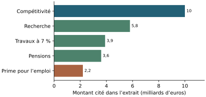

# ENS Rennes D-E — Entretien (oral) 2022 · Corrigé guidé

*Corrigé rédigé par IA, non officiel.*

**Rédaction** · GPT-6.2 Astra Ultra · vitesse non renseignée

Les 22 tirages de ce fascicule de 44 pages appellent une réflexion personnelle de dix minutes au maximum. Les questions servant de titres et les relances sont proposées pour l’entraînement. Les renvois de pages suivent le fascicule distribué, y compris pour les extraits de la même œuvre.

## Sujet 1 — Qui peut prendre part à une décision scientifique ?

*Fascicule, pages 1 à 2.*

> [!INDICATION]
> Séparer l’autorité sur un constat et la légitimité de fixer le critère de décision.

Lévy-Leblond soulève un paradoxe démocratique. Le pouvoir d’autoriser une installation ou d’en accepter le coût concerne tous les citoyens. Les compétences permettant de juger sa solidité sont distribuées entre plusieurs métiers. Le physicien interrogé sur une centrale peut expliquer le phénomène physique tout en dépendant, pour le béton et les fissures, du génie civil et des métallurgistes. À quel moment la parole d’expert éclaire-t-elle un choix commun ?

**I. Délimiter l’expertise.** A. Spécialités scientifiques. B. Questions restant techniques.

**II. Organiser le choix collectif.** A. Débat sur les valeurs. B. Réponse publique aux objections.

L’égalité politique commande d’abord de rendre contestables les hypothèses et les critères du choix. Le regroupement de faits sous l’autorité d’un savant cache les incertitudes et les spécialités. Mais égale participation ne donne pas une égale validité à toute affirmation factuelle. Des auditions contradictoires permettent de savoir qui a vérifié quoi. Ensuite, même une expertise convergente ne décide pas de la répartition entre un bénéfice collectif et un risque local. Une assemblée peut demander ce qu’apporterait une autre solution et qui répondrait des conséquences. L’auteur a raison d’élargir la culture des scientifiques à l’histoire de leurs propres pratiques. Encore faut-il donner aux non-spécialistes temps, documents et prise effective sur la décision.

**Relance.** Une consultation du public suffit-elle ?

Elle doit intervenir avant que les options soient closes et laisser une trace des objections et de la réponse qui leur a été donnée.

## Sujet 2 — Comment apprécier la contribution économique de la recherche ?

*Fascicule, pages 3 à 4.*

> [!INDICATION]
> Comparer une innovation commercialisée et une compétence de recherche durable.

Lévy-Leblond conteste deux enchaînements fréquents, celui qui attribue chaque innovation à une découverte récente et celui qui déduit d’une pénurie d’ingénieurs annoncée la nécessité de diffuser une culture scientifique. Une modification de téléphone peut répondre à un calendrier commercial. Elle ne dit presque rien de la date des connaissances qui ont permis les composants. Que peut mesurer l’argument économique ?

**I. Suivre la production d’innovations.** A. Calendrier du marché. B. Temps long des découvertes.

**II. Évaluer la recherche.** A. Compétences d’appropriation. B. Indicateurs par secteur.

Le financement sur quelques années rend visible un livrable et encourage les découvertes applicables. Il peut aussi écarter le travail lent dont aucun client immédiat ne capte le bénéfice. L’auteur mobilise l’idée d’une capacité à comprendre la recherche conduite ailleurs. Une équipe compétente constitue un moyen de tester et d’adapter une connaissance qu’elle n’a pas initiée. Cette valeur est réelle, mais difficile à isoler d’un investissement de formation ou d’équipement. La succession des modèles de téléphone ne démontre inversement pas que toute innovation est superficielle. Comparer des secteurs, suivre les délais entre travaux et applications et regarder les carrières effectives permettrait de tester les deux propositions. Le motif économique éclaire une politique scientifique sans résumer la valeur de connaître.

**Relance.** Un résultat inutilisé est-il économiquement inutile ?

Sa valeur peut inclure une capacité acquise ou un résultat négatif qui évite des dépenses. Il faut en chercher la trace au lieu de la présumer.

## Sujet 3 — Que transmet-on lorsque l’on diffuse la culture scientifique ?

*Fascicule, pages 5 à 6.*

> [!INDICATION]
> Choisir un savoir précis et distinguer son énoncé, sa preuve et son usage.

Les initiatives de diffusion supposent souvent qu’un savoir constitué passe du savant au public. Lévy-Leblond demande ce que l’expression recouvre effectivement. Il rapproche l’enseignement des sciences de celui de la philosophie, où discuter les œuvres et leurs objections fait partie de la formation. Connaître davantage de résultats suffit-il à comprendre ce que fait un scientifique ?

**I. Préciser la culture transmise.** A. Savoir et preuve. B. Rôle de l’histoire.

**II. Examiner son appropriation.** A. Questions du public. B. Évaluation du jugement.

La diffusion de connaissances exactes donne des prises communes. Apprendre à lire un graphique est déjà une acquisition mesurable. La métaphore d’une diffusion à sens unique efface toutefois la construction du problème, les controverses passées et les questions posées par les destinataires. Introduire l’histoire d’une preuve rend visibles les erreurs corrigées et la différence entre doute méthodique et opinion arbitraire. On ne peut pourtant transposer à chaque cours toute l’histoire de sa discipline. L’enseignement doit sélectionner des épisodes qui changent effectivement l’interprétation d’un résultat. Enfin, l’adhésion au progrès économique n’est pas un indicateur suffisant de culture. Une personne peut connaître un mécanisme et refuser certains usages pour des motifs raisonnés.

**Relance.** Quelle épreuve montrerait ce progrès ?

Demander à un élève d’expliquer ce qui ferait réviser une conclusion et de reconnaître une objection déjà examinée.

## Sujet 4 — Dans quelles conditions le sport émancipe-t-il ?

*Fascicule, pages 7 à 8.*

> [!INDICATION]
> Comparer le public, les pratiquants et les personnes qui établissent les règles.

Igor Martinache replace le sport moderne dans les institutions qui ont instauré règles, classements et comparaisons. Une championne qui s’entraîne six heures par jour et une randonnée occasionnelle figurent sous le même mot. Ce rapprochement a une force critique. Il pose aussi un problème de définition. La valeur sociale du sport se déduit-elle de son origine compétitive ?

**I. Identifier les institutions sportives.** A. Comparabilité des performances. B. Sélection par les ressources.

**II. Tester une émancipation.** A. Partage des recettes. B. Participation aux décisions.

Les classements rendent la performance lisible et autorisent des participants éloignés à partager un jeu. Ils favorisent aussi une sélection lorsque l’accès aux terrains, aux soins et au temps d’entraînement est inégal. La distribution des recettes entre organisateurs, intermédiaires et pratiquants mérite alors une enquête distincte de celle des médailles. La généalogie des écoles britanniques explique certains traits du sport codifié, sans fixer tous les usages présents. Un club peut permettre l’apprentissage de règles communes et laisser les mêmes membres à l’écart des décisions. Demander qui fixe l’horaire, qui peut payer et qui dirige le club traduit l’émancipation en critères observables. La randonnée invite enfin à ne pas évaluer toute pratique avec le seul palmarès de la compétition.

**Relance.** La popularité d’un spectacle prouve-t-elle son ouverture ?

Le nombre de spectateurs renseigne sur l’audience. Il faut d’autres données pour connaître l’accès à la pratique et à ses instances dirigeantes.

## Sujet 5 — Quand une appartenance devient-elle exclusive ?

*Fascicule, pages 9 à 10.*

> [!INDICATION]
> Tester l’argument sur une appartenance choisie et sur une appartenance assignée.

Dans l’extrait de Roland Gori, l’identité se construit à la rencontre de plusieurs appartenances. L’idée empruntée à Amin Maalouf est qu’une appartenance devient dangereuse si elle exige de disqualifier toutes les autres. Expliquer ce processus aide à résister aux assignations qui rendent deux voisins incompatibles en dépit d’une histoire largement partagée. Mais la pluralité suffit-elle à protéger du rejet ?

**I. Décrire l’assignation exclusive.** A. Pluralité des rôles. B. Injonction de loyauté.

**II. Discuter ses effets.** A. Médiations institutionnelles. B. Droit au désaccord.

Une identité composée laisse choisir le registre pertinent selon la situation, par exemple profession ou langue commune. L’exigence de choisir un camp unique réduit ces possibilités et transforme le désaccord en défaut de loyauté. Cette analyse explique la force de certains discours. Elle ne suffit pas à établir une séquence nécessaire entre sentiment d’appartenance et violence. Il faut étudier institutions, discriminations et règles qui récompensent l’exclusion. Le caractère choisi ou subi d’une identité compte aussi. Une minorité peut se nommer pour demander l’égalité et conserver une pluralité interne. La proposition la plus solide est donc politique et vérifiable. Une personne peut-elle revendiquer un droit ou contester un porte-parole sans être réputée étrangère au groupe ?

**Relance.** Une identité collective forte est-elle nécessairement exclusive ?

Un collectif peut défendre une langue ou un droit et reconnaître en même temps les appartenances et désaccords de ses membres.

## Sujet 6 — L’unité d’une personne suppose-t-elle qu’elle soit homogène ?

*Fascicule, pages 11 à 12.*

> [!INDICATION]
> Identifier le point où l’extrait passe de l’individu biologique à une collectivité politique.

Roland Gori interroge l’étymologie d’individu, ce qui ne se divise pas. Il convoque la pluralité des instances psychiques et l’organisation du vivant pour contester l’existence d’une essence simple. Les stéréotypes prêtant un caractère immuable à toute une nation en disent souvent plus sur l’observateur que sur les personnes observées. Comment penser une continuité qui accueille les différences ?

**I. Penser une identité composée.** A. Conflits de rôles. B. Stéréotypes collectifs.

**II. Expliquer la continuité.** A. Limites de l’analogie biologique. B. Récit personnel et institutions.

Une personne peut tenir des rôles contradictoires et demeurer identifiable à travers sa mémoire et ses engagements. Cela permet de contester les diagnostics qui enferment une collectivité dans une seule disposition. L’analogie entre un organisme composé et une nation diverse rencontre néanmoins une limite. Des organes n’ont pas les mêmes droits ou possibilités de contestation que des citoyens. Passer du vivant à la politique réclame une justification autonome. La continuité peut reposer sur des pratiques, une histoire discutée et des institutions dans lesquelles l’adhésion varie. Un changement de langue usuelle au cours d’une vie illustre la transformation d’une appartenance sans disparition du sujet qui en répond. Le critère pertinent devient la possibilité de raconter et de réviser cette trajectoire.

**Relance.** Une catégorie collective a-t-elle encore une valeur descriptive ?

Elle peut révéler une inégalité statistique, à condition d’examiner les différences internes et de ne pas prédire mécaniquement le caractère individuel.

## Sujet 7 — Pourquoi la demande d’identité peut-elle servir un pouvoir autoritaire ?

*Fascicule, pages 13 à 14.*

> [!INDICATION]
> Transformer une analogie politique en hypothèse comparative vérifiable.

Gori relie uniformisation mondiale et fragmentation culturelle. Lorsque les lieux d’échange se raréfient, une identité présentée comme intacte peut sembler restaurer une maîtrise perdue. Le texte rapproche des mouvements qui rejettent le pluralisme, valorisent une seule voix publique et disqualifient la critique. Cette ressemblance formelle dispense-t-elle d’expliquer chaque contexte ?

**I. Examiner une demande d’identité.** A. Transformation économique. B. Disqualification des contradicteurs.

**II. Tester l’explication.** A. Comparaison entre contextes. B. Institutions de représentation.

L’intérêt de l’analyse est de décrire un mécanisme d’exclusion des voix discordantes. On peut observer ce qu’il advient d’un membre qui conteste son porte-parole ou d’une institution qui publie une objection. La faiblesse serait d’attribuer les mêmes causes à des phénomènes historiquement différents sur la seule base de ce vocabulaire. Ni religion, ni mondialisation, ni condition économique n’explique isolément des trajectoires aussi diverses. Un contre-exemple utile serait une région économiquement bouleversée où de nouvelles institutions de représentation entretiennent des liens entre groupes. En comparant des cas exposés à des contraintes proches, on pourrait mieux distinguer explication sociale et qualification morale. Préserver le droit au désaccord est alors une conclusion institutionnelle plus précise qu’une condamnation générale du besoin d’appartenance.

**Relance.** Comment éviter de stigmatiser une religion entière ?

Étudier des organisations, des pratiques et leurs contradicteurs au sein même de chaque tradition. Un discours prétendant représenter tous les croyants doit aussi être discuté.

## Sujet 8 — Qui choisit l’emploi du budget derrière une réduction d’impôt ?

*Fascicule, pages 15 à 16.*

> [!INDICATION]
> Imaginer le même don en présence puis en l’absence de l’allégement fiscal.

Le passage adapté de Katia Weidenfeld souligne qu’une dépense fiscale associe décision publique et initiative privée. Le Parlement définit les dépenses éligibles, puis le contribuable choisit de donner ou d’investir et désigne parfois un bénéficiaire. Un euro de réduction vaut un euro de recette en moins par rapport à un régime de référence. Le partage du financement garantit-il un gain démocratique ?

**I. Décrire la décision partagée.** A. Incitation publique. B. Choix des donateurs.

**II. Évaluer sa légitimité.** A. Dépense additionnelle. B. Égalité d’accès au dispositif.

L’incitation peut susciter une action qui, sans elle, n’aurait pas eu lieu. Mais le texte ne peut déduire l’économie réalisée du seul taux de réduction. Si le contribuable aurait donné la même somme, l’État subventionne un choix ancien. Si le dispositif mobilise de nouvelles ressources, le gain dépend encore de l’utilité de leur destination. La critique démocratique porte ensuite sur l’inégale capacité à orienter l’argent public. Une personne peu imposée accède mal à une réduction non remboursable. Un crédit remboursable changerait cette incidence. Publier le coût, comparer une subvention soumise au vote et vérifier où va l’argent rendraient possible la discussion. Le jugement porte ici sur l’extrait modifié, non sur l’ensemble de l’article.

**Relance.** Un mécénat peut-il rester démocratiquement légitime ?

Oui, si les objectifs et conditions sont publics, les bénéficiaires diversifiés et l’effet supplémentaire suffisamment établi au regard du coût.

## Sujet 9 — Que mesure le coût annoncé d’une niche fiscale ?

*Fascicule, pages 17 à 18.*

> [!INDICATION]
> Donner une même mesure avec deux références possibles puis discuter sa distribution.

L’autre extrait de Weidenfeld examine la fabrication du chiffre. Pour chiffrer une exception, il faut choisir une règle normale. Une même mesure sera classée comme exception ou élément constitutif du barème selon la référence. L’addition de dispositifs hétérogènes produit un montant frappant qui ne constitue pas encore un programme d’économies réalisables. Comment en tirer une critique sociale précise ?

**I. Construire le coût fiscal.** A. Norme de référence. B. Limites d’une addition.

**II. Discuter l’incidence.** A. Réponses comportementales. B. Distribution des avantages.

Les chiffres de l’article classent entre autres le crédit d’impôt recherche, le taux de travaux et la prime pour l’emploi. Ils se rapportent à la période étudiée. Un total statique ne dit ni comment les contribuables changeraient de comportement ni qui supporterait la suppression. Il serait pourtant excessif d’en déduire que le chiffrage est inutile. Publier la norme de référence, une fourchette et la distribution des bénéficiaires permet de comparer des alternatives. Une mesure dont le coût est élevé peut soutenir des ménages modestes, tandis qu’une petite mesure peut se concentrer sur quelques patrimoines. Le contrôle social porte ainsi sur l’incidence et le résultat, au-delà de la seule visibilité du montant. Il faut tenir compte de la coupure explicite dans le document distribué.

**Relance.** Peut-on récupérer tout le montant affiché en supprimant la mesure ?

Cela suppose des bases et des comportements inchangés, notamment l’absence de report vers un autre dispositif. Cette hypothèse doit être testée.

## Sujet 10 — Un changement de vocabulaire transforme-t-il l’école ?

*Fascicule, pages 19 à 20.*

> [!INDICATION]
> Suivre un devoir de sa consigne jusqu’à sa correction, dans deux configurations.

Gemma Serrano part des mots nouveaux employés pour décrire l’école numérique. Ils rendent pensables des espaces de travail au-delà de la salle de classe, la disponibilité de documents et de nouveaux gestes. Une promesse lexicale ne garantit pourtant pas une activité pédagogique différente. Comment l’observer ?

**I. Analyser les mots de l’école.** A. Promesses de participation. B. Anciennes tâches renommées.

**II. Observer les transformations.** A. Conditions matérielles. B. Travail scolaire réellement acquis.

Le vocabulaire peut d’abord légitimer des expériences. Dire qu’un élève contribue à un travail collectif autorise la publication et la révision mutuelle de productions. Il peut aussi rebaptiser une activité ancienne, par exemple des exercices individuels distribués à l’écran. Il faut donc regarder la tâche, le temps de réponse et le rôle de l’enseignant. Ensuite le corps et l’espace ne disparaissent pas. La possibilité de travailler ailleurs dépend d’un équipement, d’un lieu calme et des règles qui rendent une interaction possible. Une comparaison de deux classes utilisant le même outil mais poursuivant des objectifs différents éclairerait cette médiation. Une réforme peut réussir en développant une capacité d’expression tout en obligeant à revoir le coût de préparation pour les enseignants.

**Relance.** Quel indicateur ferait apparaître un changement réel ?

Observer les révisions qu’un élève apporte après une critique documentée de ses pairs, et vérifier s’il sait ensuite expliquer seul cette révision.

## Sujet 11 — Comment faire d’un usage numérique un savoir partagé ?

*Fascicule, pages 21 à 22.*

> [!INDICATION]
> Donner un exemple où deux élèves passent autant de temps devant l’écran mais apprennent différemment.

Dans ce second extrait, Serrano décrit le numérique comme une culture faite de techniques, de pratiques et de dispositifs sociaux. Savoir utiliser une application ne suffit pas à comprendre le classement de ses contenus ou à modifier la tâche qu’elle propose. La distinction entre usagers et personnes capables d’agir sur l’outil combat l’idée d’une génération uniformément compétente.

**I. Définir la culture numérique.** A. Usages ordinaires. B. Compréhension du classement.

**II. Distribuer les apprentissages.** A. Rôles au sein du groupe. B. Réutilisation individuelle.

Un professeur peut faire comparer les sources mobilisées par un groupe et organiser l’explication des critères de sélection. Cela fait de la coopération un apprentissage explicite. Mais mettre des élèves autour d’un écran ne distribue pas spontanément le pouvoir d’essayer, d’écrire ou de corriger. Le même élève peut manipuler pendant que d’autres regardent. Des rôles tournants et une évaluation individuelle ultérieure permettraient de vérifier l’apprentissage. L’analogie avec une culture invite aussi à examiner le temps nécessaire pour que des professionnels préparent et critiquent ensemble une activité. L’âge prédit mal cette disponibilité. Le succès serait la capacité durable de choisir, vérifier et discuter une pratique dans une situation nouvelle.

**Relance.** Que devient l’expertise du professeur ?

Il lui revient notamment de choisir une tâche où l’erreur peut apparaître et de vérifier ce que chaque participant a compris, même s’il découvre certains outils avec les élèves.

## Sujet 13 — Transmettre peut-il apprendre à penser par soi-même ?

*Fascicule, pages 23 à 24.*

> [!INDICATION]
> Suivre une règle transmise par un adulte et réutilisée dans une discussion entre élèves.

Dans l’entretien de Dominique Ottavi avec Nathalie Sarthou-Lajus, l’opposition entre l’adulte qui transmet et l’élève qui apprend masque les apprentissages entre pairs et les transmissions implicites. La prétention de Watson à former à volonté les enfants à n’importe quelle destinée donne la mesure d’un autre danger, croire le sujet entièrement modelable. Où situer la responsabilité de l’éducateur ?

**I. Identifier ce qui se transmet.** A. Règles scolaires explicites. B. Apprentissages entre pairs.

**II. Former le jugement.** A. Responsabilité de l’adulte. B. Droit de demander des raisons.

Une transmission explicite offre à des enfants inégalement familiers des codes scolaires un accès à des règles qu’ils auraient sinon à deviner. Elle suppose cependant une appropriation. Copier une démonstration ne permet pas nécessairement de reconnaître quand l’utiliser. Faire discuter des solutions entre élèves peut rendre ce travail visible. Mais laisser le groupe décider seul peut conforter les hiérarchies de parole. L’adulte reste responsable du cadre, du droit au désaccord et de l’exactitude des savoirs. La culture commune d’Ottavi se mesure alors à la possibilité d’interroger une proposition sans exclure celui qui l’a émise. Apprendre à juger par soi-même suppose la transmission des moyens de discuter celui qui enseigne.

**Relance.** Comment distinguer autorité éducative et argument d’autorité ?

La première aménage les conditions d’un apprentissage et rend ses critères explicites. Un argument devient discutable lorsque l’élève a accès aux raisons qui l’étayent.

## Sujet 14 — Peut-on comprendre un conflit sans son histoire politique ?

*Fascicule, pages 25 à 26.*

> [!INDICATION]
> Séparer intention déclarée, explication historique et jugement de légitimité.

Le texte de Rosinski, tronqué et modifié, reprend la formule de Clausewitz sur la continuité entre politique et guerre. Son problème est explicatif. Cesser d’échanger des notes diplomatiques signifie-t-il que les relations politiques cessent ? Les divergences évoquées entre Bismarck et Moltke montrent déjà que les autorités qui agissent au nom d’un État ne poursuivent pas nécessairement le même objectif.

**I. Rendre compte d’une continuité politique.** A. Désaccord des autorités. B. Histoire institutionnelle.

**II. Délimiter l’explication.** A. Incertitudes et révisions. B. Expériences des populations.

Lire le conflit comme fait politique permet de demander quels intérêts sont invoqués, comment des institutions les définissent et qui répond de leurs conséquences. Cette lecture retire à la violence l’apparence d’une rupture sans histoire. Elle pourrait cependant donner aux décisions une cohérence rétrospective excessive. Les projets initiaux changent, des événements imprévus affectent les populations et le désaccord traverse les institutions. L’intention d’un gouvernement n’épuise pas les histoires subies par les civils. Une histoire comparée devrait donc confronter discours publics, archives de décision et expériences sociales. La continuité politique est une méthode d’enquête, sans constituer ni une prédiction suffisante ni une justification morale.

**Relance.** Une explication politique excuse-t-elle les actes ?

Décrire les raisons invoquées permet de les examiner. La responsabilité juridique et morale exige ensuite des critères propres, dont les effets sur les personnes.

## Sujet 16 — L’argent rend-il les relations impersonnelles ?

*Fascicule, pages 27 à 28.*

> [!INDICATION]
> Comparer deux versements de même montant, d’origines et de destinations différentes.

De Blic et Lazarus présentent chez Simmel une transformation majeure. Une somme divisible et transférable autorise l’échange à distance, dispense parfois d’une dépendance personnelle et rend comparables des prestations. Pourtant une même somme reçue en salaire, en cadeau ou en allocation n’ouvre pas toujours les mêmes possibilités dans la vie d’une famille. Pourquoi l’équivalence monétaire ne suffit-elle pas à rendre compte des usages ?

**I. Étudier la monnaie commune.** A. Équivalence des paiements. B. Indépendance relationnelle.

**II. Examiner les usages situés.** A. Marquage de l’argent. B. Contraintes familiales.

La généralité de la monnaie facilite la mobilité. Quitter un fournisseur ou un employeur est plus simple lorsque les engagements peuvent se régler dans une unité commune. Mais elle suppose une confiance dans l’institution qui garantit l’échange et des marchés effectivement accessibles. Zelizer aide ensuite à voir le marquage social de l’argent. À montant identique, une enveloppe destinée à un anniversaire peut rester réservée à une dépense particulière. Cette affectation ne réfute pas la possibilité matérielle de dépenser autrement. Elle explique son coût relationnel. Une enquête sur plusieurs budgets d’un même montant permettrait de relier formes de paiement, conventions familiales et marges de liberté. L’émancipation est donc située, pas un effet mécanique de l’instrument.

**Relance.** Le marquage de l’argent disparaît-il sur un compte unique ?

Le support peut être unique alors que ses détenteurs distinguent mentalement des sommes et se demandent mutuellement des comptes sur leur emploi.

## Sujet 17 — L’intérêt au désintéressement discrédite-t-il le service public ?

*Fascicule, pages 29 à 30.*

> [!INDICATION]
> Distinguer la motivation d’un agent et les justificatifs publics de sa décision.

L’extrait qui présente les cours de Bourdieu sur le champ juridique part d’un paradoxe. Un fonctionnaire peut acquérir du prestige en servant une règle impersonnelle. La reconnaissance de cet avantage invalide-t-elle nécessairement la décision rendue au nom de tous ? Le concept d’illusio explique pourquoi des participants investissent du temps et de l’énergie dans un univers dont ils partagent les enjeux.

**I. Analyser les incitations d’un milieu.** A. Enjeux professionnels. B. Reconnaissance des pairs.

**II. Examiner l’intérêt général.** A. Possibilité de réfutation. B. Justification d’une décision.

L’existence d’intérêts de carrière aide à comprendre la force des attentes professionnelles. Les pairs peuvent honorer celui qui motive une décision et sanctionner la faveur accordée à un proche. L’institution peut donc rendre profitable un comportement utile au public. Mais l’explication deviendrait irréfutable si toute action contraire à un avantage visible était réputée cacher un avantage invisible. Une enquête doit indiquer par avance quelles récompenses, contraintes ou risques elle s’attend à observer. Le rapport d’une commission qui s’exprime au nom de l’intérêt général peut ainsi être examiné du point de vue de sa composition, des voix entendues et de l’indépendance de ses conclusions. L’origine sociale d’un discours n’en décide pas à elle seule la valeur.

**Relance.** Quel cas mettrait la thèse à l’épreuve ?

Observer des agents placés devant une décision impopulaire parmi leurs pairs, puis comparer les raisons et les coûts effectifs de leurs choix.

## Sujet 18 — Des compétences interculturelles peuvent-elles corriger une inégalité ?

*Fascicule, pages 31 à 32.*

> [!INDICATION]
> Choisir une situation et tester successivement l’hypothèse du malentendu et celle d’une règle inégale.

Altay Manço décrit la multiplication et l’entrecroisement des appartenances. Deux personnes partageant une nationalité peuvent différer par leur profession, leur langue familiale ou leur parcours. Les compétences de décentrement et de négociation deviennent précieuses lorsque la même scène reçoit des interprétations différentes. Que peut accomplir une aptitude individuelle face à une asymétrie institutionnelle ?

**I. Identifier des appartenances croisées.** A. Décentrement. B. Sens donné par autrui.

**II. Mesurer le pouvoir réel.** A. Négociation concrète. B. Accès à un recours.

La première étape consiste à reconnaître que son propre comportement comporte des conventions locales. La seconde est d’interroger l’autre sur le sens qu’il donne à la situation, au lieu de lui attribuer mécaniquement un trait culturel. Une médiation peut ainsi résoudre un malentendu. Le texte signale néanmoins que l’acculturation est rarement égalitaire. Une personne à qui l’on refuse un service peut parfaitement en connaître les codes. Ici l’issue dépend aussi du recours disponible, des règles d’accès et du pouvoir de décision. Il faut donc associer à la formation une observation des procédures. Un organisme peut constater moins de malentendus tout en laissant intact un écart d’accès. L’hyperdiversité désigne un problème d’enquête quand les catégories grossières ne décrivent plus les trajectoires.

**Relance.** Comment évaluer une médiation ?

Demander si chacun a pu reformuler le différend, puis regarder si la décision et les voies de recours sont compréhensibles et accessibles aux deux parties.

## Sujet 19 — Que fait un magistrat de la laïcité dans une audience ?

*Fascicule, pages 33 à 34.*

> [!INDICATION]
> Comparer les positions du juge, de l’agent public et du justiciable.

Jean-Philippe Pierron distingue la laïcité comme norme de l’État et comme méthode de rencontre. Une audience peut opposer des personnes dont les convictions sont incompatibles. Comment le magistrat peut-il leur donner une égale attention tout en décidant en droit ?

**I. Identifier les rôles juridiques.** A. Impartialité du magistrat. B. Liberté du justiciable.

**II. Préciser la méthode.** A. Écoute contradictoire. B. Motivation contrôlable.

D’abord, neutralité de la puissance publique et liberté de conscience fixent le cadre. Les obligations attachées à la fonction du juge ne se transposent pas à l’identique à chaque justiciable. L’autorité doit justifier les restrictions par leur base juridique et leur nécessité. Ensuite, recueillir une parole dans ses termes propres peut éclairer les faits et leurs conséquences. Ce travail d’écoute n’oblige pas le juge à approuver l’opinion exprimée. La limite de la métaphore de la méthode est le risque d’une souplesse variable selon les préférences de chacun. Motivation de la décision, contradiction et recours rendent cette pratique vérifiable. La même exigence d’impartialité peut ainsi conduire à des gestes différents lorsqu’ils assurent à chacun un accès effectif à l’audience.

**Relance.** La neutralité exige-t-elle d’ignorer toutes les convictions ?

Le juge doit parfois les connaître pour comprendre un litige et protéger une liberté. Il doit justifier sa décision par le droit applicable à tous.

## Sujet 20 — Une organisation préparée peut-elle manquer une crise ?

*Fascicule, pages 35 à 36.*

> [!INDICATION]
> Restituer ce qui était connaissable à chaque date et séparer le livre de son compte rendu.

Yves Chappoz rend compte du travail de Bergeron, Borraz, Castel et Dedieu sur les décisions françaises du début de 2020. Le fait de disposer de plans a pu nourrir un sentiment de préparation. Les premiers signaux semblaient maîtrisés dans les cadres prévus, avant un changement de perception rapide en mars. Comment distinguer des erreurs d’organisation d’un jugement facile après coup ?

**I. Étudier le sentiment de préparation.** A. Plans existants. B. Traitement d’une alerte.

**II. Évaluer une réponse collective.** A. Coordination des autorités. B. Informations alors disponibles.

La possession d’un plan renseigne sur les scénarios déjà envisagés. Elle ne garantit pas que des observations discordantes atteindront une autorité capable de réviser le scénario. La multiplication de cellules peut donner des interlocuteurs à chaque métier, mais aussi répéter le même travail et brouiller la responsabilité. Il faut ensuite comparer les informations accessibles à chaque date, les désaccords alors enregistrés et les solutions effectivement disponibles. L’ouvrage recensé interroge notamment le calendrier des décisions et des élections municipales. Connaître la suite ne suffit pas à disqualifier toute option antérieure. Un enseignement vérifiable serait la capacité d’une organisation à faire remonter un doute, à nommer un arbitre et à garder une trace datée de la révision d’un plan.

**Relance.** Le nombre d’instances créées mesure-t-il la coordination ?

On peut plutôt suivre un signal jusqu’à la décision, vérifier les doublons et déterminer où le délai s’est allongé.

## Sujet 21 — Une compétition équitable suffit-elle pour vivre en égaux ?

*Fascicule, pages 37 à 38.*

> [!INDICATION]
> Distinguer égalité des conditions de départ et égalité de statut après la sélection.

Pierre Rosanvallon rappelle les racines religieuses puis politiques du mérite et la différence entre effort et talent. La promesse d’égalité des chances traduit une exigence importante. La place occupée ne devrait pas être assignée à la naissance. Mais explique-t-elle à elle seule la légitimité des écarts de conditions ?

**I. Examiner les chances initiales.** A. Héritage et formation. B. Mesure du mérite.

**II. Évaluer les rapports sociaux.** A. Amplitude des écarts. B. Biens et droits communs.

L’école et la limitation de l’héritage peuvent réduire des avantages de départ. Il demeure difficile de séparer effort, précocité des soutiens et talents socialement valorisés. La réussite d’un seul concours confond souvent ces éléments. Ensuite, même une compétition rendue équitable produit des gagnants et des perdants. Fixer des écarts considérables au terme de la compétition peut fragiliser leur capacité à vivre et décider ensemble. L’intérêt de la société des égaux est de déplacer l’attention vers les relations concrètes, l’accès commun aux services et la reconnaissance de chacun. Ce déplacement n’oblige pas à abandonner la lutte contre les discriminations d’accès. Il invite à juger ensemble les procédures de sélection et la vie possible après la sélection.

**Relance.** Faut-il renoncer à tout recrutement sur épreuve ?

Une épreuve peut mesurer une aptitude pertinente, avec des biais contrôlés. Cela ne justifie pas que les candidats non retenus perdent l’accès aux biens essentiels ou à la parole publique.

## Sujet 22 — Qui a le pouvoir de formuler un problème scientifique ?

*Fascicule, pages 39 à 40.*

> [!INDICATION]
> Chercher une décision précise à laquelle les participants ont réellement contribué.

Léo Coutellec part du mot de Bachelard sur la construction du problème. Une enquête participative permet à des personnes concernées d’identifier une difficulté que le découpage académique rendait peu visible. La science lente et la coopération entre disciplines répondent aussi à des formes d’organisation du travail de recherche. À quelles conditions ces choix changent-ils la qualité du savoir ?

**I. Ouvrir la définition du problème.** A. Savoirs d’expérience. B. Choix de la question.

**II. Apprécier la coopération.** A. Critères de preuve. B. Révision entre disciplines.

Faire participer au choix d’une question ouvre de nouvelles observations. Mais un accord sur l’intérêt d’une question ne vaut pas validation de la réponse. Les critères de preuve, les contre-exemples et la possibilité de publier un résultat décevant doivent être explicites. La lenteur peut autoriser relecture et correction. Elle ne garantit pas à elle seule la qualité, et certains problèmes exigent une réponse dans un délai étroit. Enfin juxtaposer deux rapports de disciplines différentes ne suffit pas à les faire dialoguer. Une vraie interaction apparaît lorsqu’une mesure de l’une conduit l’autre à réviser son protocole ou sa catégorie. La pluralité mérite d’être appréciée par ce qu’elle modifie effectivement dans l’enquête, depuis la question initiale jusqu’à son évaluation.

**Relance.** Une participation accrue affaiblit-elle la rigueur ?

Elle peut améliorer la pertinence des questions et le repérage d’erreurs, à condition que l’examen des preuves reste contradictoire pour tous.

## Sujet 23 — L’entreprise dite libérée redistribue-t-elle le pouvoir ?

*Fascicule, pages 41 à 42.*

> [!INDICATION]
> Suivre une décision contestée jusqu’à la personne ou l’instance qui tranche.

Le texte de Jean-Claude Casalegno présente le rôle du récit dans la diffusion de l’entreprise libérée. Le cas de FAVI et la figure de Jean-François Zobrist personnifient la rupture avec la hiérarchie traditionnelle. Une direction qui annonce qu’elle renonce à commander conserve-t-elle le pouvoir de reprendre cette liberté ?

**I. Comprendre la force d’un récit.** A. Cas de FAVI. B. Figure du dirigeant.

**II. Tester la redistribution.** A. Pouvoir de décision. B. Coût des arbitrages.

L’histoire du dirigeant peut rendre visible une pratique jusque-là jugée impossible et donner confiance à une équipe pour essayer une nouvelle organisation. Le récit héroïque concentre aussi l’attention sur celui qui octroie l’autonomie. Il laisse ouvertes les questions de rémunération, de droit au désaccord et de partage des gains. La suppression d’un échelon peut rapprocher la décision du travail réel ou transférer au collectif la charge d’un arbitrage fixé ailleurs. Examiner qui décide d’un investissement, qui peut ralentir une cadence et qui assume les pertes permet de distinguer ces effets. Une comparaison de sites, incluant les expériences interrompues, corrigerait la sélection des seuls récits réussis. Le mythe peut inspirer un changement. Il ne constitue pas son évaluation.

**Relance.** La satisfaction des salariés suffit-elle ?

Elle compte comme résultat, mais une enquête doit aussi observer possibilités de recours, durée du travail et décision sur les contraintes matérielles.

## Sujet 24 — Comment comparer des régimes qui se disent démocratiques ?

*Fascicule, pages 43 à 44.*

> [!INDICATION]
> Passer du nom du régime à trois pratiques que l’on peut vérifier.

Élisabeth Brisson observe la plasticité d’un terme revendiqué dans des régimes fort différents. Elle mobilise Amartya Sen pour placer la discussion publique au cœur de la démocratie, au-delà de la seule organisation d’élections. Quelle définition permet d’accueillir plusieurs histoires politiques sans rendre le terme indifférent aux pratiques ?

**I. Distinguer les institutions.** A. Élections ouvertes. B. Discussion publique.

**II. Comparer les régimes.** A. Mécanisme d’alerte. B. Responsabilité des dirigeants.

Une élection a besoin d’alternatives réelles, d’informations et de moyens de contester un résultat. La liberté de débattre entre les scrutins permet qu’une souffrance sociale devienne un problème public. Sen relie notamment l’alerte sur une famine à l’information libre et à la responsabilité politique. Ce mécanisme éclaire une différence institutionnelle sans démontrer que tout régime électoral écarte toute privation. Ensuite, l’exercice de la raison publique peut avoir des traditions multiples. Le reconnaître évite d’identifier l’idéal à un seul pays. Mais la diversité historique ne justifie pas de faire l’économie de critères communs. Peut-on publier un désaccord, organiser une opposition et demander des comptes à des responsables qui risquent de perdre leur fonction ? Telles sont des observations plus discriminantes qu’une appellation officielle.

**Relance.** L’existence d’une assemblée consultative suffit-elle ?

Il faut examiner qui peut y prendre la parole, quelles décisions elle peut infléchir et ce qu’il advient d’une objection publique.

## Dialogue avec le jury sur le projet professionnel

Le jury de 2022 observe que de nombreuses personnes cherchent à deviner son projet préféré, jusqu’à présenter un sujet de thèse déjà ficelé. Une expérience réelle et une incertitude précise donnent davantage de matière à un échange. Un candidat intéressé par la justice peut expliquer ce qu’il a appris en lisant deux décisions contradictoires, distinguer le travail de recherche d’une fonction de jugement et dire quelle observation de terrain lui permettrait de préciser sa préférence. À la question « qu’est-ce qui vous ferait changer d’avis ? », donner un critère personnel vérifiable, par exemple la place que l’on souhaite accorder au contact avec le public. Chacun doit remplacer cet exemple par sa propre expérience.

[Fascicule de la session](https://www.ens-rennes.fr/medias/fichier/annales-e-preuve-orale-d-entretien-d-e-2022_1683016709342-pdf) · [Rapport du jury](https://www.ens-rennes.fr/medias/fichier/rapport-de-jury-entretien-oral-d-e-2022_1668097934748-pdf)
