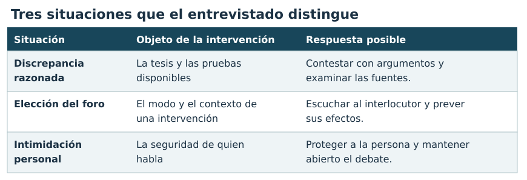

# ENS Rennes · D-E · Espagnol 2022 — Corrigé brut

*Corrigé rédigé par IA, non officiel. Signalez toute erreur.*

**Rédaction** · GPT-6.2 Astra Ultra · vitesse non renseignée

## I. Version

Pourquoi certains pays ont-ils choisi, à une époque donnée, d’investir dans le nucléaire pour alimenter leur système électrique ? Une façon simple de répondre à cette question consiste à observer les pics historiques du nombre de réacteurs construits chaque année et à les rapprocher de moments précis de l’histoire. Deux événements apparaissent clairement comme des moteurs de cette forme d’énergie : la guerre froide et la crise des prix du pétrole.

Les périodes de crise de cette industrie suivent elles aussi une logique bien identifiable, liée cette fois aux accidents survenus dans de grands réacteurs nucléaires. Trois accidents majeurs en soixante-dix ans, trois crises. En 1979, l’accident de la centrale de Three Mile Island a mis fin à l’essor du nucléaire aux États-Unis. Par la suite, ceux de Tchernobyl et de Fukushima ont étendu ce coup d’arrêt à presque tout le monde occidental. Pour beaucoup, Fukushima semblait marquer la fin de l’ère nucléaire.

L’accident a avivé le rejet du nucléaire dans la société. À cela s’ajoute une augmentation exponentielle des coûts, due à plusieurs facteurs, principalement aux exigences de sécurité découlant des accidents et au rétrécissement du marché.

Pourtant, ce ne fut pas la fin. Ce fut, en tout cas, un coup sévère porté à un modèle de développement fondé sur de grands réacteurs, gourmands en capitaux, complexes à construire et, à terme, coûteux.

Aujourd’hui, la crise climatique conduit de nombreux experts et dirigeants du monde à se tourner de nouveau vers cette source d’énergie comme élément de la solution : une source propre et presque toujours disponible.

## II. Thème

La inflación ha vuelto a irrumpir en el debate político. Y con ella reaparece el arma del control de precios: el jueves 30 de septiembre el primer ministro, Jean Castex, anunció un «escudo tarifario» para hacer frente a la fuerte subida de los precios de la energía. Es el resurgir del «mundo anterior al mundo de antes», resume Julien Vaulpré, antiguo asesor del Elíseo. Sin embargo, la inflación de 2021 no tiene nada que ver con la de los años setenta: un 2,1 % interanual en septiembre, frente a más del 13 % en 1974 o en 1981. «Por ahora se trata más bien de un problema político que económico», matiza Philippe Martin, «pero es evidente lo delicada que es la cuestión. Unos precios se notan más que otros. Cuando sube la energía o se encarecen los alimentos, se nota». Así, en las encuestas aparece con toda claridad la idea de que «todo sube», señala Frédéric Dabi, director general del IFOP. A su juicio, la preocupación por el poder adquisitivo supera claramente a la que suscita el desempleo. Algo llamativo al salir de una crisis.

Los sindicatos ya esgrimen la inflación para reclamar aumentos salariales. Este argumento está desplazando al de la necesidad de apoyar a los trabajadores de la «segunda línea», que predominaba hace apenas unos meses.

## III.1. ¿Cómo está presentado el tema de la libertad de expresión en la universidad?

La entrevista presenta la libertad de expresión en la universidad a partir de un conflicto concreto. La periodista recuerda los carteles y las amenazas que recibió la profesora Kathleen Stock en Sussex tras publicar un libro. El lector entra así en el debate por las consecuencias personales de una controversia académica. Anthony Grayling, el entrevistado, desplaza la pregunta: antes de elaborar una lista de opiniones permitidas, propone pensar en la responsabilidad de quien habla y de quien responde.

La comparación del caballo al que uno aprecia sin sentarlo a la mesa le sirve para explicar que el contexto importa. Una idea polémica puede examinarse en un seminario donde haya tiempo para definir los términos y discutir las pruebas. Otra cosa es convertir el desacuerdo con una tesis en una condena de la persona que la sostiene. Según Grayling, las redes sociales amplifican esa confusión: basta con compartir una acusación en pocos segundos para sumarse a una campaña sin haber leído siquiera el texto discutido.

El formato de preguntas y respuestas permite pasar del episodio a una propuesta pedagógica. El filósofo defiende las tutorías y el aprendizaje de la escucha, y atribuye también a las escuelas una responsabilidad en el uso de las redes. La libertad académica aparece como una práctica que se aprende. Exige poder responder a un argumento incómodo y, al mismo tiempo, proteger a quien interviene frente a la intimidación. El lector recibe ante todo la interpretación razonada de Grayling acerca del caso, no una encuesta entre los estudiantes de Sussex.

*253 mots.*

## III.2. ¿En qué medida le parece a usted que la libertad de expresión debe tener límites?

La libertad de expresión debe proteger incluso opiniones que una mayoría considera ofensivas o equivocadas. De lo contrario, quien gobierna podría convertir casi cualquier crítica incómoda en una infracción. Pensemos en una investigación periodística sobre la financiación de un partido: el disgusto de sus dirigentes no basta para impedir que se publiquen hechos comprobados. La posibilidad de cuestionar el poder perdería gran parte de su valor si dependiera del consentimiento de los afectados.

Ahora bien, amenazar directamente a una persona, difundir su dirección para facilitar un acoso o impedirle por la fuerza acudir a su trabajo son conductas que pueden privarla de sus propias libertades. En estos casos me parece legítima una intervención proporcionada. La norma debe definir con precisión la conducta y ofrecer garantías a ambas partes. Una universidad podría proteger de inmediato a una profesora amenazada y examinar después responsabilidades concretas, sin sancionar por ese motivo a estudiantes que hayan criticado pacíficamente sus argumentos.

Hay además usos de la palabra que, aun siendo legales, merecen una respuesta distinta de la prohibición. Ante una afirmación falsa en un debate, suele ser más útil solicitar la fuente, aportar datos y reservar al interlocutor la posibilidad de rectificar. Moderar los turnos de voz también permite que participe quien no consigue hacerse oír. A mi juicio, la mejor prueba de un límite consiste en preguntar qué daño identificable evita, quién revisa su aplicación y si existe una respuesta menos restrictiva que proteja igualmente a las personas.

*244 mots.*

[Sujet](https://www.ens-rennes.fr/medias/fichier/sujet-espagnol-d-e-e-crit-2022_1657700618259-pdf)
