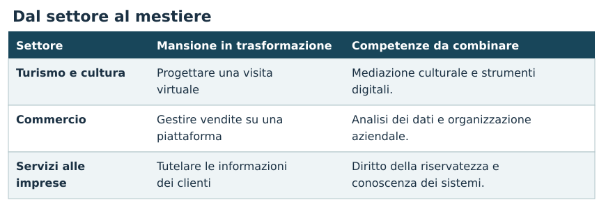

# ENS Rennes · D-E · Italien 2022 — Corrigé brut

*Corrigé rédigé par IA, non officiel. Signalez toute erreur.*

**Rédaction** · GPT-6.2 Astra Ultra · vitesse non renseignée

## I. Version

**La pollution accroît la criminalité et nuit aux résultats scolaires**

La qualité de l’air dans la plaine du Pô s’est considérablement améliorée ces dernières décennies, tout en restant très mauvaise. La santé des dizaines de millions de personnes qui résident dans les régions du nord de l’Italie n’est pas seule à en faire les frais. La pollution entraîne également une hausse de la criminalité et une dégradation des résultats scolaires. Une série d’études met clairement en évidence le lien entre ces phénomènes.

Comment montrer que l’air pollué nuit aux capacités d’apprentissage des enfants ? On peut, par exemple, s’intéresser aux établissements scolaires situés à moins de 250 mètres d’un axe routier important, puis utiliser la direction des vents dominants pour établir le lien de cause à effet entre exposition aux polluants et résultats des élèves. C’est ce qu’ont fait des chercheurs américains. Ils ont suivi des élèves lors de leur passage de l’école élémentaire au collège ou du collège au lycée. Lorsqu’un élève change d’établissement pour un autre où l’air est plus pollué, sa moyenne a tendance à baisser. Le nombre de ses jours d’absence augmente également, de même que la probabilité qu’il adopte un comportement passible d’une sanction disciplinaire telle qu’une exclusion temporaire.

La pollution atmosphérique a aussi une influence sur les résultats d’examens importants comme le baccalauréat. Une autre étude montre que, si l’examen a lieu un jour où le brouillard de pollution est particulièrement dense, les résultats sont en moyenne moins bons. Cela a des répercussions sur les chances d’intégrer des filières universitaires sélectives et peut donc marquer durablement la carrière professionnelle.

## II. Thème

**Il trattato del Quirinale**

Parigi e Roma preparano un trattato di cooperazione che potrebbe essere firmato a novembre e che contiene impegni di rilievo sull’Europa e sulla difesa. Il trattato del Quirinale fra Francia e Italia formalizzerà la cooperazione fra i due Paesi, come ha fatto il trattato dell’Eliseo per i rapporti franco-tedeschi. Prende il nome dall’imponente palazzo cinquecentesco che sorge sul più alto colle di Roma ed è la sede del Presidente della Repubblica italiana.

«Una sorta di omaggio al lavoro di Sergio Mattarella», secondo Marc Lazar, studioso dell’Italia. «Il presidente francese è grato in particolare al capo dello Stato italiano per essersi costantemente adoperato, soprattutto quando la Lega di Salvini e il Movimento 5 Stelle erano al governo, affinché l’Italia mantenesse il suo impegno europeo.»

Avviato già all’inizio del 2018 da Emmanuel Macron e da Paolo Gentiloni, allora presidente del Consiglio, il progetto era stato congelato con l’arrivo dei populisti al governo. Ora può tornare alla ribalta, con dichiarazioni molto nette sull’impegno europeo dei due Paesi. Potrebbe inoltre sancire una più stretta cooperazione in materia di difesa e una vera collaborazione nella lotta al terrorismo, agli attacchi informatici e al traffico di armi.

## III.1. Quali settori professionali saranno i più favorevoli all’occupazione nel prossimo decennio?

Secondo lo studio presentato da Diana Cavalcoli nel 2021, le migliori prospettive occupazionali verso il 2030 si concentrano soprattutto nei servizi alle imprese e alle persone. Fra i settori in crescita spiccano l’informatica e le telecomunicazioni. Le aziende cercano già figure che faticano a trovare e avranno bisogno di persone capaci di progettare interfacce, usare dati o integrare nuovi strumenti nelle attività produttive. Il fatto che circa il 57 per cento delle trenta professioni segnalate come emergenti sia collegato alla tecnologia dà un’indicazione sulla loro natura. Non significa che la maggioranza di tutti i posti di lavoro italiani diventerà informatica.

Anche la cultura, lo sport, i servizi di cura e la formazione offrono opportunità. Un museo potrà affidare una visita virtuale a chi conosce le opere e sa progettare un’esperienza digitale accessibile. Un’impresa commerciale avrà bisogno di un responsabile delle vendite online che sappia leggere i dati e coordinare fornitori e personale. In entrambi i casi emerge un profilo ibrido. Restano inoltre indispensabili lavori manuali nell’edilizia e mansioni di custodia per gli impianti.

Queste previsioni devono orientare la formazione senza trasformarsi in una promessa per il singolo candidato. Lo stesso settore può creare nuovi ruoli e ridurre quelli legati a procedure ripetitive. Perciò, accanto alle conoscenze tecniche, diventano importanti l’ascolto, la capacità di affrontare problemi imprevisti e la disponibilità ad apprendere durante tutta la vita professionale. Un giovane dovrebbe chiedersi quali attività saprà svolgere, oltre a scegliere il settore in cui entrare.

*242 mots.*

## III.2. Come immagini la tua situazione professionale ideale nel 2030?

Nel 2030 mi piacerebbe lavorare in una squadra che aiuti i piccoli comuni a migliorare i servizi pubblici digitali. Immagino, per esempio, di seguire la progettazione di un portale per richiedere una borsa di studio. Vorrei occuparmi del punto in cui si incontrano diritto, economia e bisogni quotidiani: capire chi ha accesso al beneficio, perché alcuni studenti rinunciano a fare domanda e quali modifiche renderebbero la procedura più semplice.

Per arrivarci dovrei imparare a leggere un bilancio e ad analizzare dati, ma anche a condurre un colloquio con chi usa il servizio. Prima di proporre una nuova applicazione, passerei una mattina allo sportello con gli impiegati e con le famiglie. Potrei scoprire che il vero problema è un documento difficile da ottenere oppure un modulo illeggibile sul telefono. La soluzione migliore, in quel caso, potrebbe essere cambiare una regola o mantenere un canale di assistenza personale. Il successo si misurerebbe anche contando quante persone aventi diritto riescono a completare la procedura.

Nella mia situazione ideale avrei un contratto stabile e tempo per aggiornarmi. Vorrei poter discutere i risultati con colleghi di formazione diversa, riconoscere un errore prima che diventi costoso e vedere come un progetto cambia dopo i primi mesi. Non saprei prevedere il nome esatto della professione fra qualche anno. So però che vorrei un lavoro in cui una competenza tecnica acquisti valore perché permette a qualcuno di esercitare più facilmente un diritto.

*234 mots.*

[Sujet](https://www.ens-rennes.fr/medias/fichier/sujet-italien-d-e-e-crit-2022_1657700630352-pdf)
