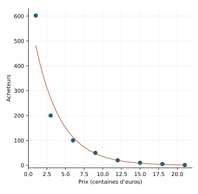
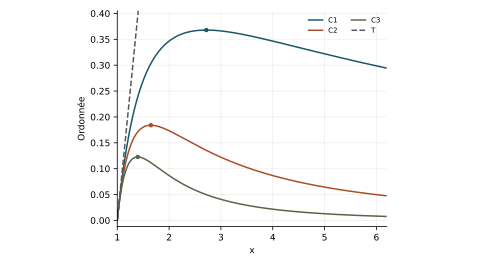

# ENS Rennes D-E — Mathématiques appliquées et statistiques 2022 · Corrigé brut

*Corrigé rédigé par IA, non officiel. Signalez toute erreur.*

**Rédaction** · GPT-6.2 Astra Ultra · vitesse non renseignée

**Révision** · GPT-6.2 Astra Ultra · vitesse non renseignée

**Ajustement d’une demande, transmission binaire et lois à densité.** Les grandeurs monétaires du premier exercice sont d’abord exprimées en centaines d’euros. Dans le deuxième, une erreur inverse le message binaire.

## 1.I. Prix de vente et nombre d’acheteurs

### Question 1.I.1

Les points ont pour coordonnées $(1,602),(3,200),(6,100),(9,50),(12,20),(15,10),(18,5),(21,1)$. Le rapport des échelles est celui du sujet, 1 cm pour une unité en abscisse et 1 cm pour 30 acheteurs en ordonnée.

### Question 1.I.2

On trouve $\bar y=8^{-1}\sum_i y_i=988/8=123{,}50$ et $V(y)=8^{-1}\sum_i y_i^2-\bar y^2=36676{,}50$ acheteurs au carré.

### Question 1.I.3

On a $\bar x=10{,}625$, $V(x)=44{,}734375$ et $\operatorname{Cov}(x,y)=8^{-1}\sum_i x_i y_i-\bar x\bar y=-968{,}0625$. D’où $r=\operatorname{Cov}(x,y)/\sqrt{V(x)V(y)}\simeq-0{,}76$. Le nuage incurvé, notamment la valeur 602, est mal décrit par un modèle affine unique.

### Question 1.I.4.a

Les logarithmes existent car chaque $y_i>0$.

| $x_i$ | 1 | 3 | 6 | 9 | 12 | 15 | 18 | 21 |
|---|---:|---:|---:|---:|---:|---:|---:|---:|
| $z_i=\ln y_i$ | 6,40 | 5,30 | 4,61 | 3,91 | 3,00 | 2,30 | 1,61 | 0,00 |

### Question 1.I.4.b

Les logarithmes donnent $\bar z\simeq3{,}39044$, $V(z)\simeq3{,}80661$ et $\operatorname{Cov}(x,z)\simeq-12{,}94944$. Ainsi $r_{xz}\simeq-0{,}99$, nettement plus proche de $-1$ que le coefficient précédent. Un ajustement affine de $z$ en fonction de $x$ est justifié.

### Question 1.I.4.c

La pente vaut $a=\operatorname{Cov}(x,z)/V(x)\simeq-0{,}289474$, et $b=\bar z-a\bar x\simeq6{,}466103$. Une équation au centième est donc $z=-0{,}29x+6{,}47$.

### Question 1.I.4.d

Le modèle ajusté est $y\simeq e^{6{,}466103-0{,}289474x}$. L’énoncé retient dans la partie suivante la formule simplifiée $y=e^{6{,}5-0{,}29x}$, où l’ordonnée à l’origine est arrondie au dixième.

## 1.II. Bénéfice net

### Question 1.II.1

Le coût unitaire est 3 centaines d’euros. Le coût total vaut $3y$, le chiffre d’affaires $xy$, et le bénéfice $(x-3)y$, tous trois en centaines d’euros.

| Prix $x$ | Acheteurs $y$ | Coût | Chiffre d’affaires | Bénéfice |
|---:|---:|---:|---:|---:|
| 3 | 200 | 600 | 600 | 0 |
| 6 | 100 | 300 | 600 | 300 |
| 9 | 50 | 150 | 450 | 300 |
| 12 | 20 | 60 | 240 | 180 |
| 15 | 10 | 30 | 150 | 120 |
| 18 | 5 | 15 | 90 | 75 |

### Question 1.II.2

Avec la demande modélisée $y=e^{-0{,}29x+6{,}5}$, la marge nette prévisionnelle est $f(x)=(x-3)e^{-0{,}29x+6{,}5}$ centaines d’euros.

### Question 1.II.3

$f'(x)=e^{-0{,}29x+6{,}5}[1-0{,}29(x-3)]$. La fonction croît de $f(0)=-3e^{6{,}5}\simeq-1995{,}42$ à son maximum en $x_*=3+1/0{,}29=187/29$, puis décroît strictement. À l’infini sa limite est 0 par croissances comparées. Sa limite à droite de 0 vaut $f(0)$ par continuité.

| Prix, en centaines d’euros | $0$ | $187/29$ | $+\infty$ |
|---|---:|---:|---:|
| Valeur ou limite du bénéfice | $-3e^{6{,}5}$ | $e^{4{,}63}/0{,}29$ | $0$ |
| Variation vers la colonne suivante | Croît | Décroît | |

### Question 1.II.4

Le prix optimal du modèle est $100x_*=644{,}83$ euros à un centime près. Le bénéfice vaut $f(x_*)\simeq353{,}50$ centaines d’euros, soit **35 349,68 euros** en convertissant avant d’arrondir.

## 2.I. Chaîne de transmissions pour p = 1/3

### Question 2.I.1.a

Le nombre de transmissions est supérieur d’une unité au nombre d’intermédiaires. Les $n+1$ erreurs possibles sont des événements indépendants de même probabilité $2/3$. Ainsi $Y_n\sim\mathcal B(n+1,2/3)$ et $Y_n(\Omega)=\{0,\ldots,n+1\}$. Pour tout $k$ de ce support, $P(Y_n=k)=\binom{n+1}k(2/3)^k(1/3)^{n+1-k}$.

### Question 2.I.1.b

$\mathbb E Y_n=2(n+1)/3$, et $\operatorname{Var}(Y_n)=(n+1)(2/3)(1/3)=2(n+1)/9$.

### Question 2.I.1.c

Par indépendance $P(Y_n=0)=(1/3)^{n+1}$.

### Question 2.I.1.d

$P(Y_n\ge1)=1-(1/3)^{n+1}$.

### Question 2.I.2.a

$Z_3(\Omega)=\{0,1,2,3\}$. Toute suite prescrite des trois états (bon ou mauvais message) est possible : partir du bon message, puis imposer une transmission correcte lorsque l’état doit rester identique, et une erreur lorsqu’il doit changer. Chaque choix a probabilité strictement positive.

### Question 2.I.2.b

Les trois intermédiaires ont le bon message si et seulement si les trois premiers envois sont corrects. C’est la probabilité d’aucune erreur sur trois envois, celle de $Y_2=0$. Elle vaut $(1/3)^3=1/27$.

### Question 2.I.2.c

$\{Z_3=0\}=\bar T_1\cap T_2\cap T_3$. Sa probabilité est $(2/3)(1/3)^2=2/27$.

### Question 2.I.2.d

Notons $C$ une transmission correcte et $E$ une erreur. Si seul le premier intermédiaire a le bon message, les envois sont $CEC$. Si seul le deuxième le reçoit, ils sont $EEE$. Si seul le troisième le reçoit, ils sont $ECE$. Ces trois événements disjoints traduisent respectivement $T_1\cap\bar T_2\cap T_3$, $\bar T_1\cap\bar T_2\cap\bar T_3$ et $\bar T_1\cap T_2\cap\bar T_3$. Par indépendance, $P(Z_3=1)=(2+8+4)/27=14/27$.

### Question 2.I.2.e

$P(Z_3=2)=1-(2+14+1)/27=10/27$. Alors $\mathbb E Z_3=(0\cdot2+1\cdot14+2\cdot10+3\cdot1)/27=37/27$. Les réceptions par les trois intermédiaires dépendent des erreurs déjà commises.

## 2.II. Fiabilité après plusieurs intermédiaires

### Question 2.II.1.a

Pour $n=1$, $\{X_1=1\}=(T_1\cap T_2)\cup(\bar T_1\cap\bar T_2)$. L’union est disjointe.

### Question 2.II.1.b

$P(X_1=1)=p^2+(1-p)^2$.

### Question 2.II.1.c

$P(X_1=0)=2p(1-p)$.

### Question 2.II.1.d

$P(X_1=1)-P(X_1=0)=p^2+(1-p)^2-2p(1-p)=(2p-1)^2\ge0$. Il y a égalité pour $p=1/2$.

### Question 2.II.2.a

Si le message était correct, il le reste avec probabilité $p$. S’il était faux, il devient correct avec probabilité $1-p$. Donc $P(X_{n+1}=1\mid X_n=1)=p$ et $P(X_{n+1}=1\mid X_n=0)=1-p$ en couplant les deux chaînes par leurs premiers envois.

### Question 2.II.2.b

Les probabilités totales donnent $u_{n+1}=pu_n+(1-p)(1-u_n)=(2p-1)u_n+1-p$.

### Question 2.II.3.a

Avec $v_n=u_n-1/2$, la récurrence devient $v_{n+1}=(2p-1)v_n$. La raison est $2p-1$ et $v_1=p^2+(1-p)^2-1/2=1/2-2p(1-p)$.

### Question 2.II.3.b

$v_n=(1/2-2p(1-p))(2p-1)^{n-1}$. Ainsi $u_n=1/2+(1/2-2p(1-p))(2p-1)^{n-1}=[1+(2p-1)^{n+1}]/2$. La dernière expression couvre aussi $p=1/2$.

On peut vérifier la formule sans récurrence. Le destinataire reçoit le message initial quand le nombre $J$ d’erreurs est pair. Comme $J$ suit la loi binomiale de paramètres $n+1$ et $1-p$, l’identité $\mathbf{1}_{\{J\text{ pair}\}}=(1+(-1)^J)/2$ donne $u_n=[1+(p-(1-p))^{n+1}]/2$ par le binôme.

### Question 2.II.3.c

$0<p<1$ implique $|2p-1|<1$, donc $u_n\to1/2$.

## 3.I. Variations, forme des courbes et tangente

### Question 3.I.1

Pour $n\ge1$, $f_n(x)=\ln(x)/x^n\to0$ lorsque $x\to+\infty$.

### Question 3.I.2.a

Les fonctions $\ln x$ et $x^{-n}$ sont dérivables sur $]0,+\infty[$. Sur $[1,+\infty[$, $f_n'(x)=x^{-n-1}-nx^{-n-1}\ln x=(1-n\ln x)/x^{n+1}$.

### Question 3.I.2.b

La dérivée est positive pour $1\le x<e^{1/n}$, nulle en $e^{1/n}$ et négative ensuite. La fonction part de $f_n(1)=0$, croît jusqu’à $1/(ne)$ puis décroît vers 0.

### Question 3.I.3.a

Le maximum est atteint en $x=e^{1/n}$ et vaut $M_n=(1/n)/(e^{1/n})^n=1/(ne)$.

### Question 3.I.3.b

$M_n=1/(ne)\to0$ lorsque $n\to\infty$.

### Question 3.I.4

Pour $x>1$, $f_n(x)>0$ et $f_{n+1}(x)=f_n(x)/x<f_n(x)$. Chaque courbe se place strictement sous la précédente pour $x>1$. Toutes passent par $(1,0)$.

### Question 3.I.5.a

Le logarithme et les puissances sont lisses sur $]0,\infty[$. Ainsi $f_n'$ est dérivable sur le domaine et
$$f_n''(x)=\frac{-n-(n+1)(1-n\ln x)}{x^{n+2}}=\frac{n(n+1)\ln x-(2n+1)}{x^{n+2}}.$$

### Question 3.I.5.b

Posons $b_n=\exp((2n+1)/(n(n+1)))$. Le numérateur de $f_n''$ croît strictement et s’annule en $b_n$. La courbe est concave sur $[1,b_n]$, convexe sur $[b_n,+\infty[$, avec point d’inflexion d’abscisse $b_n$.

### Question 3.I.6.a

$f_n(1)=0$ et $f_n'(1)=1$ pour tout $n$. La tangente commune a pour équation $y=x-1$.

### Question 3.I.6.b

Pour $x\ge1$, $0\le f_n(x)\le\ln x\le x-1$. La dernière inégalité vient de la croissance de $x-1-\ln x$ sur $[1,+\infty[$ et de sa valeur 0 en 1. La tangente est donc au-dessus sur tout le domaine, strictement pour $x>1$.

### Question 3.I.7

On place les sommets $(e,1/e),(\sqrt e,1/(2e)),(e^{1/3},1/(3e))$. À droite de 1, $C_1$ est au-dessus de $C_2$, elle-même au-dessus de $C_3$. Chacune se rapproche de l’axe horizontal. L’échelle prescrite est de 2 cm par unité horizontale et 20 cm par unité verticale.

## 3.II. Intégrales et variables à densité

### Question 3.II.1.a

$\varphi'(x)=(\ln x)/x=f_1(x)$ pour $x\ge1$.

### Question 3.II.1.b

$I_1(A)=\varphi(A)-\varphi(1)=\tfrac12(\ln A)^2$.

### Question 3.II.1.c

$\tfrac12(\ln A)^2\to+\infty$. L’intégrale impropre de $f_1$ sur $[1,\infty[$ diverge vers $+\infty$.

### Question 3.II.2.a

Pour $n\ge2$, prenons $u=\ln x$, $dv=x^{-n}dx$, donc $v=-x^{1-n}/(n-1)$. Par parties sur $[1,A]$,
$$I_n(A)=-\frac{\ln A}{(n-1)A^{n-1}}+\frac{1}{n-1}\int_1^A x^{-n}dx
=-\frac{\ln A}{(n-1)A^{n-1}}-\frac{1}{(n-1)^2 A^{n-1}}+\frac{1}{(n-1)^2}.$$

### Question 3.II.2.b

Par croissances comparées $\ln(A)/A^{n-1}\to0$, et $A^{1-n}\to0$. Donc $I_n(A)\to1/(n-1)^2$.

### Question 3.II.2.c

L’intégrale $\int_1^\infty f_n(x)dx$ converge pour $n\ge2$ et vaut $1/(n-1)^2$ par définition à partir de $I_n(A)$.

### Question 3.II.3.a

Sur $]-\infty,1[$, $g_n=0$. Sur $[1,\infty[$ c’est $(n-1)^2 f_n$, continue. Comme $f_n(1)=0$, les deux limites en 1 valent $g_n(1)=0$ et la fonction est continue partout.

### Question 3.II.3.b

$g_n$ est continue donc mesurable. Elle est non négative car $\ln x\ge0$ sur $[1,\infty[$. Son intégrale totale vaut $(n-1)^2/(n-1)^2=1$. C’est une densité.

### Question 3.II.4.a

Pour $x<1$, $G_n(x)=0$. Pour $x\ge1$, $G_n(x)=(n-1)^2 I_n(x)$, donc
$$G_n(x)=1-\frac{1+(n-1)\ln x}{x^{n-1}}.$$

### Question 3.II.4.b

$P(X_n>e)=1-G_n(e)=n/e^{n-1}$.

### Question 3.II.5

Le support étant dans $[1,\infty[$, l’espérance est finie si et seulement si $\int_1^\infty xg_n(x)dx=(n-1)^2\int_1^\infty f_{n-1}(x)dx$ converge. Pour $n=2$ elle diverge par 1.c. Pour tout $n\ge3$ elle converge par 2.c et vaut $\mathbb E X_n=((n-1)/(n-2))^2$.

Au premier rang admissible, $n=3$, la formule donne $\mathbb E X_3=4$. Au rang précédent, l’intégrale tronquée de $xg_2(x)$ vaut $(\ln A)^2/2$, qui croît sans borne. Le seuil de convergence est ainsi sensible au facteur $x$ du premier moment.
