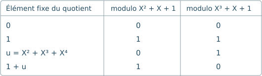
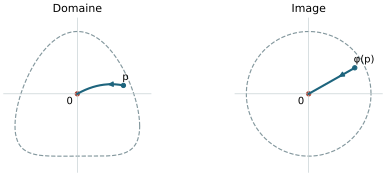

# ENS 2022 — Cycle master mathématiques · Corrigé brut

*Corrigé rédigé par IA, non officiel. Signalez toute erreur.*

**Rédaction** · GPT-6.2 Astra Ultra · vitesse non renseignée · 26 novembre 2026

**Révision (tour 1)** · GPT-6.2 Astra Ultra · vitesse non renseignée · 26 novembre 2026

**Écrit de mathématiques du vendredi 18 mars 2022, de 13 h à 18 h.** La garde de l’ENS Paris-Saclay indique cinq heures et interdit les calculatrices. Le règlement classe cet écrit parmi les épreuves d’admissibilité. Les deux problèmes indépendants comptent à parts égales. Le département de mathématiques de l’ENS Rennes répertorie également ce sujet dans ses annales de 2022.

[Sujet de l’ENS Paris-Saclay](https://ens-paris-saclay.fr/sites/default/files/CONCOURS/ANNALES_2C/2C_Math/2022_Sujet_Ecrit_2A_Maths_Maths.pdf) · [Règlement, p. 2](https://ens-paris-saclay.fr/sites/default/files/CONCOURS/Reglements/2022_Modalites_d_inscription_CCM.pdf#page=2) · [Annales de l’ENS Rennes](https://math.ens-rennes.fr/admission/integrer-le-departement/concours-cycle-master)

## Problème A · Anneaux, corps et irréductibilité

On travaille avec des anneaux commutatifs unitaires. Un anneau intègre est supposé non nul. Les idéaux engendrés par un élément $a$ sont notés $(a)$ et les pgcd de polynômes sont pris unitaires.

### A.1 · Idéaux et corps

Soit $a\ne0$ dans un anneau dont les seuls idéaux sont $(0)$ et l’anneau entier. Comme $a\in(a)$, on a $(a)\ne(0)$, donc $(a)=A$. En particulier $1=ba$ pour un certain $b$. Tout élément non nul est inversible. Réciproquement, dans un corps, un idéal contenant un élément non nul contient son inverse multiplié par cet élément, donc l’unité.

Soit $\pi:A\to A/I$ la projection. Un idéal $J$ contenant $I$ donne l’idéal $J/I$ du quotient. Inversement, l’image réciproque d’un idéal du quotient contient $I$, et ces deux opérations sont réciproques. Le quotient est un corps exactement lorsque $I$ est propre et que les seuls idéaux au-dessus de $I$ sont $I$ et $A$. C’est la définition d’un idéal maximal. Si $I=A$, le quotient nul n’est pas un corps.

### A.2 · Polynômes irréductibles et idéaux maximaux

L’anneau $K[X]$ est euclidien, donc principal. Un idéal $(D)$ contient $(P)$ si et seulement si $D$ divise $P$. Lorsque $P$ est irréductible, un tel $D$ est une unité ou un associé de $P$. Les seuls idéaux au-dessus de $(P)$ sont alors l’anneau entier et $(P)$, qui est propre. Réciproquement, si $(P)$ est maximal et $P=BC$, l’idéal $(B)$ est égal à $(P)$ ou à $K[X]$. Dans le second cas $B$ est une unité. Dans le premier, $B=UP$ et la simplification par $P\ne0$ donne $UC=1$. Enfin, une constante non nulle engendre tout l’anneau et $(0)$ est strictement contenu dans $(X)$, idéal propre. Ces cas ne donnent pas d’idéal maximal.

### A.3 · Caractéristique positive

Le morphisme $\iota:\mathbb Z\to A$ est $k\mapsto k1_A$. Si un entier strictement positif annule $1_A$, appelons $m$ le plus petit. Il n’est pas égal à 1 car $1_A\ne0$. Si $m=uv$ avec $1<u,v<m$, alors $(u1_A)(v1_A)=0$, avec deux facteurs non nuls par minimalité. C’est impossible dans un anneau intègre. Ainsi $m$ est premier. La division euclidienne par $m$ donne aussi $\ker\iota=m\mathbb Z$. Si aucun tel entier n’existe, $\ker\iota=0$ et la caractéristique est zéro.

### A.4 · Image du morphisme canonique et sous-corps premier

Le morphisme $\bar\iota:\mathbb Z/\ker\iota\to A$, donné par $[k]\mapsto k1_A$, est bien défini puisque deux représentants diffèrent d’un élément du noyau. Si $\bar\iota([k])=0$, on a $k\in\ker\iota$, donc $[k]=[0]$. Cela prouve l’injectivité.

La seconde affirmation du feuillet demande une distinction. Si le corps $K$ a pour caractéristique $p>0$, l’image est isomorphe au corps $\mathbb F_p$. Tout sous-corps contient $1_K$, ses multiples entiers et donc cette image. C’est bien le plus petit sous-corps. Si $K$ a caractéristique zéro, l’image de $\bar\iota$ est une copie de $\mathbb Z$. Par exemple dans $K=\mathbb Q$, elle ne contient pas $1/2$. Dans ce cas le plus petit sous-corps est le corps des fractions de cette image, isomorphe à $\mathbb Q$. Le prolongement $a/b\mapsto(a1_K)(b1_K)^{-1}$ est injectif et tout sous-corps de $K$ en contient l’image.

### A.5 · Cardinal d’un corps fini

Si $K$ est fini, les multiples entiers de $1_K$ ne peuvent être tous distincts. La caractéristique est donc un premier $p$ et $K$ contient son sous-corps premier $\mathbb F_p$. Comme espace vectoriel sur ce corps, $K$ admet une base finie de taille $n\ge1$ (une famille libre est une partie de l’ensemble fini $K$). Chaque élément se représente par un unique $n$-uplet à coefficients dans $\mathbb F_p$, donc $|K|=p^n$.

### A.6 · Construire deux corps sur le corps à deux éléments

**a.** Un polynôme de degré 2 est réductible s’il a une racine dans le corps de base. Sur $\mathbb F_2$, il est automatiquement unitaire. Pour que $X^2+aX+b$ n’ait pas la racine 0 il faut $b=1$. Sa valeur en 1 devient $a$, donc l’absence de la racine 1 impose $a=1$. Le seul candidat est $F=X^2+X+1$, et il n’a effectivement aucune racine.

**b.** Le cubique $P=X^3+X+1$ vaut 1 en 0 et en 1. Une décomposition d’un cubique en facteurs non constants fournirait un facteur linéaire, donc $P$ est irréductible. Le quartique $Q=X^4+X+1$ n’a également aucune racine. Une décomposition serait donc le produit de deux quadratiques irréductibles, nécessairement $F^2=X^4+X^2+1$. Ce polynôme diffère de $Q$, d’où son irréductibilité.

**c.** Par A.2 et A.1, les quotients $\mathbb F_2[X]/(P)$ et $\mathbb F_2[X]/(Q)$ sont des corps. Les représentants uniques de degrés respectivement inférieurs à 3 et à 4 se comptent grâce à la division euclidienne. On obtient $2^3=8$ et $2^4=16$ éléments. Dans le premier, la classe $\xi$ de $X$ vérifie $\xi^3=\xi+1$. Dans le second elle vérifie $\xi^4=\xi+1$.

### A.7 · Morphisme de Frobenius et éléments fixes

**a.** En caractéristique $p$, les coefficients $\binom pk$ sont nuls dans $A$ pour $0<k<p$. Comme $A$ est commutatif, le binôme donne $(u+v)^p=u^p+v^p$. On a aussi $(uv)^p=u^pv^p$ et $1^p=1$. Ainsi $u\mapsto u^p$ est un morphisme unitaire.

**b.** Sur $\mathbb F_p$, tous les éléments sont des multiples entiers de 1, que ce morphisme fixe par additivité. Frobenius y est l’identité.

**c.** Dans $\mathbb F_p[X]$, pour $a\in\mathbb F_p$ et $g\in\mathbb F_p[X]$, $(ag)^p=ag^p$. Avec l’additivité, c’est la linéarité sur $\mathbb F_p$. Si $g^p=g$ et $g\ne0$, les degrés donnent $p\deg g=\deg g$. Le polynôme est constant. Réciproquement, toutes les constantes sont fixes, y compris zéro.

**d.** Dans $\mathbb F_q$, les éléments fixes sont les racines de $T^p-T$. Elles sont au plus $p$ car ce polynôme est non nul de degré $p$. Les $p$ éléments de la copie canonique de $\mathbb F_p$ sont déjà fixes d’après la question b. Cette copie épuise donc les points fixes, même si $q>p$.

### A.8 · Dérivation et facteurs multiples

**a.** Écrivons $f=f_i^{\alpha_i}h$ avec $f_i\nmid h$. On a
$$f'=f_i^{\alpha_i-1}(\alpha_i f_i'h+f_i h').$$
Tout irréductible $f_i$ non constant sur $\mathbb F_p$ a une dérivée non nulle. En effet, une dérivée nulle imposerait que tous ses exposants soient multiples de $p$ et ferait de $f_i$ une puissance $p$-ième, comme démontré au point b. Comme $\deg f_i'<\deg f_i$, on a $f_i\nmid f_i'$. Si $p\nmid\alpha_i$, le terme entre parenthèses est non nul modulo $f_i$. La multiplicité de $f_i$ dans $f'$ est donc exactement $\alpha_i-1$. Si $p\mid\alpha_i$, la dérivation donne directement $f'=f_i^{\alpha_i}h'$, et la multiplicité est au moins $\alpha_i$. Il en résulte
$$\frac f{\gcd(f,f')}=\prod_{i\, :\, p\nmid\alpha_i} f_i.$$

**b.** Si $f'=0$, chaque coefficient $a_k$ d’indice non multiple de $p$ est nul, car $ka_k=0$. Ainsi $f(X)=\sum_j a_{pj}X^{pj}$. Les coefficients de $\mathbb F_p$ étant fixes par Frobenius, ce polynôme est $g(X)^p$ pour $g(X)=\sum_j a_{pj}X^j$. Comme $f$ est non constant et $p\ge2$, cette puissance fournit une factorisation non triviale.

### A.9 · Décomposition par les restes

Désormais $f=f_1\cdots f_r$ avec des facteurs deux à deux distincts. Si deux polynômes diffèrent d’un multiple de $f$, leurs restes sont égaux modulo chaque $f_i$. Le morphisme $\psi$ est donc bien défini et préserve les sommes, produits et l’unité. Si chaque $f_i$ divise un représentant $g$, leur produit divise $g$ puisqu’ils sont premiers entre eux deux à deux. Le noyau est nul.

Pour obtenir un tuple arbitraire $(a_i)$, posons $F_i=f/f_i$. Bézout fournit $U_iF_i+V_i f_i=1$. L’élément $e_i=U_iF_i$ vaut 1 modulo $f_i$ et 0 modulo les autres facteurs. En choisissant des représentants $g_i$ des $a_i$, le polynôme $\sum_i e_i g_i$ a tous les restes prescrits. Le morphisme est surjectif, donc c’est un isomorphisme.

### A.10 · Noyau et nombre de facteurs

Le morphisme de A.9 commute avec l’élévation à la puissance $p$. Il transforme $\varphi=\mathrm{Frob}-\mathrm{id}$ en l’application coordonnée par coordonnée $u_i\mapsto u_i^p-u_i$ dans les corps $K_i$. Par A.7.d, le noyau dans chaque coordonnée est $\mathbb F_p$. Ainsi $\ker\varphi\simeq\mathbb F_p^r$ comme espace vectoriel sur $\mathbb F_p$, d’où $\dim\ker\varphi=r$. En particulier, pour $f$ sans facteur multiple, un noyau de dimension 1 équivaut à l’irréductibilité.

### A.11 · Le quartique par la matrice du Frobenius moins l’identité

On a $f'=1$, donc le quartique est sans facteur multiple. Dans la base $(1,X,X^2,X^3)$ de l’algèbre quotient, $X^4=X+1$. Les images des vecteurs de base valent $0$, $X^2+X$, $1+X+X^2$ et $X^2$ (car $X^6=X^3+X^2$). En les plaçant en colonnes, on obtient sur $\mathbb F_2$
$$M_4=\begin{pmatrix}0&0&1&0\\0&1&1&0\\0&1&1&1\\0&0&0&0\end{pmatrix}.$$
Si $M_4(a,b,c,d)^{\mathsf T}=0$, la première ligne impose $c=0$, la deuxième $b=0$ puis la troisième $d=0$. Seul $a$ est libre. La dimension du noyau est 1 et A.10 redonne l’irréductibilité de $X^4+X+1$.

### A.12 · Le quintique par le même test

Ici $f=X^5+X^4+1$ et $f'=X^4$. Comme $f(0)=1$, le pgcd est 1. En réduisant par $X^5=X^4+1$, on trouve $X^6=X^4+X+1$ et $X^8=X^4+X^3+X^2+X+1$. Dans la base $(1,X,X^2,X^3,X^4)$, les colonnes de $\varphi$ sont les coordonnées de $0$, $X^2+X$, $X^4+X^2$, $X^4+X^3+X+1$, $X^3+X^2+X+1$. Ainsi
$$M_5=\begin{pmatrix}0&0&0&1&1\\0&1&0&1&1\\0&1&1&0&1\\0&0&0&1&1\\0&0&1&1&0\end{pmatrix}.$$
Dans le noyau, $d=e$, $b=0$, $c=d=e$, et $a$ est libre. Une base est $(1,X^2+X^3+X^4)$. La dimension vaut 2, donc $f$ possède exactement deux facteurs irréductibles distincts. Le produit $(X^2+X+1)(X^3+X+1)=X^5+X^4+1$ le confirme.

## Problème B · Inversion globale et équation différentielle

On se donne $\phi:\mathbb R^n\to\mathbb R^n$ de classe $C^2$, à différentielle inversible en tout point, telle que $\|\phi(x)\|\to+\infty$ lorsque $\|x\|\to+\infty$. On note $D\phi(x)$ sa différentielle, et $[D\phi(x)]^{-1}$ l’inverse de cette application linéaire.

### B.1 · Deux hypothèses indépendantes

Si l’on garde seulement l’inversibilité de la dérivée sur $\mathbb R$, $x\mapsto e^x$ a une dérivée partout strictement positive, mais son image est $]0,+\infty[$ et il tend vers zéro lorsque $x\to-\infty$. Si l’on garde seulement la condition de croissance en norme, $x\mapsto x^2$ la vérifie mais a une dérivée nulle en 0 et prend la même valeur en $1$ et $-1$. Les deux applications sont de classe $C^2$.

### B.2 · Caractériser les applications propres

Supposons d’abord que l’image réciproque de tout compact par $f$ est compacte. Si $\|f(x)\|$ ne tendait pas vers l’infini avec $\|x\|$, il existerait $M$ et une suite $x_k$ avec $\|x_k\|\to\infty$ et $\|f(x_k)\|\le M$. Les $x_k$ appartiendraient tous à l’image réciproque de la boule fermée de rayon $M$ dans $\mathbb R^d$, qui est compacte et donc bornée. C’est impossible.

Réciproquement, supposons la condition de croissance. Pour un compact $K\subset\mathbb R^d$, $f^{-1}(K)$ est fermé par continuité de $f$. Prenons $M$ tel que $K\subset\overline B_M(0)$. Il existe $R$ tel que $\|x\|>R$ entraîne $\|f(x)\|>M$. L’image réciproque de $K$ est donc également bornée et par suite compacte dans $\mathbb R^n$. Ces deux formulations expriment ici la propreté de $f$.

### B.3 · L’image est fermée

Soit $y_k=\phi(x_k)$ une suite de l’image convergeant vers $y$. Le compact $K=\{y\}\cup\{y_k:k\ge1\}$ a une image réciproque compacte d’après B.2. On peut extraire de $(x_k)$ une sous-suite convergeant vers $x$. La continuité donne $\phi(x)=y$, ce qui montre que l’image contient toutes ses limites de suites.

### B.4 · L’image est ouverte

En chaque $x$, le théorème d’inversion locale fournit des voisinages ouverts $U_x$ de $x$ et $V_x$ de $\phi(x)$ tels que $\phi:U_x\to V_x$ soit un difféomorphisme. L’image globale, réunion des $V_x$, est donc ouverte.

### B.5 · Surjectivité

L’image est non vide puisqu’elle contient $\phi(0)$. Elle est ouverte et fermée dans l’espace connexe $\mathbb R^n$. Elle est donc égale à $\mathbb R^n$.

### B.6 · Fibres finies

**a.** Si $\phi(x)=y$, l’inversion locale donne un voisinage de $x$ sur lequel $\phi$ est injective. Une boule ouverte $B_{\varepsilon_x}(x)$ contenue dans ce voisinage ne rencontre donc la fibre de $y$ qu’en $x$.

**b.** Cette fibre est non vide par B.5, et compacte comme image réciproque du singleton $\{y\}$ par B.2. Les boules trouvées en a la recouvrent. Un nombre fini d’entre elles suffit par compacité, et chacune contient exactement un point de la fibre. Celle-ci est donc finie.

### B.7 · Existence du flot maximal

Considérons $F(x)=[D\phi(x)]^{-1}\phi(x)$. Comme $D\phi$ est de classe $C^1$ et à valeurs dans les matrices inversibles, l’inversion matricielle, qui est lisse sur cet ouvert, conserve la régularité $C^1$. Le produit par $\phi(x)$ rend $F$ de classe $C^1$, donc localement lipschitzienne. Le théorème de Cauchy-Lipschitz appliqué à $x'=-F(x)$ et $x(0)=p$ donne une unique solution maximale vers le futur, définie sur $[0,b[$ avec $0<b\le+\infty$.

### B.8 · Contraction dans l’image et existence globale

**a.** En posant $y(t)=\phi(x_p(t))$, la règle de la chaîne donne
$$y'(t)=D\phi(x_p(t))\,(-[D\phi(x_p(t))]^{-1}\phi(x_p(t)))=-y(t).$$
Comme $y(0)=\phi(p)$, on a $\phi(x_p(t))=e^{-t}\phi(p)$ pour tout $t<b$.

**b.** Le segment fermé $S=\{s\phi(p):0\le s\le1\}$ est compact. Toute la trajectoire reste donc dans le compact $K=\phi^{-1}(S)$ par B.2. Si $b<\infty$, $F$ est bornée sur $K$, donc $\|x_p(t)-x_p(s)\|\le M|t-s|$ pour $s,t<b$. La trajectoire admettrait une limite dans $K$ lorsque $t\uparrow b$. Une solution locale issue de cette limite prolongerait $x_p$ au-delà de $b$ par raccordement, en contradiction avec la maximalité. Ainsi $b=+\infty$. La formule en a fournit aussitôt $\phi(x_p(t))\to0$.

### B.9 · Attirer les trajectoires près d’un zéro

Soit $p_i$ un zéro de $\phi$. L’inversion locale donne une branche inverse $g_i$ près de 0 telle que $g_i(0)=p_i$. Prenons une boule ouverte $B_r(0)$ dans son domaine et posons $V_i=g_i(B_r(0))$. En réduisant les voisinages si nécessaire, on peut les rendre disjoints puisque les $p_i$ sont distincts et en nombre fini.

Pour $p\in V_i$, la courbe $z(t)=g_i(e^{-t}\phi(p))$ est bien définie pour tout $t\ge0$, puisque la boule est stable par les contractions de facteur $e^{-t}$. Elle démarre en $p$. La dérivée de l’inverse vaut $Dg_i(y)=[D\phi(g_i(y))]^{-1}$, d’où $z'=-F(z)$. L’unicité donne $z=x_p$ et donc $x_p(t)\to g_i(0)=p_i$. L’argument construit le voisinage sur lequel l’inversion reste licite pendant toute la trajectoire.

Pour visualiser le relèvement, la figure emploie le difféomorphisme $\phi(u,v)=(u,v+0{,}45u^2)$, qui fixe l’origine. Une droite de l’espace d’arrivée correspond alors à une courbe dans le domaine.

### B.10 · Les bassins recouvrent tout l’espace

**a.** Pour $T\ge0$, la courbe $t\mapsto x_p(t+T)$ satisfait la même équation autonome et a pour valeur initiale $x_p(T)$. Par unicité, $x_{x_p(T)}(t)=x_p(t+T)$ pour tous $t\ge0$.

**b.** La trajectoire entière est dans le compact $K$ de B.8. La suite $x_p(k)$ admet donc une sous-suite convergeant vers $q$. Par continuité et B.8, $\phi(q)=0$, donc $q=p_i$ pour un certain $i$. Le voisinage $V_i$ étant ouvert, un terme de cette sous-suite s’y trouve. On peut prendre son indice pour $T$.

**c.** Par B.9, la trajectoire issue de $x_p(T)\in V_i$ converge vers $p_i$. Le décalage en a montre que la trajectoire initiale $x_p$ a cette même limite. Chacun des $p$ appartient donc à l’un des ensembles $W_i=\{p:x_p(t)\to p_i\}$. Cela prouve $\mathbb R^n=\bigcup_i W_i$.

### B.11 · Ouverture des bassins et unicité du zéro

**a.** Fixons $p$, $T>0$ et $\delta>0$. Choisissons une boule fermée contenant tous les $x_p(t)$, $0\le t\le T$, à distance au moins 1 du bord. Par continuité de $DF$, $F$ est lipschitzienne de constante $L$ sur cette boule convexe. Posons $\eta=\min(1/2,\delta)$ et $\varepsilon=\eta e^{-LT}/2$. Pour $\|p-q\|<\varepsilon$, tant que $\|x_p-x_q\|<\eta$, les deux trajectoires demeurent dans la boule et leur équation intégrale donne
$$\|x_p(t)-x_q(t)\|\le\|p-q\|+L\int_0^t\|x_p(s)-x_q(s)\|\,\mathrm ds.$$
Grönwall majore le membre de gauche par $\|p-q\|e^{Lt}<\eta/2$ pour $t\le T$. Un premier instant d’atteinte de $\eta$ est donc impossible. L’estimation vaut sur tout $[0,T]$ et implique la majoration demandée par $\delta$.

**b.** Si $p\in W_i$, on a $x_p(T)\in V_i$ pour un temps $T>0$ suffisamment grand. Choisissons une boule fermée de rayon $\delta>0$ autour de $x_p(T)$ contenue dans $V_i$. La question a montre que tous les points $q$ suffisamment proches de $p$ vérifient $x_q(T)\in V_i$. Par B.9 puis la propriété de décalage, $q\in W_i$. Ainsi $W_i$ est ouvert.

**c.** Chaque $W_i$ est non vide car il contient $p_i$, qui est un équilibre. Les $W_i$ sont disjoints par unicité de la limite et leur réunion est tout $\mathbb R^n$. S’il y en avait au moins deux, $W_1$ et la réunion des autres formeraient deux ouverts non vides disjoints recouvrant l’espace connexe $\mathbb R^n$. On en déduit $l=1$.

### B.12 · De la fibre de zéro à l’inversion globale

Fixons maintenant un $y\in\mathbb R^n$ quelconque. L’application $\phi_y(x)=\phi(x)-y$ est de classe $C^2$, avec la même différentielle inversible. En outre, $\|\phi_y(x)\|\ge\|\phi(x)\|-\|y\|\to\infty$. Le raisonnement sur la fibre de zéro s’applique à $\phi_y$ et montre que $\phi_y^{-1}(\{0\})=\phi^{-1}(\{y\})$ est un singleton. Ainsi $\phi$ est bijective. Sa réciproque coïncide près de chaque $y$ avec une réciproque locale $C^2$ fournie par le théorème d’inversion locale. La réciproque globale est donc de classe $C^2$ et $\phi$ est un difféomorphisme de $\mathbb R^n$ sur lui-même.
