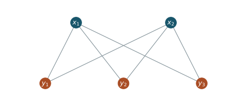
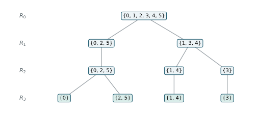

# ENS MP — Informatique-mathématiques 2022 · Corrigé brut

*Corrigé rédigé par IA, non officiel. Signalez toute erreur.*

**Rédaction** · GPT-6.2 Astra Ultra · vitesse non renseignée

**Révision** · GPT-6.2 Astra Ultra · vitesse non renseignée · 26 novembre 2026

**Automates, points fixes et équivalence de langage.** Un état accepte un mot lorsque le parcours de ses lettres aboutit à une sortie 1. On cherche à décider si deux états acceptent les mêmes mots, puis à calculer toutes les classes en une seule fois.

## 1. Langages reconnus et parcours de paires

### Question 1.1

Depuis 1, les mots acceptés ont un nombre impair de lettres $a$. Depuis 2, ce nombre est pair, zéro compris. Chaque $a$ échange les états et $b$ laisse l’état courant inchangé.

### Question 1.2

On a $L(0)=(ab)^*$, $L(1)=\varnothing$ et $L(2)=b(ab)^*$. Depuis 0, toute excursion qui se termine pour la première fois de nouveau en 0 doit suivre $0\xrightarrow{a}2\xrightarrow{b}0$. Toute autre lettre sur ce trajet mène au puits 1. Depuis 2, il faut commencer par $b$.

### Question 1.3

Soit $B$ l’ensemble des mots finissant par $b$, et soient $P,I$ les mots dont le nombre de $a$ est respectivement pair et impair. Alors
$$L(0)=\{\varepsilon\}\cup(B\cap P),\qquad L(1)=B\cap I,\qquad L(2)=B\cap P.$$
Pour un mot non vide, les états 0 et 2 ont les mêmes transitions sortantes. Après la dernière lettre $a$ on se trouve en 1 ou 2, tous deux non acceptants. Une dernière lettre $b$ mène en 0 si la parité, comptée à partir de 0 ou de 2, est paire. Partir de 1 inverse cette parité. À droite du dessin, 3 et 4 ont le langage de 0, 5 et 7 celui de 1, et 6 celui de 2. En effet, en identifiant ces groupes, les sorties et les deux transitions de chaque groupe redonnent la partie gauche.

### Question 1.4

Les classes sont $\{0,3,4\}$, $\{1,5,7\}$ et $\{2,6\}$. La relation est l’union des trois carrés cartésiens de ces classes. Le mot vide distingue la première des deux autres et $b$ distingue les deux dernières.

### Question 1.5

Notons $ij=(i,j)$ et écrivons une barre au-dessus d’une paire déjà traitée puis ignorée. La paire soulignée est celle que l’on vient d’extraire, les entrées à droite sont encore dans la file. Les deux dernières lignes demandées sont
$$03,15,04,26,17,\overline{17},\overline{03},\overline{17},\overline{03},\overline{26},\underline{17} \qquad (\mathrm{vrai}),$$
$$25,16,\underline{07},27,13 \qquad (\mathrm{faux}).$$
Dans la première ligne, le dernier 17 est aussi ignoré et la file est vide. Dans la deuxième, les sorties de 0 et 7 diffèrent. Les deux dernières entrées ne sont jamais examinées.

## 2. Points fixes et clôtures

### Question 2.1

Si $X\subseteq Y$, la suite $X,Y,Y,\ldots$ est croissante et sa réunion vaut $Y$. La continuité donne $f(Y)=f(X)\cup f(Y)$, donc $f(X)\subseteq f(Y)$.

### Question 2.2

Pour $X\subseteq Y$, la suite $Y,X,X,\ldots$ décroît et son intersection vaut $X$. La co-continuité donne $f(X)=f(Y)\cap f(X)$, soit $f(X)\subseteq f(Y)$.

### Question 2.3

Sur $E=\mathbb N$, posons $f(S)=E$ si $S$ est infini, et $f(S)=\varnothing$ sinon. Cette fonction est croissante. Les préfixes $[0,i]$ ont des images vides, mais leur réunion a pour image $E$. Les queues $[i,+\infty[\cap\mathbb N$ ont toutes pour image $E$, mais leur intersection a pour image $\varnothing$. Sur un ensemble fini, en revanche, toute chaîne monotone indexée par les entiers est stationnaire et toute fonction croissante a les deux propriétés.

Une affirmation du préambule de la partie 2 appelle également une restriction. Une réunion **infinie** de fonctions co-continues peut perdre la co-continuité. Par exemple, $h_j(S)=\{0\}$ si $j\in S$, et $\varnothing$ sinon, préserve les intersections décroissantes. Leur réunion vaut $\{0\}$ sur chaque queue et $\varnothing$ sur l’intersection vide. Les preuves ci-dessous utilisent les propriétés de stabilité vérifiées directement.

### Question 2.4.i

Toute fonction admet $\varnothing$ comme post-point fixe car $\varnothing\subseteq f(\varnothing)$, et $E$ comme pré-point fixe car $f(E)\subseteq E$.

### Question 2.4.ii

Si $E\ne\varnothing$, $f(S)=E\setminus S$ n’a aucun point fixe. Pour un élément fixé de $E$, l’égalité exigerait que son appartenance à $S$ équivaille à sa non-appartenance. Si $E=\varnothing$, son unique partie est forcément fixe.

### Question 2.5

Écrivons $U=\bigcup_{i\in J}S_i$ avec $S_i\subseteq f(S_i)$. Pour chaque $i$, $S_i\subseteq f(S_i)\subseteq f(U)$ par croissance. La réunion donne $U\subseteq f(U)$, quelle que soit la cardinalité de $J$.

### Question 2.6.i

De $\nu f\subseteq f(\nu f)$, la croissance donne $f(\nu f)\subseteq f(f(\nu f))$. Ainsi $f(\nu f)$ est lui-même un post-point fixe et figure dans la réunion qui définit $\nu f$. Cela donne $f(\nu f)\subseteq\nu f$.

### Question 2.6.ii

Les deux inclusions donnent $f(\nu f)=\nu f$. Si $Z=f(Z)$, alors $Z\subseteq f(Z)$ et donc $Z\subseteq\nu f$. On a bien établi la maximalité au sens du plus grand élément.

### Question 2.7

Soit $M=\bigcap_{f(Y)\subseteq Y}Y$. Pour chaque tel $Y$, $f(M)\subseteq f(Y)\subseteq Y$. Ainsi $f(M)\subseteq M$ et par croissance $f(f(M))\subseteq f(M)$. Donc $f(M)$ est lui-même dans la famille intersectée, soit $M\subseteq f(M)$. Finalement $M$ est fixe, et tout point fixe, qui est un pré-point, contient $M$.

### Question 2.8.i

On a $f(E)\subseteq E$. Si $f^{i+1}(E)\subseteq f^i(E)$, la croissance donne $f^{i+2}(E)\subseteq f^{i+1}(E)$. D’où la décroissance par récurrence.

### Question 2.8.ii

Posons $D=\bigcap_{i\ge0}f^i(E)$. Par co-continuité sur la chaîne précédente, $f(D)=\bigcap_{i\ge0}f^{i+1}(E)=D$ puisque le terme omis est $E$. Pour tout point fixe $Z$, $Z\subseteq E$ implique $Z=f^i(Z)\subseteq f^i(E)$ par croissance de chaque itérée. Donc $Z\subseteq D$ et $D=\nu f$.

### Question 2.9.i

Posons $u=f\cup\mathrm{id}$. Pour chaque $X$, $X=u^0(X)$ et $f(X)\subseteq u(X)$ sont contenus dans $\bigcup_{i\ge0}u^i(X)=f^\omega(X)$.

### Question 2.9.ii

Si $f$ est continue, $u$ est continue puisque réunion et image par l’identité commutent aux réunions croissantes. Elle est croissante et extensive, donc $u^i(X)$ croît avec $i$. Posons $U=f^\omega(X)$. Alors $u(U)=\bigcup_i u^{i+1}(X)=U$, le premier terme étant contenu dans le suivant. Toutes les itérées de $u$ fixent $U$, donc $f^\omega(U)=U$. Ceci établit la saturation. La croissance de $f^\omega$ vient de celle de toutes les itérées et l’extensivité de 2.9.i.

### Question 2.10

Le calcul précédent donne $X\subseteq U$ et $f(U)\subseteq u(U)=U$. Si $Y\supseteq X$ et $f(Y)\subseteq Y$, alors $u(Y)=Y$ et $u^i(X)\subseteq u^i(Y)=Y$ par croissance. En réunissant, $U\subseteq Y$. Ceci prouve les trois propriétés demandées.

### Question 2.11

D’après 2.9, $f^\omega$ est une clôture contenant $f$. Pour toute autre clôture $h$ avec $f\subseteq h$, on a $X\subseteq h(X)$ et $f(h(X))\subseteq h(h(X))\subseteq h(X)$. La question 2.10 donne $f^\omega(X)\subseteq h(X)$ pour chaque $X$, soit l’ordre point par point demandé.

### Question 2.12

Il s’agit, respectivement, de la réflexivité ($xRx$ pour tout $x$), de la symétrie ($xRy\Rightarrow yRx$) et de la transitivité ($xRy$ et $yRz\Rightarrow xRz$).

### Question 2.13

Les pré-points fixes de $r,s,t$ sont, respectivement, les relations réflexives, symétriques, transitives. Pour $r\cup t$ il faut simultanément réflexivité et transitivité, soit un préordre. Pour $r\cup s\cup t$ on obtient exactement les relations d’équivalence.

### Question 2.14

Soit $R_i$ une chaîne croissante et $R=\bigcup_iR_i$. La fonction constante $r$ commute à cette réunion non vide. Transposer commute à toute réunion donc $s(R)=\bigcup_i s(R_i)$. Si $(x,z)\in R\cdot R$, il existe $y$ avec $xR_i y$ et $yR_jz$. Pour $m=\max(i,j)$, les deux liens sont dans $R_m$, d’où $(x,z)\in t(R_m)$. L’autre inclusion vient de $R_m\subseteq R$. Ainsi $t$ est continue. La relation transitive minimale contenant $R$ est $t^\omega(R)$, comme le donne 2.10. L’expression $t(R)$ à la fin de la page 7 ne contient en général que les chemins de longueur deux.

## 3. Bisimulations et tests de deux états

### Question 3.1

La première paire engendre $03,15,04,26,17$ dans la notation de 1.5. Les successeurs par $(a,b)$ sont respectivement $(15,04),(26,17),(17,03),(17,03),(26,17)$. Chaque paire a deux sorties égales, donc l’ensemble décrit est une bisimulation. Toute bisimulation contenant $03$ contient les cinq paires, chacune étant accessible. Pour $25$, la lettre $b$ impose $07$, qui a des sorties distinctes. Aucune bisimulation ne contient $25$.

### Question 3.2

Pour $R\subseteq S$ et $(x,y)\in p(R)$, les sorties coïncident et chaque paire de successeurs appartient à $R$, donc à $S$. Cela donne $(x,y)\in p(S)$, puis $p(R)\subseteq p(S)$.

### Question 3.3.i

Si $L(x)=L(y)$, la présence de $\varepsilon$ y est la même et donc $o(x)=o(y)$. Pour toute lettre $a$ et tout mot $w$, on a $w\in L(\delta(x,a))\Leftrightarrow aw\in L(x)\Leftrightarrow aw\in L(y)\Leftrightarrow w\in L(\delta(y,a))$. Les successeurs sont donc équivalents, ce qui donne $\simeq\,\subseteq p({\simeq})$.

### Question 3.3.ii

Soit $R\subseteq p(R)$. Montrons pour **tous** $xRy$ que $w\in L(x)\Leftrightarrow w\in L(y)$, par récurrence sur $w$. Pour $\varepsilon$, cela résulte de $o(x)=o(y)$. Pour $w=av$, la paire $(\delta(x,a),\delta(y,a))$ est dans $R$. L’hypothèse de récurrence appliquée à cette paire et à $v$ donne l’équivalence voulue pour $av$. Ainsi $R\subseteq {\simeq}$.

### Question 3.3.iii

La relation $\simeq$ est une bisimulation et contient toute bisimulation. Elle est donc égale à leur réunion $\nu p$.

### Question 3.4

Au départ $u_0=(x_0,y_0)\in F$. D’une entrée de boucle à la suivante, une paire extraite qui est ignorée est déjà dans $R$. Si elle est nouvelle et que la boucle continue, elle passe dans $R$, qui ne perd jamais d’élément. Toute autre paire de $R\cup F$ subsiste. Donc $u_0\in R\cup F$ reste vrai.

### Question 3.5

À l’initialisation $R=\varnothing$, donc $R\subseteq p(R\cup F)$. Lors d’un passage qui se poursuit, l’union $R\cup F$ ne diminue pas d’après 3.4. Par croissance de $p$, chaque ancienne paire reste dans la nouvelle image. La paire nouvelle, le cas échéant, a deux sorties égales après le test, et toutes ses paires de successeurs viennent d’entrer dans la file. Elle appartient donc elle aussi à $p(R'\cup F')$, où les primes désignent les valeurs à l’entrée suivante.

### Question 3.6

Les invariants deviennent $u_0\in R$ et $R\subseteq p(R)$. Ainsi $R$ est une bisimulation contenant $u_0$. D’après 3.3.ii, les états de départ ont le même langage et la réponse vraie est justifiée.

### Question 3.7

L’invariant $I_3$ est que toute paire $(x,y)\in F$ admet un mot témoin $w$ avec $x=\delta^*(x_0,w)$ et $y=\delta^*(y_0,w)$. Initialement on prend $\varepsilon$. L’extraction conserve les témoins des paires restantes. Si l’on insère les successeurs de la paire extraite, leurs témoins sont les mots $wa$ pour $a\in A$. À une sortie fausse, la paire extraite avait un témoin $w$ et ses sorties diffèrent. Ce même mot est donc accepté depuis exactement un état initial.

### Question 3.8

La quantité entière $n^2-|R|$ baisse de un à chaque passage non trivial qui ne se termine pas par un retour faux. Lors d’un passage trivial, elle est constante mais la longueur de la file baisse de un. Le couple $(n^2-|R|,|F|)$ décroît donc strictement dans l’ordre lexicographique sur $\mathbb N^2$ à chaque retour en tête de boucle. Il n’existe pas d’exécution infinie.

### Question 3.9

Les réponses vraie et fausse ont été justifiées en 3.6–3.7 et la terminaison en 3.8. Chaque paire nouvelle occasionne deux tests de sortie et au plus $2k$ appels de transition, avec $k=|A|$. Il y a au plus $n^2$ passages de ce type, retour faux compris. Les passages triviaux n’appellent ni $o$ ni $\delta$. La borne est donc $O((k+1)n^2)$, soit $O(kn^2)$ pour $k\ge1$. Si l’alphabet est vide, seules les deux sorties initiales sont comparées.

### Question 3.10

La file donne un parcours en largeur du graphe des paires, la pile un parcours en profondeur. Si le résultat est vrai, elles développent exactement les mêmes paires accessibles, une fois chacune, et consomment toutes les insertions. En cas d’échec, l’ordre peut changer le travail avant le premier désaccord.

Par exemple, comparer un puits acceptant $z$ avec un état acceptant $x$ qui, par $a$, mène à un puits refusant et, par $b$, au premier d’une chaîne de $m$ états acceptants. Les deux lettres font avancer d’un pas dans cette chaîne, dont le dernier état boucle. Si l’on insère $a$ puis $b$, la file trouve le désaccord dès la deuxième extraction. La pile développe les $m$ paires de la chaîne avant de traiter la branche $a$ de départ.

### Question 3.11

De la première à la sixième insertion dans $R$, on trouve $x_1y_1,x_2y_2,x_1y_3,x_2y_1,x_1y_2,x_2y_3$. La septième extraction retrouve $x_1y_1$. La relation obtenue est $\{x_1,x_2\}\times\{y_1,y_2,y_3\}$, de cardinal six.

### Question 3.12

Prenons deux cycles acceptants de longueurs $m$ et $m+1$ et partons d’un état de chacun. Deux temps donnent la même paire exactement si leur différence est divisible par les deux longueurs. La première répétition vient après $\mathrm{ppcm}(m,m+1)=m(m+1)$ pas. Pour $n=2m+1$, il y a donc $(n^2-1)/4$ paires distinctes et une dernière extraction triviale, ce qui atteint l’ordre quadratique.

### Question 3.13

Une condition suffisante simple est que $g$ soit croissante et extensive. Prenons
$$I'_2:\quad R\subseteq p(g(R)\cup F).$$
Au départ l’inclusion est vide. D’une entrée à la suivante, $g(R)\cup F$ ne diminue pas. En effet, une paire ignorée est dans $g(R)$, tandis qu’une paire développée entre dans $R'\subseteq g(R')$ et $g(R)\subseteq g(R')$. Par croissance de $p$, les anciennes paires vérifient encore l’invariant. Une paire développée a des sorties égales et tous ses successeurs dans $F'$, donc elle le vérifie aussi. Quand $F$ est vide, $R\subseteq p(g(R))$ est exactement la bisimulation modulo $g$.

Le même argument conserve $u_0\in g(R)\cup F$. Cette version du premier invariant couvre le cas où $u_0\in g(\varnothing)$ est ignorée dès le premier tour, cas où $u_0\in R\cup F$ imprimé dans l’algorithme 2 peut cesser d’être vrai.

### Question 3.14

Par extensivité, $u\notin g(R)$ entraîne $u\notin R$. Un développement ajoute donc exactement une paire à $R$. Un passage trivial consomme une entrée sans insertion. Le même couple lexicographique qu’en 3.8 décroît strictement à tout passage qui se poursuit.

### Question 3.15

Si $h,j$ sont compatibles, $h\circ j$ est croissante. En utilisant d’abord la croissance de $h$, puis sa compatibilité,
$$(h\circ j)\circ f\subseteq h\circ f\circ j\subseteq f\circ h\circ j.$$
C’est la compatibilité cherchée.

### Question 3.16

Écrivons $H(X)=\bigcup_i h_i(X)$. Cette fonction est croissante par croissance de chaque terme. Pour chaque $i$ et $X$, $h_i(f(X))\subseteq f(h_i(X))\subseteq f(H(X))$. Réunir donne $H\circ f\subseteq f\circ H$.

### Question 3.17

L’identité est compatible. Par 3.16, $u=h\cup\mathrm{id}$ est compatible, puis, par 3.15 et récurrence, chaque $u^i$ l’est. Une nouvelle application de 3.16 à $h^\omega=\bigcup_{i\ge0}u^i$ conclut. Aucune hypothèse de continuité de $h$ n’est nécessaire ici.

### Question 3.18.i

Si $X\subseteq f(h(X))$, alors
$$h(X)\subseteq h(f(h(X)))\subseteq f(h(h(X)))\subseteq f(h(X)).$$
Les trois passages utilisent la croissance de $h$, la compatibilité, puis la saturation de $h$ et la croissance de $f$. Ainsi $h(X)$ est post-point fixe de $f$.

### Question 3.18.ii

Pour chaque post-point $X$ de $f\circ h$, on a $X\subseteq h(X)\subseteq\nu f$ par extensivité et par (i). La réunion de ces $X$ donne $\nu(f\circ h)\subseteq\nu f$.

### Question 3.18.iii

Oui. De $\nu f\subseteq h(\nu f)$ on déduit $\nu f=f(\nu f)\subseteq f(h(\nu f))$. Ainsi $\nu f$ est un post-point de $f\circ h$ et se trouve contenu dans le plus grand point fixe de cette composée. Les deux plus grands points fixes sont égaux.

### Question 3.19

Il suffit que $g$ soit une clôture compatible avec $p$. La terminaison vient de 3.14. À la sortie vraie, 3.13 donne $R\subseteq p(g(R))$ et $u_0\in g(R)$. Par 3.18.i, $g(R)$ est une bisimulation, donc $u_0\in {\simeq}$. À la sortie fausse, le témoin de 3.7 reste valable car toute nouvelle mise en file suit toujours une transition simultanée. Le mot témoin distingue les deux langages.

### Question 3.20

On extrait d’abord $(x_1,y_1),(x_2,y_2),(x_3,y_3)$. Les deux parcours se rejoignent en $x_4$, puis traversent le cycle $x_4,\ldots,x_n,x_3$ de longueur $n-2$. On extrait ensuite une seconde fois $(x_4,x_4)$. Total, $3+(n-2)+1=n+2$ itérations.

### Question 3.21

Choisissons $g(R)=R\cup 1=r^\omega(R)$. C’est la clôture réflexive. La constante $r$ est compatible car $r(p(R))=1\subseteq p(1)$, chaque état ayant ses propres sorties et successeurs. L’identité et la réunion conservent la compatibilité par 3.16. La question 3.19 s’applique. Après les trois premières comparaisons, la quatrième extraction est diagonale et ignorée. Pour tester $(x,y)\in g(R)$, comparer d’abord $x$ et $y$, puis, si nécessaire, chercher la paire dans la liste $R$. Sur ces entrées, cette liste contient au plus trois paires. En initialisant $R$ à la liste vide et la file à la seule paire de départ, les quatre itérations et leur initialisation prennent donc un temps constant.

### Question 3.22

Prenons la clôture d’équivalence $g=(r\cup s\cup t)^\omega$. Les trois fonctions de base sont croissantes. La compatibilité de $r$ vient de 3.21. Si $(x,y)\in s(p(R))$, les sorties coïncident et chaque paire de successeurs est dans $s(R)$, d’où $s\circ p\subseteq p\circ s$. Si $x\,p(R)\,z\,p(R)\,y$, les trois sorties coïncident et $\delta(z,a)$ sert d’intermédiaire pour chaque lettre, d’où $t\circ p\subseteq p\circ t$. Par 2.14, 2.9 et 3.16–3.17, $g$ est une clôture compatible, donc le test est correct.

Au cinquième tour le chemin non orienté $x_1-y_1-x_2-y_2$ est déjà présent. La paire $(x_1,y_2)$ est dans $g(R)$, elle est ignorée et la file se vide.

### Question 3.23

Il y a initialement $n$ classes de $g(\varnothing)=1$. Un développement fusionne exactement deux classes distinctes et leur nombre baisse de un. Un passage trivial ne le change pas. Pour $n\ge1$, il y a donc au plus $n-1$ fusions, et au plus $n$ passages non triviaux si l’on inclut un éventuel retour faux avant fusion. Une structure d’ensembles disjoints permet de décider l’égalité des représentants et de fusionner les classes.

## 4. Raffinement global et automate quotient

### Question 4.1

Pour chaque paire non ordonnée d’états distincts, initialiser et exécuter le test de Hopcroft–Karp. Reporter le résultat symétriquement dans une matrice booléenne, avec une diagonale vraie. Les $n(n-1)/2$ tests coûtent chacun $O(kn\alpha(n))$, initialisation des représentants comprise pour $k\ge1$. Total $O(kn^3\alpha(n))$.

### Question 4.2

Pour toute suite décroissante $(R_i)$, $(x,y)\in p(\bigcap_i R_i)$ signifie $o(x)=o(y)$ et, pour chaque $a$ et chaque $i$, $(\delta(x,a),\delta(y,a))\in R_i$. C’est exactement l’appartenance à $\bigcap_i p(R_i)$. Ainsi $p$ est co-continue, même pour un ensemble infini d’états. Les questions 2.8 et 3.3 donnent $\simeq\,=\nu p=\bigcap_{i\ge0}p^i(X\times X)$.

### Question 4.3

$R_0=X\times X$ est une équivalence. Si $R$ est une équivalence, $p(R)$ requiert l’égalité des sorties et, pour chaque lettre $a$, celle des classes des successeurs. C’est l’égalité de deux signatures $(o(x),([\delta(x,a)]_R)_{a\in A})$, donc une équivalence. Par récurrence, tous les $R_i=p^i(X\times X)$ le sont.

### Question 4.4

La chaîne $(R_i)$ est décroissante par 2.8.i. Si $R_{i+1}\subsetneq R_i$, une classe au moins se scinde, donc le nombre de classes augmente. Une égalité à deux niveaux consécutifs rend la suite stationnaire par application de $p$. Pour $n\ge1$, la chaîne part d’une classe et en compte au plus $n$. Donc soit elle est déjà stationnaire avant le rang $n-1$, soit $R_{n-1}$ compte $n$ classes et ne peut plus se raffiner. Son intersection est $R_{n-1}$, égale à $\simeq$ par 4.2. Si l’automate est vide, la relation vide se calcule directement.

### Question 4.5

L’unique transition est $0\to1\to2\to3\to4\to5\to3$. Les états acceptants sont 0, 2 et 5. En regroupant les états dont les mots de longueur strictement inférieure au rang donnent les mêmes sorties, on obtient
$$\begin{aligned}
R_0&: 012345,\\
R_1&: 025\mid134,\\
R_2&: 025\mid14\mid3,\\
R_3=R_4=\cdots&:0\mid14\mid25\mid3 .
\end{aligned}$$
Dans l’automate quotient on a $[0]\to[14]\to[25]\to[3]\to[14]$, où $[0]$ et $[25]$ sont acceptants. La notation $[14]$ désigne l’ensemble $\{1,4\}$ et $[25]$ l’ensemble $\{2,5\}$. Par récurrence sur la longueur d’un mot, son parcours dans le quotient est la suite des classes de son parcours original. L’acceptation est donc conservée.

### Question 4.6

Écrivons $T(R)=\{(x,y):\forall a,\ (\delta(x,a),\delta(y,a))\in R\}$. Alors $p(R)=P_0\cap T(R)$, $d(R)=R\cap T(R)$ et $R_1=P_0$. Pour $j\ge1$, on a $R_{j+1}=P_0\cap T(R_j)\subseteq R_j\subseteq P_0$. Il en résulte $R_{j+1}=R_j\cap T(R_j)=d(R_j)$. L’initialisation et cette récurrence donnent $d^i(P_0)=R_{i+1}$.

### Question 4.7

Numérotons les états de 0 à $n-1$ et les lettres de 1 à $k$. Stockons les transitions dans un tableau $n\times k$, les sorties dans un tableau, la classe courante dans $c[x]$, initialisée en numérotant les classes de sortie non vides de 0 à $q-1$, où $q$ est leur nombre. Même si tous les états sont acceptants, l’unique classe reçoit le numéro 0. À une étape, constituer la clé
$$K_x=(c[x],c[\delta(x,a_1)],\ldots,c[\delta(x,a_k)]).$$
Trier les indices des états selon leurs clés. Une lecture des indices triés attribue le même nouveau numéro à deux clés identiques et incrémente le numéro à chaque changement. Conserver les anciens numéros jusqu’à la fin de ce passage. Si le nombre de classes ne change pas, retourner les nouvelles classes. Sinon, recommencer.

L’égalité des clés décrit exactement $d(R)$ par définition. Les partitions se raffinent, donc l’égalité de leurs nombres de classes suffit pour certifier leur égalité. Par 4.4–4.6, le résultat est $\simeq$. Un tri comparatif garanti, tel le tri fusion, coûte $O(n\log n)$ comparaisons de $O(k+1)$ opérations. La construction des clés et le balayage coûtent $O((k+1)n)$. En au plus $n$ passages, on obtient $O(kn^2\log n)$ pour $k\ge1,n\ge2$, avec $O((k+1)n)$ cases. La relation est donnée par $x\simeq y\Leftrightarrow c[x]=c[y]$ ou peut être écrite en matrice en $O(n^2)$.

### Question 4.8

Choisir un représentant par classe, puis écrire $o'([x])=o(x)$ et $\delta'([x],a)=[\delta(x,a)]$. La bisimulation $\simeq$ garantit que ces deux prescriptions sont indépendantes du représentant. Une récurrence sur le mot montre que l’état atteint dans le quotient est la classe de l’état atteint dans l’original, d’où conservation des langages. Deux classes distinctes reconnaissent des langages distincts. Tout automate reconnaissant cet ensemble de langages depuis ses états nécessite au moins un état par langage distinct. Le quotient atteint cette borne et se construit en $O(kn+n)$ après le raffinement.

### Question 4.9

À chaque étape de 4.7, les numéros de classes appartiennent à $\{0,\ldots,n-1\}$. En partant d’une liste des indices, appliquer un tri stable par comptage sur la dernière coordonnée, puis sur l’avant-dernière, jusqu’à la première. Pour une coordonnée, compter les occurrences dans $n$ cases, calculer par sommes préfixes la première position de chaque valeur, puis recopier les indices dans un tableau auxiliaire par ordre d’arrivée en avançant le pointeur de la valeur. Cela coûte $O(n)$, initialisation comprise.

Après chaque passe les indices sont triés par le suffixe de coordonnées déjà parcouru, car la stabilité conserve l’ordre de ce suffixe lorsque la nouvelle coordonnée est égale. La liste finale a donc exactement l’ordre lexicographique requis. Un raffinement coûte $O((k+1)n)$ pour les $k+1$ coordonnées et le balayage. Il y en a au plus $n$, plus la construction du quotient. Le coût total est $O(kn^2)$ pour $k\ge1$. Pour $k=0$, les sorties déterminent immédiatement le quotient.
