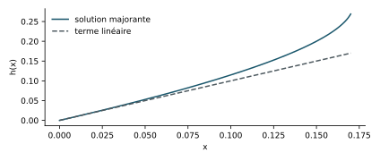

# ENS MP — Mathématiques C 2022 · Corrigé brut

*Corrigé rédigé par IA, non officiel. Signalez toute erreur.*

**Rédaction** · GPT-6.2 Astra Ultra · vitesse non renseignée

On note $f_k$ le coefficient de degré $k$, $\widehat f$ la série de ses modules et $O_m$ les séries sans termes de degrés inférieurs à $m$.

## A. Premières propriétés

### Question 1

Par hypothèse $\sum_k|f_kz^k|=\widehat f(|z|)<\infty$. La série converge absolument, et l’inégalité triangulaire sur les sommes partielles puis à la limite donne $|f(z)|\le\widehat f(|z|)$. Pour $f=1-z$ et $z=1$ les deux membres valent $0$ et $2$.

### Question 2

Pour tout $0\le r<\rho(g)$, la série $\sum_k|g_k|r^k$ converge absolument. Comme $|f_k|\le|g_k|$, $\sum |f_k|r^k$ converge également. On obtient $\rho(f)\ge\rho(g)$, y compris si le rayon de droite est infini. Si ce rayon est nul, l’inégalité est immédiate.

### Question 3

Si $0<r<\rho(f)$, les termes $|f_k|r^k$ sont bornés par $M$. Le coefficient de $z^k$ dans $a/(r-z)$ vaut $a/r^{k+1}$. Choisir $a=r(M+1)$ donne la première implication. Si ce majorant existe, alors pour $t<r$, $\sum |f_k|t^k\le(a/r)\sum(t/r)^k<\infty$. D’où $r\le\rho(\widehat f)$. On en déduit $\rho(f)\le\rho(\widehat f)$, même si le premier rayon est infini ou nul. L’autre sens suit de 2 avec $f\prec\widehat f$.

### Question 4

Pour chaque $k$, $|(fg)_k|\le\sum_{i=0}^k|f_i||g_{k-i}|=(\widehat f\,\widehat g)_k$. Pour $0\le r<\min(\rho(f),\rho(g))$, la somme du majorant en $r$ est le produit fini $\widehat f(r)\widehat g(r)$, par sommation de la famille positive. Ainsi $\rho(fg)\ge\min(\rho(f),\rho(g))$.

## B. Composition

### Question 5

Le produit d’un élément de $O_p$ par un élément de $O_q$ appartient à $O_{p+q}$, par le produit de Cauchy. Ainsi $h^r\in O_{r\ell}$. Les puissances présentes dans $f\circ h$ ont des exposants $k\ge n$, d’où $f\circ h\in O_{n\ell}$. Pour $k\ge1$,
$$(g+h)^k-g^k=h\sum_{i=0}^{k-1}(g+h)^i g^{k-1-i}\in O_{\ell+k-1}.$$
Le terme constant de $f$ disparaît dans la différence. En sommant coefficient par coefficient pour $k\ge\max(n,1)$, on obtient $f\circ(g+h)-f\circ g\in O_{n+\ell-1}$.

### Question 6

Pour tout $m$, $|(f\circ g)_m|\le\sum_{k=0}^m|f_k|(\widehat g^k)_m=(\widehat f\circ\widehat g)_m$ par 4. Si les deux rayons sont positifs, $\widehat g(r)\to0$ quand $r\downarrow0$, puisque $g_0=0$. Choisissons $0<r<\rho(g)$ tel que $\widehat g(r)<\rho(f)$. En regroupant les coefficients positifs, $\sum_m(\widehat f\circ\widehat g)_m r^m=\sum_k|f_k|\widehat g(r)^k<\infty$. Donc $\rho(f\circ g)\ge r>0$.

### Question 7

Comme $|h_j|\le g_j$, les convolutions donnent $|(h^k)_m|\le(g^k)_m$. Les $f_k$ étant positifs au sens large, $|(f\circ h)_m|\le\sum_k f_k(g^k)_m=(f\circ g)_m$.

### Question 8

Pour $r<\infty$, la somme à termes positifs se réordonne en
$$(f\circ g)(r)=\sum_m\sum_{k=1}^m f_k(g^k)_m r^m=\sum_{k\ge1}f_k\,g(r)^k=f(g(r)).$$
Le produit de Cauchy à coefficients positifs justifie la somme de chaque puissance, avec la convention de l’énoncé pour les coefficients nuls. L’identité reste vraie en $r=0$ et si $g=0$. En $r=\infty$, on passe par croissance des sommes à la limite $r\to\infty$. Si $g$ est non nulle, $g(r)\to\infty$ car elle a un coefficient positif de degré au moins un ; le cas $g=0$ est immédiat.

### Question 9

Posons $r=|z|$. Si $f$ possède un coefficient non nul de degré $j\ge1$, la finitude de $(\widehat f\circ\widehat g)(r)$ et la question 8 (appliquée à $\widehat f-|f_0|$) donnent $|f_j|\widehat g(r)^j<\infty$, puis $\sum_k|f_k|\widehat g(r)^k<\infty$. Donc $g(z)$ existe et la famille des termes du développement de $\sum_k f_kg(z)^k$ est absolument sommable. En regroupant par degré total, on obtient sa somme $(f\circ g)(z)$.

Pour $f$ constante, l’hypothèse imprimée ne garantit pas que $g(z)$ soit défini. Par exemple $f=1$, $g=\sum_{k\ge1}k!z^k$ donnent $\rho(\widehat f\circ\widehat g)=\infty$, tandis que $g(1)$ diverge. L’identité pour une constante est valable en tout point où $g(z)$ existe ; la composée formelle est constante partout.

### Question 10

Dans $\mathbb C[z]/(z^{m+1})$, les substitutions par $g,h\in O_1$ sont bien définies car elles envoient $z^{m+1}$ dans l’idéal $(z^{m+1})$. On représente les trois séries par leurs troncatures à l’ordre $m$ ; les substitutions polynomiales y sont associatives. Les deux composées ont donc le même coefficient à chaque degré $m$, ce qui donne l’associativité formelle.

## C. Série majorante

### Question 11

Après multiplication par $b-h$, on obtient $(1+a)h^2-(b+ax)h+abx=0$. La branche cherchée est
$$h(x)=\frac{b+ax-\sqrt{(b+ax)^2-4ab(1+a)x}}{2(1+a)}.$$
Le discriminant vaut $b^2>0$ en zéro. Sur un voisinage assez petit, sa racine est développable en série entière, en utilisant $b\sqrt{1+u(x)}$ avec $u(0)=0$. La branche a $h(0)=0$, donc $b-h$ y reste non nul quitte à réduire le voisinage. Elle vérifie l’équation d’origine.

### Question 12

Notons $U=z^2/(b-z)=\sum_{j\ge2}z^j/b^{j-1}$. Comme les séries intérieures sont sans constante, $(U\circ h)_k$ est un polynôme à coefficients positifs en $h_1,\ldots,h_{k-1}$. La relation $h=a(I+U\circ h)$ impose donc $h_0=0,h_1=a$, puis tous les coefficients positifs au sens large par récurrence. Pour $g$ l’inégalité donne $g_0=0,g_1\le a$ ; si $g_i\le h_i$ pour $i<k$, la monotonie de ce polynôme donne $g_k\le h_k$. Ainsi $g\prec h$ et $\rho(g)\ge\rho(h)>0$ par 2 et 11.

## D. Série réciproque

### Question 13

Pour $h\in O_1$, $(h\circ f)_m=\lambda^m h_m+\sum_{1\le k<m}h_k(f^k)_m$. En degré un, $h_1=1/\lambda$. Ensuite, puisque $\lambda^m\ne0$, l’égalité à $I_m$ détermine $h_m$ à partir des précédents. La construction récursive produit bien une solution et assure l’unicité.

### Question 14

On a $f\circ g=\lambda g+F\circ g$. Le coefficient de degré $m$ de $F\circ g$ dépend exclusivement de $g_1,\ldots,g_{m-1}$ car $F\in O_2$. On construit donc $g_1=1/\lambda$, puis chaque $g_m$ de façon unique pour obtenir $f\circ g=I$.

### Question 15

Par 10, $h=h\circ I=h\circ(f\circ g)=(h\circ f)\circ g=I\circ g=g$. Cette série est l’inverse bilatère $f^\dagger$.

### Question 16

De $\lambda g=I-F\circ g$ et de 6, on tire $\widehat g\prec |\lambda|^{-1}(I+\widehat F\circ\widehat g)$. Comme la relation $\prec$ compare les modules des coefficients, c’est aussi la notation avec $1/\lambda$ de l’énoncé. Si $\rho(f)>0$, choisissons $0<b<\rho(f)$. Les termes $|F_j|b^j$ sont bornés. Comme $F\in O_2$, il existe $K>0$ tel que $\widehat F\prec K z^2/(b-z)$ (le coefficient du majorant en degré $j\ge2$ est $K b^{1-j}$). La monotonie des convolutions donne alors $\widehat g\prec a(I+\widehat g^2/(b-\widehat g))$ pour $a=\max(1,K)/|\lambda|$. La partie C donne $\rho(g)>0$.

### Question 17

Pour $f=I+F$, l’équation de 14 devient $G+F\circ(I+G)=0$. Changer $G$ en $[G]_{d+1}$ dans le premier terme introduit une erreur dans $O_{d+2}$. Dans le second, $G-[G]_d\in O_{d+1}$ et $F\in O_2$, donc par 5 le changement est aussi dans $O_{d+2}$. Leur somme a l’ordre voulu.

### Question 18

Notons $t=(1-\alpha)s$. La question 17 donne $[G]_{d+1}=-[F\circ(I+[G]_d)]_{d+1}$. Donc $\widehat{[G]_{d+1}}(t)\le\widehat F(t+\widehat{[G]_d}(t))$. Pour $d=1$, $[G]_1=0$. Si $\widehat{[G]_d}(t)\le\alpha s$, l’argument à droite est au plus $s$ et la valeur au plus $\alpha s$. Par récurrence la borne est vraie à tous les rangs. Par croissance des sommes partielles positives, $\widehat G(t)\le\alpha s$.

## E. Linéarisation formelle

### Question 19

Au degré $m\ge2$ on a $(\lambda^m-\lambda)H_m=(F\circ(I+H))_m$. Comme $F\in O_2$, le membre droit ne dépend que de $H_2,\ldots,H_{m-1}$. Le coefficient de gauche est non nul car $\lambda\ne0$ et $\lambda^{m-1}\ne1$. La récurrence construit une unique série $H\in O_2$. Les degrés zéro et un sont automatiquement satisfaits.

### Question 20

Pour $h=I+H$, l’équation de 19 équivaut à $h\circ(\lambda I)=f\circ h$. Le coefficient linéaire de $h$ vaut un, donc la partie D permet de composer à gauche par $h^\dagger$. On obtient $h^\dagger\circ f\circ h=\lambda I$. Réciproquement cette conjugaison redonne l’équation de 19, assurant l’unicité sous la normalisation.

## F. Cas hyperbolique

### Question 21

Pour $m\ge2$, $|\lambda^m-\lambda|\ge|\lambda|\,\big||\lambda|^{m-1}-1\big|$. Si $0<|\lambda|<1$, la dernière quantité est au moins $|\lambda|(1-|\lambda|)$ ; si $|\lambda|>1$, elle est au moins $|\lambda|(|\lambda|-1)$. Ainsi $\omega=|\lambda|\,\big|1-|\lambda|\big|>0$ convient.

### Question 22

Pour $m\ge2$, par 19 et 21, $|H_m|\le\omega^{-1}|(F\circ(I+H))_m|\le\omega^{-1}(\widehat F\circ(I+\widehat H))_m$. Les premiers coefficients de $H$ sont nuls, donc cette inégalité fournit toute la majoration annoncée.

### Question 23

Posons $U=I+\widehat H$. Comme en 16, l’analyticité de $F\in O_2$ donne $\widehat F\prec Kz^2/(b-z)$ avec $K,b>0$. La question 22 donne $U\prec I+(K/\omega)U^2/(b-U)$. La partie C, avec $a=\max(1,K/\omega)$, fournit $\rho(U)>0$. Il s’ensuit $\rho(H)>0$ et $\rho(h)>0$.

## G. Cas elliptique et pertes de rayon

### Question 24

Puisque $F\in O_{m+1}$ et $m\ge1$, $\widehat F(s)/s\to0$ en $0^+$. Choisissons $0<r_0<\min(1,\rho(F))$ tel que $\widehat F(s)\le s$ pour $0\le s\le r_0$. Si $r=\gamma s$, chaque monôme est multiplié par $\gamma^k\le\gamma^{m+1}$. D’où $\widehat F(r)\le\gamma^{m+1}\widehat F(s)\le\gamma^m r$.

### Question 25

Par construction $(P\circ(\lambda I)-\lambda P)_k=F_k$ pour $m+1\le k\le2m$. Les degrés plus bas sont nuls, donc la différence à $F$ est dans $O_{2m+1}$. En notant $R=(I+P)^\dagger-I$, la relation $R=-P\circ(I+R)$ donne $R\in O_{m+1}$, puis $R+P\in O_{2m+1}$ par 5. Sur la plage $r\le\gamma_m r_0$, 24 et $\gamma_m^m=\alpha_m^2$ donnent $\widehat P(r)\le\widehat F(r)/\alpha_m\le\alpha_m r$. Pour $0<r\le(1-\alpha_m)\gamma_m r_0$, posons $s=r/(1-\alpha_m)$. La question 18 appliquée à $P$ donne $\widehat R(r)\le\alpha_m s=\alpha_m r/(1-\alpha_m)$. Au rayon nul, cette borne est immédiate.

### Question 26

Modulo $O_{2m+1}$, la question 5 donne $F\circ(I+P)\equiv F$. L’argument intérieur vaut donc $\lambda I+\lambda P+F$ à cet ordre. Puisque $R\in O_{m+1}$ et $\lambda P+F\in O_{m+1}$, substituer cet argument dans $R$ donne $R\circ(\lambda I)$ modulo $O_{2m+1}$. Par 25, $R\equiv-P$ ; par suite $G\equiv\lambda P+F-P\circ(\lambda I)\equiv0$ modulo $O_{2m+1}$.

### Question 27

Abrégeons $a=\alpha_m$, $\gamma=\gamma_m$. Pour $r$ dans l’intervalle demandé, posons $s=(1+a)r$ et $t=(1+a^2)s$. Alors $s\le\gamma r_0$ et $t\le(1-a)\gamma r_0$. Par 25, $\widehat P(r)\le ar$. Ainsi la taille de $I+P$ est au plus $s$, celle de $F\circ(I+P)$ au plus $a^2s$ par 24, et celle de $(\lambda I+F)\circ(I+P)$ au plus $t$, car $|\lambda|=1$. En développant $G=\lambda P+F\circ(I+P)+R\circ((\lambda I+F)\circ(I+P))$, 25 donne
$$\widehat G(r)\le\left(a+(1+a)a^2+\frac{a(1+a)(1+a^2)}{1-a}\right)r.$$
Les trois termes croissent avec $a\in(0,1/5]$. En $a=1/5$ leur somme vaut $1/5+6/125+39/125=14/25\le1$. D’où la seconde borne.

### Question 28

Supposons $F_k\in O_{m+1}$, $m=2^k$, avec $\widehat F_k(r_k)\le r_k$. Cela vaut au départ. Pour $0\le s\le r_k$, la positivité et l’ordre donnent $\widehat F_k(s)\le(s/r_k)^{m+1}\widehat F_k(r_k)\le s$. Le raisonnement de 24 s’applique donc avec ce $r_k$, même si le rayon de convergence est exactement $r_k$. Construisons $P_k$ par 25 puis $F_{k+1}=G$ par 26. Alors $P_k\in O_{m+1}$ et $F_{k+1}\in O_{2m+1}$. La récurrence du sujet donne précisément le rayon admissible de 27, donc $\widehat F_{k+1}(r_{k+1})\le r_{k+1}$. Enfin $\widehat P_k(r_{k+1})\le\alpha_m r_{k+1}\le r_k-r_{k+1}$ car $(1+\alpha_m)r_{k+1}\le r_k$. Les séries restent de rayon positif et l’induction est complète.

### Question 29

Les $r_k$ sont positifs décroissants et admettent une limite $r_\infty\ge0$. La question 28 donne $(I+\widehat P_j)(r_{j+1})\le r_j$. En composant ces majorants de droite à gauche, $\widehat h_k(r_k)\le r_0$. Comme $P_j\in O_{1+2^j}$, tout coefficient de degré fixé de $h_k$ finit par être constant : la substitution d’une série égale à $I$ jusqu’à ce degré ne le change pas. La limite formelle $h_*$ vérifie $h_*=I+O_2$. Par télescopage des conjugaisons, $f\circ h_k=h_k\circ(\lambda I+F_k)$. En tout degré fixé, $F_k$ finit par être nul jusque-là. Le passage coefficient par coefficient donne $f\circ h_*=h_*\circ(\lambda I)$, donc $h_*=h$ par 19–20.

Pour toute troncature d’ordre $d$, choisissons $k$ assez grand pour la stabilisation. Alors $\widehat{[h]_d}(r_\infty)\le\widehat h_k(r_k)\le r_0$. Par croissance en $d$, $\widehat h(r_\infty)\le r_0$ et $\rho(h)\ge r_\infty$. Aucun passage de cet argument n’impose que $r_\infty$ soit strictement positif pour tout $\lambda$ irrationnel sur le cercle.
