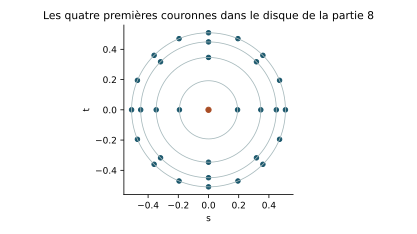
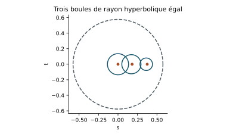

# ENS MP — Mathématiques D 2022 · Corrigé brut

*Corrigé rédigé par IA, non officiel. Signalez toute erreur.*

**Rédaction** · GPT-6.2 Astra Ultra · vitesse non renseignée

On écrit $v_0=(0,0,1)$, $B(u,v)=3x_ux_v+3y_uy_v-z_uz_v$ et $H$ pour la nappe supérieure de $B(v,v)=-1$.

## 1. Un critère d’équidistribution

### Question 1.1

Pour $Q(x)=x(x-a)(x-1)$, prenons $0<\lambda<1/(1+\max_{[0,1]}|Q^\prime|)$. Alors $P^\prime=1-\lambda Q^\prime>0$. Comme $P(0)=0$ et $P(1)=1$, continuité et croissance donnent exactement l’image $[0,1]$.

### Question 1.2

Sous $a$, les itérées décroissent et sont minorées par zéro. Leur limite est un point fixe de $P$ strictement inférieur à $a$, donc zéro. Au-dessus de $a$, elles croissent vers le seul point fixe possible, $1$. Sur un compact inférieur, le maximum de l’itérée est atteint au plus grand point du compact. Sur un compact supérieur, le maximum de son écart à $1$ est atteint au plus petit point. Ces deux écarts tendent vers zéro.

### Question 1.3

Le domaine est $[-1,1]$, comme le précise le jury. L’espace vectoriel contient $1=e_0$ et le produit de deux sommes finies est $\sum_{k,\ell}a_kb_\ell e_{k+\ell}$. Cette somme finie appartient au même espace.

### Question 1.4

Pour la formule imprimée, le seuil est $t_0=(2/\pi)\arccos\sqrt{\cos b}$ : $\cos^2(\pi t/2)>\cos b$ si et seulement si $|t|<t_0$. Les images des compacts évitant le seuil sont des compacts de l’un des deux bassins. La question 1.2 donne les convergences uniformes correspondantes. À $|t|=t_0$, toutes les itérées valent $\cos b$. En général $t_0\ne\cos b$ (prendre $\cos b=1/4$, qui donne $t_0=2/3$).

Dans la version corrigée du jury, pour une demi-largeur $0<b<1$ on itère $P_{\cos^2(\pi b/2)}$. Le seuil vaut alors exactement $b$.

### Question 1.5

Prenons $0<\varepsilon<\min((b-a)/2,(d-c)/2)$. Pour l’intervalle $[a,b]$, posons $m=(a+b)/2$, $\ell=(b-a)/2-\varepsilon/2$. Itérons le polynôme de 1.4 corrigée sur $\cos^2(\pi(s-m)/2)$. Cette fonction est un polynôme trigonométrique car son argument vaut $(1+\cos(\pi(s-m)))/2$. En distance circulaire de période $2$ au centre $m$, l’intervalle $[a+\varepsilon,b-\varepsilon]$ est à distance au plus $\ell-\varepsilon/2$ et le complément de $[a,b]$ à distance au moins $\ell+\varepsilon/2$. Par 1.4 on obtient un facteur dans $[0,1]$, supérieur à $1-\varepsilon/2$ sur le premier et inférieur à $\varepsilon/2$ sur le second. Construisons de même un facteur en $t$. Leur produit a les fréquences entières demandées et satisfait les trois inégalités, puisque $(1-\varepsilon/2)^2\ge1-\varepsilon$.

### Question 1.6

Pour $(u,v)=(0,0)$, moyenne discrète et intégrale normalisée valent $1$. Pour les autres couples, la moyenne tend vers zéro par hypothèse et l’intégrale se factorise, avec un facteur nul par intégration d’une exponentielle sur sa période. La linéarité donne la formule pour tout polynôme trigonométrique des deux variables.

### Question 1.7

Notons $\mu_n$ la moyenne sur $E_n$ et $R$ le rectangle fermé. Comme $1_R\ge f_\varepsilon-\varepsilon$, la limite inférieure de $\mu_n(R)$ est au moins $(1-\varepsilon)|R_{\rm int,\varepsilon}|/4-\varepsilon$, où le rectangle intérieur est amputé de $\varepsilon$ sur chaque bord. Ainsi $\liminf\mu_n(R)\ge |R|/4$. Le complément de $R$ contient un nombre fini de rectangles fermés disjoints dont l’aire totale est arbitrairement proche de $4-|R|$ (découper suivant les côtés, puis rétrécir les pièces). La même borne inférieure appliquée à chacun donne $\limsup\mu_n(R)\le |R|/4$.

## 2. Pseudo-orthogonalité

### Question 2.1

La matrice $J=\operatorname{diag}(3,3,-1)$ est inversible. Pour $v\ne0$, $w\mapsto v^tJw$ est donc une forme non nulle, dont le noyau $v^\perp$ a codimension un. Son intersection avec $\mathbb Rv$ est nulle exactement lorsque $B(v,v)\ne0$, ce qui équivaut à la somme directe par dimension.

### Question 2.2

Les vecteurs $(\sqrt3 x_i,\sqrt3 y_i,1)$ ont pour normes $z_i>0$. Cauchy–Schwarz donne $3x_1x_2+3y_1y_2+1\le z_1z_2$, soit $B(v_1,v_2)\le-1$. L’égalité impose la proportionnalité positive des deux vecteurs. Leur dernière coordonnée commune $1$ impose le facteur $1$, donc $v_1=v_2$. La réciproque est l’équation de $H$.

### Question 2.3

Si $w\perp v$, écrivons $w_*=(x_w,y_w)$ et $v_*=(x_v,y_v)$. Alors $z_w=3v_*\cdot w_*/z_v$. Par Cauchy–Schwarz et $z_v^2=1+3|v_*|^2$, $B(w,w)\ge 3|w_*|^2/z_v^2$. Cette quantité est positive pour $w\ne0$, puisque $w_*=0$ impliquerait $z_w=0$. La restriction symétrique bilinéaire est donc définie positive.

## 3. Symétries réelles

### Question 3.1

$g^tJg=J$ donne $(\det g)^2=1$. L’identité vérifie la relation, le produit aussi par substitution, et multiplier la relation par les inverses de $g^t,g$ montre que $g^{-1}$ la vérifie. Ces transformations forment un groupe.

### Question 3.2

Le niveau $B(v,v)=-1$ se décompose en deux graphes $z=\pm\sqrt{1+3x^2+3y^2}$, chacun homéomorphe au plan. Ils sont ouverts et fermés dans ce niveau. L’homéomorphisme $g$ permute ses composantes connexes, donc envoie $H$ sur $H$ ou sur $-H$.

### Question 3.3

Comme $B(w,w)>0$, $V=w^\perp\oplus\mathbb Rw$. La formule fixe le premier facteur et change le signe du second, d’où $s_w^2=I$. Les espaces propres de $+1,-1$ sont respectivement le plan $w^\perp$ et la droite $\mathbb Rw$.

### Question 3.4

La décomposition orthogonale de 3.3 montre que $s_w$ préserve $B$. Posons $u=v_0-B(v_0,w)w/B(w,w)$. Alors $u\perp w$ et $B(u,u)=-1-B(v_0,w)^2/B(w,w)<0$. En normalisant $u$ et choisissant son signe on obtient un point de $H$ fixé par $s_w$. La permutation des deux nappes préserve donc $H$.

### Question 3.5

Si $u\ne v$, prenons $w=u-v$. On a $B(w,w)=-2-2B(u,v)>0$ par 2.2, et $2B(u,w)=B(w,w)$. Ainsi $s_w(u)=u-w=v$. Si $u=v$, tout $w\ne0$ de $u^\perp$ convient par 2.3.

## 4. Géométrie de la nappe supérieure

### Question 4.1

Une courbe de $H$ issue de $v$ a sa dérivée dans $v^\perp$ par dérivation de $B(\gamma,\gamma)=-1$. Réciproquement, pour $w\in v^\perp$, la courbe $(v+tw)/\sqrt{-B(v+tw,v+tw)}$ reste dans $H$ pour $t$ assez petit et a pour dérivée $w$ en zéro. Ainsi $T_vH=v^\perp$, muni du produit scalaire de 2.3.

### Question 4.2

La vitesse est multipliée par $|h^\prime|$ après composition. La substitution $s=h(t)$ dans l’intégrale donne $\ell(\gamma\circ h)=\ell(\gamma)$, que $h$ soit croissant ou décroissant. On peut scinder aux points de raccord de la courbe.

### Question 4.3

Posons $u=\gamma(a)$ et $p=u-f\gamma$. Comme $B(u,\gamma)=-f$, $p\perp\gamma$ et $B(p,p)=f^2-1$. Or $\gamma^\prime\perp\gamma$. Dans le produit scalaire tangent, $|f^\prime|=|B(p,\gamma^\prime)|\le\sqrt{f^2-1}\,n$.

### Question 4.4

Par 2.2, $f\ge1$. Pour $\delta>0$, $(\operatorname{arcosh}(f+\delta))^\prime\le n$ par 4.3. Intégrons par morceaux puis faisons $\delta\downarrow0$ ; $f(a)=1$ donne $\operatorname{arcosh}f(b)\le\ell(\gamma)$. Le cosinus hyperbolique croît sur $\mathbb R_+$.

### Question 4.5

Les points du graphe $H$ se relient en relevant un segment du plan, donc la distance est finie. Retourner un chemin donne la symétrie. Concaténer deux chemins de longueurs à $\varepsilon$ de leurs infimums donne l’inégalité triangulaire après passage à la limite. On a $d(u,u)=0$ par le chemin constant et $d(u,v)\ge\operatorname{arcosh}(-B(u,v))>0$ si $u\ne v$, par 2.2 et 4.4.

### Question 4.6

Il faut $g\in G_0$ comme le confirme le rapport. La courbe $g\gamma$ reste dans $H$, de même longueur car $B(g\gamma^\prime,g\gamma^\prime)=B(\gamma^\prime,\gamma^\prime)$. L’inverse $g^{-1}$ donne une bijection des deux familles de courbes, donc les infimums coïncident.

### Question 4.7

La substitution donne $B(F,F)=\sinh^2t-\cosh^2t=-1$ et $z_F=\cosh t>0$. Réciproquement $z_v\ge1$ et $t=\operatorname{arcosh}z_v$ impose $|(x_v,y_v)|=\sinh(t)/\sqrt3$. Pour $t>0$ choisir l’argument de ce couple, et pour $t=0$ tout angle convient.

### Question 4.8

Le carré de la vitesse tangentielle est $\cosh^2t-\sinh^2t=1$. La longueur sur $[0,b]$ vaut donc $b$.

### Question 4.9

Par 3.5, une isométrie $g$ envoie $u$ sur $v_0$. Écrivons $gv=F(t,\theta)$. La courbe radiale donne $d(v_0,gv)\le t$, et 4.4 donne la borne inverse car $-B(v_0,gv)=\cosh t$. Ainsi $\cosh d(u,v)=\cosh t=-B(gu,gv)=-B(u,v)$.

## 5. Symétries entières

### Question 5.1

Dans la condition donnée, $d(v_0,gv_0)\le d(v_0,w)+R+d(v,v_0)$. Ainsi $U=gv_0$ a sa coordonnée $z_U=\cosh d(v_0,U)$ bornée et ses deux autres coordonnées aussi. Pour $W=ge_j$, $j=1,2$, on a $W\perp U$ et $B(W,W)=3$. L’inégalité de 2.3 borne $|W_*|$ par $z_U$, puis $z_W=3U_*\cdot W_*/z_U$ est borné. Les neuf entrées sont entières bornées, d’où la finitude.

### Question 5.2

On trouve $s_1(x,y,z)=(x,-y,z)$, $s_2(x,y,z)=(y,x,z)$ et $s_3(x,y,z)=(z-2x,y,2z-3x)$. Les matrices correspondantes sont $\operatorname{diag}(1,-1,1)$, $\left(\begin{smallmatrix}0&1&0\\1&0&0\\0&0&1\end{smallmatrix}\right)$ et $\left(\begin{smallmatrix}-2&0&1\\0&1&0\\-3&0&2\end{smallmatrix}\right)$. Ces involutions entières ont un inverse entier et préservent la nappe par 3.4.

### Question 5.3

$T$ est défini dans $H$ par $0\le y\le x$ et $3x\le z$, ce que vérifie $v_0$. Alors $z^2=1+3(x^2+y^2)\le1+6x^2\le1+2z^2/3$, donc $1\le z\le\sqrt3$. Les trois coordonnées sont bornées et les inégalités définissent un fermé du graphe fermé $H$.

### Question 5.4

$s_1$ change le signe de $y$ et $s_2s_1s_2$ celui de $x$. On obtient deux coordonnées positives ou nulles, que $s_2$ permet de trier pour avoir $x\ge y$. Ce sont les deux inégalités voulues.

### Question 5.5

La condition est $z-3x<0$. Par 5.2, $z^\prime=2z-3x<z$. Comme $\cosh d(v_0,v)=z$ et que la fonction est strictement croissante sur $\mathbb R_+$, la distance décroît strictement.

### Question 5.6

Par 5.1, on peut choisir dans l’orbite un point minimisant $d(v_0,\cdot)$ : il suffit de comparer les points de distance au plus $d(v_0,v)$. Appliquons 5.4, qui conserve la hauteur. La troisième inégalité est alors satisfaite, sans quoi 5.5 contredirait la minimalité. On a atteint $T$.

## 6. Points rationnels à dénominateur fixé

### Question 6.1

$v\in P_k$ signifie $v\in H$, $kv\in V_{\mathbb Z}$. Donc $g(kv)=k(gv)\in V_{\mathbb Z}$ et $gv\in H$. Appliquer le même argument à $g^{-1}$ donne l’égalité des ensembles.

### Question 6.2

$1\le z_v\le s$ et $3(x_v^2+y_v^2)\le s^2-1$. Les trois entiers $kx_v,ky_v,kz_v$ restent donc dans des intervalles bornés.

### Question 6.3

Soit $D=\max_{u\in T}d(u,v_0)$ et choisissons $g_0v\in T$ par 5.6. Si $gv\in T$, $q=gg_0^{-1}$ envoie $g_0v$ sur $gv$, d’où $d(qv_0,v_0)\le d(v_0,g_0v)+d(gv,v_0)\le2D$. Ainsi au plus $C=|\Gamma(2D)|$ valeurs de $q$, donc de $g$, conviennent.

### Question 6.4

Il faut $s\ge1$ pour que $R=\operatorname{arcosh}s$ existe. Si $g\in\Gamma(R-D)$ et $u\in P_k\cap T$, alors $gu\in P_k(s)$. Pour un point image $v$, $u=g^{-1}v\in T$ donne au plus $C$ choix de $g^{-1}$ par 6.3, d’où le minorant. Réciproquement, pour $v\in P_k(s)$, prendre $g$ tel que $u=g^{-1}v\in T$. Alors $d(v_0,gv_0)\le R+D$ et $u\in P_k$. Les couples de $\Gamma(R+D)\times(P_k\cap T)$ recouvrent donc $P_k(s)$, d’où le majorant.

### Question 6.5

En prolongeant $F$ par périodicité en l’angle, on obtient $\cosh d=1+\sinh^2t\,(1-\cos(\alpha e^{-t}))$. Sur tout intervalle borné de $\alpha$, le développement $1-\cos x=x^2/2+O(x^4)$ donne uniformément $1+\alpha^2/8+O(e^{-2t})$. La continuité uniforme de $\operatorname{arcosh}$ sur tout segment de $[1,\infty)$ donne la conclusion, y compris en $\alpha=0$.

### Question 6.6

Pour $p=gv_0$ dans la boule de rayon $n\log2$, ramenons son rayon au multiple inférieur $k\log2$. Ce déplacement radial coûte au plus $\log2$. Sur la couronne de ce rayon, l’angle le plus proche est à distance angulaire au plus $\pi 2^{-k}$. Par la formule exacte de 6.5, le coût hyperbolique est borné indépendamment de $k$ (le niveau $k=0$ est le pôle).

Inversement tout point $u$ est à distance au plus $D$ d’un point d’orbite : écrire $u=gx$, $x\in T$. Pour $v$ dans la grille, si son rayon est au plus $D$, prendre l’identité. Sinon, reculer radialement de $D$ vers le pôle et approcher ce nouveau point par $gv_0$ à distance au plus $D$. Alors $d(v_0,gv_0)\le d(v_0,v)\le n\log2$ et $d(v,gv_0)\le2D$. Un même $r$ majore les deux coûts.

### Question 6.7

Une boule de rayon $r$ rencontre au plus $2+2r/\log2$ niveaux. Sur le niveau $t=k\log2$, deux points de cette boule sont à distance au plus $2r$ et vérifient $\sinh(d/2)=\sinh t\,|\sin(\Delta\theta/2)|$, par 6.5. L’écart angulaire circulaire à un des points est donc $O_r(2^{-k})$ pour $k$ grand, car $\sin(x)\ge2x/\pi$ sur $[0,\pi/2]$. Le pas angulaire $2\pi\,2^{-k}$ borne le nombre de points par une constante. Les petits niveaux sont finis. Pour compter les $g$, fixons-en un $g_0$ approchant $v$ si possible. Tout autre vérifie $g_0^{-1}g\in\Gamma(2r)$, ensemble fini. Le plus grand des deux majorants convient.

### Question 6.8

Entre la grille et $\Gamma(n\log2)$, chaque sommet a entre $1$ et $A$ voisins d’après 6.6–6.7. Les deux cardinaux sont donc dans un rapport compris entre $1/A$ et $A$. La grille contient $1+2+\cdots+2^n=2^{n+1}-1$ points. Pour $n\log2\le R<(n+1)\log2$, l’inclusion des boules consécutives donne des constantes positives encadrant $|\Gamma(R)|/e^R$.

### Question 6.9

Par 6.4 et 6.8, pour $R=\operatorname{arcosh}s$ assez grand, $|P_k(s)|$ est encadré par deux constantes fois $e^R|P_k\cap T|$. Les constantes dépendent de $C,D$ et de 6.8, donc sont indépendantes de $k$. Or $e^R=s+\sqrt{s^2-1}\sim2s$.

## 7. L’équation modulaire

### Question 7.1

Si $d\mid u$, les $d$ termes valent $1$. Sinon $z=e^{2i\pi u/d}\ne1$ et $\sum_{k=0}^{d-1}z^k=(1-z^d)/(1-z)=0$. Les modules sont pris positifs.

### Question 7.2

La multiplication par $n$ préserve $S(d)$ et a pour inverse celle par un inverse de $n$ modulo $d$. Pour $k\mid d$, elle envoie $kS(d/k)$ dans lui-même car elle commute à l’injection par $k$. Son inverse aussi, donc elle préserve leur complément, $S_{\rm prim}(d)$. Dans la définition, le diviseur qui enlève la primitivité est bien $k>1$.

### Question 7.3

La formule est l’inverse du morphisme chinois de réduction des deux coordonnées, donc bijective sur les ensembles $S$. Une paire est imprimitivement relevée si et seulement si elle appartient à $pS(d/p)$ pour un premier $p\mid d$, puisque chaque relèvement composé se factorise. Si $p\mid d_1$, cette condition signifie dans les composantes chinoises : première composante dans $pS(d_1/p)$, seconde quelconque dans $S(d_2)$ (la multiplication par $p$ y est bijective). Même preuve pour $p\mid d_2$. La primitivité équivaut donc à celle des deux composantes.

### Question 7.4

Après 7.3, le caractère de la paire combinée est le produit du caractère de fréquences $(nu,nv)$ au module $d_1$ et de fréquences $(mu,mv)$ au module $d_2$. On a $nd_2\equiv1\bmod d_1$, $md_1\equiv1\bmod d_2$. Le changement bijectif 7.2 retire respectivement $n$ et $m$ dans les deux sommes. Elles se multiplient, d’où la formule.

### Question 7.5

Pour une puissance première, $S_{\rm prim}(p^\alpha)=S(p^\alpha)\setminus pS(p^{\alpha-1})$ par factorisation de toute remontée non triviale. L’injection conserve le caractère : la multiplication des numérateurs et du dénominateur par $p$ se simplifie. Ainsi $L_{\rm prim}(p^\alpha)=L(p^\alpha)-L(p^{\alpha-1})$, aux mêmes fréquences.

### Question 7.6

Pour $p=2$, $h=1$. Pour $p$ impair, $h^2=-1$ donne un élément d’ordre $4$, donc $4\mid p-1$. Réciproquement, les $(p-1)/2$ carrés non nuls sont des racines de $X^{(p-1)/2}-1$ par Fermat. Ils forment toutes les racines par le degré. Si $p\equiv1\bmod4$, $-1$ est aussi racine et est donc un carré.

### Question 7.7

Dans $\mathbb F_p$, $a^2+b^2=(b-ha)(b+ha)$ pour $h^2=-1$. Le corps est intègre, donc la nullité équivaut à $b=ha$ ou $b=-ha$.

### Question 7.8

Si $j_m^2+1=c p^m$, posons $j_{m+1}=j_m+tp^m$. Modulo $p^{m+1}$, le résidu est $p^m(c+2j_m t)$. Le coefficient $2j_m$ est inversible modulo $p$ ; il existe un unique $t\bmod p$ annulant ce résidu. En partant de 7.6, l’induction construit la racine.

### Question 7.9

Les facteurs $b-ja$ et $b+ja$ diffèrent de $2ja$, unité modulo $p$. Si leur produit est divisible par $p^\alpha$, l’un est une unité et l’autre est divisible par $p^\alpha$. On obtient $b=\pm ja\bmod p^\alpha$, et ces deux solutions conviennent.

### Question 7.10

Si $2k<\alpha$, la congruence des carrés impose $v_p(b)=k$ : deux valuations de carrés distinctes donneraient à la somme la plus petite, strictement inférieure à $\alpha$. Diviser par $p^{2k}$ et appliquer 7.9 modulo $p^{\alpha-2k}$ aux coordonnées divisées par $p^k$ donne $b\equiv\pm ja\bmod p^{\alpha-k}$. La manipulation se renverse. Si $2k\ge\alpha$, $a^2$ est déjà nul modulo $p^\alpha$, donc il faut et il suffit que $p^{\lceil\alpha/2\rceil}\mid b$.

### Question 7.11

Au module $p^{2k}$, les $p^{2k}$ couples $(p^kA,p^kB)$, avec $A,B\bmod p^k$, vérifient la congruence. La préimage par multiplication par $p$ satisfait celle du module précédent exactement si $A^2+B^2=0\bmod p$. Par 7.7, les deux droites éliminent $2p-1$ classes sur $p^2$. Il reste $p^{2k}(1-1/p)^2\ge p^{2k}/2$, car $p\ge5$.

### Question 7.12

Posons $c=b-ja$, $e=b+ja$. Ce changement est inversible et $ce=0\bmod p^\alpha$. Le caractère a pour coefficients $U=(v-u/j)/2$, $V=(v+u/j)/2$ sur $c,e$, avec $4UV=v^2+u^2$. Pour $v_p(c)=k<\alpha$, écrivons $c=p^k c_0$ avec $c_0$ unité modulo $p^{\alpha-k}$ et $e=p^{\alpha-k}e_0$, $e_0\bmod p^k$. La somme en $e_0$ est nulle sauf si $p^k\mid V$. Celle en $c_0$ est la différence entre la somme sur toutes les classes et celle sur les multiples de $p$, donc nulle sauf si $p^{\alpha-k-1}\mid U$. Ainsi toute contribution non nulle exige $p^{\alpha-1}\mid UV$. Pour $c=0$, toute valeur de $e$ est permise et il faut $p^\alpha\mid V$, ce qui implique encore cette condition. La première annulation en résulte. La seconde suit de 7.5 en l’appliquant aux deux étages.

### Question 7.13

Si $p\nmid u^2+v^2$, les deux fréquences sur les droites sont non nulles. Les deux sommes complètes sont nulles et l’origine a été comptée deux fois : $L(p)=-1$. Comme $L(1)=1$ et $L(p^2)=0$ par 7.12, $L_{\rm prim}(p)=-2$ et $L_{\rm prim}(p^2)=1$.

### Question 7.14

Le $j$-ième premier distinct vaut au moins $j+1$, donc $d\ge m!$ pour $m=|\mathcal P(d)|$. Si $m$ croît, $\log(m!)\ge(m/2)\log(m/2)$ donne $m/\log d\to0$. Si $m$ reste borné, ce quotient tend aussi vers zéro. Les deux estimations donnent la limite générale.

### Question 7.15

Pour $d=\prod_{p\mid d}p^{k_p}$ impair, 7.4 aux fréquences nulles et 7.11 (admise aussi pour les premiers inertes) donnent $|S_{\rm prim}(d^2)|\ge \prod p^{2k_p}/2^{|\mathcal P(d)|}=d^2 2^{-|\mathcal P(d)|}$. Par 7.14 le rapport $d^{2-\varepsilon}/|S_{\rm prim}(d^2)|$ tend vers zéro le long des impairs.

### Question 7.16

Posons $M=u^2+v^2>0$. Pour $p\nmid M$, 7.12–7.13 bornent tous les facteurs locaux par $2$, car ils sont nuls à partir du troisième étage. Pour $p\mid M$, les facteurs d’exposant strictement supérieur à $v_p(M)+2$ sont nuls et les autres ont un maximum fini. En multipliant ces maxima, majorés au besoin par $1$, on obtient $|L_{\rm prim}(u,v,d)|\le C\,2^{|\mathcal P(d)|}$. La question 7.14 implique que ce majorant est $o(d^\varepsilon)$ pour tout $\varepsilon>0$.

## 8. Points rationnels de hauteur bornée dans une boule

### Question 8.1

Posons $w=(s,t)$ et $\rho^2=s^2+t^2$. La substitution donne $B(\Psi,\Psi)=-1$ et $z_\Psi>0$. Pour $v\in H$, l’inverse est $w=(x_v,y_v)/(z_v+1)$, car $3|w|^2=(z_v-1)/(z_v+1)<1$. Les deux compositions sont l’identité et les dénominateurs sont strictement positifs sur leurs domaines. Les deux applications sont continues. Le rapport confirme que le nom imprimé $\phi$ dans le préambule désigne $\Psi$.

### Question 8.2

Les formules directes et inverses de 8.1 sont à coefficients rationnels. Elles envoient donc les points rationnels de leur domaine sur des points rationnels, dans les deux sens.

### Question 8.3

Si $kv$ est entier, $d=k(z_v+1)$, $a=kx_v$, $b=ky_v$ sont entiers et $w=(a/d,b/d)$. Inversement ce choix impose
$$k=\frac{d}{z_v+1}=\frac12\left(d-\frac{3(a^2+b^2)}{d}\right).$$
Ainsi $k$ est entier exactement si $d\mid3(a^2+b^2)$ et si **$d-3(a^2+b^2)/d$** est pair. Il est positif dans $D$, et alors $kx_v=a$, $ky_v=b$, $kz_v=d-k$ sont entiers. La borne $d\le h(z_v+1)$ équivaut à $k\le h$.

La deuxième condition imprimée omet la division par $d$. Pour $a=3,b=1,d=10$, elle est satisfaite, de même que les deux autres conditions avec $h=4$. Pourtant $\Psi(3/10,1/10)=(6/7,2/7,13/7)$ a hauteur $7$. Cette discordance et celle de 8.5 se lisent sur les pages imprimées 11–12. Nous conservons ci-dessous $Q_d$ et $A$ dans leur sens imprimé et distinguons le dénominateur qui décrit réellement la hauteur.

### Question 8.4

Pour $w=(s,t)$ rationnel, soit $N$ le plus petit entier positif rendant entiers $Ns,Nt,3N(s^2+t^2)$ : c’est le ppcm de trois dénominateurs réduits. Les $d$ qui satisfont la première condition avec $a=ds,b=dt$ sont exactement ses multiples. Pour $d$ pair, $d\mid3(a^2+b^2)$ garantit automatiquement la parité imprimée. Pour $d$ impair, il faut $a+b$ impair. Ainsi si $N$ est pair tous ses multiples conviennent. S’il est impair, tous ses multiples pairs conviennent, et ses multiples impairs conviennent tous ou aucun suivant la parité de $Ns+Nt$. Les indices admis sont donc exactement les multiples d’un unique indice $D_{\rm imp}\in\{N,2N\}$. Le point n’appartient qu’à la couche primitive de cet indice.

### Question 8.5

L’égalité imprimée est fausse. Prenons $d=2$ et $u=v=0$. Dans $[-1,1[^2$, $Q_2$ contient les quatre paires de coordonnées dans $\{-1,0\}$ et les quatre paires de coordonnées dans $\{-1/2,1/2\}$. Au niveau $1$, la parité imprimée conserve seulement $(-1,0)$ et $(0,-1)$. Ainsi $|Q_2^{\rm prim}|=6$. En revanche $S(2)=\{(0,0),(1,1)\}$ et $S_{\rm prim}(2)=\{(1,1)\}$. Le membre de droite vaut $4$. Même en remplaçant la parité par celle de la hauteur en 8.3, seuls les quatre couples entiers seraient conservés à l’étage 2 avant retrait de $Q_1$, donnant $2$, et non $4$.

Les questions suivantes ont néanmoins des conclusions vraies. Pour les démontrer pour les ensembles effectivement définis, nous donnons un comptage indépendant des identités de caractères de cette page.

### Question 8.6

Identifions $w=s+it$ à $\alpha/\beta$ en entiers de Gauss premiers entre eux, $\beta\ne0$. Ce couple est unique aux quatre unités près. On utilise ici que $\mathbb Z[i]$ est euclidien pour la norme : arrondir les deux coordonnées d’un quotient donne un reste de norme strictement plus petite. Cela fournit le pgcd, Bézout et la factorisation en premiers.

Écrivons $b_0=|\beta|^2$, $a_0=|\alpha|^2$, $\xi=\alpha\bar\beta$. Les nombres $\Re\xi,\Im\xi,a_0,b_0$ ont pgcd rationnel $1$. En effet, si un premier rationnel $p$ divisait les quatre, on aurait dans $\mathbb Z[i]/p$ les produits $\alpha\bar\beta,\bar\alpha\beta,\alpha\bar\alpha,\beta\bar\beta$ tous nuls. En multipliant une identité de Bézout $X\alpha+Y\beta=1$ par sa conjuguée, on obtiendrait $1=0\bmod p$. Ainsi le ppcm des dénominateurs de $s,t,3|w|^2$ vaut
$$N=b_0/g,\qquad g=\gcd(3,b_0).$$
En détail, aucun premier autre que $3$ ne peut subsister dans $\gcd(\Re\xi,\Im\xi,3a_0,b_0)$. Si $3\mid b_0$, la somme de deux carrés est nulle modulo $3$ uniquement lorsque les deux coordonnées sont nulles. Donc $3\mid\beta$, $3\nmid a_0$ par coprimalité, et ce pgcd vaut exactement $3$.

D’après 8.4, $D_{\rm imp}=N$ si $b_0$ est pair. Si $b_0$ est impair, la parité de $Ns+Nt$ est celle de $|\xi/g|^2$ et donc celle de $a_0$. Ainsi $D_{\rm imp}=N$ si $b_0$ est pair ou si $a_0$ est impair, et $D_{\rm imp}=2N$ sinon. En particulier $D_{\rm imp}=\lambda|\beta|^2$, où le facteur $\lambda>0$ ne dépend que des classes de $(\alpha,\beta)$ modulo $6$.

**Comptage par classes.** Soit $E$ un rectangle borné ou un disque et fixons des classes de $(\alpha,\beta)$ modulo $6$ compatibles avec la coprimalité aux premiers de $6$. Le nombre de couples premiers entre eux tels que $\alpha/\beta\in E$, $|\beta|^2\le T$ est
$$c_6\,|E|\,T^2+o(T^2),\qquad c_6>0,$$
avec la même constante pour toutes ces classes. Pour le voir, dans $\mathbb C^2$ le domaine $0<|y|^2\le1$, $x/y\in E$ a un bord de mesure nulle et un volume $\int_{|y|\le1}|y|^2\,dy\,|E|=(\pi/2)|E|$. Le dilater par $\sqrt T$ multiplie le volume par $T^2$. Pour tout réseau de congruence fixé, les sommes de Riemann sur les carrés du réseau donnent ce volume divisé par la covolume, avec reste $o(T^2)$. Par le théorème chinois, exclure les diviseurs premiers gaussiens communs $\pi$ de norme au plus $M$ et premiers à $6$ multiplie la densité de la classe par $\prod_\pi(1-|\pi|^{-4})$ (un représentant par classe d’associés). Pour les autres premiers, un multiple commun doit vérifier $|\pi|\le|\beta|\le\sqrt T$. Le nombre de couples dans le domaine divisibles par un tel $\pi$ est $O_E((1+\sqrt T/|\pi|)^4)=O_E(T^2/|\pi|^4)$. Or $\sum_{0\ne z\in\mathbb Z[i]}|z|^{-4}<\infty$ par couronnes. La queue après division par $T^2$ tend uniformément vers zéro quand $M$ croît, et le produit des densités a une limite positive. Cela prouve le comptage annoncé.

Appliquons-le à $E=[-1,1[^2$ avec $T=h/\lambda$ dans chaque classe admissible. Au moins une classe convient (par exemple $\alpha\equiv\beta\equiv1$). Divisons par $4$ pour les unités et additionnons. On trouve $A(h)\sim C h^2$ avec $C>0$, d’où $h^{3/2-\varepsilon}=o(A(h))$.

### Question 8.7

Pour tout rectangle $E\subset[-1,1]^2$, la preuve de 8.6 donne $|Q_{\le n}\cap E|\sim (C/4)|E|\,n^2$ si son aire est positive. Les bords ont mesure nulle dans la preuve par sommes de Riemann et leur contribution est $o(n^2)$. En divisant par $A(n)\sim Cn^2$, on obtient le critère d’équidistribution. Cet argument s’applique aux $Q_d$ de l’imprimé sans la fausse égalité de 8.5.

### Question 8.8

Écrivons $w=(s,t)$, $X=(x_v,y_v)$, $z=z_v$ et $c=\cosh r$. La condition $-B(v,\Psi(w))<c$ devient
$$3(z+c)|w|^2-6X\cdot w+z-c<0.$$
En complétant le carré et en utilisant $3|X|^2=z^2-1$, on trouve le centre $X/(z+c)$ et le rayon $\sinh r/(\sqrt3(z+c))$. Ce disque est contenu dans $D$ : $\sqrt{z^2-1}+\sinh r<z+\cosh r$.

### Question 8.9

Pour $w=\alpha/\beta$ comme en 8.6, le plus petit indice vérifiant la parité **corrigée** de 8.3 est $D_{\rm vrai}=\lambda' b_0$. En effet, au premier indice $N=b_0/g$, cette parité est celle de $(b_0-3a_0)/g$. Si elle échoue, tous les indices multiples pairs de $N$ la satisfont et aucun multiple impair ne convient. Ainsi $\lambda'$ vaut $1/g$ si $b_0\equiv a_0\bmod 2$, et $2/g$ sinon. Ce facteur dépend encore seulement des classes modulo $6$. Par le comptage démontré en 8.6 il existe donc $K>0$, indépendant du disque $E$ et de $L>0$, tel que
$$|\{w\in E:D_{\rm vrai}\le Lh\}|\sim K |E|\,L^2h^2.$$
Fixons $t=d(v_0,v)>r$. Dans la boule de centre $v$ et de rayon $r$, la hauteur verticale est comprise entre $\cosh(t-r)$ et $\cosh(t+r)$. Avec $L_\pm=1+\cosh(t\pm r)$, l’inclusion de 8.3 corrigée encadre le nombre demandé entre les comptes sur $E=\Psi^{-1}b_r(v)$ pour les deux bornes $L_\pm h$. Or $|E|=\pi\sinh^2r/[3(\cosh t+\cosh r)^2]$ est encadrée par deux constantes strictement positives dépendant de $r$ fois $\cosh^{-2}t$. Comme $A(Lh)\sim C L^2h^2$, on obtient exactement les deux bornes annoncées pour $h$ assez grand (pouvant dépendre de $v$). Pour une boule fermée, le bord est négligeable par le même comptage. Lorsque $t\le r$, la même preuve donne un minorant avec $L_-=2$. Comme $1+\cosh(t-r)\le1+\cosh r$, on peut diminuer la constante $C_1$ d’un facteur uniforme dépendant seulement de $r$ pour obtenir la même écriture à tous les centres.

### Question 8.10

L’isométrie $g$ conserve $P_{\le h}$ par 6.1 et envoie la boule de centre $v$ sur celle de centre $gv$. Majorons le même cardinal au centre $gv$ et minorons-le au centre $v$ par 8.9. Après division on obtient le premier quotient avec facteur $(C_2/C_1)(\cosh d(v_0,v)/\cosh d(v_0,gv))^2$. En utilisant le majorant au centre $v$ et le minorant au centre $gv$, on obtient le second avec $C_1/C_2$. Prendre le maximum des seuils, en utilisant l’extension de 8.9 si $gv$ est proche de $v_0$.

### Question 8.11

La constante $C$ de 8.6 est finie et strictement positive. Ainsi $A(h)/h^{2+\varepsilon}\sim C h^{-\varepsilon}\to0$ et $h^{2-\varepsilon}/A(h)\sim h^{-\varepsilon}/C\to0$.

### Question 8.12

Pour $v,r$ fixés, 8.9 et $A(Lh)\sim CL^2h^2$ donnent $c(v,r)h^2\le |P_{\le h}\cap b_r(v)|\le C(v,r)h^2$ à partir d’un seuil, avec deux constantes strictement positives. L’extension de 8.9 couvre aussi les centres de distance au pôle inférieure ou égale à $r$. Comme $h^\varepsilon\to\infty$, les constantes sont absorbées pour $h$ assez grand et l’on obtient les puissances $2-\varepsilon$ et $2+\varepsilon$.
