# ENS Ulm — PC, Chimie B 2022 · Corrigé brut

*Corrigé rédigé par IA, non officiel.*

**Rédaction** · GPT-6.2 Astra Ultra · vitesse non renseignée

**Couverture.** Les 76 questions sont traitées. Les mécanismes sont écrits sur les centres réactifs. Les attributions RMN reprennent la numérotation de la figure 14. Le bilan de la flèche formelle de cyclisation en Q45 et la convention de L en Q68–70 sont explicités.

## Stéréochimie et rétrosynthèse du remdesivir

### Question 1 — Carbones stéréogènes

Les quatre carbones du cycle furanose sont stéréogènes. Ils comprennent le carbone anomérique, lié à O du cycle, au carbone voisin, à la base et au nitrile, les deux carbones porteurs de OH et le carbone portant la chaîne $\mathrm{CH_2O}$. Le carbone α de l’alanine est le cinquième. Dans la numérotation de la figure 14, les carbones CH du sucre sont 4, 5 et 6, le carbone anomérique quaternaire n’est pas numéroté parmi les protons et le CH alaninique est 13. Le méthine de l’ester 2-éthylbutyle a deux bras éthyle identiques.

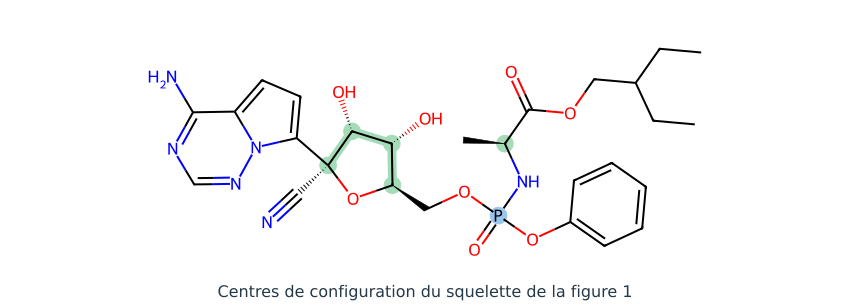

### Question 2 — Géométrie du phosphore

Le phosphore a quatre directions de liaison, vers O du phosphoryle, O du phénoxy, O du nucléoside et N alaninique, sans doublet libre central. Le modèle AX₄ donne un environnement tétraédrique, angles voisins de $109{,}5^\circ$. On laisse par exemple P=O et P–OPh dans le plan, P–O–nucléoside en coin plein et P–N en coin hachuré. La figure 1 ne fixe pas par des coins la configuration absolue de P.

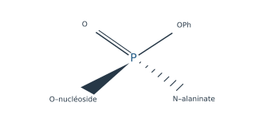

### Question 3 — Nombre de stéréoisomères

Un centre stéréogène est un atome pour lequel l’échange de deux ligands conduit à un stéréoisomère. Au phosphore, les quatre ligands sont différents, même les deux groupes OR car la chaîne nucléosidique diffère du phényle. Aux cinq carbones s’ajoute ce phosphore. Le squelette n’a pas de symétrie donnant une forme méso. Sans fixer de configuration, on compte $2^6=64$ stéréoisomères, soit 32 couples d’énantiomères. Une fois les cinq carbones fixés, les deux configurations possibles de P sont diastéréoisomères.

### Question 4 — Première hydrolyse du promédicament

L’ester est $\mathrm{P{-}NH{-}CH(CH_3){-}C(O){-}OR}$ avec $\mathrm{R=CH_2CH(CH_2CH_3)_2}$. En milieu basique $\mathrm{HO^-}$ attaque le carbone du carbonyle et la liaison π se déplace vers O. L’intermédiaire tétraédrique reforme C=O et libère $\mathrm{RO^-}$. Le transfert de proton conduit au carboxylate $\mathrm{P{-}NH{-}CH(CH_3){-}CO_2^-}$ et à ROH. Le premier métabolite est le remdesivir dont seul cet ester est hydrolysé, sous forme CO₂H ou CO₂⁻ selon le pH. La saponification illustre le bilan de l’estérase.

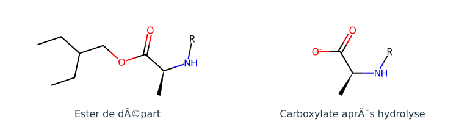

### Question 5 — Polarité de la coupure D1

Le phosphore du chlorophosphoramidate A, polarisé par ses voisins électronégatifs et porteur d’un chlorure partant, est électrophile. Dans B, l’oxygène de l’alcool primaire exocyclique est nucléophile. L’attaque sur P crée précisément la liaison P–O de D1.

### Question 6 — Déconnexion alternative

On coupe O–CH₂ sur la chaîne primaire au lieu de P–O. Le synthon A′ est le phosphoramidate $\mathrm{(PhO)(AlaNH)P(O)O^-}$, où AlaNH représente ici l’azote portant le fragment alaninate ester. Dans B′, $\mathrm{HOCH_2{-}sucre}$ est remplacé par $\mathrm{XCH_2{-}sucre}$, avec X un groupe partant tel que Br. Le carbone primaire est ainsi l’électrophile et l’oxygène du phosphate le nucléophile. D1 permet de garder la fonction alcool déjà présente dans le sucre. Le chlorure sur P est un électrophile activé, tandis que D1′ exige une activation sélective du sucre et fait réagir un oxyanion stabilisé par résonance. La protection des fonctions voisines intervient de toute façon dans la séquence réelle.

### Question 7 — Polarité de la coupure D2

Le carbone carbonylé de la lactone B est électrophile. Le carbone hétéroaromatique lié au Mg dans C est nucléophile, la liaison C–Mg étant polarisée vers C. La liaison formée est une liaison C–C entre ce carbone de base et le futur carbone anomérique du sucre.

## Phosphoramidate et alaninate

### Question 8 — Nom de l’alcool

$\mathrm{HOCH_2{-}CH(CH_2CH_3)_2}$ est le **2-éthylbutan-1-ol**. La plus longue chaîne contenant le carbone hydroxylé compte quatre carbones. L’autre branche éthyle est en position 2.

### Question 9 — Lewis du chlorure de thionyle

Une structure usuelle est $\mathrm{Cl{-}S(=O){-}Cl}$. Chaque Cl porte trois doublets libres, O en porte deux et S un. Un autre contributeur sépare les charges $\mathrm{S^+{-}O^-}$. Les liaisons vers O et Cl polarisent S positivement et facilitent l’attaque d’un doublet nucléophile. Le soufre a un environnement AX₃E et la géométrie des trois ligands est pyramidale.

### Question 10 — La pyridine peut-elle former l’alcoolate ?

Pour $\mathrm{Py+ROH\rightleftharpoons PyH^++RO^-}$, $K\simeq10^{5{,}21-16}\sim10^{-11}$. La pyridine ne forme donc pas quantitativement l’alcoolate de départ. Elle peut capter le proton d’un oxonium beaucoup plus acide formé après une attaque nucléophile.

### Question 11 — Activation de l’alcool primaire

Avec $\mathrm{R=CH_2CH(CH_2CH_3)_2}$, ROH attaque le soufre de SOCl₂. Le départ de chlorure et la déprotonation de l’oxonium par la pyridine donnent le **chlorosulfite d’alkyle** $\mathrm{RO{-}S(O)Cl}$. Celui-ci est l’intermédiaire d’activation. Sur un alcool primaire, un chlorure peut ensuite attaquer le carbone de R par substitution et le chlorosulfite partant se fragmente en SO₂ et chlorure. On représente alors l’électrophile alkylant 2 par $\mathrm{ClCH_2CH(CH_2CH_3)_2}$. Une représentation de la substitution suivante directement sur R activé par le chlorosulfite conserve la même connectivité d’ester.

### Question 12 — Configuration de la L-alanine

Les priorités CIP sont $\mathrm{NH_2>CO_2H>CH_3>H}$. Les deux substituants carbonés sont départagés par $[O,O,O]$ contre $[H,H,H]$. En orientant H vers l’arrière, 1→2→3 tourne dans le sens antihoraire pour l’alanine représentée, qui est **S**. La notation L décrit une configuration relative et ne prédit pas le signe du pouvoir rotatoire.

### Question 13 — Fonctions ionisables de l’alanine

CO₂H est un acide carboxylique, ordre de grandeur $pK_a\sim4$ à 5 pour un acide aliphatique isolé. L’amine NH₂ accepte un proton et son acide conjugué NH₃⁺ a généralement un $pK_a$ de l’ordre de 9 à 11. Ce second chiffre décrit NH₃⁺/NH₂, distinct de l’acidité du N–H d’une amine neutre.

### Question 14 — Influence des fonctions voisines

Le premier $pK_a=2{,}34$ est abaissé par rapport à un carboxyle isolé. Le substituant ammonium exerce un effet inductif attracteur et stabilise électrostatiquement le carboxylate voisin. Le second $pK_a=9{,}87$ correspond à la perte de H⁺ par NH₃⁺ et reste dans l’intervalle usuel d’un alkylammonium. Les effets électroniques, électrostatiques et de solvatation déterminent les valeurs exactes.

### Question 15 — Forme majoritaire au voisinage de pH 7

Comme $2{,}34<7<9{,}87$, la forme majoritaire est $\mathrm{{}^+H_3N{-}CH(CH_3){-}COO^-}$. Le rapport carboxylate/acide est d’environ $10^{4,66}$ et le rapport amine/ammonium d’environ $10^{-2,87}$. Le carboxylate peut attaquer le carbone primaire de 2 tandis que l’ammonium ne dispose pas d’un doublet libre. Cela explique l’alkylation sur O et la formation de l’ester sous forme de sel d’ammonium.

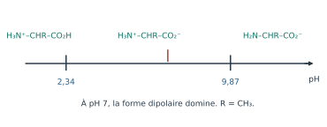

### Question 16 — Quatre signaux RMN de 3

À 8,59 ppm, le singulet de 3 H correspond à NH₃⁺, très déblindé et échangeable. À 1,53 ppm, l’heptuplet apparent de 1 H vient du CH de $\mathrm{OCH_2CH(Et)_2}$, couplé aux six H des trois méthylènes voisins avec des constantes proches. À 1,44 ppm, le doublet de 3 H correspond au CH₃ de l’alanine, voisin d’un CH. À 0,88 ppm, le triplet de 6 H réunit les deux CH₃ terminaux des éthyles, chacun voisin d’un CH₂.

### Question 17 — Substitution au phosphore

Le premier équivalent de $\mathrm{Et_3N}$ neutralise l’ammonium de 3 et libère l’amine neutre. Son doublet attaque P dans $\mathrm{PhO{-}P(O)Cl_2}$. L’intermédiaire de substitution peut se représenter par une espèce pentacoordonnée, puis Cl⁻ part. Une déprotonation au niveau de l’azote fournit $\mathrm{PhO{-}P(O)(Cl){-}NH{-}AlaOR}$ et le second équivalent de base capte le proton associé au chlorure éliminé. La triéthylamine ne transforme pas l’amine primaire neutre en amidure.

## Hétérocycle et sucre protégé

### Question 18 — Deux réactivités de l’hydroxylamine substituée

Dans $\mathrm{H_2N{-}O{-}SO_2Mes}$, le groupe lié à N par O est inductivement attracteur. Le doublet porté par N permet une attaque sur un carbonyle, donc une réactivité nucléophile. Dans un autre événement, l’attaque d’un nucléophile sur l’azote peut déplacer le groupe mésitylènesulfonate stabilisé par délocalisation. Le même azote peut ainsi agir en site électrophile d’un transfert de NH₂.

### Question 19 — Structure de l’intermédiaire 8

Le formyle du pyrrole-2-carbaldéhyde fournit l’oxime O-sulfonylée $\mathrm{Py{-}CH=N{-}O{-}SO_2Mes}$ et le N du cycle porte en outre un substituant NH₂. Pour former l’oxime, le N nucléophile d’un équivalent attaque le carbonyle, puis les transferts de protons et la déshydratation de la carbinolamine créent C=N. L’autre équivalent transfère NH₂ sur le N pyrrolique avec rupture N–O et départ du sulfonate. La base peut capter le proton du N pyrrolique au cours de ce transfert. Ces opérations de comptabilité mécanistique ne fixent pas leur ordre temporel. La structure proposée contient bien 14 C et 3 N.

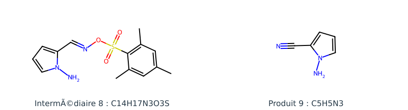

### Question 20 — De l’oxime activée au nitrile 9

Dans $\mathrm{Py{-}CH=N{-}O{-}SO_2Mes}$, la base prélève le H de CH=N. Les électrons de C–H forment la seconde liaison π de C≡N tandis que la liaison N–O se rompt vers O, donnant le sulfonate. Ce bilan d’élimination fournit le 1-aminopyrrole-2-carbonitrile de la figure 6. Le groupe NH₂ fixé à l’azote du pyrrole est conservé.

### Question 21 — Méthylglycoside et anomères

En milieu acide, la protonation du OH anomérique du ribofuranose permet le départ d’eau. Le cation oxocarbénium est stabilisé par l’oxygène du cycle, sous les formes $\mathrm{O{-}C^+\leftrightarrow O^+=C}$. Le méthanol attaque ce centre depuis l’une ou l’autre face. La déprotonation fournit l’acétal méthylique et régénère le catalyseur. Les autres centres conservent leur configuration. On attend deux anomères, dans des proportions qui ne sont pas nécessairement égales.

### Question 22 — Protection des alcools

On peut déprotoner les trois OH de 11 par une base adaptée puis faire réagir les alcoolates sur le bromure de benzyle $\mathrm{PhCH_2Br}$, par exemple dans un solvant aprotique anhydre, à froid lors de l’addition puis à température ambiante. La substitution au carbone benzylique forme trois éthers $\mathrm{OCH_2Ph}$, notés OBn. La fonction acétal reste protégée en milieu basique. Les groupes benzyle masquent les alcools, en particulier face à l’organomagnésien d’une étape ultérieure.

### Question 23 — Hydrolyse sélective du méthylglycoside

Pour 12→13, on protonne l’O du méthoxy anomérique. Le méthanol part, laissant un oxocarbénium. L’eau attaque et la déprotonation forme le lactol. Les éthers benzyliques sont conservés dans ces conditions d’hydrolyse ménagée. Les deux sens utilisent une catalyse acide. Pour former 11, travailler dans un excès de méthanol suffisamment sec et limiter ou éliminer l’eau favorise l’acétal. Pour 13, au contraire, un excès d’eau en milieu acide déplace l’équilibre vers l’hémiacétal.

### Question 24 — Oxydation du lactol

Le carbone hémiacétal porte dans 13 une liaison à O du cycle, une à OH et une à H. Dans 14, il est lié à O du cycle et doublement à un oxygène. Son degré d’oxydation augmente de deux unités. Le lactol devient une **lactone**, un ester cyclique à cinq chaînons, ici une γ-lactone.

## Construction et analyse du nucléoside

### Question 25 — Cram du chlorotriméthylsilane

Dans $\mathrm{(CH_3)_3SiCl}$, Si porte quatre liaisons σ et aucun doublet libre. Le type AX₄ donne un tétraèdre, angles voisins de $109{,}5^\circ$. On trace Si–Cl et Si–CH₃ dans le plan, un deuxième Si–CH₃ en coin plein et le dernier en coin hachuré. Les trois méthyles identiques rendent Si non stéréogène.

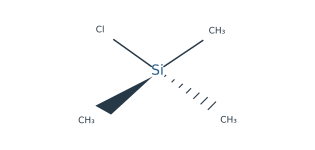

### Question 26 — Comparer Si–Cl et C–Cl

Si est moins électronégatif que C et que Cl. Les liaisons Si–C et Si–Cl laissent donc Si nettement électrophile. Les liaisons Si–C plus longues éloignent les trois méthyles du centre. Une substitution associative, avec un intermédiaire ou un état de transition à cinq voisins, est accessible au silicium. Le carbone tertiaire de $\mathrm{(CH_3)_3CCl}$ est très encombré vis-à-vis d’une attaque arrière. Il peut s’ioniser en milieu favorable, par une voie différente. Le nucléophile azoté accède donc aisément au Si dans la silylation recherchée.

### Question 27 — Structure de 15

La base bromée hétéroaromatique 10 conserve son squelette et sa liaison C–Br. Son substituant exocyclique $\mathrm{-NH_2}$ devient $\mathrm{-N[Si(CH_3)_3]_2}$. Les deux substitutions ajoutent chacune $\mathrm{C_3H_8Si}$ net. On retrouve $\mathrm{C_{12}H_{21}BrN_4Si_2}$ pour 15.

### Question 28 — Liaison C–C et retour à l’hémiacétal

Le magnésium s’insère dans la liaison hétéroaryl–Br. On note le nouveau réactif $\mathrm{Het{-}MgBr}$, où Het porte l’amine protégée de 15. Le carbone lié à Mg attaque le C=O de la lactone 14. Les électrons π vont sur O, donnant un alcoolate tétraédrique et la liaison C–C attendue. On peut aussi ouvrir l’ester en une hydroxycétone sous forme alcoolate puis refermer le cycle par addition intramoléculaire. Au traitement aqueux acide, l’alcoolate est protoné et les liaisons N–Si sont hydrolysées. Le produit cyclique 16 porte OH et Het sur le même carbone et l’amine exocyclique a retrouvé ses deux H.

### Question 29 — Pourquoi protéger les deux N–H ?

Une fonction NH₂ libre possède des H protogènes pour un organomagnésien. Le transfert de proton consommerait le nucléophile carboné en donnant une liaison C–H. Remplacer les deux N–H par N–Si prévient cette consommation et permet l’addition à la lactone. Les protections sont retirées lors du traitement aqueux.

### Question 30 — Relation entre 16a et 16b

16a et 16b sont des **diastéréoisomères**, plus précisément des épimères au carbone hémiacétalique. Les deux faces de la lactone sont diastéréotopiques en raison des centres préexistants. Les deux chemins sont possibles et peuvent donner un mélange qui n’a aucune raison d’être équimolaire. Une chromatographie sur phase achirale ou une cristallisation fractionnée peut en principe séparer ces diastéréoisomères si leurs propriétés sont suffisamment différentes et si l’interconversion au centre hémiacétal reste assez lente.

### Question 31 — Structures de Lewis et formation d’une liaison au carbone anomérique

L’ion cyanure a dix électrons de valence. La forme $\mathrm{{}^{-}{:}C\!\equiv\!N{:}}$ comporte un doublet sur chaque atome et une charge formelle $-1$ sur C. L’ion diatomique est linéaire. Dans BF₃, les trois F portent chacun trois doublets et B présente trois liaisons et une lacune. Le type AX₃ est plan trigonal, angles de $120^\circ$. Les trois liaisons peuvent être tracées dans le plan. L’oxygène du lactol cède un doublet au bore, ce qui facilite une ionisation au carbone anomérique et la formation d’un oxocarbénium stabilisé par l’oxygène cyclique. L’extrémité carbone du nucléophile attaque ce centre et crée la liaison C–C≡N du produit 17, sur la face figurée. Les trois autres centres du sucre restent en place.

### Question 32 — Retirer les éthers benzyle

L’hydrogénolyse catalytique sous H₂ sur palladium sur charbon, par exemple en milieu alcoolique à température ambiante, est une méthode classique de débenzylation. Dans 17 la fonction nitrile peut aussi être réduite, et l’hétérocycle mérite surveillance. Une autre possibilité est une coupure de Lewis avec BCl₃ en milieu aprotique anhydre à basse température, par exemple dans le dichlorométhane, suivie du traitement aqueux. La coordination à l’oxygène fragilise la liaison O–CH₂Ph. La libération des trois OH, sans hydrogénation du nitrile, conduit à 18.

### Question 33 — Protection d’un diol en acétonide

Les deux OH secondaires du sucre et l’acétone donnent une acétonide en présence d’un acide catalytique, par exemple l’acide para-toluènesulfonique. Un excès d’acétone sèche et des tamis moléculaires compatibles favorisent l’équilibre. Le mélange est agité et peut être chauffé à reflux doux, sous réfrigérant et avec un tube garde desséchant ouvert à l’atmosphère en tête. On emploie une verrerie sèche et un chauffage sans flamme. Le réfrigérant renvoie le solvant au ballon. Si l’on fixe l’eau par des tamis dans ce montage, la verrerie à reflux à elle seule ne l’élimine pas.

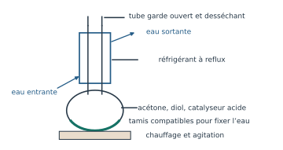

### Question 34 — Transacétalisation

Le réactif est $\mathrm{(CH_3)_2C(OCH_3)_2}$. En catalyse acide, protonation d’un OMe puis départ de méthanol donnent un oxocarbénium. Le premier OH du diol attaque son carbone, puis un transfert de proton et le départ du second méthanol permettent l’attaque intramoléculaire du deuxième OH. La fermeture et la déprotonation produisent le cycle $\mathrm{-O-C(CH_3)_2-O-}$ et régénèrent le catalyseur. Deux molécules de méthanol sont libérées par acétonide formée.

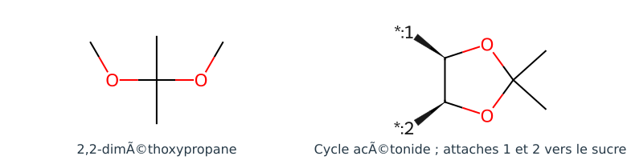

### Question 35 — Choix du diol vicinal

Les deux alcools secondaires vicinaux du ribose sont **cis**, orientés du même côté sur la figure. Leur rapprochement favorise l’attaque intramoléculaire et la formation d’un dioxolane à cinq chaînons, fusionné au cycle du sucre. Le OH primaire exocyclique ne donne pas avec ces voisins la même combinaison de proximité et d’orientation. Il reste libre pour la phosphorylation.

### Question 36 — Rôle du N-méthylimidazole

L’oxygène de l’alcool primaire de 19 attaque le P électrophile de 5. Le chlorure part par substitution sur P et la déprotonation de l’oxonium conduit à 20. L’azote non méthylé du N-méthylimidazole a un doublet disponible, qui peut capter le proton. Il peut aussi activer transitoirement P par attaque nucléophile avant d’être déplacé par l’alcool. Le doublet de l’azote N-méthylé contribue au sextet aromatique et n’offre pas la même basicité. Un équivalent de base fixe le HCl libéré, le léger excès maintient de la base libre et permet la participation nucléophile. Aucune formation quantitative d’un alcoolate par cette base n’est requise.

### Question 37 — Dernière déprotection

L’acétonide est hydrolysée en milieu aqueux faiblement acide, par exemple par un acide dilué dans un mélange eau–solvant miscible à température modérée. Protonation d’un oxygène acétalique, ouverture, entrée d’eau et fragmentation restituent le diol cis et l’acétone. Des conditions ménagées et un suivi de la conversion limitent l’hydrolyse concurrente de l’ester de l’alanine ou du phosphoramidate.

## Lecture de la RMN du médicament

### Question 38 — Répartir les protons du médicament

La fenêtre **8,00–6,50 ppm** contient 8 H. Ce sont H1, H2 et H3 de la base hétéroaromatique et les cinq H8 à H12 du phényle. La fenêtre **5,00–3,50 ppm** contient les trois CH du sucre H4–H6, les deux H du CH₂7 relié à l’oxygène du phosphate, H13 voisin de l’azote et du carbonyle, et les deux H du OCH₂15 de l’ester, soit 8 H. L’intégrale expérimentale de l’un des signaux peut être perturbée par un pic de solvant proche. La fenêtre **1,50–0,50 ppm** contient le CH₃14 (3 H), le CH16 (1 H), les CH₂17 et 19 (4 H) et les CH₃18 et 20 (6 H), soit 14 H. Les intégrations des trois enveloppes sont compatibles avec ces totaux. Les pics du méthanol et de l’eau sont extérieurs à cette attribution.

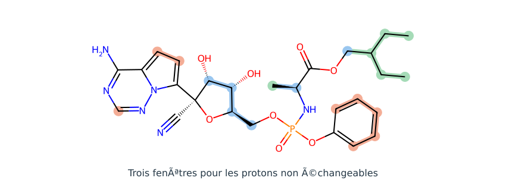

### Question 39 — Singulet à 7,87 ppm

Il s’agit de **H1**, proton porté par le carbone situé entre deux azotes du cycle à six. Ces voisins électronégatifs contribuent au déblindage et aucun voisin CH directement adjacent ne donne de couplage vicinal usuel. H2 et H3, voisins sur le cycle à cinq, apparaissent chacun comme un doublet.

## De la réactivité du pyrrole aux porphyrines

### Question 40 — Approximation des orbitales frontières

L’approximation de Fukui retient principalement l’interaction entre une orbitale occupée de plus haute énergie (HO) d’un donneur et une orbitale vacante de plus basse énergie (BV) de l’autre partenaire. À recouvrement comparable, la stabilisation augmente lorsque l’écart d’énergie est plus petit. Les coefficients locaux et la compatibilité de phase et de symétrie déterminent si le recouvrement est possible au site considéré.

### Question 41 — Orbitales π du pyrrole

L’orbitale **(b) est la HO** et **(a) la BV**. Dans (b), de larges régions de même phase s’étendent sur deux centres voisins de chaque côté. Dans (a), les changements de signe autour du cycle sont plus nombreux, ce qui augmente le caractère antiliant et élève l’énergie. Les deux orbitales π possèdent aussi le plan nodal commun du squelette moléculaire. On les compare à l’intérieur du même système.

### Question 42 — Choix du donneur et de l’accepteur

Les niveaux du pyrrole sont HO $-3{,}057$ et BV $+1{,}378\ \mathrm{eV}$. Ceux de l’acide méthanoïque sont HO $-11{,}820$ et BV $+0{,}957\ \mathrm{eV}$. L’écart HO(pyrrole)–BV(acide) vaut $4{,}014\ \mathrm{eV}$, contre $13{,}198\ \mathrm{eV}$ dans l’autre sens. L’interaction privilégiée fait du cycle le donneur π et du carbone carbonylé de l’acide l’accepteur. On peut proposer une formation de liaison C–C de type substitution électrophile du pyrrole, avec addition–élimination sur un dérivé formylique activé, sur le schéma formel de l’exercice.

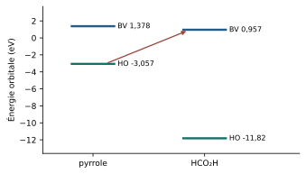

### Question 43 — Un monomère bifonctionnel

Une proposition cohérente est le **pyrrole-2-carbaldéhyde** C. Le bilan formel est $\mathrm{C_4H_5N+HCO_2H\to C_5H_5NO+H_2O}$. On forme en position α une liaison entre le cycle et le carbone du groupe CHO. Les deux positions α du pyrrole initial sont équivalentes. Dans le complexe σ d’une attaque en α, la charge positive peut se délocaliser sur davantage de sites que pour une attaque en β. Le retour à l’aromaticité accompagne la perte du proton du site substitué. Ce bilan ne suppose pas qu’une acylation directe de l’acide libre soit quantitative.

### Question 44 — Dimériser le pyrrole-carbaldehyde

En milieu acide, protoner le carbonyle de C accroît son électrophilie. Le C5 libre d’une seconde molécule attaque ce carbone. La perte du proton en C5 restitue l’aromaticité et fournit le carbinol $\mathrm{Py{-}CH(OH){-}Py'{-}CHO}$, où les liaisons aux pyrroles sont en α. Protonation du OH puis départ de H₂O donnent un cation méthine délocalisé sur les deux cycles. La déprotonation d’un azote approprié donne une forme neutre de dipyrrométhène. Une écriture de D est ainsi une **dipyrrine formylée** reliant les deux cycles α par un pont CH et portant encore un CHO α terminal. L’autre extrémité présente encore un Cα–H. Le schéma indique une forme tautomère précise.

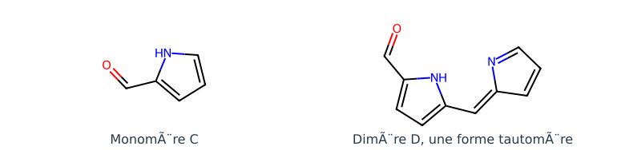

### Question 45 — Cyclisation et rendement

Le couplage des extrémités CHO et α libres de deux dimères établit d’abord une chaîne de quatre cycles. Sa fermeture peut donner le macrocycle porphyrinique, en concurrence avec les condensations intermoléculaires qui conduisent à des oligomères plus longs ou à des polymères. Le rendement isolé en porphine est donc généralement limité dans une telle stratégie. Une concentration faible et une introduction lente des partenaires favorisent la fermeture intramoléculaire une fois la longueur requise atteinte. Un cation métallique gabarit adapté peut également préorganiser les quatre azotes. Le raccourci D+D de la figure 16 décrit le squelette à obtenir et ne détaille pas les ajustements de protonation et d’oxydoréduction. Quatre C de formule $\mathrm{C_5H_5NO}$ moins quatre eaux donneraient $\mathrm{C_{20}H_{12}N_4}$, alors que la porphine libre est $\mathrm{C_{20}H_{14}N_4}$. Des condensations et pertes d’eau seules ne constituent donc pas un bilan atomique complet de cette dernière flèche.

## Électrons, spectres et complexes

### Question 46 — Acidité des NH internes

Une amine neutre $\mathrm{R_2NH}$ a typiquement un $pK_a$ de l’ordre de 35 à 40 pour le couple amine/amidure, selon le solvant. Pour la porphine libre $\mathrm{H_2Por}$, deux N internes sont NH. On obtient successivement $\mathrm{HPor^-}$, avec un seul NH et un N déprotoné, puis $\mathrm{Por^{2-}}$, sans NH. Une écriture de Lewis localise les charges sur les anciens N–H, et les formes tautomères ou de résonance distinguent cette écriture de la répartition électronique réelle. Un $pK_a$ voisin de 16 indique des NH nettement plus acides. L’environnement conjugué et la stabilisation des formes déprotonées expliquent qualitativement cet écart. L’aromaticité existe déjà dans la molécule neutre.

### Question 47 — Compter les orbitales π

Les vingt carbones et les quatre azotes du macrocycle apportent chacun une OA $p_z$, donc **24 OA et 24 OM π** dans cette base. Une écriture de la molécule neutre attribue un électron π à chaque carbone et aux deux N iminiques, deux à chacun des deux N pyrroliques, soit $20+2+4=26$ électrons. Lors de la perte des deux protons, les doublets supplémentaires se trouvent dans le plan et le décompte π reste 26. Le dianion possède donc **13 OM π doublement occupées** dans l’état fondamental de ce modèle.

### Question 48 — Courant de cycle et géométrie

En champ magnétique, l’aromaticité engendre un courant de cycle. Les protons périphériques subissent un déblindage et résonnent à plus grand déplacement chimique. Les NH situés au centre de la porphine libre sont fortement blindés et peuvent même avoir un déplacement chimique négatif. La conjugaison exige un recouvrement continu des orbitales $p_z$, favorisé par une structure globalement plane. La métallation ou des contraintes stériques peuvent la déformer.

### Question 49 — Absorption du pyrrole

Le spectre est dans l’**ultraviolet** et le maximum de la figure se situe vers **290 nm**. L’écart orbitalaire donné vaut $1{,}378-(-3{,}057)=4{,}435\ \mathrm{eV}$. L’estimation $\lambda=hc/\Delta E\simeq1240/4{,}435\simeq280\ \mathrm{nm}$ annonce le bon domaine et un ordre de grandeur proche. L’écart HO–BV calculé sur une molécule ne donne pas exactement l’énergie de transition en solution.

### Question 50 — Déplacement de la bande de Soret

La bande de Soret se trouve vers 400 nm, à plus grande longueur d’onde que le maximum du pyrrole vers 290 nm. Cela représente environ $3{,}1\ \mathrm{eV}$ au lieu de $4{,}3\ \mathrm{eV}$ par photon. La conjugaison étendue sur tout le macrocycle resserre certains espacements entre niveaux π occupés et π* vacants. Le déplacement vers les grandes longueurs d’onde est un déplacement bathochrome. Les positions des maxima seules ne comparent pas quantitativement les intensités.

### Question 51 — Nature de la transition

La bande de Soret est une transition électronique intense **π→π*** du macrocycle conjugué. Dans une description plus complète, plusieurs excitations proches se combinent. L’attribution reste une excitation du système π du ligand et peut déjà être faite pour une porphyrine sans métal.

### Question 52 — Coordination du métal

Le cation $\mathrm{Mg^{2+}}$ ou $\mathrm{Fe^{2+}}$ est acide de Lewis, accepteur de doublets. Les quatre N de $\mathrm{Por^{2-}}$ sont donneurs à travers des doublets orientés dans le plan de la cavité. La porphyrine est une base de Lewis tétradentate et forme quatre liaisons de coordination N→métal. Ces liaisons ont un caractère covalent donneur–accepteur.

### Question 53 — Effet chélate et préorganisation

Quatre ligands monodentates doivent être réunis autour du même métal, alors que les quatre atomes donneurs d’une seule porphyrine appartiennent au même macrocycle. Une première liaison rapproche déjà les trois autres N de leurs positions de coordination. L’association perd moins d’entropie de translation par liaison formée. La préorganisation de la cavité réduit aussi le coût de réarrangement et facilite le rattachement d’un donneur momentanément dissocié. Ces effets chélate et macrocyclique favorisent la constante de formation.

## Stockage et transport de l’oxygène

### Question 54 — Un débit de sang dissous insuffisant

Assimilons les 50 mL indiqués à un volume éjecté par battement et le sang, pour l’oxygène physiquement dissous, à l’eau des données. Un battement transporte $6\ \mathrm{mg\,L^{-1}}\times0{,}050\ \mathrm L=0{,}30\ \mathrm{mg}$. À 80 % d’utilisation, cela fournit 0,24 mg. Il faudrait $2500/0{,}24\simeq1{,}0\times10^4$ battements par minute. Cet ordre de grandeur est physiologiquement irréalisable. La fixation du dioxygène sur un transporteur accroît considérablement le contenu du sang en O₂.

### Question 55 — Contraintes du diagramme potentiel–pH

À pH physiologique, le fer aqueux libre en présence de dioxygène se trouve dans des conditions qui favorisent son oxydation et, pour Fe(III), la formation d’un hydroxyde peu soluble dans le diagramme. À titre indicatif le potentiel d’équilibre O₂/H₂O décroît avec le pH et reste de l’ordre de $0{,}8\ \mathrm V$ vers pH 7. Le fer libre ne resterait donc pas simplement un centre ferreux soluble, apte à fixer puis libérer O₂ de façon répétée.

### Question 56 — Degrés d’oxydation

La figure part explicitement de Fe(II) et de O₂ neutre à l’étape I. À l’étape II, le pont $\mathrm{Fe{-}O{-}O{-}Fe}$ est un peroxyde. Chaque O est à $-\mathrm I$ et chaque fer passe à $+\mathrm{III}$. À l’étape III, la rupture du peroxyde donne deux motifs ferryle $\mathrm{Fe^{IV}{=}O^{-II}}$. À l’étape IV, la réaction d’un ferryle avec Fe(II) donne un pont oxo $\mathrm{Fe^{III}{-}O^{-II}{-}Fe^{III}}$. La somme des degrés du fer passe de $4+2$ à $3+3$ dans cette dernière étape.

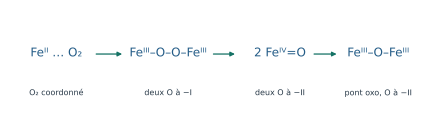

### Question 57 — Protection assurée par la globine

Un hème isolé peut rencontrer un deuxième hème et former des espèces pontées qui consomment O₂ au lieu de le transporter réversiblement. Dans la globine, chaque hème occupe une poche qui limite ce contact, fournit un ligand axial et module l’environnement de l’O₂ lié. La fixation et la libération du dioxygène peuvent ainsi se répéter sans que la voie bimoléculaire de la figure 21 domine.

### Question 58 — Quatre niveaux de structure de l’hémoglobine

La **structure primaire** est la succession orientée des résidus d’une chaîne, de N-terminal vers C-terminal, reliés par des liaisons peptidiques. La **structure secondaire** est son organisation locale. Dans une globine prédominent des hélices α dont les groupements C=O et N–H du squelette sont reliés par des liaisons hydrogène entre résidus $i$ et $i+4$. La **structure tertiaire** est le repliement tridimensionnel complet d’une chaîne, qui forme notamment une poche pour l’hème. La **structure quaternaire** est l’assemblage précis des quatre sous-unités. L’hémoglobine adulte principale est $\alpha_2\beta_2$ et porte quatre hèmes, un par chaîne. La myoglobine ne possède qu’une chaîne et un hème.

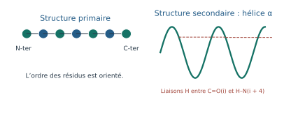

### Question 59 — Énergies des interactions

L’hélice est stabilisée par des liaisons hydrogène entre C=O et N–H du squelette. Les structures tertiaire et quaternaire bénéficient du rassemblement de groupes apolaires hors de l’eau, de contacts de dispersion, de liaisons hydrogène et d’interactions entre charges opposées ou ponts salins. Une liaison hydrogène vaut typiquement quelques à quelques dizaines de kJ/mol. Un contact dispersif individuel est souvent de l’ordre du kJ/mol, un contact ionique dans une protéine peut aller de quelques à quelques dizaines de kJ/mol suivant le milieu. L’effet hydrophobe est aussi un effet de solvatation et d’entropie, sans énergie fixe de liaison élémentaire. Leur grand nombre stabilise le repliement. Une liaison peptidique covalente relève d’une échelle de plusieurs centaines de kJ/mol.

### Question 60 — Chauffage et perte de fonction

À température suffisamment élevée, ici 60 °C dans les conditions envisagées, le bilan d’énergie libre devient moins favorable à l’état replié. Des interactions non covalentes se réorganisent et l’architecture tertiaire ou quaternaire peut être perdue, avec agrégation possible. La poche de l’hème, les interactions avec l’histidine et la communication entre sous-unités ne présentent plus leur disposition fonctionnelle. Le transport réversible et coopératif d’O₂ est altéré. La séquence primaire peut rester intacte.

### Question 61 — Saturation de la myoglobine

Posons $x=K_{\rm Mb}P_{\rm O_2}/P^\circ$. La loi d’action de masse donne $[\mathrm{MbO_2}]/[\mathrm{Mb}]=x$. Ainsi $Y_{\rm Mb}=[\mathrm{MbO_2}]/([\mathrm{Mb}]+[\mathrm{MbO_2}])=x/(1+x)$. À faible pression $Y\sim x$ et à haute pression $Y\to1$. La demi-saturation est atteinte à $P^\circ/K_{\rm Mb}$. La courbe est une hyperbole de fixation à un seul site.

### Question 62 — Hypothèse de sites indépendants

Si les quatre sites sont identiques et indépendants, chacun a pour probabilité d’occupation $y=x_H/(1+x_H)$ avec $x_H=K_{\rm Hb}^{\rm mono}P_{\rm O_2}/P^\circ$. Un tétramère porte en moyenne $4y$ molécules. En divisant par les quatre places, $Y_{\rm Hb}=y$ est encore une hyperbole. La simple multiplicité des sites ne suffit donc pas à expliquer la sigmoïde expérimentale.

### Question 63 — Chargement pulmonaire et déchargement tissulaire

Vers 100 mmHg aux poumons, les courbes d’hémoglobine se situent près de la saturation. À 30 mmHg dans les tissus, la saturation est nettement plus faible et la pente forte. Par exemple la courbe pH 7,2 passe grossièrement de la moitié des places occupées à une occupation presque totale entre ces deux pressions. La chute de pression libère donc une fraction importante de l’O₂ transporté. La myoglobine garde une saturation élevée à 30 mmHg et peut capter et stocker O₂ dans les muscles. Les ordonnées sont des lectures graphiques approximatives.

### Question 64 — Effet Bohr et activité d’un muscle

La respiration produit notamment du CO₂. Dans l’eau, son hydratation puis l’équilibre $\mathrm{H_2CO_3\rightleftharpoons HCO_3^-+H^+}$ tendent à abaisser le pH lorsque le CO₂ augmente. La courbe d’hémoglobine se déplace alors vers les pressions plus hautes. À pression d’O₂ donnée, la fixation est moindre et le tissu actif reçoit davantage de dioxygène. L’élimination de CO₂ dans les poumons favorise en retour le chargement.

## Modèle concerté de la fixation

### Question 65 — Saturation d’un dimère

La saturation est le rapport du nombre de sites occupés au nombre total de sites disponibles. Dans la notation de l’énoncé $Y=([R_2S]+2[R_2S_2])/[2([T_2]+[R_2]+[R_2S]+[R_2S_2])]$. Le facteur 2 au dénominateur compte les deux sous-unités de chaque dimère, y compris les dimères T qui ont deux positions physiquement présentes mais ne fixent pas S dans ce modèle.

### Question 66 — Constante apparente de première fixation

Pour un site isolé $K_d=[R][S]/([RS]C^\circ)$. Sa constante d’association est $1/K_d$. Les deux configurations distinctes pour placer une molécule sur $R_2$ doublent le poids statistique. Par conséquent $K_{b1}=2/K_d$ et $[R_2S]=2[R_2][S]/(C^\circ K_d)$. La concentration $[R_2S]$ réunit les deux états microscopiques.

### Question 67 — Seconde fixation

Un dimère monoligandé n’offre plus qu’un site libre, alors qu’un dimère saturé peut perdre l’un ou l’autre de ses deux ligands. La constante d’association apparente vaut $K_{b2}=1/(2K_d)$. En posant $x=[S]/(C^\circ K_d)$, on obtient $[R_2S_2]=[R_2S]x/2=[R_2]x^2$. Le facteur de multiplicité du premier état compense celui de la seconde dissociation.

### Question 68 — Courbe de Monod–Wyman–Changeux

Pour $T_2\rightleftharpoons R_2$, $L=[R_2]/[T_2]$, donc $[T_2]=[R_2]/L$. Les poids relatifs des états sont $1/L,1,2x,x^2$, avec $x=[S]/(C^\circ K_d)$. Dans Q65, le numérateur devient $[R_2](2x+2x^2)$. Après division par deux, $\boxed{Y=x(1+x)/(1/L+(1+x)^2)}$. Pour $n$ protomères, l’état relâché a le polynôme statistique $(1+x)^n$ et la même méthode donne $Y=x(1+x)^{n-1}/[1/L+(1+x)^n]$.

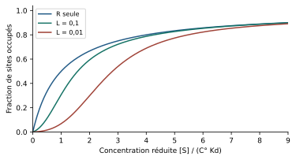

### Question 69 — Limites du modèle concerté

Pour $x\to0$ à $L$ fixé, $Y\sim x/(1+1/L)=[L/(1+L)]x$. Le facteur devant $x$ est la fraction initiale de forme R en l’absence de ligand. Pour $x\to\infty$, $Y\to1$. Les formes relâchées fortement liguées dominent et tous les sites finissent par être saturés. Une faible fraction initiale de R peut donc coexister avec une saturation finale complète.

### Question 70 — Disparition de la population tendue

Si $L\to\infty$, $1/L\to0$ et $Y=x/(1+x)$ quel que soit $n$. La forme R domine déjà avant toute fixation. Ses sites ayant la même affinité intrinsèque et étant indépendants dans cette conformation, il ne reste plus de bascule collective à favoriser par la fixation. Le facteur $n$ intervient dans le nombre de molécules liées par oligomère et disparaît de la fraction de saturation.

### Question 71 — Si les deux formes fixent le substrat

Une coopérativité positive peut persister si R a une affinité plus forte que T. Les premiers ligands enrichissent la population R, ce qui facilite les suivants. Avec $x_R=[S]/(C^\circ K_{d,R})$ et $x_T=[S]/(C^\circ K_{d,T})$, le poids total est $Z=(1+x_R)^n+(1/L)(1+x_T)^n$. La saturation vaut $[x_R(1+x_R)^{n-1}+(1/L)x_T(1+x_T)^{n-1}]/Z$. Pour deux affinités égales elle se réduit exactement à une hyperbole et l’effet allostérique sur la fixation disparaît.

## Du spin au réarrangement de l’hémoglobine

### Question 72 — Configuration de Fe(II)

Le fer $Z=26$ a pour configuration fondamentale $[\mathrm{Ar}]\,3d^6 4s^2$. L’ion $\mathrm{Fe^{2+}}$ possède 24 électrons et la configuration $[\mathrm{Ar}]\,3d^6$.

### Question 73 — Répartir six électrons entre deux ensembles d’orbitales

Les configurations limites usuelles sont **haut spin**, $t_{2g}^4e_g^2$, quatre électrons non appariés, $S=2$, et **bas spin**, $t_{2g}^6 e_g^0$, aucun électron non apparié, $S=0$. Le remplissage intermédiaire $t_{2g}^5e_g^1$ possède deux électrons non appariés et peut être représenté avec $S=1$. Il ne minimise seul l’énergie pour aucune plage de paramètres dans le modèle simplifié à un seul écart et un seul coût d’appariement de Q74.

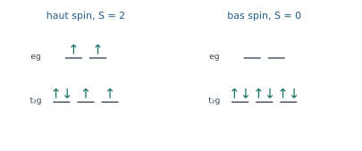

### Question 74 — Arbitrer énergie de champ et appariement

La règle de Hund favorise dans des orbitales dégénérées l’occupation simple à spins parallèles avant l’appariement. En prenant le niveau $t_{2g}$ pour origine, les coûts du bas, intermédiaire et haut spin de Q73 sont respectivement $3P$, $\Delta_0+2P$, $2\Delta_0+P$. Si $\Delta_0>P$, il est moins coûteux d’apparier dans $t_{2g}$ et le bas spin gagne. Si $\Delta_0<P$, le haut spin gagne. Pour $\Delta_0=P$ ces expressions coïncident dans ce modèle. Les interactions supplémentaires d’un complexe réel peuvent lever l’égalité.

### Question 75 — Deux rayons d’un même cation

À charge identique, l’ion à haut spin occupe des orbitales $e_g$ orientées vers les ligands et à caractère σ antiliant dans le modèle moléculaire. Les distances métal–ligand augmentent. Le plus grand rayon, **92 pm**, s’associe donc à Fe(II) haut spin, et **75 pm** à Fe(II) bas spin, avec la même convention de comparaison.

### Question 76 — De la poche de l’hème à l’allostérie

Dans le désoxyhème, le fer de plus grand rayon et de haut spin se trouve légèrement hors du plan de la porphyrine. L’arrivée d’O₂ modifie son environnement de coordination et favorise un état de plus faible spin et de plus petit rayon dans le modèle proposé. Le centre métallique se rapproche du plan des quatre N. L’histidine proximale qui lui est liée entraîne une hélice et les interfaces entre sous-unités se réorganisent. L’équilibre de la protéine entière se déplace alors vers la conformation R, de plus grande affinité. Une première fixation augmente donc la probabilité de fixation aux autres hèmes sans qu’une molécule d’O₂ doive physiquement passer d’un site au suivant.
