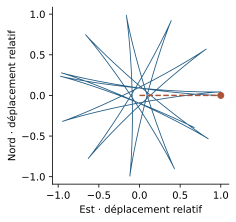
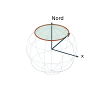
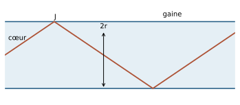
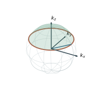
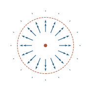
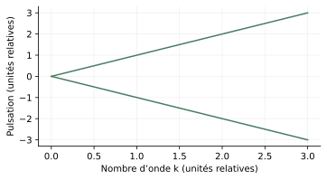
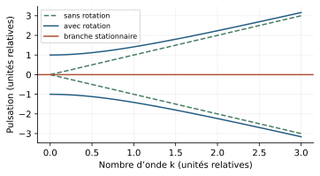
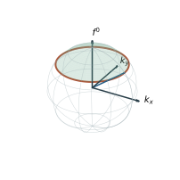

# ENS Ulm PC 2022 — Physique C · Corrigé brut

*Corrigé rédigé par IA, non officiel. Signalez toute erreur.*

**Lecture du rapport du jury** · GPT-6.2 Astra Ultra · vitesse non renseignée

**Rédaction** · GPT-6.2 Astra Ultra · vitesse non renseignée

## Effets géométriques et topologiques en physique

## Pendule de Foucault

### Question 1 — Pesanteur et entraînement

La surface tourne à $\Omega=2\pi/(86400\,\mathrm{s})=7,27\,10^{-5}\,\mathrm{s}^{-1}$. L’accélération centrifuge est au plus $\Omega^2R_T=0,034\,\mathrm{m\,s^{-2}}$, contre $GM_T/R_T^2\simeq9,8\,\mathrm{m\,s^{-2}}$ vers le centre. La correction relative est inférieure à $0,0035$, y compris pour la déviation angulaire de la verticale en radians. La variation de direction de l’attraction sur la longueur du pendule est elle-même au plus d’ordre $67/(6,4\,10^6)\simeq10^{-5}$. On prend ainsi $\mathbf P=-mg\mathbf e_z$.

### Question 2 — Projection dans la base mobile

Avec $\mathbf e_r$ dirigé du point fixe vers la masse et $\mathbf e_\alpha$ dans le sens croissant de l’angle, $m\mathbf a=-T\mathbf e_r-mg\mathbf e_z$. Comme $\dot{\mathbf e}_r=\dot\alpha\mathbf e_\alpha$, les projections donnent $-m\ell\dot\alpha^2=mg\cos\alpha-T$ et $m\ell\ddot\alpha=-mg\sin\alpha$. La réaction du fil entretient notamment l’accélération centripète.

### Question 3 — Petites oscillations

Pour une amplitude $|\alpha|\ll1$ en radians, $\sin\alpha=\alpha+O(\alpha^3)$. L’équation tangentielle devient $\ddot\alpha+\omega_0^2\alpha=0$, avec $\omega_0=\sqrt{g/\ell}\simeq0,38\,\mathrm{s}^{-1}$. La période est $2\pi\sqrt{\ell/g}\simeq16,4\,\mathrm{s}$.

### Question 4 — Déplacement au premier ordre

Depuis la position basse, la coordonnée horizontale varie de $\ell\sin\alpha\simeq\ell\alpha$ et la cote de $\ell(1-\cos\alpha)\simeq\ell\alpha^2/2$. L’approximation linéaire ne conserve donc que le déplacement horizontal.

### Question 5 — Deux échelles de temps

Le rapport $\Omega/\omega_0\simeq7,27\,10^{-5}/0,38\simeq1,9\,10^{-4}$. La Terre tourne de l’ordre du millième de radian par oscillation. On peut distinguer le mouvement rapide de la rotation lente du plan.

### Question 6 — Couplage de Coriolis

Dans la base directe locale est, nord, haut, $\mathbf e_3=\cos\lambda\,\mathbf e_y+\sin\lambda\,\mathbf e_z$. La projection horizontale de $-2\boldsymbol\Omega\times\dot{\mathbf r}$ vaut $2\Omega\sin\lambda(\dot y\mathbf e_x-\dot x\mathbf e_y)$. En ajoutant le rappel $-\omega_0^2(x,y)$, on obtient $\ddot x+\omega_0^2x=2\widetilde\Omega\dot y$, $\ddot y+\omega_0^2y=-2\widetilde\Omega\dot x$, avec $\widetilde\Omega=\Omega\sin\lambda$.

### Question 7 — Variable complexe

L’addition de la seconde équation multipliée par $i$ à la première donne $\ddot u+2i\widetilde\Omega\dot u+\omega_0^2u=0$. Les racines sont $-i\widetilde\Omega\pm i\nu$, où $\nu=\sqrt{\omega_0^2+\widetilde\Omega^2}$. Une forme générale est $u=e^{-i\widetilde\Omega t}(A\cos\nu t+B\sin\nu t)$, avec deux constantes complexes.

### Question 8 — Lâcher sans vitesse

À l’origine $u(0)=A=x_0$. La dérivée initiale est $-i\widetilde\Omega A+\nu B=0$. Ainsi $u=x_0e^{-i\widetilde\Omega t}[\cos(\nu t)+i(\widetilde\Omega/\nu)\sin(\nu t)]$. Le petit terme en sinus garantit exactement la vitesse initiale imposée.

### Question 9 — Plan de battement

Comme $\widetilde\Omega/\omega_0\ll1$, $\nu\simeq\omega_0$ à l’ordre relatif quadratique. Au premier ordre dominant en amplitude, $u\simeq x_0\cos(\omega_0t)e^{-i\widetilde\Omega t}$. Le facteur réel parcourt rapidement un diamètre tandis que son orientation tourne à la vitesse angulaire $-\widetilde\Omega$. On conserve la phase lente sur la durée d’une journée.

### Question 10 — Angle en une journée

L’angle orienté accumulé en un tour terrestre vaut $\psi=-2\pi\sin\lambda$. À Paris, $\sin49^\circ\simeq0,755$, soit environ $-272^\circ$ vu d’en haut. Pour un retour d’orientation modulo $2\pi$, les deux pôles (un tour) et l’équateur (zéro tour) conviennent. Si le mot « plan » désigne strictement une droite horizontale sans sens, un demi-tour la conserve aussi, ce qui ajoute les latitudes $\pm30^\circ$.

### Question 11 — Masse et longueur

La durée d’observation nécessaire est de plusieurs heures. À forme comparable, une masse importante augmente l’inertie face à la traînée de l’air. Un long fil augmente la période, permet une excursion horizontale aisément visible à petite amplitude angulaire et rend le déplacement latéral de la trace plus visible. La vitesse de précession idéale reste fixée par la latitude.

### Question 12 — Que mesure un pendule ?

Fixé à un support stable et observé assez longtemps, un pendule peut donner $\sin\lambda=-\dot\psi/\Omega$ grâce au taux et au sens de précession. La mesure ne fournit pas la longitude, ni une direction spontanée vers une destination. Un pendule tenu à la main subit les mouvements du support et un petit pendule oscille généralement trop peu de temps à cause des frottements.

### Question 13 — Aire de la calotte terrestre

Le trajet $\gamma$ est le parallèle de colatitude $\theta_0=\pi/2-\lambda$. Sur la calotte nord, $h=(4\pi R_T^2)^{-1}\int_0^{2\pi}\int_0^{\theta_0}R_T^2\sin\theta\,d\theta\,d\varphi=(1-\sin\lambda)/2$. Ainsi $\chi=2\pi(1-\sin\lambda)=2\pi+\psi$. Le flux d’angle solide et la précession orientée coïncident modulo un tour.

## Fibre optique et transport de la polarisation

### Question 14 — Ouverture numérique

À l’entrée dans l’air, Snell donne $\sin\theta_{\rm in}=n_1\sin\theta_p'$ où $\theta_p'$ est l’angle intérieur à l’axe. L’incidence sur la gaine vaut $\pi/2-\theta_p'$. Pour la réflexion totale il faut $n_1\cos\theta_p'>n_2$. Ainsi $\sin^2\theta_{\rm in}<n_1^2-n_2^2$, soit $\theta_{\rm in}<\theta_c$ avec $\mathrm{ON}=\sin\theta_c=\sqrt{n_1^2-n_2^2}$ pour une ouverture réalisable dans l’air. Si cette racine dépasse un, tous les angles d’entrée accessibles satisfont le critère.

### Question 15 — Modes du modèle de rayons

De J à K le rayon descend d’un diamètre puis remonte d’un diamètre, donc $\Delta y=4r$. Notons $\lambda_1$ la longueur d’onde dans le cœur et $\lambda_0=n_1\lambda_1$ celle du vide. Alors $k_y=(2\pi/\lambda_1)\sin\theta_p'$, et la condition de phase impose $\sin\theta_p=p\lambda_0/(4r)$ pour l’angle d’entrée, $p=0,1,\ldots$. Les ordres vérifient $p<4r\,\mathrm{ON}/\lambda_0$ et leur nombre est le plafond de ce rapport positif (à un seuil exact le mode rasant est exclu). Si $r<r_c=\lambda_0/(4\,\mathrm{ON})$, seul $p=0$ reste. Avec la convention $\lambda=\lambda_1$ cela donne $r_c=n_1\lambda/(4\,\mathrm{ON})$. On compte ici les angles méridiens positifs, selon le modèle du sujet.

### Question 16 — Dispersion intermodale

La vitesse dans le cœur vaut $c/n_1$. Pour une longueur axiale $\ell$, le trajet oblique dure $n_1\ell/(c\cos\theta')$. À l’angle limite $\cos\theta'=\sqrt{1-(\mathrm{ON}/n_1)^2}$. Le retard sur le rayon axial est donc $\Delta t=(n_1\ell/c)[(1-\mathrm{ON}^2/n_1^2)^{-1/2}-1]$. Dans ce modèle à un bit par intervalle, la séparation entre émissions doit au moins atteindre cet étalement, d’où $D_{\max}\simeq1/\Delta t$ bits par seconde.

### Question 17 — Géométrie de l’hélice

Quand on déroule la surface du cylindre, un tour devient la diagonale d’un rectangle de côtés $p$ et $2\pi R$. D’où $\ell=\sqrt{p^2+(2\pi R)^2}$, $\cos\theta=p/\ell$ et $\tan\theta=2\pi R/p$.

### Question 18 — Trajectoire du vecteur d’onde

La tangente à l’hélice tourne une fois autour de l’axe. Sa composante axiale et sa norme sont constantes. L’extrémité du vecteur d’onde décrit donc un cercle horizontal, de rayon $k\sin\theta$ et de cote $k\cos\theta$.

### Question 19 — Sphère des directions

Le cercle est le parallèle de colatitude $\theta$ sur la sphère de rayon $k$. Son aire de calotte nord vaut $S_\gamma=\int_0^{2\pi}\int_0^\theta k^2\sin u\,du\,d\varphi=2\pi k^2(1-\cos\theta)$. Elle varie de zéro à une demi-sphère lorsque la fibre passe d’une direction axiale à une direction transverse.

### Question 20 — Relation expérimentale

Changer le pas $p$, le rayon $R$, ou les deux de manière à modifier $2\pi R/p$, change l’angle solide balayé. Sur la figure 5, par exemple $g_\gamma\simeq2$ donne $\beta\simeq2$ radians et $g_\gamma\simeq4$ donne environ $4$. La pente est voisine de un et l’ordonnée à l’origine est nulle. L’angle déroulé dans la convention de l’expérience est donc $\beta\simeq S_\gamma/k^2=2\pi(1-\cos\theta)$.

### Question 21 — Fibre plane

À l’équateur des directions, $\theta=\pi/2$ donc $\beta=2\pi$. L’axe de polarisation en sortie retrouve son orientation initiale. On peut aussi voir ce cas comme la limite d’une boucle plane.

### Question 22 — Correspondances classiques

| Pendule | Fibre |
|---|---|
| Rayon terrestre $\mathbf R$ | Vecteur d’onde $\mathbf k$ |
| Parallèle de colatitude $\pi/2-\lambda$ | Parallèle de colatitude $\theta$ |
| Plan vertical, repéré par sa trace dans le plan tangent | Polarisation linéaire dans le plan transverse |
| Aire de calotte divisée par $R_T^2$ | Aire de calotte divisée par $k^2$ |
| Rotation $\psi$ après un jour | Rotation $\beta$ après un tour de fibre |

Dans les deux expériences, la direction de contrôle revient à son origine. L’orientation transportée conserve la mémoire du chemin par son angle solide, modulo un tour et selon l’orientation choisie.

## Évolution adiabatique et phase de Berry

### Question 23 — Évolution dans une base fixe

Insérons $\psi=\sum_n c_n\phi_n$ dans l’équation donnée. À paramètres fixes, seuls les coefficients sont dérivés. En multipliant par $\phi_p^*$ et en intégrant de $0$ à $L$, l’orthonormalité donne $i\hbar\dot c_p=E_pc_p$. Ainsi $\psi(x,t)=\sum_n c_n(0)e^{-iE_nt/\hbar}\phi_n(x;\boldsymbol\lambda)$.

### Question 24 — État stationnaire pur

Si $c_n(0)=\delta_{np}$, seul demeure $\psi=e^{-iE_pt/\hbar}\phi_p$. Le facteur de phase a pour module un. La densité $|\psi(x,t)|^2=|\phi_p(x)|^2$ peut varier avec $x$ mais reste constante au cours du temps.

### Question 25 — Projection sur une base variable

La dérivée contient maintenant $\sum_n(\dot c_n\phi_n+c_n\dot{\boldsymbol\lambda}\cdot\nabla_\lambda\phi_n)$. Notons $\langle p|q\rangle=\int_0^L\phi_p^*\phi_q\,dx$. La projection donne $i\hbar\dot c_p=E_pc_p-\hbar\sum_n\alpha_{pn}c_n$, avec $\alpha_{pn}=i\sum_j\dot\lambda_j\int_0^L\phi_p^*\partial_{\lambda_j}\phi_n\,dx$. Les $\alpha$ ont la dimension d’une pulsation.

### Question 26 — Retrait de la phase dynamique

À paramètres fixes, $\int_0^t E_n\,dt'=E_nt$. Multiplier la solution de Q23 par $e^{iE_nt/\hbar}$ donne $d_n(t)=c_n(0)$ à tout instant.

### Question 27 — Équation en interaction

Écrivons $S_n(t)=\hbar^{-1}\int_0^t E_n(t')dt'$, donc $c_n=d_ne^{-iS_n}$. En substituant dans Q25, le terme dû à $\dot S_p$ annule celui en $E_p$. Il reste $\dot d_p=i\sum_n\alpha_{pn}d_n\exp[i\int_0^t\omega_{pn}(t')dt']$, où $\omega_{pn}=(E_p-E_n)/\hbar$.

### Question 28 — Population initiale concentrée

Pour $p\ne\ell$, les termes $n\ne\ell$ du membre de droite sont produits d’un couplage et d’une petite amplitude. Au premier ordre, $d_\ell\simeq d_\ell(0)=1$ dans l’approximation indiquée. D’où $\dot d_p=i\alpha_{p\ell}(t)\exp[i\int_0^t\omega_{p\ell}(t')dt']$.

### Question 29 — Cas des écarts constants

Avec $d_p(0)=0$ et $\omega_{p\ell}\ne0$, l’intégration donne $d_p=(\alpha_{p\ell}/\omega_{p\ell})(e^{i\omega_{p\ell}t}-1)$. Le terme constant impose la condition initiale. À dégénérescence exacte, l’intégrale aurait pour limite $i\alpha_{p\ell}t$.

### Question 30 — Critère adiabatique

Puisque $|e^{iu}-1|\le2$, $|d_p|\le2|\alpha_{p\ell}/\omega_{p\ell}|$ dans le cas précédent. On exige donc pour chaque $p\ne\ell$ un rapport $\hbar|\langle p|\dot\ell\rangle|/|E_p-E_\ell|\ll1$. Sur un chemin régulier sans croisement et avec un écart minimal positif, ralentir uniformément le parcours rend ce rapport petit. Pour des données variables, le caractère lisse et lent du protocole évite une accumulation par modulation résonante.

### Question 31 — Connexion réelle

Dans l’état suivi, $i\hbar\dot c_\ell=(E_\ell-\dot{\boldsymbol\lambda}\cdot\mathbf A_\ell)c_\ell$, avec $A_{\ell,j}=i\hbar\int_0^L\phi_\ell^*\partial_{\lambda_j}\phi_\ell\,dx$. La dérivée de la norme unité donne $0=\langle\partial_j\ell|\ell\rangle+\langle\ell|\partial_j\ell\rangle=2\Re\langle\ell|\partial_j\ell\rangle$. L’intégrale est imaginaire pure, donc $A_{\ell,j}$ est réel.

### Question 32 — Deux phases

Avec $c_\ell=e^{iF_\ell}$, on a $-\hbar\dot F_\ell=E_\ell-\dot{\boldsymbol\lambda}\cdot\mathbf A_\ell$. On choisit $F_\ell(0)=0$ puisque $c_\ell(0)=1$. Ainsi $c_\ell=e^{i(\Phi_{\rm dyn}+\Phi_{\rm geom})}$ avec $\Phi_{\rm dyn}=-\hbar^{-1}\int_0^tE_\ell\,dt'$ et $\Phi_{\rm geom}=\hbar^{-1}\int_\gamma\mathbf A_\ell\cdot d\boldsymbol\lambda$. Seul le premier terme dépend de la durée pour un même chemin parcouru adiabatiquement.

### Question 33 — Interférence de deux états

Dans un seul état instantané, la phase géométrique globale disparaît de $|\psi|^2$, qui suit $|\phi_\ell(x;\boldsymbol\lambda(t))|^2$. Pour la superposition à poids égaux, la densité devient $(|\phi_\ell|^2+|\phi_{\ell'}|^2)/2+\Re[\phi_\ell^*\phi_{\ell'}e^{i(F_{\ell'}-F_\ell)}]$. Une différence de phases géométriques modifie alors le terme d’interférence là où les deux fonctions se recouvrent.

### Question 34 — Flux de courbure

Pour une surface orientée $S$ bordée par $\gamma$, le théorème de Stokes donne $\Phi_{\rm geom}=\hbar^{-1}\oint_\gamma\mathbf A_\ell\cdot d\boldsymbol\lambda=\hbar^{-1}\int_S\mathbf B_\ell\cdot d\mathbf S$, avec $\mathbf B_\ell=\nabla_\lambda\times\mathbf A_\ell$. La connexion est supposée régulière sur la surface choisie. L’orientation du bord est celle de la règle de la main droite.

### Question 35 — Orientation classique et phase quantique

| Pendule de Foucault | État quantique suivi |
|---|---|
| Position de l’attache sur la Terre | Paramètres du hamiltonien |
| Tour terrestre lent devant l’oscillation | Cycle lent devant les fréquences de transition |
| Phase de l’oscillation rapide | Phase dynamique intégrée |
| Orientation du plan au retour | Phase de Berry au retour |
| Angle solide de la calotte | Flux de la courbure divisé par $\hbar$ |

L’écart mesuré à la fin du cycle dépend de sa géométrie et de son orientation.

## Monopole magnétique et potentiels locaux

### Question 36 — Flux du monopole

Sur $S_r$, la normale sortante est $\mathbf e_r$ et $B_r$ est constant. Le flux vaut donc $4\pi r^2\mu_0q_m/(4\pi r^2)=\mu_0q_m$. Le champ est radial, sortant pour $q_m>0$, et décroît comme $1/r^2$. Pour une charge non nulle, le flux à travers une surface fermée contredit la loi de Maxwell du flux magnétique nul.

### Question 37 — Obstacle à un potentiel global

Si un potentiel régulier unique existait sur toute la sphère, sa circulation sur l’équateur, calculée par Stokes sur la calotte nord puis sur la calotte sud, apparaîtrait avec deux signes opposés. La somme des flux serait nulle. Q36 donne $\mu_0q_m\ne0$. L’argument porte sur la surface entourant l’origine, même si le champ est régulier en chacun de ses points.

### Question 38 — Potentiels sur deux cartes

Posons $a=\mu_0q_m/(4\pi)$. Pour les deux potentiels, $rA_\varphi$ est indépendant de $r$, les composantes radiale et polaire de $\mathbf A$ sont nulles, et $\partial_\theta(\sin\theta A_\varphi)=(a/r)\sin\theta$. Le rotationnel est donc $a\mathbf e_r/r^2$. De plus $A_{N,\varphi}=a\tan(\theta/2)/r$ et $A_{S,\varphi}=-a\cot(\theta/2)/r$. Le premier tend vers $a\theta/(2r)$ au nord et diverge comme $2a/[r(\pi-\theta)]$ au sud. Le second tend vers $-a(\pi-\theta)/(2r)$ au sud et diverge comme $-2a/(r\theta)$ au nord. Chaque carte couvre la sphère privée du seul pôle opposé.

### Question 39 — Deux orientations de l’équateur

Prenons le sens $\varphi$ croissant sur l’équateur $E$, bord positif de l’hémisphère nord pour la normale sortante. Le bord positif du sud est $-E$. Par Stokes appliqué séparément à chaque carte, $\int_{S_r}\mathbf B\cdot d\mathbf S=\oint_E\mathbf A_N\cdot d\boldsymbol\ell-\oint_E\mathbf A_S\cdot d\boldsymbol\ell$.

### Question 40 — Vérification du flux

Sur le recouvrement, $\mathbf A_N-\mathbf A_S=2a\mathbf e_\varphi/(r\sin\theta)$. À l’équateur $d\boldsymbol\ell=r\mathbf e_\varphi d\varphi$, donc l’intégrale vaut $\int_0^{2\pi}2a\,d\varphi=4\pi a=\mu_0q_m$. Les potentiels locaux reproduisent bien le flux non nul.

## Équations en couche mince

### Question 41 — Force de Coriolis volumique

Pour $\mathbf v=(v_x,v_y,0)$ et $\boldsymbol\Omega=\Omega(0,\cos\lambda,\sin\lambda)$, le produit $-2\rho\boldsymbol\Omega\times\mathbf v$ a pour composantes $2\rho\Omega(\sin\lambda\,v_y,-\sin\lambda\,v_x,\cos\lambda\,v_x)$. La suite retient uniquement les deux premières.

### Question 42 — Pression verticale

L’accélération verticale est nulle dans l’approximation donnée. La projection verticale donne $0=-\partial_z p-\rho g$. Une intégration à $x,y,t$ fixés conduit à $p=-\rho gz+p_2(x,y,t)$. La partie $p_1$ est donc linéaire en $z$, à une constante additive près.

### Question 43 — Effet d’une pente de surface

La condition $p(x,y,h,t)=0$ entraîne $p=\rho g(h-z)$. À cote fixée son gradient horizontal est $\rho g\nabla_h h$. En divisant l’équation horizontale par $\rho$ et en regroupant Coriolis à gauche, on obtient $\partial_t\mathbf v+(\mathbf v\cdot\nabla_h)\mathbf v+f\mathbf e_z\times\mathbf v=-g\nabla_hh$ avec $f=2\Omega\sin\lambda$. Une pente vers le haut suivant $x$ accélère le fluide vers les $x$ décroissants.

### Question 44 — Bilan massique d’une colonne

Le courant de masse volumique est $\mathbf j=\rho\mathbf v$. Une tranche de largeur unité et d’épaisseur $dx$ contient $\rho h\,dx$. L’entrée par unité de temps est $\rho hv$ à gauche et la sortie $(\rho hv)(x+dx)$ à droite. Ainsi $\rho\partial_t h\,dx=-\partial_x(\rho hv)\,dx$ et $\partial_t h+\partial_x(hv)=0$. La hauteur instantanée intervient aussi dans la surface de passage.

### Question 45 — Conservation en deux dimensions

En intégrant sur la profondeur, le débit surfacique horizontal devient $\mathbf J=h\mathbf v$. Le bilan s’écrit $\partial_th+\nabla_h\cdot(h\mathbf v)=0$. Les deux termes s’expriment en mètres par seconde.

### Question 46 — Linéarisation des deux bilans

Autour de $h=H$ constant et $\mathbf v=0$, $\mathbf v\cdot\nabla\mathbf v$ et $\nabla\cdot(\eta\mathbf v)$ sont quadratiques en perturbations. En gardant les termes linéaires, $\partial_t\mathbf v+f\mathbf e_z\times\mathbf v=-g\nabla_h\eta$ et $\partial_t\eta+H\nabla_h\cdot\mathbf v=0$.

### Question 47 — Équation de d’Alembert

Pour $f=0$, dérivons le bilan de hauteur par rapport au temps. La divergence de l’équation de quantité de mouvement donne $\nabla_h\cdot\partial_t\mathbf v=-g\Delta_h\eta$. Ainsi $\partial_t^2\eta-c^2\Delta_h\eta=0$ avec $c=\sqrt{gH}$ en mètres par seconde. C’est l’équation de d’Alembert en deux dimensions.

### Question 48 — Dispersion sans rotation

Pour $\eta\propto e^{i(\mathbf k\cdot\mathbf x-\omega t)}$, $\omega^2=c^2(k_x^2+k_y^2)$, donc $\omega=\pm ck$, $k=|\mathbf k|$. Le graphe est constitué de deux demi-droites issues de l’origine. La vitesse de groupe d’une branche a pour norme $c$ quelle que soit la fréquence. Un paquet d’ondes planes colinéaires d’une même branche se transporte sans étalement dispersif.

### Question 49 — Variables réduites

En posant $u=v_x/c$, $v=v_y/c$, $s=\eta/H$ et $f'=f/c$, la division par les échelles donne $c^{-1}\partial_tu-f'v=-\partial_xs$, $c^{-1}\partial_tv+f'u=-\partial_ys$, $c^{-1}\partial_ts+\partial_xu+\partial_yv=0$. Les variables d’amplitude sont sans dimension et $f'$ est un inverse de longueur.

### Question 50 — Opérateur matriciel

Avec la phase $e^{i(k_xx+k_yy-\omega t)}$, l’équation de hauteur donne $(\omega/c)s_0=k_xu_0+k_yv_0$. Celles des vitesses donnent $(\omega/c)u_0=k_xs_0+if'v_0$ et $(\omega/c)v_0=k_ys_0-if'u_0$. Dans l’ordre $(s_0,u_0,v_0)$, les trois lignes de $M/c$ sont donc $(0,k_x,k_y)$, $(k_x,0,if')$, $(k_y,-if',0)$. L’opérateur est hermitien.

### Question 51 — Trois valeurs propres

Écrivons $w=\omega/c$. Le développement de $\det(wI-M/c)$ donne $w(w^2-f'^2)-k_x^2w-k_y^2w$ car les termes croisés imaginaires se compensent. Ainsi $\omega_1=-c\sqrt{k^2+f'^2}$, $\omega_2=0$, $\omega_3=c\sqrt{k^2+f'^2}$. Au seul point $k=f'=0$, ces branches se rejoignent.

### Question 52 — Bandes de fréquence

À $f$ fixé non nul, les branches mobiles débutent à $\pm|f|$ pour $k=0$ et tendent vers les demi-droites $\pm ck$ à grand $k$. La branche centrale est stationnaire. Les intervalles $0<|\omega|<|f|$ sont vides dans ce modèle uniforme. Le module de la vitesse de groupe vaut $c^2 k/\sqrt{f^2+c^2k^2}$, donc la rotation rend la propagation dispersive. Quand $f\to0$, on retrouve Q48 pour les perturbations de hauteur, avec en outre un mode de vitesse transverse stationnaire.

## Ondes équatoriales et nombre de Chern

### Question 53 — Coordonnées de la sphère des paramètres

Le rayon est $K=\sqrt{k_x^2+k_y^2+f'^2}$. L’axe vertical est $f'$ et le plan horizontal a pour axes $k_x,k_y$. L’angle $\theta$ se mesure depuis $+f'$, et $\varphi$ depuis $+k_x$ vers $+k_y$ dans le plan horizontal. Les coordonnées sont $(K\sin\theta\cos\varphi,K\sin\theta\sin\varphi,K\cos\theta)$.

### Question 54 — Vecteur propre au pôle nord

Pour $0<\theta<\pi$, la projection horizontale fixe $\varphi$ modulo $2\pi$, donc l’expression donnée est unique. Au nord, $\Psi_3=e^{i\varphi}(0,1,-i)/\sqrt2$, et au sud $\Psi_3=e^{-i\varphi}(0,1,i)/\sqrt2$. L’azimut arbitraire y affecte le représentant complexe. La jauge $\Psi_N=e^{-i\varphi}\Psi_3$ tend au nord vers $(0,1,-i)/\sqrt2$, indépendant du chemin. La troisième coordonnée cartésienne des pôles, appelée $k_z$ à cet endroit du sujet, est bien $f'$.

### Question 55 — Vecteur propre au pôle sud

Choisissons $\Psi_S=e^{i\varphi}\Psi_3$. En prenant $\theta\to\pi$, les phases se compensent et $\Psi_S\to(0,1,i)/\sqrt2$, quelle que soit la direction d’approche. Sur le recouvrement, $\Psi_S=e^{2i\varphi}\Psi_N$.

### Question 56 — Différence des connexions

Avec $C_\theta=\cos\theta$, l’expression (21) donne $2\Psi_3^\dagger\Psi_3=\sin^2\theta+(\cos^2\varphi+C_\theta^2\sin^2\varphi)+(\sin^2\varphi+C_\theta^2\cos^2\varphi)=2$. Posons $D=-i\Psi_3^\dagger\partial_\varphi\Psi_3$. La dérivée des facteurs $e^{\mp i\varphi}$ ajoute respectivement $-1$ et $+1$ à $D$. Donc $\mathbf A_N=(D-1)\mathbf e_\varphi/(K\sin\theta)$, $\mathbf A_S=(D+1)\mathbf e_\varphi/(K\sin\theta)$ et $\mathbf A_N-\mathbf A_S=-2\mathbf e_\varphi/(K\sin\theta)$. En développant les deux composantes complexes, $\Psi_3^\dagger\partial_\varphi\Psi_3=i\cos\theta$, d’où $D=\cos\theta$.

### Question 57 — Courbure commune

Localement $\mathbf A_N-\mathbf A_S=-2\nabla\varphi$ sur le recouvrement, son rotationnel y est nul. Explicitement $\sin\theta A_{N,\varphi}=(\cos\theta-1)/K$ et $\sin\theta A_{S,\varphi}=(\cos\theta+1)/K$. Les formules sphériques donnent dans chaque carte $\mathbf B=-\mathbf e_K/K^2$, avec prolongement au pôle de cette carte.

### Question 58 — Nombre de Chern

Orientons positivement l’équateur pour l’hémisphère nord. Les deux formules de Stokes fournissent $\int_{S_K}\mathbf B\cdot d\mathbf S=\oint_E(\mathbf A_N-\mathbf A_S)\cdot d\boldsymbol\ell=\int_0^{2\pi}(-2/K)K\,d\varphi=-4\pi$. Avec la convention du sujet, $C=-(-4\pi)/(2\pi)=2$. Le résultat prévoit deux types d’ondes équatoriales, identifiés comme les ondes de Kelvin et de Yanaï.

### Question 59 — Correspondance avec le monopole

| Monopole magnétique | Ondes de la couche mince |
|---|---|
| Position $(x,y,z)$, rayon $r$ | Paramètres $(k_x,k_y,f')$, rayon $K$ |
| Charge à l’origine | Dégénérescence des branches à $K=0$ |
| Potentiels électromagnétiques locaux | Connexions des vecteurs propres dans les deux jauges |
| Champ radial $a\mathbf e_r/r^2$ | Courbure $-\mathbf e_K/K^2$ |
| Flux $4\pi a=\mu_0q_m$ | Flux $-4\pi$ et entier $C=2$ |
| Circulation de la différence des potentiels | Circulation liée à la phase de transition $e^{2i\varphi}$ |

Le flux à travers la sphère est fixé par les données de raccordement sur l’équateur. Cela explique pourquoi le calcul à l’aide de deux cartes fonctionne dans les deux problèmes.
