# ENS de Lyon — PC, Physique-chimie 2022 · Corrigé brut

*Corrigé rédigé par IA, non officiel.*

**Rédaction (tour 1)** · GPT-6.2 Astra Ultra · vitesse non renseignée

**Couverture partielle.** Les 34 questions de physique et 27 des 32 questions de chimie sont traitées intégralement. C3 et C7 exposent les principes d’interactions et de thermodynamique, C20 le raisonnement stéréochimique. Le classement des milieux pour un agent irritant et les étapes ciblées de synthèse ou d’optimisation de C19 et C21 restent hors couverture.

## Physique. Surface libre du liquide en rotation

### Question P1 — Pression sur les faces du secteur

Les forces du reste du fluide sont dirigées vers l’intérieur du petit secteur. Sur la face intérieure de rayon $r$, la force vaut $p(r,z)r\,d\theta\,dz\,\mathbf e_r$. Sur la face extérieure elle vaut $-p(r+dr,z)(r+dr)d\theta\,dz\,\mathbf e_r$. Les faces aux angles $\theta$ et $\theta+d\theta$ portent respectivement $+p(r,z)dr\,dz\,\mathbf e_\theta(\theta)$ et $-p(r,z)dr\,dz\,\mathbf e_\theta(\theta+d\theta)$ au premier ordre utile. La symétrie rend $p$ indépendant de $\theta$. Les flèches du schéma sont appliquées aux milieux des faces.

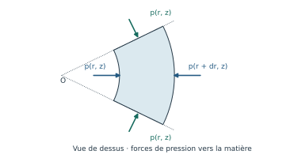

### Question P2 — Bilan local des forces

La paire de forces sur les arcs donne radialement $-[p+r\partial_r p]dr\,d\theta\,dz$. Les deux faces droites ajoutent $+p\,dr\,d\theta\,dz$. Sur les faces horizontales la différence vaut $-\partial_zp\,d\tau\,\mathbf e_z$. Ainsi la pression exerce $-\nabla p\,d\tau$. Dans le laboratoire une particule corotative a pour accélération $-r\Omega^2\mathbf e_r$. Le poids est $\rho\mathbf g\,d\tau$. Le principe fondamental donne $\boxed{\nabla p=\rho\mathbf g+\rho r\Omega^2\mathbf e_r}$.

### Question P3 — Champ de pression

De $\partial_rp=\rho\Omega^2r$, on tire $p=\rho\Omega^2r^2/2+B(z)$. Or $B'(z)=-\rho g$. Ainsi $p(r,z)=A+\rho\Omega^2r^2/2-\rho gz$. La constante $A$ est une pression, celle au centre du fond pour l’origine du sujet.

### Question P4 — Surface libre

La tension interfaciale est négligée et $p(r,Z(r))=p_0=p(0,Z_0)$. La soustraction élimine $A$ et donne $Z(r)=Z_0+\Omega^2r^2/(2g)$. La surface est un paraboloïde de révolution ouvert vers le haut.

### Question P5 — Effort sur le fond et profil réduit

En pression relative, le liquide exerce sur le fond l’effort vertical descendant $\int_0^R 2\pi r[p(r,0)-p_0]dr$. Les parois latérales exercent une pression horizontale et la résultante verticale équilibre le poids. Comme $p(r,0)-p_0=\rho gZ(r)$, l’intégrale vaut $\rho g\pi R^2h$. En remplaçant $Z$ par l’expression précédente, on obtient $Z_0=h-\Omega^2R^2/(4g)$, d’où $Z=h+k(2r^2-R^2)$ avec $k=\Omega^2/(4g)$.

Pour $0\le s=r/R\le1$, $Q(s)=kR(2s^2-1)$. La courbe convexe part de $-kR$ avec une pente nulle, coupe le niveau initial en $1/\sqrt2$ quel que soit $\Omega\ne0$ et atteint $+kR$ au bord. La moyenne surfacique $\int_0^1 Q(s)2s\,ds$ est nulle. L’abaissement central et la surélévation périphérique ont même amplitude.

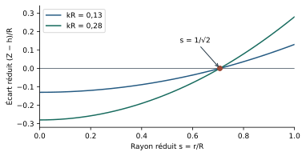

### Question P6 — Domaine de rotation admissible

Pour garder le fond mouillé, $Z(0)=h-kR^2>0$. Pour éviter le débordement, $Z(R)=h+kR^2<H$. Si $h=H/2$, les deux limites coïncident, soit $|\Omega|<\sqrt{2gH}/R$. Avec les données, le seuil est d’environ $32\ \mathrm{rad\,s^{-1}}$. À la limite les contacts géométriques commencent.

### Question P7 — Absence de masse volumique dans le profil

Le poids par unité de volume est proportionnel à la masse gravitationnelle et l’effet d’entraînement à la masse inertielle. Leur égalité fait intervenir la même masse volumique. Dans $dZ/dr=\Omega^2r/g$ elle s’élimine. Le champ de pression relatif, lui, reste proportionnel à $\rho$.

### Question P8 — Équilibre d’un petit flotteur

Dans le référentiel tournant, $\mathbf g_{\rm eff}=-g\mathbf e_z+\Omega^2r\mathbf e_r$ est normal à la surface libre. Le potentiel par unité de masse $gz-\Omega^2r^2/2$ a la même valeur en tout point de cette surface. Le flotteur n’a donc pas de position radiale privilégiée à l’équilibre. Les actions volumiques se réduisent à $(m_f-\rho V_{\rm immergé})\mathbf g_{\rm eff}$, sous l’hypothèse locale du sujet et en négligeant l’air. La même fraction du volume est immergée qu’au repos, $V_{\rm immergé}/V_f=\rho_f/\rho$. Le plan tangent et la direction de la poussée sont inclinés hors de l’axe.

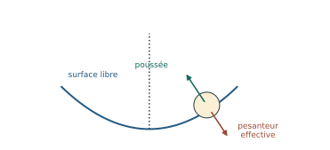

## Un miroir liquide pour observer les étoiles

### Question P9 — Foyer du miroir parabolique

Pour $W=2kr^2$, la pente vaut $4kr$. Au point de la parabole de pente 1, de rayon $r_*=1/(4k)$, un rayon vertical incident se réfléchit horizontalement vers l’axe. Son altitude est celle du foyer, $f=W(r_*)=1/(8k)=g/(2\Omega^2)$. L’argument est géométrique sur la parabole prolongée, même si ce point est hors de la portion que forme le miroir. On retrouve $W=r^2/(4f)$.

### Question P10 — Vitesse du Large Zenith Telescope

Pour $f=10\ \mathrm m$, $|\Omega|=\sqrt{g/(2f)}\simeq0{,}71\ \mathrm{rad\,s^{-1}}$, soit $60|\Omega|/(2\pi)\simeq6{,}8\ \mathrm{tr\,min^{-1}}$.

### Question P11 — Construction des images stellaires

L’étoile axiale envoie un faisceau parallèle à l’axe, réfléchi au foyer $F$. Pour une étoile voisine dont la direction fait un petit angle $\beta$, le rayon frappant le sommet se réfléchit symétriquement par rapport à la normale axiale. Il coupe le plan focal à une distance $f\tan\beta\simeq f\beta$ de $F$. On trace un autre rayon du même faisceau convergeant vers ce point dans l’approximation de Gauss. Le CCD est placé dans le plan perpendiculaire à l’axe passant par $F$. Si les deux étoiles sont exactement dans la même direction, leurs images coïncident.

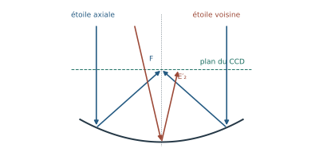

### Question P12 — Qualité de la réflexion

Le paraboloïde assure le stigmatisme géométrique exact pour le point à l’infini sur l’axe et son foyer. Un miroir sphérique de grande ouverture présente une aberration sphérique, car ses rayons marginaux et paraxiaux ne convergent pas exactement à la même distance. Ce résultat axial ne supprime ni la diffraction ni les aberrations hors axe.

### Question P13 — Diamètre du télescope

La puissance reçue à éclairement identique est proportionnelle à l’aire $\pi D^2/4$. Une grande ouverture permet de détecter des objets peu lumineux. Pour une ouverture circulaire la limite de Rayleigh est de l’ordre de $1{,}22\lambda/D$ radians. Un diamètre plus grand permet donc de séparer deux directions plus proches lorsque les autres perturbations le permettent.

## La phase d’arrêt et ses échanges d’énergie

### Question P14 — Hypothèses de l’écoulement

L’écoulement est axisymétrique et purement azimutal, sans mouvement radial ni vertical. Toutes les couches à une même distance de l’axe ont la même vitesse à tout $z$. Le modèle est déterministe et laminaire. Il néglige les circulations secondaires, les fluctuations et la couche visqueuse près du fond. La réorganisation de la surface libre entre les deux états ne peut d’ailleurs pas être décrite exactement par des particules toujours à altitude et rayon fixes.

### Question P15 — Énergie cinétique instantanée

L’énergie cinétique est $E_c(t)=\tfrac12\int_{V(t)}\rho v(r,t)^2d\tau=\pi\rho\int_0^R r Z(r,t)v(r,t)^2\,dr$. Le facteur $2\pi r$ vient de l’intégration angulaire. La valeur est en joules.

### Question P16 — Énergie de la rotation initiale

On trouve $E_{c0}=\pi\rho\Omega^2[hR^4/4+k R^6/12]$. Avec $m=\rho\pi R^2h$, la référence cylindrique vaut $E_c^*=mR^2\Omega^2/4$, en accord avec le moment d’inertie $mR^2/2$. Le rapport correctif est $\alpha_c=kR^2/(3h)>0$. La déformation porte plus de matière aux grands rayons.

### Question P17 — Énergie potentielle de pesanteur

On intègre $gz$ par unité de masse, soit $E_p(t)=\int_{V(t)}\rho gz\,d\tau=\pi\rho g\int_0^R r Z(r,t)^2\,dr$. Il faut intégrer $z$ dans la colonne et non attribuer à toute la colonne l’altitude de son sommet.

### Question P18 — Énergie de la surface parabolique

Sous la moyenne de disque $\langle A\rangle=2\int_0^R Ar\,dr/R^2$, on a $\langle 2r^2-R^2\rangle=0$ et $\langle (2r^2-R^2)^2\rangle=R^4/3$. D’où $E_{p0}=E_p^*(1+\alpha_p)$, avec $E_p^*=mgh/2$ et $\alpha_p=k^2R^4/(3h^2)$. La surface horizontale est l’état de plus faible énergie potentielle à volume fixé.

### Question P19 — Perte d’énergie mécanique

La variation est $\Delta E_m=-E_c^*(1+\alpha_c)-E_p^*\alpha_p$. En divisant par $-E_c^*$, le terme supplémentaire est $\alpha= kR^2/(3h)+(2gh/(R^2\Omega^2))k^2R^4/(3h^2)$. En remplaçant $k=\Omega^2/(4g)$, on obtient $\alpha=\Omega^2R^2/(8gh)$, donc $\alpha^*=1/8$.

### Question P20 — Premier principe sur le liquide

Le système fermé est tout le liquide. L’échange thermique est négligé. Après l’arrêt instantané, la paroi ne se déplace pas et sa puissance mécanique au contact est nulle. L’atmosphère à pression uniforme fournit le travail $-p_0\Delta V=0$ au liquide incompressible. Le poids est déjà compté dans $E_p$. Ainsi $\Delta U+\Delta E_m=0$. On peut également regrouper $U+p_0V$ dans l’enthalpie à la pression extérieure. Le cisaillement interne dissipe l’énergie mécanique, avec $\Delta U>0$.

### Question P21 — Échauffement

Avec $\Delta U\simeq m c_p\Delta T$, on obtient $\Delta T=\dfrac{R^2\Omega^2}{4c_p}\left(1+\dfrac{R^2\Omega^2}{8gh}\right)$. Pour $R=h=0{,}040\ \mathrm m$, $\Omega=6\ \mathrm{rad\,s^{-1}}$, $g\simeq10$ et $c_p=4000\ \mathrm{J\,kg^{-1}\,K^{-1}}$, la variation est d’environ $3{,}7\times10^{-6}\ \mathrm K$. Elle est positive et très difficile à mesurer avec un thermomètre ordinaire.

### Question P22 — Freinage progressif

Pendant un ralentissement progressif le liquide qui tend à entraîner le récipient fournit un couple dans le sens de sa rotation. La paroi tourne encore et reçoit une puissance positive. Le travail $W_{\rm paroi\to liquide}$ est donc négatif. Pour les mêmes états extrêmes, $mc_p\Delta T=-\Delta E_m+W_{\rm paroi\to liquide}$. La chaleur dissipée au sein du liquide et son échauffement adiabatique sont alors plus faibles que lors de l’arrêt brutal.

## Diffusion visqueuse et vorticité

### Question P23 — Cisaillement et rotation en bloc

Pour $v=\Omega r$, deux anneaux voisins n’ont aucune rotation relative. Un fluide newtonien en rotation solide ne doit donc exercer aucun cisaillement. Pourtant $\partial_rv=\Omega$. Le terme $-v/r$ compense exactement cette valeur. On peut aussi écrire $\tau=\eta r\,\partial_r(v/r)$, où $v/r$ est la vitesse angulaire locale.

### Question P24 — Forces et moments sur une couronne

La couronne subit son poids et les pressions normales sur les faces cylindriques et horizontales. Les forces verticales ont un moment axial nul, tout comme les pressions radiales. Les tractions tangentielles sur les deux faces cylindriques ont des bras de levier $r$ et $r+dr$ et produisent le couple axial résultant. Sur la face extérieure la traction est $+\tau(r+dr)\mathbf e_\theta$, sur la face intérieure $-\tau(r)\mathbf e_\theta$. Le modèle exclut le cisaillement sur les faces horizontales.

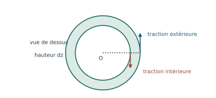

### Question P25 — Théorème du moment cinétique

La masse est $dm=2\pi\rho r\,dr\,dz$ et $d^2\sigma_z=dm\,rv=2\pi\rho r^2v\,dr\,dz$. Le couple externe vaut $2\pi dz[(r+dr)^2\tau(r+dr)-r^2\tau(r)]$. En prenant la dérivée temporelle dans le laboratoire et en divisant par $2\pi dr\,dz$, on obtient $\rho r^2\partial_t v=\partial_r(r^2\tau)$. Le bilan contient deux facteurs de rayon, provenant de l’aire et du bras de levier.

### Question P26 — Diffusion de la vitesse azimutale

On a $r^2\tau=\eta(r^2v_r-rv)$. La dérivée vaut $\eta(r^2v_{rr}+rv_r-v)$, d’où $\partial_t v=\nu(v_{rr}+v_r/r-v/r^2)=\nu(\Delta v-v/r^2)$ avec $\nu=\eta/\rho$. Le laplacien scalaire de la composante et le laplacien vectoriel de $v\mathbf e_\theta$ diffèrent par le dernier terme.

### Question P27 — Conditions initiales et aux limites

Le liquide est initialement en rotation solide, $v(r,0^-)=\Omega r$. Dans le volume intérieur la vitesse garde cette valeur à $0^+$. Pour $t>0$, l’adhérence donne $v(R,t)=0$. Sur l’axe, une vitesse régulière impose $v(0,t)=0$ et $v=O(r)$ au voisinage de zéro. La discontinuité au coin $r=R,t=0$ traduit l’arrêt idéalement instantané.

### Question P28 — Retrouver la vitesse par la vorticité

Le produit $rv$ tend vers zéro en $r=0$. Ainsi $v(r,t)=r^{-1}\int_0^r u\omega(u,t)\,du$. Pour une vorticité uniforme on retrouve $v=\omega r/2$, ce qui fixe le facteur deux entre rotation solide et vorticité.

### Question P29 — Équation de la vorticité

À rayon fixé, $v_t=r^{-1}\int_0^r u\omega_t\,du$. En espace, $v_r=\omega-v/r$ et $v_{rr}=\omega_r-\omega/r+2v/r^2$. L’équation de vitesse devient donc $v_t=\nu\omega_r$. En multipliant par $r$ puis en dérivant en $r$, on obtient $r\omega_t=\nu\partial_r(r\omega_r)$, soit $\boxed{\partial_t\omega=\nu\Delta\omega}$. Aux temps positifs, la paroi fixe impose en outre $\partial_r\omega(R,t)=0$ dans ce modèle.

### Question P30 — Flux diffusif

L’équation est linéaire, parabolique, du premier ordre en temps et du second en espace. Les gradients de vorticité se lissent par diffusion visqueuse, sur une distance d’ordre $\sqrt{\nu t}$. Comme pour la loi de Fick ou de Fourier, on pose $\phi_\omega=-\nu\partial_r\omega$, compté positif vers les grands rayons. Alors $\partial_t\omega=-(1/r)\partial_r(r\phi_\omega)$. Ses unités sont $\mathrm{m\,s^{-2}}$.

### Question P31 — Régime stationnaire

À l’état stationnaire, $r\omega_r=A$, ainsi $\omega=A\ln(r/R)+B$. La régularité impose $A=0$ et $v=Br/2$ d’après P28. Si le récipient tourne uniformément, $B=2\Omega$, situation initiale. S’il est arrêté et si le liquide adhère, $B=0$, situation finale. Dans cet écoulement en bloc le flux de vorticité et le cisaillement sont nuls.

### Question P32 — Profils successifs et signe de la vorticité

À $0^-$, $v=\Omega r$ et $\omega=2\Omega$. Peu après, le cœur tourne encore et le profil de vitesse redescend vers zéro dans une couche proche du bord. Le maximum s’abaisse ensuite, l’influence du freinage atteint progressivement l’axe et la vitesse s’annule partout à long terme. Pour une rotation positive, la vorticité devient **négative près du bord**, car $rv$ y diminue, tout en restant positive au centre. À $t>0$, $\int_0^R\omega r\,dr=Rv(R,t)=0$. Le creux négatif compense la zone positive. La vorticité positive diffuse vers l’extérieur dans la région de pente négative. Les deux lobes s’atténuent. Les tracés correspondent à des solutions radiales respectant les conditions aux limites.

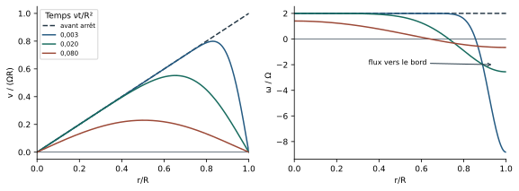

### Question P33 — Temps caractéristique par un bilan

Pour un modèle d’ordre de grandeur, le cœur contient une quantité positive $N_+\sim V_{c}\omega_0$. L’échange avec la couche freinée se fait sur une surface $S_c$ à travers un gradient d’échelle $\ell$, soit un flux sortant $\sim\nu\omega_0/\ell$. Le bilan $dN_+/dt\sim-S_c\nu\omega_0/\ell$ conduit à $d\omega_0/dt\sim-\omega_0/\tau$ et $\tau\sim V_c\ell/(\nu S_c)$. Pour $V_c\sim\pi R^2h$, $S_c\sim2\pi Rh$ et $\ell\sim R$, on trouve $\tau\sim R^2/(2\nu)$, à un facteur géométrique près. On prédit une décroissance exponentielle dans cette approximation globale. Le flux considéré est celui entre les régions de signes opposés. Une intégrale signée sur tout le disque donnerait zéro après l’arrêt et ne pourrait tenir lieu de stock décroissant.

### Question P34 — Valeur estimée et limites

Pour l’eau, $\nu=10^{-6}\ \mathrm{m^2\,s^{-1}}$. Avec $R=0{,}04\ \mathrm m$, $R^2/(2\nu)\simeq8\times10^2\ \mathrm s$, soit une dizaine de minutes et un ordre de grandeur de $10^3\ \mathrm s$. La minute observée est nettement plus courte. Le nombre de Reynolds initial $|\Omega|R^2/\nu$ vaut environ $10^4$. L’hypothèse d’un écoulement laminaire purement azimutal peut échouer. Les mouvements secondaires, le frottement du fond et le transport à de plus petites échelles accélèrent le freinage. Le modèle global ne fixe pas un préfacteur précis.

## Chimie. Nomenclature et thermodynamique

### Question C1 — Lire le nom d’un amide

La structure est $\mathrm{CH_3(CH_2)_7C(O)NHCH_2Ar}$, où $\mathrm{Ar}$ est un noyau benzénique substitué en 1 par le méthylène benzylique, en 3 par $\mathrm{OCH_3}$ et en 4 par OH. La chaîne acyle comporte neuf carbones. L’azote porte encore un hydrogène.

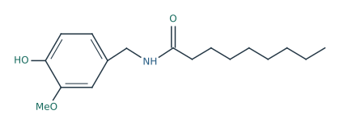

### Question C2 — Comparer les constitutions

La nordihydrocapsaïcine comporte, comme le nonivamide, un fragment acyle saturé à neuf carbones. Sa chaîne est ramifiée alors que celle du nonivamide est linéaire. Les deux composés de formule $\mathrm{C_{17}H_{27}NO_3}$ sont des **isomères de constitution**, plus précisément de chaîne.

### Question C3 — Interactions entre soluté et solvant, éléments de réponse

Un phénol et un amide permettent des interactions polaires et des liaisons hydrogène, alors qu’une partie hydrocarbonée interagit surtout par dispersion. Un solvant polaire protique peut donner et accepter certaines liaisons hydrogène, un solvant polaire aprotique peut notamment en accepter et un hydrocarbure est peu polaire. La dissolution rompt aussi des interactions soluté–soluté et solvant–solvant. Ces seules étiquettes ne permettent donc pas de calculer un équilibre. La comparaison des performances des milieux pour l’agent irritant reste hors couverture.

### Question C4 — Égalité des potentiels chimiques

À l’équilibre, $\mu_s^\circ=\mu^\circ_{\rm solv}+RT\ln a_{\rm sol}$. En prenant $a_{\rm sol}=x_{\rm sol}$, on obtient $x_{\rm sol}=\exp[(\mu_s^\circ-\mu^\circ_{\rm solv})/(RT)]$. Ce résultat fait appel au choix d’un état standard compatible et à l’approximation de solution idéale. En solution non idéale la grandeur directement obtenue est l’activité $\gamma x$.

### Question C5 — Droite de van ’t Hoff

Avec $\Delta_{\rm dis}G^\circ=\mu_{\rm solv}^\circ-\mu_s^\circ$, on a $\ln x_{\rm sol}=-(\Delta_{\rm dis}H^\circ/R)(1/T)+\Delta_{\rm dis}S^\circ/R$ si les grandeurs standard varient peu sur l’intervalle. La pente a pour dimension le kelvin et l’ordonnée à l’origine est sans dimension. Le signe moins devant l’enthalpie est essentiel.

### Question C6 — Exploiter un ajustement linéaire

La figure donne une pente de $-3682{,}6\ \mathrm K$ et une ordonnée à l’origine de $11{,}069$. Avec le $R\simeq8\ \mathrm{J\,mol^{-1}\,K^{-1}}$ fourni, on trouve $\Delta_{\rm dis}H^\circ\simeq29\ \mathrm{kJ\,mol^{-1}}$ et $\Delta_{\rm dis}S^\circ\simeq89\ \mathrm{J\,mol^{-1}\,K^{-1}}$. En utilisant $R=8{,}314$, les valeurs sont environ 31 et 92 dans les mêmes unités. Le caractère endothermique explique le signe négatif de la pente.

### Question C7 — Décomposition de l’énergie libre, éléments de réponse

À température donnée il faut comparer $\Delta H^\circ-T\Delta S^\circ$. Une enthalpie de dissolution positive est défavorable sur le plan enthalpique. Une entropie positive contribue favorablement par $-T\Delta S^\circ$, parfois assez pour compenser une part importante du coût enthalpique. Une entropie négative renforce ce coût. La comparaison numérique entre milieux et le choix d’un solvant pour cet irritant restent hors couverture.

## Des fragments de lignine aux fonctions organiques

### Question C8 — Addition sur le fragment de lignine

L’hydroxyde effectue une addition nucléophile conjuguée sur le système carbonylé étendu du fragment de lignine. Une liaison C–O apparaît à l’extrémité de la chaîne, les liaisons multiples se réorganisent et une forme phénolate aromatique est obtenue. La conservation du nombre d’atomes du squelette écarte une substitution lors de cette première étape.

### Question C9 — Quatre autres adduits de la lignine

Le schéma donne les quatre autres connectivités, en conservant les repères $R_1,R_2$ de l’énoncé. L’attaque directe sur le carbonyle crée un carbone portant OH et O⁻. Sur les deux branches cycliques du système conjugué, les deux attaques de type 1,4 sont distinctes car le méthoxy rend les branches dissymétriques. Enfin, l’attaque sur le carbone exocyclique le plus proche du cycle donne un alcool benzylique avec phénolate aromatique. L’adduit terminal déjà dessiné dans l’énoncé est le cinquième produit formel.

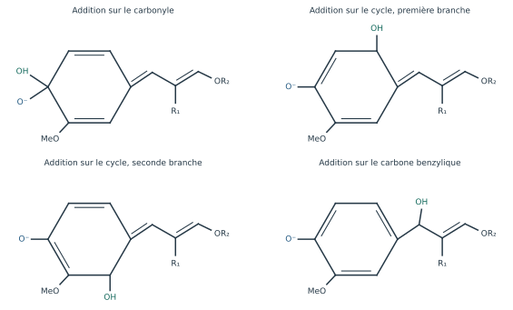

### Question C10 — De l’hémiacétal à l’aldéhyde

Le carbone terminal de 2 porte à la fois $\mathrm{OH}$ et $\mathrm{OR_2}$, donc une fonction **hémiacétal**. Le composé 3 porte un **aldéhyde**. L’ouverture de l’hémiacétal régénère le carbonyle et libère $\mathrm{R_2OH}$. Il s’agit de l’inverse d’une hémiacétalisation.

### Question C11 — Pourquoi cet adduit conduit à la vanilline

La réorganisation vers 2 restitue l’aromaticité du noyau sous forme phénolate. L’addition sur le carbone portant déjà $\mathrm{OR_2}$ crée de plus l’hémiacétal qui se fragmente en aldéhyde conjugué et $\mathrm{R_2OH}$. Les adduits sur le cycle perdent l’avantage aromatique, et l’autre adduit aromatique à OH benzylique ne possède pas ce même carbone hémiacétal. Les deux arguments sont donc nécessaires pour expliquer la voie indiquée.

### Question C12 — Retour de l’énal vers deux carbonyles

Notons $\mathrm{Ar}$ le noyau vanillique sous sa forme phénolate. Le composé 3 est $\mathrm{Ar{-}CH=C(R_1){-}CHO}$. L’addition conjuguée de l’hydroxyde suivie d’une protonation donne le β-hydroxyaldéhyde $\mathrm{Ar{-}CH(OH){-}CH(R_1){-}CHO}$. La base forme l’alcoolate, qui rétablit le carbonyle $\mathrm{Ar{-}CHO}$ en rompant la liaison C–C adjacente. Les électrons de cette liaison alimentent un énolate stabilisé par le carbonyle restant. Sa protonation, suivie si nécessaire de la tautomérie énol–aldéhyde, donne le coproduit 5, $\mathrm{R_1CH_2CHO}$. On reconnaît une rétro-aldolisation après inversion de la crotonisation.

### Question C13 — Bilan d’une cascade enzymatique

Le glucose cède des équivalents réducteurs à $\mathrm{NAD^+}$ en devenant une gluconolactone. Le pyruvate donne de l’alanine par amination réductrice, puis l’alanine cède son groupe aminé à la vanilline. Le bilan du schéma, avec les espèces neutres indiquées, est $\mathrm{vanilline+glucose+NH_3\longrightarrow vanillylamine+gluconolactone+H_2O}$. Les intermédiaires de la navette et les coenzymes s’éliminent de ce bilan.

### Question C14 — Constituants consommés ou recyclés

La vanilline, le glucose et l’ammoniac sont consommés dans le bilan en proportions molaires $1:1:1$. Les enzymes ATA, ADH et GDH sont catalytiques. Le pool $\mathrm{NAD^+/NADH}$ et le couple alanine/pyruvate sont régénérés. Une quantité catalytique de chacun de ces pools suffit dans le modèle idéal, même s’il faut en apporter pour amorcer le cycle.

### Question C15 — Rôle du NADH

Le NADH est le **réducteur** de l’étape catalysée par l’alanine déshydrogénase. Il fournit un hydrure, soit l’équivalent de deux électrons et d’un proton, puis se retrouve sous forme $\mathrm{NAD^+}$. L’ensemble pyruvate–ammoniac est réduit en alanine. La glucose déshydrogénase assure ensuite la régénération du NADH.

### Question C16 — Hydrolyse d’une polycaprolactone

Le motif du polyester est $\mathrm{[-O-(CH_2)_5-C(O)-]}$. L’hydrolyse puis l’acidification donnent 7, l’acide 6-hydroxyhexanoïque, $\mathrm{HO(CH_2)_5CO_2H}$. Dans le composé 8 représenté par la transformation indiquée, l’alcool terminal est remplacé par Br. Sa formule est $\mathrm{Br(CH_2)_5CO_2H}$. Les deux structures conservent les six carbones.

### Question C17 — Diagramme isobare eau–HBr

Sur l’axe horizontal on porte la fraction massique de HBr de 0 à 1. Les deux courbes se rejoignent aux corps purs, à $100\,^{\circ}\mathrm C$ pour l’eau et à $-66{,}8\,^{\circ}\mathrm C$ pour HBr à la pression considérée. Elles sont tangentes au **maximum** azéotropique $(0{,}476;124{,}3\,^{\circ}\mathrm C)$. La courbe de bulle est la frontière inférieure de la zone biphasée, celle de rosée la frontière supérieure. Au-dessous il y a une phase liquide, au-dessus une phase vapeur. Une horizontale relie les compositions à l’équilibre dans chaque fuseau.

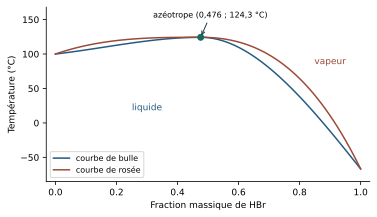

### Question C18 — Lire la limite d’une séparation binaire

Pour une composition à gauche de l’azéotrope, la vapeur est plus riche en eau que le liquide. En retirant la vapeur, la composition du liquide résiduel se déplace vers celle de l’azéotrope. À droite, la vapeur est relativement plus riche en HBr et le résidu tend aussi vers le même point. Une distillation fractionnée à pression fixée permet donc d’approcher la composition azéotropique dans le **résidu**. Au point commun les deux phases ont la même composition et la distillation à cette pression ne les enrichit plus l’une par rapport à l’autre.

### Question C20 — Stabilité relative des alcènes, éléments de réponse

Pour deux substituants encombrants portés par les carbones d’une double liaison, l’arrangement $E$ peut abaisser les répulsions stériques. Si l’isomérisation est réversible, l’équilibre favorise l’isomère de plus faible énergie libre. Le chauffage accélère l’approche de cet équilibre et ne suffit pas, à lui seul, à autoriser la rotation autour d’une liaison double intacte. Le raisonnement traite la stéréochimie générale, sans reconstituer la séquence du fragment.

## Mesurer une concentration par voltammétrie

### Question C22 — Oxydation détectée à l’électrode

En notant Cap la forme initiale et Q la quinone dessinée au schéma 4, la demi-équation en milieu aqueux acide est $\mathrm{Cap+H_2O\longrightarrow Q+CH_3OH+2H^++2e^-}$. Le bilan conserve les trois oxygènes de Cap plus celui de l’eau. Le nombre d’électrons est $n=2$. La déméthylation s’accompagne de la libération de méthanol. Une simple réduction de la quinone à l’électrode ne réinstalle pas le méthoxy initial. Cela justifie le modèle d’oxydation chimiquement irréversible adopté ici.

### Question C23 — Courant et consommation surfacique

L’électrode d’aire $S$ porte $S\Gamma_{\rm Red}$ moles de forme réduite. Une variation $S\,d\Gamma_{\rm Red}<0$ libère $-nS\,d\Gamma_{\rm Red}$ moles d’électrons. Avec la convention du courant anodique positif, $dQ=-nFS\,d\Gamma_{\rm Red}$, soit $I=-nFS\,d\Gamma_{\rm Red}/dt$. L’unité est le coulomb par seconde.

### Question C24 — Équation de consommation de la couche adsorbée

En posant $p=RT/(nF)$ et $\eta=E-E^\circ$, l’égalité donne $-nFS\,\dot\Gamma_{\rm Red}=nFS k^\circ\Gamma_{\rm Red}e^{\alpha\eta/p}$. Donc $\dot\Gamma_{\rm Red}=-k^\circ e^{\alpha\eta/p}\Gamma_{\rm Red}$, avec $\eta(t)=\eta_0+vt$. Le coefficient de consommation est positif et croît durant le balayage vers les potentiels élevés.

### Question C25 — Intégration pendant le balayage

En séparant les variables, $\ln(\Gamma_{\rm Red}/\Gamma_{\rm Red,0})=-(k^\circ/v)\int_{\eta_0}^{\eta}e^{\alpha u/p}\,du$. En définissant $K_{\rm ads}=pk^\circ/v$, il vient $\Gamma_{\rm Red}(t)=\Gamma_{\rm Red,0}\exp[-(K_{\rm ads}/\alpha)(e^{\alpha\eta(t)/p}-e^{\alpha\eta_0/p})]$. À $t=0$ on retrouve la valeur initiale. À tout instant la concentration surfacique garde ses unités de quantité de matière par aire.

### Question C26 — Départ très loin du seuil d’oxydation

Dans cette limite $e^{\alpha\eta_0/p}\to0$ et l’électrode porte initialement uniquement la forme réduite, soit $\Gamma_{\rm Red,0}=\Gamma_{\rm tot}$. Il reste $\Gamma_{\rm Red}=\Gamma_{\rm tot}\exp[-(K_{\rm ads}/\alpha)e^{\alpha\eta/p}]$, comprise entre zéro et $\Gamma_{\rm tot}$.

### Question C27 — Expression de la vague d’oxydation

Le courant cinétique de C24 est proportionnel à $\Gamma_{\rm Red}e^{\alpha\eta/p}$. En substituant C26 on obtient $I=nFS k^\circ\Gamma_{\rm tot}\exp[(\alpha\eta/p)-(K_{\rm ads}/\alpha)e^{\alpha\eta/p}]$. Aux potentiels très négatifs le transfert est lent. Aux potentiels très positifs le stock initial adsorbé est consommé, ce qui explique un maximum entre ces limites.

### Question C28 — Position du pic et courant maximal

On obtient $d\ln I/dE=(\alpha/p)[1-(K_{\rm ads}/\alpha)e^{\alpha\eta/p}]$. Le crochet décroît continûment et s’annule quand $e^{\alpha\eta_{\rm pic}/p}=\alpha/K_{\rm ads}$. D’où $E_{\rm pic}=E^\circ+(p/\alpha)\ln(\alpha/K_{\rm ads})$. Au maximum la fraction restante est $e^{-1}$. En remplaçant $K_{\rm ads}=pk^\circ/v$, on obtient $I_{\rm pic}=n^2F^2S\alpha\,v\Gamma_{\rm tot}/(eRT)$. La position varie comme $\ln v$ et la hauteur comme $v$.

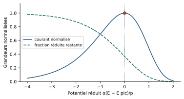

### Question C29 — Confrontation aux balayages expérimentaux

La figure 3 montre des pics anodiques positifs. Leur hauteur augmente et leur maximum se déplace vers les potentiels plus positifs quand le balayage s’accélère. En 4A les points de $I_{\rm pic}$ suivent une droite croissante en $v$, avec un léger décalage possible de la ligne de base. En 4B, d’environ $(3{,}2;0{,}69)$ à $(5{,}7;0{,}765)$, la pente graphique vaut $\sim0{,}030\ \mathrm V$ par unité de $\ln v$. Le modèle prévoit $RT/(\alpha nF)$. À température ambiante et pour $n=2$, cela donne un ordre de grandeur $\alpha\simeq0{,}4$, compatible avec $0<\alpha<1$. Un changement d’unité de vitesse décale l’origine de l’abscisse logarithmique, pas la pente.

### Question C30 — Courbe d’étalonnage

À vitesse de balayage fixée, C28 prévoit $I_{\rm pic}\propto\Gamma_{\rm tot}$ et le sujet donne $\Gamma_{\rm tot}\propto c$. Le courant de pic doit donc croître linéairement avec la concentration. La figure 5 montre des pics croissants dans une zone de potentiel presque inchangée, vers $0{,}7\ \mathrm V$ par rapport à Ag/AgCl. La figure 6 et son encart montrent une réponse approximativement linéaire, des faibles concentrations jusqu’à $10\ \mu\mathrm{mol\,L^{-1}}$. Une lecture à $10\ \mu\mathrm{mol\,L^{-1}}$ donne de l’ordre de $10^2\ \mu\mathrm A$, soit une sensibilité d’ordre $10\ \mu\mathrm A$ par $\mu\mathrm{mol\,L^{-1}}$. La précision du dessin ne justifie pas une pente plus exacte.

### Question C31 — Concentration inconnue par étalonnage

On mesure un blanc puis des étalons de concentrations connues encadrant la concentration recherchée, en conservant la même électrode ou une surface équivalente, le milieu, le temps de contact et le balayage. La ligne de base est déterminée de la même manière pour toutes les mesures. On ajuste $I_{\rm pic}=ac+b$ sur la plage étalonnée. On mesure l’inconnue dans ces mêmes conditions et on calcule $c=(I_{\rm pic}-b)/a$. Si une dilution a été nécessaire, on applique son facteur. Des répétitions et un étalon de contrôle renseignent sur l’incertitude et une dérive de sensibilité.

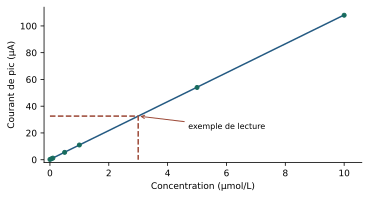

### Question C32 — Comparer les domaines mesurables

La gamme montrée va de $0{,}03$ à $10\ \mu\mathrm{mol\,L^{-1}}$, soit $3\times10^{-8}$ à $10^{-5}\ \mathrm{mol\,L^{-1}}$. Elle atteint des concentrations bien plus faibles que beaucoup de titrages volumétriques usuels en TP, souvent pratiqués au voisinage du millimolaire ou du centimolaire. Certaines mesures sélectives atteignent aussi de très faibles activités. Par exemple une électrode de verre étalonnée mesure une activité de $\mathrm{H^+}$ d’ordre $10^{-7}$ vers pH 7. Ce sont des analytes et des étalonnages différents. Le premier point tracé ne détermine à lui seul ni la limite de détection statistique ni la précision de la nouvelle électrode.
