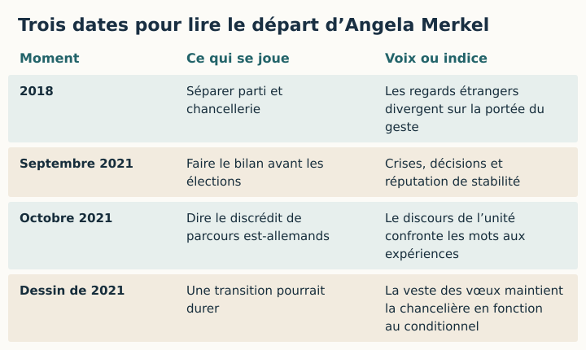

# X-ENS · MP-PC-PSI · Allemand 2022 — Corrigé brut

*Corrigé rédigé par IA, non officiel. Signalez toute erreur.*

**Rédaction** · GPT-6.2 Astra Ultra · vitesse non renseignée

**Révision (tour 1)** · GPT-6.2 Astra Ultra · vitesse non renseignée

[Sujet commun](https://www.polytechnique.edu/admission-cycle-ingenieur/sites/admission/files/content/2022%20MP-PC-PSI%20SUJET%20ECRIT%20D'ALLEMAND%20(XEULSR)_0.pdf) · [Rapport du jury](https://www.polytechnique.edu/admission-cycle-ingenieur/sites/admission/files/content/2022%20MP-PC%20RAPPORT%20ECRIT%20ALLEMAND%20(XEULSR)_0.pdf)

## A · Synthèse des documents 1 à 4

### Ein Abschied in mehreren Etappen

Angela Merkel betrachtet eine helle Jacke, während hinter ihr ähnliche Stücke in verschiedenen Farben im Schrank hängen. Notfalls könnte sie darin noch die Neujahrsansprache halten, denkt die Kanzlerin in Heiko Sakurais Zeichnung von 2021. Der Witz setzt voraus, dass die Bevölkerung nach sechzehn Jahren ihre Kleidung ebenso gut kennt wie die jährliche Ansprache. Zugleich steckt darin eine politische Ungewissheit. Selbst nach dem angekündigten Abschied könnte die Regierungsbildung noch dauern. Wie sehr die Vorstellung von Beständigkeit Merkels Bild geprägt hat und was sie verdeckt, zeigen drei Beiträge über das Ende ihrer Kanzlerschaft.

Der 2018 von der Deutschen Welle zusammengestellte internationale Pressespiegel setzt deutlich vor diesem Ende ein. Merkel kündigt an, den CDU-Vorsitz abzugeben und 2021 nicht erneut zu kandidieren. Für den britischen Guardian gefährdet ihre geschwächte Stellung ein Stück europäischer Stabilität und damit auch Macrons Reformpläne. Die New York Times sieht in der Entscheidung ein Zeichen dafür, dass Deutschland denselben politischen Fliehkräften ausgesetzt ist wie seine Nachbarn. Der Rückzug kann indes auch als geschickter Versuch gelten, das Kanzleramt für den Rest der Wahlperiode zu sichern. Nicht einmal die russischen Stimmen urteilen einheitlich. Neben scharfer Kritik an der Migrationspolitik steht Anerkennung dafür, dass eine Regierungschefin ihren Abgang selbst vorbereitet.

Die Uneinigkeit betrifft auch das Verhältnis von Person und Partei. Die österreichische Presse erinnert daran, wie entschieden Merkel selbst früher die Verbindung von Parteivorsitz und Kanzlerschaft verteidigt hatte. Andere Kommentatoren sehen im Verzicht den Versuch, der CDU Raum für einen Neuanfang zu lassen. Der Rückblick von Euronews im September 2021 zeigt, wie weit ihre Laufbahn sie von der Rolle der von Helmut Kohl geförderten Politikerin entfernt hatte. Nach der Spendenaffäre löste sie sich von ihrem einstigen Förderer. Die Physikerin mit ostdeutscher Jugend, lange mit verniedlichenden oder familiären Bezeichnungen bedacht, blieb schließlich länger im Amt als zahlreiche Regierungschefs ihrer internationalen Partner.

Ihre Art, Kontinuität herzustellen, erschöpft sich dabei nicht in gleichbleibenden Entscheidungen. In der Eurokrise bestand sie auch gegenüber Staaten in wirtschaftlicher Not auf Sparmaßnahmen. In der Pandemie nahm die Regierung dagegen hohe Ausgaben in Kauf, um die Wirtschaft zu stützen. In der Flüchtlingskrise wurde gerade ein Satz der Zuversicht zu einem über ihre Amtszeit hinaus wirksamen politischen Zeichen. Er verschaffte ihr keineswegs allgemeinen Beifall. Das Bild der Kanzlerin, die lange beobachtet und spät handelt, erklärt also weder die konkreten Entscheidungen noch die gegensätzlichen Reaktionen auf sie vollständig.

Der Beitrag über ihre Rede zum Jahrestag der Einheit untersucht genauer, wer sich durch die Worte der Kanzlerin vertreten fühlte. Merkel machte kenntlich, wie verletzend die Beschreibung ihrer DDR-Biografie als Belastung war. Auch die Vorstellung, sie habe ihr Verständnis Deutschlands und Europas im Unterschied zu anderen erst erlernen müssen, stellte sie infrage. Die besondere Wirkung der Rede beruht dem Beitrag zufolge darauf, dass viele Ostdeutsche solche Zweifel an ihrer Zugehörigkeit unabhängig von der eigenen Leistung kennen. Zugleich kam das deutliche Wort spät. Die Ausgrenzung habe Solidarität beschädigt und reiche in ihren Folgen bis zur geringen Vertretung Ostdeutscher in den Eliten. Menschen mit Einwanderungsgeschichte könnten Merkels Frage nach der Zuständigkeit für nationale Zugehörigkeit ebenfalls stellen, ohne dass sie selbst diesen Zusammenhang ausdrücklich herstellte.

So erhält Sakurais Kleiderschrank neben der Anspielung auf mögliche Koalitionsverhandlungen eine zweite Bedeutung. Für die öffentliche Wahrnehmung war Merkels Auftreten längst zu einem verlässlichen Ritual geworden. Die verschiedenen Zeitpunkte des Abschieds zeigen jedoch, wie viel hinter dieser vertrauten Erscheinung zur Entscheidung stand. International ging es um die Handlungsfähigkeit Europas, in der Partei um die Bedingungen der Nachfolge und in der Gesellschaft um Erfahrungen, über die selbst eine ostdeutsche Regierungschefin erst am Ende in dieser Deutlichkeit sprach. Ein vertrautes Gesicht konnte mithin ein Gefühl der Sicherheit vermitteln, ohne dass sich die Menschen über die Bilanz seiner Politik oder den Platz ihrer eigenen Geschichte einig waren.

*610 mots hors titre, par unités séparées par des espaces.*

## B · Texte d’opinion

Ein Wähler, der am 26. September sein Kreuz setzt, kann damit der einen oder anderen Partei mehr Gewicht geben. Er kann nicht bestellen, wer gemeinsam mit wem regiert. Jürgen Paul nimmt diese Besonderheit ernst, wenn er die vielen denkbaren Koalitionen betrachtet. Zugleich erzählt er die Wahl über weite Strecken als Wettkampf dreier Persönlichkeiten. Ich würde die Reihenfolge umkehren. Gerade weil die amtierende Kanzlerin nicht wieder antritt, sollten die Parteien genauer erklären, wie sich ihre politischen Vorhaben in Verhandlungen behaupten können.

Die Berichte über einzelne Kandidaten sind deshalb keineswegs belanglos. Wer als Ministerpräsident ein Katastrophengebiet besucht, muss verstehen, wie sein Verhalten auf Menschen wirkt, die gerade Haus oder Angehörige verloren haben. Laschets Lachen war für viele verletzend. Ein kurzer Bildausschnitt beantwortet aber nicht die Frage, welche Schlussfolgerungen er aus der Flut für den Schutz der Gemeinden zieht. Eine ernsthafte Befragung müsste ihm Gelegenheit geben, Prioritäten, Zuständigkeiten und Finanzierung zu erläutern. Das Publikum hätte dann die Möglichkeit, den Eindruck des Augenblicks gegen ein überprüfbares politisches Angebot abzuwägen.

Dasselbe gilt für die anderen Bewerber. Die ministerielle Erfahrung von Olaf Scholz kann Vertrauen stützen. Sie ist zugleich ein Grund, genauer nach seiner Verantwortung in den von Paul angesprochenen Affären zu fragen. Erfahrung zählt wenig, wenn sie nur dort zugerechnet wird, wo eine Regierung Erfolge vorweisen kann. Annalena Baerbocks Fehler bei Angaben zu ihrem Lebenslauf und bei der Arbeit an ihrem Buch verdienen ebenfalls Nachfragen. Sie ersetzen keine Auseinandersetzung mit dem Klima- oder Sozialprogramm ihrer Partei. Wer unterschiedliche Fehler in einem einzigen Wettbewerb um persönliche Glaubwürdigkeit verrechnet, kann am Ende kaum sagen, welche Politik die gewählte Mehrheit ermöglichen soll.

Besonders deutlich wird das bei den Farben der denkbaren Bündnisse. In einem Wahlstudio lässt sich eine Ampel in Sekunden darstellen. Viel länger dauert die Verständigung darüber, wie öffentliche Investitionen finanziert werden sollen oder welche Belastung ein Haushalt im Zuge einer Klimamaßnahme tragen kann. Ein kleiner Koalitionspartner kann an solchen Fragen erheblichen Einfluss gewinnen. Deshalb würde ich auch die Spitzen der kleineren Parteien vor der Wahl fragen, welchen eigenen Vorschlag sie unbedingt verwirklichen möchten und wo sie einen Kompromiss für vertretbar halten. Von ihnen ein fertiges Regierungspaket zu verlangen wäre dagegen unehrlich, solange niemand die Sitzverteilung kennt.

Ich teile daher Pauls Zurückhaltung gegenüber den Umfragen. Die Ungewissheit ist nicht bloß eine aufregende Eigenschaft dieses Wahlkampfs. Sie schützt auch die Bedeutung der letzten Stimme und die Freiheit der Abgeordneten, eine tragfähige Mehrheit zu finden. Eine lange Verhandlung muss keine Niederlage der Demokratie sein. Problematisch wäre sie dann, wenn die Beteiligten bis zum Schluss unkenntlich machten, zwischen welchen Alternativen sie wählen und welchen Preis sie anderen zumuten.

Nach sechzehn Jahren mit derselben Kanzlerin fällt es leicht, das Ende einer Ära am Wechsel des Gesichts bei der Neujahrsansprache festzumachen. Ein anspruchsvollerer Maßstab wäre die Fähigkeit der Wähler, im späteren Koalitionsvertrag die Entscheidungen wiederzufinden, über die sie im September gestritten haben. Erst dann ließe sich beurteilen, ob dieser ungewöhnliche Wahlkampf mehr hinterlassen hat als Erinnerungen an eine Aufholjagd, ein Lachen und einige besonders umstrittene Buchseiten. Eine Wahl sollte ihren politischen Gehalt auch nach dem Verschwinden der Plakate behalten.

*507 mots, selon le même décompte.*

