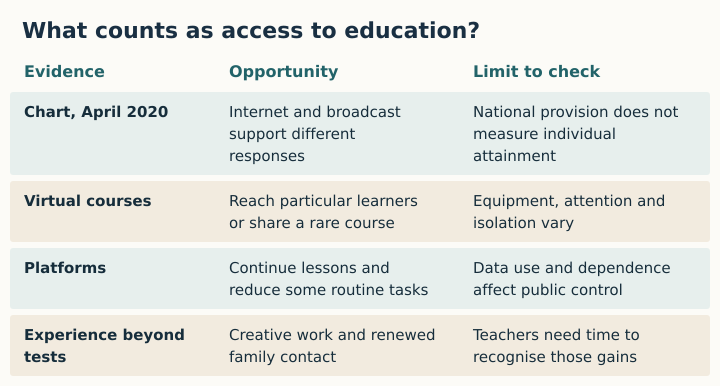

# X-ENS · MP-PC-PSI · Anglais 2022 — Corrigé guidé

*Corrigé rédigé par IA, non officiel. Signalez toute erreur.*

**Rédaction** · GPT-6.2 Astra Ultra · vitesse non renseignée

**Révision (tour 1)** · GPT-6.2 Astra Ultra · vitesse non renseignée

[Sujet commun](https://www.polytechnique.edu/admission-cycle-ingenieur/sites/admission/files/content/2022%20MP-PC-PSI%20SUJET%20ECRIT%20D'ANGLAIS%20(XEULSR).pdf) · [Rapport du jury](https://www.polytechnique.edu/admission-cycle-ingenieur/sites/admission/files/content/2022%20MP-PC%20RAPPORT%20ECRIT%20ANGLAIS%20(XEULSR).pdf)

## Préparer la composition

L’axe horizontal du graphique répartit des pays par revenu. Les couleurs représentent les modes d’enseignement à distance adoptés lors des fermetures. Chaque trait foncé donne un autre indicateur, la part moyenne de la population connectée à Internet. Elle passe d’environ 15 % dans le groupe à faible revenu à plus de 80 % dans le groupe le plus riche. Ce graphique d’avril 2020 ne donne ni les notes des élèves ni leur préférence entre la classe et l’écran.

La synthèse peut partir d’un écart entre offrir des cours à distance et permettre un apprentissage à chaque élève. Confronter l’option à distance utile à certains enfants, les risques commerciaux signalés par Fleming et les apprentissages que les tests ignorent. L’éditorial remonte à 2018. Pour lui répondre, examiner son objection aux distributions de matériel sans projet éducatif, puis l’hypothèse qui lui fait imputer les mauvais résultats aux seuls maîtres.

## A · Synthèse des documents 1 à 4

### Learning beyond the screen

Closing school buildings forced education authorities to decide very quickly what could travel beyond the classroom. The Economist's April 2020 chart records the markedly different options available to countries at different income levels. A year later, Nic Fleming in The New York Times and two contributions in The Washington Post examined a more difficult question. Which of the changes brought about by an emergency might actually improve learning, and how could schools tell whether a change had helped?

Access sets a first limit. The chart distinguishes responses using the internet, television, radio or combinations of these media from the share of people connected to the internet. Average connectivity rises from about fifteen per cent in the lowest income group to over eighty per cent in the highest. Online instruction alone is especially prominent among high income countries, whereas broadcasting features in the response elsewhere. None of the bars measures what a child learned. Even in the UK, Fleming reports that the sudden switch could mean a list of worksheets at one school and live video lessons at another. The Washington Post's account of American districts similarly records differences in individual attention, equipment and contact with teachers.

Yet the same arrangement could serve some pupils well. A teenager with a job, a child with a medical condition or a pupil whose own school does not teach Portuguese might gain access to a course through a remote connection. One Maryland mother describes an especially rewarding experience for her gifted daughter with autism. Others report isolation, exhaustion at the screen and mounting academic difficulties, including among students learning English. Some pupils disappeared from contact altogether. A district considering a virtual academy therefore faces questions about choice and funding as well as technology. One parent wants a separate budget so that neither form of provision develops at the expense of the other.

There are also competing answers to the question of who will decide. The rapid increase in investment reported by Fleming, from seven billion dollars globally in 2019 to more than sixteen billion in 2020, reflects confidence that the market will last. Digital platforms could relieve teachers of some routine tasks and support work in class. But dependence on the same providers for teaching, homework and administration would give private companies considerable influence over public services. In one review, 79 of 123 education apps shared data with third parties. Changing contractual terms are difficult for a school to follow and still less accessible to parents. The rapid adoption that solved an immediate problem also makes these decisions about longer term control more pressing.

How an authority measures the outcome matters just as much. The contribution published by Valerie Strauss acknowledges disruption and lost opportunities but questions proposals to concentrate on the reading and mathematics covered by standardised tests. Pupils made music and videos together, investigated infection with their families and interpreted public protests against racial injustice. These activities required inquiry, expression and collaboration. Discarding arts, science and social studies on return to school could exclude precisely the work that would allow teachers to connect new knowledge with earlier experience.

Relationships likewise survived through means sometimes as simple as a telephone call or a teacher delivering materials that a child could not download. Families who had previously heard from school mainly over discipline found themselves talking about everyday wellbeing. Preserving time for such exchanges would acknowledge one achievement of remote teaching without requiring every pupil to spend the day online. Across the documents, the lasting educational choice concerns more than the medium of delivery. It involves identifying whose opportunities have expanded, whose difficulties remain hidden and whether teachers and families can shape the purposes for which a tool is used.

*616 mots hors titre, par unités séparées par des espaces.*

## B · Texte d’opinion

A nine-year-old who cannot read a sentence is poorly served by an argument about whether computers or teachers deserve greater respect. I agree with The Economist that an education budget should be judged by what the child can do with the education it buys. Its insistence on useful software rather than ceremonial deliveries of hardware is welcome. I am less persuaded by the speed with which the editorial moves from low reading scores to bad teaching and from bad teaching to a case for redirecting money away from teachers.

Imagine a class in which some pupils already read short stories and others are still struggling to recognise letters. A well-designed program could give each group appropriate practice, repeat an exercise without impatience and show the teacher where children repeatedly lose their place. This would be a serious advantage over assigning the same page to everyone. Its value would increase if the teacher had time to sit beside one of those pupils and find out why the difficulty persisted. The program might record a wrong answer when the real obstacle was unfamiliar vocabulary in the language of instruction. A conversation could establish that in a minute.

The editorial observes that teachers' pay can be several times the country's output per head. But that comparison alone cannot tell us how difficult it is to staff a rural school or what alternative employment a trained teacher could obtain. Nor does a school register explain every absence. Before paying a company to monitor attendance, I would want to know who checks the register, who can correct it and what happens if a post has been vacant for months. A device can accurately report that no adult is present without bringing one any closer to the village.

The Kenyan example makes a stronger case for investment because it gives a cost per child and points to sustained public support. Even then, a second country should ask what the four dollars cover, who updates the lessons and who can repair or replace the equipment. Solar charging and occasional access to a connection may be entirely adequate for particular exercises. A ministry could test that proposition over a school year, including the rainy season, with the people who would actually have to keep the service running. A comparison with a similarly supported classroom would tell it more than the number of tablets delivered.

I would also include families and local teachers in choosing what counts as a successful trial. Being able to read an unfamiliar sentence aloud and explain it the following week matters more than completing a sequence of screens. If a tool improves that ability while freeing teachers to help children who need them most, the government has good reason to buy it. If apparent progress vanishes when the device is put away, a larger contract would merely reproduce the problem at a larger scale.

The editorial is right to reject the idea that enrolment by itself amounts to education. The same discipline should apply to its remedy. Neither an electronic record of attendance nor an annual software licence can stand in for evidence that a particular child has learned to read.

*527 mots, selon le même décompte.*
