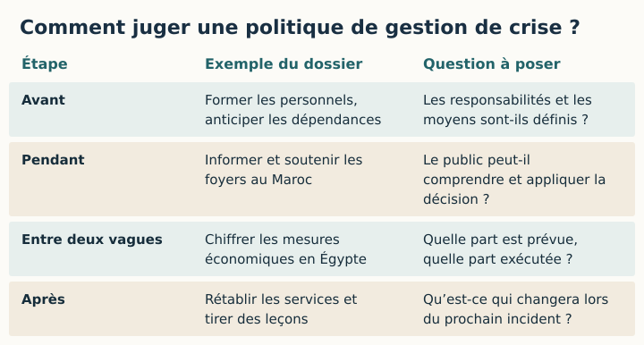

# X-ENS · MP-PC-PSI · Arabe 2022 — Corrigé guidé

*Corrigé rédigé par IA, non officiel. Signalez toute erreur.*

**Rédaction** · GPT-6.2 Astra Ultra · vitesse non renseignée

**Révision (tour 1)** · GPT-6.2 Astra Ultra · vitesse non renseignée

[Sujet commun](https://www.polytechnique.edu/admission-cycle-ingenieur/sites/admission/files/content/2022%20MP-PC-PSI%20SUJET%20ECRIT%20D'ARABE%20(XEULSR).pdf) · [Rapport du jury](https://www.polytechnique.edu/admission-cycle-ingenieur/sites/admission/files/content/2022%20MP-PC%20RAPPORT%20ECRIT%20ARABE%20(XEULSR).pdf)

## Préparer la composition

Dater les jugements. Les auteurs des deux premières pièces constatent une préparation insuffisante et défendent un enseignement de la gestion des crises. L’entretien avec un spécialiste lors d’une conférence arabe suffit déjà à nuancer l’idée d’une absence totale de la discipline. Les pièces de 2020 éprouvent ce diagnostic dans des pays précis. Le document égyptien présente les mesures économiques de la première vague qui appuient la préparation de la deuxième. Les 100 milliards de livres égyptiennes mobilisés et les 65 milliards déjà dépensés ne s’additionnent pas. Des crédits, taux et montants annoncés ne démontrent pas à eux seuls une efficacité sanitaire.

L’éditorial provient de Jordanie. Il propose une cellule médiatique, un porte-parole et un contrôle des prises de parole télévisées. Opposer deux cas concrets permet d’étayer la discussion. Une annonce gouvernementale doit être identifiable et vérifiable ; une question indépendante doit pouvoir être posée, y compris si elle contredit cette annonce. L’exemple attribué au responsable italien est présenté comme une information déformée.

## A · Synthèse des documents 1 à 4

### بين تشخيص العجز واختبار الاستعداد للأزمة

قد يبدأ انقطاع الكهرباء مشكلة في شبكة محددة ثم يصير أزمة صحية إذا تعطل ضخ المياه إلى المنازل. يستعمل أحد كاتبي المقالين الأولين هذا المثال لبيان أن خطورة الحادث لا تقتصر على ما أتلفه في اللحظة الأولى. والسؤال الذي يطرحه الملف هو مدى استعداد المؤسسات في البلدان العربية لرؤية هذه الصلات قبل أن تضطر إلى التصرف تحت ضغط الوقت. وفي حين يغلب على مقال الاستراتيجية والحوار المنشور في سويس إنفو تشخيص القصور، يقدم حوار مغربي ورسم معلوماتي مصري من عام الجائحة ما يتيح فحص ذلك الحكم في ضوء تجربتين محددتين.

فإدارة الأزمات في المقال الأول مجال معرفة ينبغي أن يدرس لمن سيتحملون مسؤولية عملية، ومنهم المهندسون والأطباء العاملون في مرافق حيوية. ومما يستشهد به الكاتب مخاطر تعطل شبكات الكهرباء والصرف والتجربة اليابانية مع الكوارث. لا يكفي في نظره أن يعجب الناس بتصرف مجتمع آخر حين تقع الكارثة ثم يواصلوا العمل بالطريقة نفسها. ويرى أن ضعف البحث والتدريب في المنطقة يحرم المسؤولين من سيناريوهات توضح مسبقا موضع الخلل المحتمل وما قد يترتب عليه. ومع ذلك فإن انعقاد مؤتمرين عربيين متعاقبين، أولهما في العقبة والثاني في شرم الشيخ، ووجود اختصاصيين يحاورهم الصحفيون يبين أن تشخيص غياب الثقافة العملية لا يعني انعدام كل معرفة بالموضوع.

ويوضح يوسف وصال في الحوار الذي أجري في مصر أن الاختبار يأتي بعد إصدار التوصيات. فقد يتفق المشاركون على الأولويات ثم تختلف قدرة البلدان على التنفيذ بحسب الموارد البشرية والعلمية والمادية المتاحة لها. ويميز بين الاستشراف قبل الحادث، واستعمال منظومة معروفة الأدوار والوسائل أثناءه، وإعادة التوازن عقب وقوعه، ثم تقويم ما جرى واستخلاص الدروس. ويجعل هذا التسلسل من كل تجربة مادة يمكن أن تفيد في المرة التالية. كما يتيح التعاون الإقليمي تبادل الخبرة والتقنيات، إلا أن توصية جامعة أو مؤتمر لا تعفي الجهات التي تدير مرافق الناس من تحديد ما يمكن تطبيقه فعلا.

ومن هنا تكتسب تجربة المغرب دلالتها. ففي حوار مع أحداث أنفو يعرض أستاذ التواصل جواد بنيس التلازم بين حسن التدبير وحسن التواصل. فالإعلان المتكرر عن الإجراءات يتيح للناس أن يفهموها، لكن الرسالة وحدها لا تطعم أسرة فقدت دخلها بسبب الحجر. وتناول الحوار مساعدة الفئات الهشة وتضامن المواطنين إلى جانب البيانات الصحية والمواد التوعوية. كما أتاحت التقنيات الرقمية مواصلة التعليم وبعض الأعمال، وأسهمت الشبكات الاجتماعية في نقل تجارب ميدانية ونشر رسائل الوقاية. وكانت كذلك وسيلة لانتشار أخبار زائفة يصعب ضبطها. أما استعمال تطبيق «وقايتنا» فتتوقف فائدته على قبول الناس له، ويثير تتبع المخالطين أسئلة عن الحريات ينبغي أن تؤخذ في الحسبان.

ويقدم الرسم الذي نشره مصراوي في ديسمبر من عام ٢٠٢٠ وجها آخر للاستعداد. فهو يجمع التدابير الاقتصادية المتخذة في الموجة الأولى التي تستند إليها الدولة في مواجهة الثانية. ويبين أن مئة مليار جنيه دبرت من الاحتياطات وأن خمسة وستين مليارا منها كانت قد صرفت عند إعداد الوثيقة. ويعرض تخفيض أسعار الفائدة ومبادرات لتمويل قطاعات منها الصناعة والسياحة ودعما لسوق المال ومساندة للمصدرين. أما التفريق بين الغلاف المرصود وما صرف بالفعل فيتيح قراءة الأرقام بوصفها مراحل في تنفيذ سياسة، لا عددا للأشخاص الذين استفادوا ولا قياسا لما حققته التدابير من نتائج صحية. وترد هذه المعطيات باسم جهات مصرية رسمية، من بينها البنك المركزي ووزارة المالية.

فالمعلومات المالية التي أتيحت للقراء تمس حياة العامل والمستهلك، مثلما تمس البيانات الصحية قدرة الأسرة على تنظيم شؤونها أثناء الحجر.

وبذلك تلتقي التجربتان في توسيع معنى إدارة أزمة صحية. فاستمرار الدراسة أو توفير دخل مؤقت أو تمكين منشأة من مواصلة نشاطها مسائل تدخل في قدرة السكان على تحمل التدابير الوقائية. وتختلف زاويتا العرض، إذ تركز المقابلة المغربية على العلاقة بين الدولة والجمهور، فيما يكشف الرسم المصري حجم الوسائل المخصصة لبعض التدخلات. ولا تسمح التجربتان بتعميم حكم واحد على المنطقة كلها، لكنهما تبينان أن هناك مبادرات يمكن إخضاعها للمراحل التي اقترحها الاختصاصي في الحوار الأسبق. وعندئذ يصبح السؤال الذي يصل بين الشهادات ما إذا كانت المعرفة والتوصيات قد تحولت إلى قرارات مفهومة وموارد متاحة، وما إذا كان تقويمها بعد الأزمة سيغير الاستعداد لما يليها.

*612 mots hors titre, par unités séparées par des espaces.*

## B · Texte d’opinion

يصف أحمد عبد الباسط الرجوب مشهدا تعرفه بيوت كثيرة في أوقات الخوف. يستمع أفراد الأسرة إلى طبيب على قناة، ثم ينتقلون إلى أخرى فيجدون كلاما مختلفا، ويصلهم على الهاتف قول خطير منسوب إلى مسؤول أجنبي لا يعرفون أين قاله أو متى. وبعد ساعات من المتابعة يصعب عليهم أن يجيبوا عن أبسط سؤال، وهو ما الذي ينبغي فعله اليوم. أفهم من هنا مطالبته بتنظيم الخطاب العام في الأردن، وأرى أن نجاح هذا التنظيم يتوقف على التمييز بين توحيد المعلومة الرسمية وإخضاع مناقشتها لصوت واحد.

أؤيد وجود جهة معلومة تعلن القرارات وتشرح متى تسري وعلى من تنطبق. ولا يحتاج الجمهور إلى خمسة مؤتمرات لتأكيد موعد واحد. يمكن للناطق الرسمي أن ينشر بيانا قصيرا يتضمن تاريخ التحديث ومصدر الأرقام وموعد البيان المقبل، وأن يميز فيه بين القرار الذي اتخذ فعلا والخيار الذي ما زال قيد الدراسة. ومن المفيد أن يتلقى الصحفيون أسئلة الجمهور ويرسلوها قبل الإحاطة، وأن يبقى متسع لسؤال لم يخطر ببال المسؤول. بذلك يعرف المستمع أين يراجع الخبر إذا وصلته في المساء نسخة مبتورة منه.

أما اشتراط إذن مسبق لمن يظهر على شاشة ويتحدث في القضية فأراه علاجا قد يضعف القدرة على اكتشاف الخطأ. لنتصور أن بيانا وطنيا أعلن أن خدمة معينة متاحة في جميع المناطق، ثم وجدت صحفية محلية أن المركز في مدينتها مغلق. يحتاج الجمهور إلى سماع هذا الخبر والتحقق منه، حتى لو لم يختر الناطق الرسمي الصحفية أو الطبيب الذي أكد المعلومة. المطلوب من القناة في هذه الحالة أن تسمي المصدر، وتطلب جواب الجهة المعنية، وتصحح ما تنشره إذا ظهر أنه خطأ. ولا يمكن أن تطلب الثقة من المشاهد إن أخفت التصحيح بعدما بالغت في عرض الخبر الأول.

ويحسن الكاتب حين يطالب من ينقل الخبر بأن يفكر في مسؤوليته. فالمستخدم الذي يعيد إرسال عبارة مخيفة إلى مجموعة عائلية لا يصبح شاهد عيان لمجرد أنه تلقاها من صديق أمين. لكن الدعوة إلى التثبت تكون أيسر عملا إذا أتيح للناس أصل يمكنهم الرجوع إليه بلغة يفهمونها. ومن هنا تبدو فكرة التواصل مع المقيمين من جنسيات مختلفة جديرة بالتطوير. قد يساعد شخص موثوق في مجتمعه على إيصال الرسالة، بشرط أن يتاح له نص دقيق مترجم وأن يتمكن مستمعوه من طرح أسئلة تتعلق بظروفهم الفعلية.

كذلك تختلف وظيفة الصحفي عن وظيفة صاحب المنصة التي تعرض المادة على جمهور واسع. تنظيم ظهور الضيوف قد يحسن جودة النقاش، لكنه لا يعالج بمفرده سرعة انتشار مقطع قديم أو اقتباس أخرج من سياقه. ويمكن للمحررين أن يلحقوا التصحيح بالمادة الأصلية وأن يبينوا ما تغير في المعرفة مع الوقت. فتراجع مختص عن تقدير أولي بعد ورود دليل جديد سلوك جدير بالاحترام. أما خلط ذلك التراجع بالكذب فيشجع بعض المتحدثين على التمسك بالخطأ خوفا من فقدان سمعتهم.

وينبغي أن تظل بيانات الأمس متاحة إلى جانب بيان اليوم، كي يستطيع القارئ أن يرى سبب التعديل وتاريخه بنفسه.

لو أردت قياس نجاح خلية إعلامية بعد انقضاء الأزمة لبحثت عن أسرة وصلها خبر مقلق وسألتها هل استطاعت معرفة مصدره، وهل وجدت من يجيب عن سؤالها، وهل وصلها التصحيح بالسرعة نفسها التي وصلتها بها الشائعة. عند هذه النقطة يصبح خفض الضجيج خدمة عامة يمكن اختبارها، وتبقى للصحافة حرية الكشف عن تقصير قد لا يسمع المسؤول صداه داخل مؤسسته. فالثقة التي تنشأ من إمكان مراجعة الكلام وتصحيحه أصلب من الهدوء المؤقت الذي قد تحققه قلة المتحدثين.

*513 mots, selon le même décompte.*
