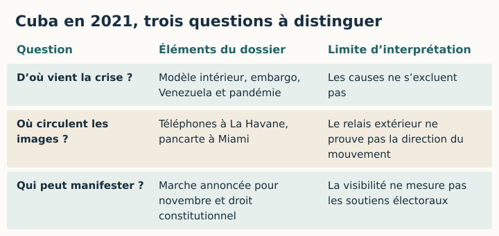

# X-ENS · MP-PC-PSI · Espagnol 2022 — Corrigé brut

*Corrigé rédigé par IA, non officiel. Signalez toute erreur.*

**Rédaction** · GPT-6.2 Astra Ultra · vitesse non renseignée

**Révision (tour 1)** · GPT-6.2 Astra Ultra · vitesse non renseignée

[Sujet commun](https://www.polytechnique.edu/admission-cycle-ingenieur/sites/admission/files/content/2022%20MP-PC-PSI%20SUJET%20ECRIT%20D'ESPAGNOL%20(XEULSR).pdf) · [Rapport du jury](https://www.polytechnique.edu/admission-cycle-ingenieur/sites/admission/files/content/2022%20MP-PC%20RAPPORT%20ECRIT%20ESPAGNOL%20(XEULSR).pdf)

## A · Synthèse des documents 1 à 4

### Entre la cola y la consigna, ¿qué cambió en Cuba en julio de 2021?

En julio de 2021 la escasez de bienes, la crisis sanitaria y el descontento político desembocaron en Cuba en las mayores protestas desde el Maleconazo de 1994. Volvieron después las colas y la aparente calma en las calles, pero ni las detenciones ni el restablecimiento de la rutina explicaban qué había movilizado a ciudadanos de lugares tan distintos. Los análisis publicados dentro del mundo hispanohablante y dos fotografías tomadas a ambos lados del estrecho de Florida muestran por qué resulta insuficiente atribuir la crisis a una sola causa o suponer que toda la sociedad cubana ha llegado a la misma conclusión.

La protesta iniciada en San Antonio de los Baños se extendió más allá de los grupos de oposición conocidos. La investigadora Anna Ayuso relaciona la visibilidad de artistas e intelectuales, entre ellos integrantes del movimiento San Isidro, con un malestar previo al agravamiento de la pandemia. El acceso a internet permitió compartir experiencias que antes permanecían separadas, aunque seguía siendo caro para muchos y las interrupciones limitaban su alcance. La foto de AFP en La Habana reúne a tres mujeres enmascaradas que miran sus teléfonos. Su contenido concreto se desconoce, pero la escena hace visible el uso cotidiano del medio por el que podían circular otras versiones de lo sucedido.

La otra imagen, procedente de una concentración en Miami, muestra el lema «Patria y vida» junto a la bandera cubana. La fórmula recupera el título de una canción y modifica la alternativa sacrificial de la consigna revolucionaria. Que la protesta encontrara eco entre los exiliados no demuestra, sin embargo, la tesis oficial de que Washington la dirigía. Según Ayuso, el sentimiento de vivir en un país acosado por las sanciones estadounidenses alcanza incluso a personas críticas con el Gobierno. A su vez, las organizaciones opositoras que habían recibido apoyo exterior no encabezaron necesariamente la iniciativa de julio.

El examen del embargo en La Nación permite precisar esa doble distinción. Las sanciones no han logrado democratizar la isla y encuentran un rechazo internacional muy amplio. Su endurecimiento afectó al turismo y a las remesas, dos fuentes de divisas ya esenciales. Además, el cierre de fronteras por la pandemia y las dificultades de Venezuela redujeron los recursos disponibles. Pero los economistas entrevistados también atribuyen el estancamiento y la insuficiente producción de alimentos a decisiones internas. Presentar el embargo como causa universal permite a las autoridades soslayar esas decisiones. Atribuir toda la penuria al sistema cubano borra, en cambio, el coste que una política exterior impone a la población. El Congreso estadounidense tiene la facultad de poner fin a ese conjunto de normas, mientras que el presidente dispone de margen para endurecerlo o aliviarlo.

El proyecto de marcha cívica para noviembre trasladó el debate al terreno jurídico. En CNN, Jorge Dávila Miguel contrasta la garantía constitucional del derecho a manifestarse, reconocida por el presidente del Tribunal Supremo Popular, con la prohibición de la convocatoria en nombre del carácter irrevocable del socialismo. El articulista recuerda que el Estado dispone de estructuras de control y de un apoyo real, cuya extensión no cabe verificar mediante encuestas independientes o una competencia política entre partidos. Cuestiona por ello que una marcha anunciada como pacífica constituya por sí misma una amenaza capaz de derribarlo. Sus promotores, entre ellos el dramaturgo Yunior García Aguilera, recibieron advertencias de posibles penas de prisión.

La repercusión internacional y la circulación de las imágenes permiten así reconocer voces que el relato oficial reducía a una minoría manipulada. No resuelven la cuestión de cuánto apoyo conserva el poder ni la de qué cambios podrán conseguir los manifestantes. Lo que sí ponen de manifiesto las protestas es una dificultad creciente para separar en la experiencia cotidiana la falta de un medicamento, la posibilidad de contarla y el derecho de reunirse para pedir responsabilidades.

*629 mots hors titre, par unités séparées par des espaces.*

## B · Texte d’opinion

Yoani Sánchez encuentra en las protestas de julio algo más exigente que el deseo de salir de Cuba. Muchos jóvenes, escribe, quieren quedarse y cambiar el país. Me convence que esta voluntad se tome en serio. Quien reclama que una institución de su propio país le escuche está actuando ya como alguien que tiene derecho a intervenir en su futuro. Sería injusto responderle que puede marcharse si no le gusta cómo vive. También sería injusto pedir a quien se marcha que demuestre por qué no pudo quedarse.

La contraposición entre la libertad y la penuria material me parece, en cambio, menos firme de lo que da a entender el artículo. Una persona que pasa horas en una cola para encontrar comida pierde algo más que tiempo. Si después no puede preguntar por qué escasea un producto ni reunirse con sus vecinos para discutir cómo se distribuye, ambas privaciones se refuerzan. Otra persona puede salir a la calle únicamente porque no encuentra un medicamento y estar en desacuerdo con algunas consignas de sus compañeros. Su participación cuenta igualmente. La pluralidad que se reclama para mañana tendría que empezar por reconocerse entre quienes protestan hoy.

Sánchez destaca además que la manifestación no necesitó un jefe que ordenara empezar. Entiendo el alivio de descubrir que personas separadas pueden reconocerse unas a otras sin esperar la autorización de una organización. Pero la falta de un jefe no resuelve lo que viene después de la concentración. Alguien tiene que escuchar a quienes vuelven a casa, recoger sus demandas y responder si se ha equivocado al hablar en su nombre. Una asamblea local, una asociación de familias o un medio independiente pueden cumplir tareas distintas. La prueba de que una voz pública representa a otros es que estos puedan corregirla sin miedo, también cuando esa voz se presenta como portavoz de la libertad.

La petición más concreta de la autora me parece por eso especialmente importante. Las familias que desconocen el paradero de una persona detenida necesitan un lugar fiable donde preguntar. Una respuesta verificable, dada a tiempo y con respeto por la intimidad familiar, tiene más valor que una declaración general de apoyo. Los llamamientos internacionales al respeto del derecho a manifestarse deben conservar esa atención a las personas. Nadie debería tener que respaldar la política de otro Estado para obtener información sobre un ser querido.

Por último, tomaría la frase final de Sánchez como una promesa que quienes la pronuncian se hacen entre sí. Como pronóstico histórico me parece demasiado segura. Haber hablado una vez no garantiza que la próxima vez resulte posible, que otros puedan escuchar o que una institución responda. Y una generación no debería ser medida por su capacidad de mantener sin descanso un valor heroico. También necesita ocasiones ordinarias para disentir, negociar y volver a intentarlo.

El avance más profundo sería que expresar una preferencia diferente dejara de señalar a alguien como héroe o enemigo. Sólo entonces dispondrían los jóvenes de la vida política corriente por la que, según Sánchez, muchos han decidido quedarse. Esa aspiración me parece más importante y también más difícil de cumplir que cualquier afirmación sobre el carácter irreversible de una jornada.

*526 mots, selon le même décompte.*

