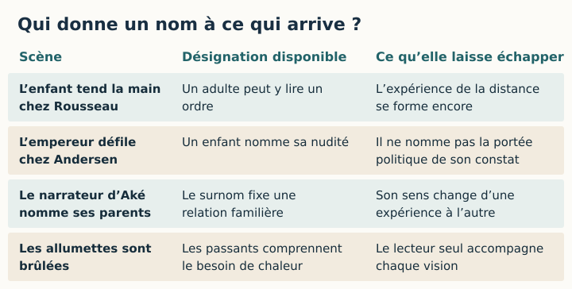

# X-ENS · MP-PC-PSI · Français 2022 — Corrigé guidé

*Corrigé rédigé par IA, non officiel. Signalez toute erreur.*

**Rédaction** · GPT-6.2 Astra Ultra · vitesse non renseignée

**Révision (tour 1)** · GPT-6.2 Astra Ultra · vitesse non renseignée

[Sujet commun](https://www.polytechnique.edu/admission-cycle-ingenieur/sites/admission/files/content/2022%20MP-PC-PSI%20SUJET%20ECRIT%20DE%20FRANCAIS%20(XEULSR).pdf) · [Rapport du jury](https://www.polytechnique.edu/admission-cycle-ingenieur/sites/admission/files/content/2022%20MP-PC-PSI%20RAPPORT%20ECRIT%20FRANCAIS%20(XEULSR).pdf)

## Préparer la composition

Le sujet ne demande pas si un enfant connaît le nom des objets qui l’entourent. La tournure « ce qui se passe » invite à étudier des événements et la manière dont ils affectent quelqu’un. Poser trois questions à chaque exemple. Qu’est-il arrivé ? Qui saurait le désigner ? Que reste-t-il de l’expérience après qu’un nom a été donné ? Dans l’œuvre d’Ernaux, la découverte d’une sœur morte que l’autrice enfant n’a pas connue fournit un contexte, sans dispenser de traiter les œuvres au programme.

Dans *Émile*, distinguer les livres I et II des épisodes ultérieurs. L’exemple du jardinier Robert permet d’observer une notion avant et après une rencontre. Chez Andersen, distinguer ce que les passants peuvent savoir de la petite fille et les visions que le conte donne à son lecteur. Chez Soyinka, différencier le surnom qui figure dans le récit, la perception de l’enfant et le travail de composition de l’adulte.

## Dissertation

Au matin, des passants trouvent le corps d’une petite vendeuse d’allumettes et expliquent, d’après les bâtons brûlés, qu’elle aura voulu se réchauffer. Ils ont parfaitement nommé un besoin de l’enfant. Qui pourrait pourtant soutenir, après avoir lu le conte d’Andersen, qu’ils ont dit ce qui s’est passé cette nuit-là ? L’écart entre une explication juste et une expérience singulière éclaire la phrase d’Annie Ernaux dans *L’Autre Fille*. « Rien de ce qui se passe dans l’enfance n’a de nom. » La formule surprend par l’étendue de sa négation. Un enfant apprend précisément à parler, il connaît le nom des gens qu’il aime et il est capable de dire ce qu’il désire. Cependant, avoir des mots pour des personnes ou des choses ne suffit pas pour savoir ce qui nous arrive en leur présence. Les livres I et II d’*Émile*, les *Contes* d’Andersen et *Aké, les années d’enfance* permettent d’éprouver cette différence. Nous examinerons d’abord comment un événement peut être vécu avant de pouvoir être nommé. Nous chercherons ensuite comment les enfants inventent pourtant des signes et savent parfois prononcer le mot qui manque aux adultes. Il restera à comprendre ce qu’un écrivain peut retrouver de cette expérience lorsqu’il entreprend de la dire longtemps après.

### Vivre un événement avant de pouvoir le nommer

Dans le premier livre d’*Émile*, un enfant trop petit pour se déplacer tend la main vers un objet éloigné. Il y a une distance entre lui et cet objet, mais il n’a pas encore acquis les expériences qui lui permettraient de la mesurer à la manière d’un adulte. Si son entourage prend le geste pour l’ordre qu’on aille lui chercher ce qu’il veut, il lui prête une intention qu’il peut ensuite faire naître en y répondant systématiquement. Une main tendue aura fini par signifier une exigence parce qu’elle l’aura d’abord signifiée aux yeux de celui qui la regardait. Rousseau oppose deux gestes qui se ressemblent. L’enfant qui tend la main en silence se trompe sur la distance ; l’adulte est invité à le porter lentement vers l’objet. Lorsque des cris accompagnent le geste et que l’enfant attend qu’on le serve, le précepteur y lit déjà un ordre. L’intention ne tient donc pas dans la silhouette d’une main tendue. La façon dont l’entourage a répondu aux premiers signes contribue à former ceux qui suivront. L’éducation commence ici par un scrupule de langage. Le mot de caprice permettrait à l’adulte de classer un comportement avant d’avoir laissé l’enfant en faire l’expérience. Ainsi une part de ce qui se passe dans l’enfance échappe aux noms que nous tenons tout prêts parce que l’événement est justement en train de former les intentions que ces mots supposent déjà constituées.

Cette antériorité n’est pas l’apanage du nourrisson privé de vocabulaire. L’enfant d’*Aké* vit dans l’enceinte de la mission, à proximité de lieux et de présences que plusieurs traditions lui apprennent à reconnaître. Les récits bibliques, les paroles des proches et le monde yorouba lui fournissent une abondance de noms. À la limite entre le jardin familier et les espaces qu’il redoute ou désire explorer, que faudrait-il appeler réel et que faudrait-il appeler imaginaire ? Une telle répartition peut intéresser un adulte qui ordonne ses souvenirs. Pour l’enfant, ce qu’une histoire lui a appris à attendre dans un lieu fait partie de ce lieu, autant que le chemin qu’il prend pour s’y rendre. Sa peur est une façon de voir plus d’êtres que n’en enregistrerait l’inventaire raisonnable du promeneur. Lui fournir le bon nom d’un arbre ou celui d’une croyance ne résoudrait pas ce qui lui arrive quand il s’en approche. Le monde n’a pas encore pris pour lui la forme d’une collection d’objets classés.

Il arrive aussi que les adultes disposent des mots et se gardent de les dire. Chez Ernaux, une petite fille apprend au hasard d’une conversation que ses parents ont eu une autre fille, morte avant sa naissance. Les mots de sœur et de mort existaient dans la langue familiale. Ce qui manquait était une situation où la cadette aurait pu dire à quelqu’un ce que cette nouvelle changeait à sa propre place dans la famille. Des années plus tard, Ernaux choisit la forme d’une lettre à la sœur qu’elle n’a jamais rencontrée. Le pronom « tu » lui donne une destinataire sans pouvoir procurer à l’enfant d’alors la réponse qu’elle n’a pas reçue. Le secret suggère une lecture plus exigeante de la phrase. Il est possible que l’enfance soit entourée de commentaires et que l’essentiel demeure sans nom, faute de quelqu’un à qui l’adresser. La petite fille d’Andersen en fait à sa manière l’épreuve. Les passants dont elle aurait attendu une pièce connaissent le froid et la pauvreté. Aucun ne reste assez longtemps auprès d’elle pour apprendre ce que signifie le froid pour celle qui craint autant le retour à la maison que la nuit au-dehors.

### Ce que le langage des enfants révèle

Mais l’enfance n’est pas tout entière attente d’une dénomination adulte. Elle sait parfois prononcer le mot dont les grandes personnes se sont interdit l’usage. Dans « Les Habits neufs de l’empereur », chacun des adultes qui regardent défiler le souverain dispose des yeux et du vocabulaire nécessaires pour constater sa nudité. Ce qui les arrête est très élaboré. Les habits prétendument invisibles aux incapables ont transformé tout constat en examen de la personne qui parle. L’enfant ignore ou néglige cette complication. Il dit tout haut ce qu’il voit et sa remarque circule jusqu’à devenir celle de la foule. C’est donc bien à un enfant qu’il revient de nommer ce qui est en train de se passer. À un détail près, qui sauve une part de la formule d’Ernaux. Le petit spectateur ne donne pas en même temps le nom de ce qu’il vient de faire. Il ne prononce aucun discours sur l’empire de l’opinion, la flatterie de cour ou la liberté de parole. Ces mots viennent au lecteur, qui mesure après coup la portée de sa remarque.

L’enfant peut également donner un nom dont la valeur relève d’un autre savoir que celui de l’état civil. La mère du narrateur d’*Aké* est désignée par le surnom couramment traduit par « Chrétienne Sauvage ». Le lecteur rencontre ainsi une personne avant de pouvoir la ramener à une définition. Les deux termes font tenir ensemble la fermeté des convictions religieuses et l’énergie redoutable de celle à qui l’enfant a affaire. Une désignation conventionnelle nous aurait appris sa place dans la parenté. Celle-ci nous apprend aussi quelque chose du rapport que le garçon entretient avec elle. Son père, nommé Essay dans le livre, entre de même dans un univers familier dont les noms ont une histoire et une sonorité propres. On se tromperait en lisant ces mots comme les légendes définitives de portraits. Ils sont assez souples pour changer de portée d’une scène à l’autre. Ce qui est nommé existe désormais entre des personnes qui se reconnaissent, sans avoir à traduire entièrement leur expérience dans les catégories communes.

Rousseau propose au livre II une manière de comprendre comment ces catégories peuvent néanmoins s’acquérir. Émile a planté des fèves sur un terrain que le jardinier Robert travaillait déjà. La découverte du dommage causé aux plantations du jardinier, puis du sort réservé aux fèves, oblige le jeune cultivateur à mesurer des prétentions concurrentes. Il sait ce que signifie désormais pour lui la perte de son ouvrage. Il peut comprendre du même coup que le travail de Robert avait pour Robert un prix analogue. Le mot de propriété, s’il vient résumer la leçon, trouve enfin à quoi s’appliquer. Un enfant aurait certes pu répéter ce mot avant de planter quoi que ce soit. Il n’aurait rien dit de comparable. Nommer est donc aussi ce qui se passe dans l’enfance, pourvu que le langage arrive assez tard pour recueillir une relation déjà rencontrée et assez tôt pour aider l’enfant à penser ce qu’un autre a éprouvé.

### Raconter l’enfance sans effacer son incertitude

Comment, toutefois, un écrivain qui connaît l’issue de l’histoire peut-il respecter le temps où aucun nom ne s’imposait ? Andersen prend une décision remarquable dans « La Petite Fille aux allumettes ». À chaque flamme, il laisse une image se former, la chaleur d’un poêle, un repas, la lumière d’un arbre, puis la présence aimée de la grand-mère. La durée de la vision se mesure à celle, infime, pendant laquelle la flamme tient. Dire seulement que la petite fille souffre du froid et qu’elle a des hallucinations ferait disparaître ce mouvement d’attente et de perte. Dire seulement qu’elle monte avec son aïeule ferait disparaître la rue où l’on retrouve son corps. Le conte maintient les deux scènes jusqu’à la fin. Le lecteur ne peut faire entendre à personne ce que l’enfant a vu, mais il saura désormais distinguer cette nuit des mots que les passants lui ont donnés. La fiction transmet avec précision une expérience qui échappait aux personnages capables de la constater.

L’écriture autobiographique se heurte à une difficulté différente. Dans *Aké*, celui qui revient sur le jardin et le domaine de son enfance sait ce que le temps a fait des lieux et des personnes. Il aurait les moyens de substituer à chaque croyance enfantine une explication culturelle ou historique. Or une grande partie de l’humour du livre tient à la patience avec laquelle il laisse un garçon pousser son raisonnement jusqu’au bout. Ainsi, lorsqu’il suit une musique et s’éloigne de chez lui avec une troupe en marche, ce qui peut s’appeler fugue ou disparition pour ceux qui le cherchent a d’abord pour lui la succession très concrète de bruits, de corps et de pas qui l’ont entraîné. L’adulte choisit l’ordre dans lequel le lecteur apprendra à s’inquiéter. Grâce à ce décalage, nous pouvons à la fois comprendre l’alarme familiale et nous souvenir qu’elle ne définit pas le départ aux yeux de celui qui est parti. La langue du récit ne restitue pas une parole enfantine enregistrée intacte. Elle crée les conditions dans lesquelles un adulte peut entendre une autre logique que la sienne.

Même le gouverneur d’Émile ne peut se dispenser d’une semblable retenue. Rousseau demande au lecteur de retrouver ce qu’il y avait d’incompréhensible, pour un enfant, dans les notions les plus claires de son propre vocabulaire. Sa critique de l’enseignement des fables en fournit l’épreuve. Dans « Le Corbeau et le Renard », l’adulte peut donner le nom de flatterie au discours du renard et en tirer une morale. L’élève qui envie l’habileté du vainqueur reçoit une tout autre leçon. Le maître a beau disposer de la bonne explication, elle ne constitue pas le nom de ce qui vient de se produire dans l’esprit de l’enfant. Ce qu’il peut faire de mieux est de prendre acte de cette discordance. Le nom qu’il avait préparé retrouvera peut-être un sens dans une autre situation. Encore faut-il que l’adulte n’ait pas refusé d’écouter pour la seule raison qu’il savait déjà comment finir la phrase.

Sans doute pourrait-on nommer les événements d’une enfance presque aussi exactement que ceux d’une vie adulte. Une naissance a eu lieu, une maison a disparu, une fillette est morte de froid. La radicalité de la phrase d’Ernaux préserve quelque chose que ce relevé exact pourrait détruire, l’ignorance à l’intérieur de laquelle un événement a d’abord été vécu. Elle nous oblige aussi à entendre les signes et les mots par lesquels des enfants se répondent, parlent à des adultes ou les rappellent à l’évidence. Le conte, l’autobiographie et même la fiction pédagogique trouvent leur justesse lorsqu’ils ne comblent pas d’un seul mot la distance entre ces expériences. Ils permettent de raconter ce qui n’avait pas de nom et de reconnaître, jusque dans la phrase qui en rend compte, que l’enfant n’aurait pas pu la prononcer telle quelle.

[Programme officiel](https://www.education.gouv.fr/bo/21/Hebdo28/ESRS2119554A.htm) · [Rousseau, Émile, livre I](https://fr.wikisource.org/wiki/%C3%89mile,_ou_De_l%E2%80%99%C3%A9ducation/%C3%89dition_1782/Livre_I)
