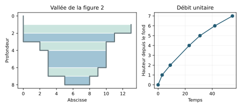
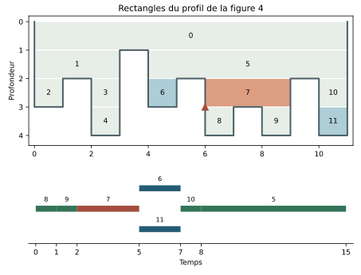

# X-ENS MP–PC–PSI · Informatique B 2022 · Corrigé guidé

*Corrigé rédigé par IA, non officiel. Signalez toute erreur.*

**Rédaction** · GPT-6.2 Astra Ultra · vitesse non renseignée · 24 novembre 2026

## Repères

La profondeur augmente vers le bas tandis que la hauteur d’eau augmente vers le haut. Les constantes H, B, G, D sont fournies. Le débit total est une unité de surface par unité de temps. La racine de la hiérarchie est de hauteur infinie.

## I · Validité d’un profil

### Question 1 · Détecter les retours immédiats

**Indication.** Le profil est précédé d’un pas B virtuel et suivi d’un pas H virtuel.

#### Solution

Comparer chaque pas au précédent, y compris le premier à B. Après la boucle, le dernier pas ne doit pas être B, puisqu’il serait suivi de H. Ce test couvre les deux parois infinies. Il prend $O(n)$ en temps et $O(1)$ en espace pour $n$ pas.

```python
def est_sans_rebroussement(g):
    précédent = B
    for pas in g:
        if ((précédent == B and pas == H) or
            (précédent == H and pas == B) or
            (précédent == G and pas == D) or
            (précédent == D and pas == G)):
            return False
        précédent = pas
    return précédent != B
```

### Question 2 · Reconnaître une vallée

**Indication.** Le droit de descendre prend fin dès la première montée.

#### Solution

Rejeter d’abord les rebroussements. Ensuite, aucun pas G n’est autorisé ; un pas B est interdit dès qu’un H a été rencontré. Les D sont admis dans les deux phases. Une vallée formée uniquement de D est acceptée. Deux passages linéaires suffisent.

```python
def est_une_vallee(g):
    if not est_sans_rebroussement(g):
        return False
    remonte = False
    for pas in g:
        if pas == G or (pas == B and remonte):
            return False
        if pas == H:
            remonte = True
    return True
```

### Question 3 · Calculer un voisin

**Indication.** L’axe vertical positif pointe vers le bas sur toutes les figures.

#### Solution

Le déplacement D augmente $x$, G le diminue, B augmente $y$ et H le diminue. Le domaine de l’argument garantit que le dernier cas est H. Temps et espace constants.

```python
def voisin(x, y, d):
    if d == D:
        return x + 1, y
    if d == G:
        return x - 1, y
    if d == B:
        return x, y + 1
    return x, y - 1
```

### Question 4 · Lister les points

**Indication.** Une suite de n pas compte n + 1 points, origine incluse.

#### Solution

Partir de $(0,0)$ et ajouter à la liste le résultat de chaque déplacement de Q3. Après $k$ tours, le dernier élément est la position après les $k$ premiers pas. Temps et espace $\Theta(n+1)$.

```python
def liste_des_points(g):
    x, y = 0, 0
    points = [(x, y)]
    for pas in g:
        x, y = voisin(x, y, pas)
        points.append((x, y))
    return points
```

### Question 5 · Détecter les points répétés

**Indication.** Comparer chaque point aux seuls points visités avant lui.

#### Solution

La double boucle examine chaque paire d’indices distincts une seule fois. Une égalité suffit à rejeter le profil, même si les visites sont très éloignées. Le pire cas (profil simple) demande $n(n+1)/2$ comparaisons, soit $\Theta(n^2)$ en temps et $O(n)$ en espace pour la liste des sommets. Aucun ensemble ni dictionnaire n’est nécessaire.

```python
def est_simple(g):
    points = liste_des_points(g)
    for i in range(len(points)):
        for j in range(i):
            if points[i] == points[j]:
                return False
    return True
```

## II · Remplissage d’une vallée

### Question 6 · Localiser le fond

**Indication.** Conserver la première occurrence de la plus grande profondeur.

#### Solution

Les abscisses d’une vallée ne décroissent jamais. Le premier point qui atteint le maximum de $y$ est donc le plus à gauche à cette profondeur. Le test strict conserve ce premier point lors d’une égalité. On obtient $(5,8)$ pour la figure 2, en un passage et en espace constant.

```python
def fond(v):
    x, y = 0, 0
    meilleur = (0, 0)
    for pas in v:
        x, y = voisin(x, y, pas)
        if y > meilleur[1]:
            meilleur = (x, y)
    return meilleur
```

### Question 7 · Extraire les plateaux

**Indication.** Un plateau est une suite maximale de D, y compris en fin de profil.

#### Solution

À l’entrée d’un bloc D, sauvegarder l’abscisse, puis consommer tous ses pas avant d’émettre un seul triplet. Une étape verticale met simplement la position à jour. L’indice avance une seule fois par pas malgré les deux boucles, soit $O(n)$ en temps et $O(p)$ pour les $p$ plateaux.

```python
def plateaux(v):
    p = []
    x, y = 0, 0
    i = 0
    while i < len(v):
        if v[i] == D:
            premier = x
            while i < len(v) and v[i] == D:
                x += 1
                i += 1
            p.append((premier, x, y))
        else:
            x, y = voisin(x, y, v[i])
            i += 1
    return p
```

### Question 8 · Empiler les rectangles du fond vers le haut

**Indication.** Partir du plateau le plus profond et absorber au même niveau les deux flancs éventuels.

#### Solution

Au début de chaque tour, les plateaux déjà atteints forment un bloc contigu. Entre le niveau courant et le suivant, la largeur d’eau est la différence entre l’extrémité droite et l’extrémité gauche de ce bloc. Les seuls plateaux susceptibles de l’élargir sont ses deux voisins immédiats. Choisir le plus profond des voisins encore présents, puis incorporer les deux en cas d’égalité. La monotonie de chaque flanc prouve l’invariant. Après le dernier voisin, la largeur reste constante jusqu’à l’infini. Chaque plateau est traité un nombre borné de fois ; le temps total est $O(n)$ et l’espace $O(p)$.

Pour la figure 2, les couples obtenus sont $(3,1),(6,1),(7,2),(8,1),(11,1),(13,-1)$. Le plateau unique d’une vallée plate conduit directement à $(w,-1)$.

```python
def decomposition_en_rectangles(v):
    p = plateaux(v)
    k = 0
    for i in range(1, len(p)):
        if p[i][2] > p[k][2]:
            k = i
    gauche, droite = k, k
    niveau = p[k][2]
    rectangles = []
    while gauche > 0 or droite + 1 < len(p):
        if gauche == 0:
            suivant = p[droite + 1][2]
        elif droite + 1 == len(p):
            suivant = p[gauche - 1][2]
        else:
            suivant = max(p[gauche - 1][2], p[droite + 1][2])
        largeur = p[droite][1] - p[gauche][0]
        rectangles.append((largeur, niveau - suivant))
        if gauche > 0 and p[gauche - 1][2] == suivant:
            gauche -= 1
        if droite + 1 < len(p) and p[droite + 1][2] == suivant:
            droite += 1
        niveau = suivant
    rectangles.append((p[droite][1] - p[gauche][0], -1))
    return rectangles
```

### Question 9 · Hauteur à un instant donné

**Indication.** Avec un débit unitaire, le temps encore disponible est aussi le volume restant.

#### Solution

Dans un rectangle fini de largeur $w$ et de hauteur $h$, soustraire $wh$ du temps si le rectangle est dépassé, puis ajouter $h$ à la hauteur. Sinon la montée partielle est $t/w$. Pour le dernier rectangle, le marqueur $-1$ déclenche toujours ce second calcul. Le temps est $O(n)$, y compris la décomposition. Dans la figure 2, les changements de pente ont lieu aux temps $3,9,23,31,42$ et aux hauteurs $1,2,4,5,6$.

```python
def hauteur_de_l_eau(t, v):
    hauteur = 0.0
    for largeur, h in decomposition_en_rectangles(v):
        if h == -1 or t <= largeur * h:
            return hauteur + t / largeur
        t -= largeur * h
        hauteur += h
```



## III · Grottes à ciel ouvert

### Question 10 · Construire la hiérarchie des rectangles

**Indication.** Le numéro d’un rectangle est son rang d’ouverture, sa fermeture se fait au sommet de pile.

#### Solution

Après un pas B, $(x,y)$ est le coin inférieur gauche du nouveau rectangle. Le sommet de pile antérieur est son père, ou la pile est vide et il s’agit de la racine. Un pas H ferme le dernier rectangle ouvert ; son bord droit est à l’abscisse courante. Un pas D avance simplement l’abscisse. La normalisation conserve un seul rectangle racine et garantit l’appariement de toutes les ouvertures et fermetures. L’ordre d’ouverture range les enfants de gauche à droite. Chaque pas coûte $O(1)$ ; l’ensemble demande $O(n)$ en temps et $O(r)$ en espace pour $r$ rectangles.

```python
def hierarchie_rectangles(g):
    origine, largeur, parent, enfants = [], [], [], []
    pile = []
    x, y = 0, 0
    for pas in g:
        if pas == B:
            y += 1
            i = len(origine)
            père = -1
            if len(pile) > 0:
                père = pile[len(pile) - 1]
                enfants[père].append(i)
            origine.append((x, y))
            largeur.append(-1)
            parent.append(père)
            enfants.append([])
            pile.append(i)
        elif pas == H:
            i = pile.pop()
            largeur[i] = x - origine[i][0]
            y -= 1
        else:
            x += 1
    return origine, largeur, parent, enfants
```

### Question 11 · Ordre de remplissage depuis la gauche

**Indication.** Un rectangle suit tous ses enfants, dans leur ordre de gauche à droite.

#### Solution

Effectuer un parcours en profondeur postfixe depuis le rectangle 0. Un cadre $(i,j)$ signifie qu’on va traiter le fils d’indice $j$ de $i$, ou émettre $i$ après le dernier fils. Chaque arête crée un seul cadre de retour et chaque sommet produit une seule sortie. Temps et espace $O(r)$. Sur la figure 4, l’ordre est $2,4,3,1,6,8,9,7,11,10,5,0$.

```python
def ordre_remplissage_depuis_origine(parent, enfants):
    ordre = []
    pile = [(0, 0)]
    while len(pile) > 0:
        i, j = pile.pop()
        if j == len(enfants[i]):
            ordre.append(i)
        else:
            pile.append((i, j + 1))
            pile.append((enfants[i][j], 0))
    return ordre
```

### Question 12 · Niveaux des rectangles depuis l’origine

**Indication.** Un rectangle fini de hauteur un consomme sa largeur en unités de temps.

#### Solution

Parcourir la liste de Q11. Tout rectangle entièrement rempli conserve la hauteur 1 ; le premier rectangle partiellement rempli reçoit le quotient du temps disponible par sa largeur. Les suivants restent à zéro. La racine, de hauteur infinie, reçoit toujours le quotient, même supérieur à 1. L’égalité au seuil donne une hauteur exactement égale à 1 et tous les suivants à zéro. Temps et espace $O(r)$.

```python
def hauteurs_eau_depuis_origine(t, largeur, parent, enfants):
    hauteur = [0.0 for w in largeur]
    for i in ordre_remplissage_depuis_origine(parent, enfants):
        if parent[i] == -1 or t <= largeur[i]:
            hauteur[i] = t / largeur[i]
            return hauteur
        hauteur[i] = 1.0
        t -= largeur[i]
    return hauteur
```

### Question 13 · Au plus deux remplissages simultanés

**Indication.** Examiner de quel côté l’eau arrive dans la partie encore sèche.

#### Solution

Quand le bassin alimenté déborde, les zones encore accessibles s’étendent à sa gauche et à sa droite. De chaque côté l’alimentation entre par l’extrémité voisine du bassin plein. L’hypothèse admise pour la source en bord, ou son image par symétrie, y donne un seul rectangle en cours de remplissage. Lorsque les deux fronts se rejoignent au niveau du père, celui-ci se remplit seul. Il y a donc au plus deux rectangles actifs.

### Question 14 · Capacité de chaque sous-arbre

**Indication.** Additionner les capacités de ses fils après les avoir entièrement calculées.

#### Solution

Un rectangle de hauteur un contribue sa largeur. Dans l’ordre postfixe chaque fils transmet une seule fois son volume déjà totalisé au père. La racine a une hauteur infinie : sa capacité totale vaut $+\infty$. Si l’on souhaite le volume jusqu’au niveau $y=0$ dessiné figure 6, le cumul de la racine avant son remplacement par l’infini représente exactement cette première tranche finie (32 sur la figure). Les volumes des autres sous-arbres ne dépendent pas de cette convention. Temps et espace $O(r)$.

```python
def volumes_totaux(largeur, parent, enfants):
    volume = largeur.copy()
    for i in ordre_remplissage_depuis_origine(parent, enfants):
        if parent[i] == -1:
            volume[i] = float("inf")
        else:
            volume[parent[i]] += volume[i]
    return volume
```

### Question 15 · Source au pied d’un rectangle quelconque

**Indication.** Séparer à chaque débordement les frères à gauche et à droite, puis redistribuer le débit dès qu’un côté est plein.

#### Solution

Initialiser les hauteurs à zéro et les volumes par Q14. Le débit vaut un, donc l’argument $t$ fournit le volume disponible. Noter $s$ le rectangle source. Sa source est à son coin inférieur gauche : dans le sous-arbre de $s$ l’eau entre par la gauche. Y émettre les descendants en ordre postfixe gauche–droite, puis $s$ lui-même, comme à Q11–12. Verser $\min(t,V_s)$ dans cet ordre. Si le budget est épuisé, terminer. Sinon le sous-arbre de $s$ est plein : retrancher $V_s$ et remonter à son père.

À chaque remontée, soit $c$ le fils déjà plein et $p$ son père. Former la liste de ses frères de gauche, du plus proche de $c$ au plus éloigné, et de même pour les frères de droite. Du côté gauche parcourir chaque sous-arbre en postfixe **droite–gauche** ; du côté droit en postfixe **gauche–droite**. Soient $L,R$ les capacités totales respectives, obtenues par addition des volumes de Q14. Avec $b=\min(t,L+R)$, affecter au côté gauche et au côté droit les volumes


$$
b_L=\min\!\bigl(L,\max(b/2,b-R)\bigr),\qquad b_R=b-b_L.
$$


Tant qu’aucun côté n’est plein, chacun reçoit la moitié. Si l’un atteint sa capacité, l’autre reçoit le reste. La formule traite aussi un côté vide. Verser chaque budget dans son ordre, par rectangles entiers puis éventuellement par un rectangle partiel. Retrancher $b$ de $t$. Si les frères ne sont pas tous pleins, terminer. Sinon, verser dans $p$ seul, jusqu’à sa capacité propre (sa largeur, ou l’infini pour la racine). Si $p$ est plein et qu’il reste du temps, remplacer $c$ par $p$ et répéter.

Les sous-arbres frères sont disjoints et le sens de chacun est celui de son point d’entrée. Un père ne monte qu’après le remplissage de tous ses enfants. Ces deux invariants justifient chaque étape. Chaque sous-arbre latéral est parcouru une seule fois, chaque liste de fils du chemin vers la racine une seule fois. Temps et espace $O(r)$. Sur la figure 6 à droite, la source est au coin du rectangle 7. Les rectangles 8, 9, 7 sont pleins aux dates 1, 2, 5. Entre 5 et 7 les rectangles 6 et 11 reçoivent chacun une demi-unité par unité de temps ; à 7 ils sont tous deux pleins. Le rectangle 10 se termine à 8, puis le 5 à 15.


