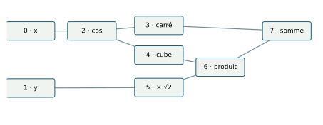
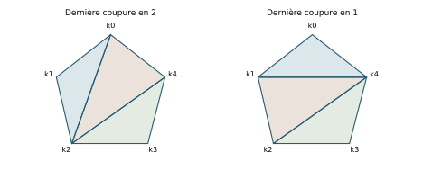
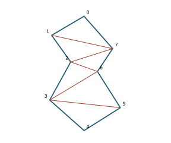

# X-ENS MP · Informatique A 2022 · Corrigé brut

*Corrigé rédigé par IA, non officiel. Signalez toute erreur.*

**Rédaction** · GPT-6.2 Astra Ultra · vitesse non renseignée · 24 novembre 2026

## Partie I · Matrices et produits

### Question I.1 · Matrice identité

Dans tout le corrigé, on reprend le type du sujet pour les matrices rectangulaires de dimensions positives.
```ocaml
type matrix = float array array

let identite n =
  Array.init n (fun i ->
    Array.init n (fun j -> if i = j then 1. else 0.))
```
Chaque ligne est allouée séparément. Le tableau contient $n^2$ coefficients, dont seuls les $n$ coefficients diagonaux valent 1.

### Question I.2 · Produit scalaire

```ocaml
let scalaire u v =
  if Array.length u <> Array.length v then invalid_arg "scalaire";
  let s = ref 0. in
  for j = 0 to Array.length u - 1 do
    s := !s +. u.(j) *. v.(j)
  done;
  !s
```
Après $r$ itérations, l’accumulateur est la somme des $r$ premiers produits. Le vecteur vide donne la somme nulle.

### Question I.3 · Compatibilité du produit

```ocaml
let mul_possible (a : matrix) (b : matrix) =
  Array.length a.(0) = Array.length b
```
Pour $A\in M_{m,n}$ et $B\in M_{q,p}$, le produit $AB$ existe exactement si $n=q$. Les matrices du sujet sont rectangulaires et possèdent au moins une ligne et une colonne.

### Question I.4 · Multiplication matricielle

```ocaml
let mul a b =
  if not (mul_possible a b) then invalid_arg "mul";
  let m = Array.length a and n = Array.length b in
  let p = Array.length b.(0) in
  Array.init m (fun i -> Array.init p (fun j ->
    let s = ref 0. in
    for k = 0 to n - 1 do
      s := !s +. a.(i).(k) *. b.(k).(j)
    done;
    !s))
```
Chaque coefficient est $\sum_{k=1}^{n}a_{ik}b_{kj}$. Les $mp$ sommes utilisent chacune exactement $n$ multiplications flottantes, soit $mnp$.

## Partie II · Parenthésage optimal

### Question II.1 · Deux parenthésages

Le coût à gauche est $k_0k_1k_2+k_0k_2k_3$, celui à droite $k_1k_2k_3+k_0k_1k_3$. La matrice obtenue est la même en arithmétique exacte. Avec $(k_0,k_1,k_2,k_3)=(1,10,1,10)$ on obtient respectivement $20$ et $200$ multiplications. En inversant la suite des dimensions, les coûts s’échangent. Il faut donc choisir le parenthésage à partir des dimensions.

### Question II.2 · Produit associé à droite

```ocaml
let rec muld = function
  | [] -> invalid_arg "muld"
  | [a] -> a
  | a :: suite -> mul a (muld suite)
```
Si la fonction parenthèse correctement le suffixe, la multiplication à gauche par la première matrice donne exactement le parenthésage demandé. Le singleton initialise la récurrence.

### Question II.3 · Produit associé à gauche

```ocaml
let mulg = function
  | [] -> invalid_arg "mulg"
  | a :: suite -> List.fold_left mul a suite
```
Après $r$ matrices, l’accumulateur vaut $((B^1B^2)\cdots B^r)$. L’ordre des facteurs est préservé.

### Question II.4 · Coût minimal sans mémoire auxiliaire

Avec des indices de matrices commençant à zéro dans le programme, le bloc $[i,j]$ a pour dimensions $k_i\times k_{j+1}$. Pour $i=j$, le coût est nul. Sinon, la dernière coupure après $s$ coûte $p(i,s)+p(s+1,j)+k_i k_{s+1}k_{j+1}$. Toutes les coupures sont admissibles et un calcul optimal doit utiliser deux sous-produits eux-mêmes optimaux.

```ocaml
let min_mul k =
  let rec cout i j =
    if i = j then 0 else begin
      let meilleur = ref max_int in
      for s = i to j - 1 do
        let candidat = cout i s + cout (s + 1) j
                       + k.(i) * k.(s + 1) * k.(j + 1) in
        meilleur := min !meilleur candidat
      done;
      !meilleur
    end
  in
  if Array.length k < 2 then invalid_arg "min_mul";
  cout 0 (Array.length k - 2)
```
Pour $m$ facteurs, le nombre d’appels satisfait $N(1)=1$ et $N(m)=1+2\sum_{r=1}^{m-1}N(r)$. La différence donne $N(m+1)=3N(m)$, donc $N(m)=3^{m-1}$. Le temps est en particulier $\Omega(2^n)$. Les coûts entiers sont supposés représentables, comme dans le modèle de calcul du sujet.

### Question II.5 · Programmation dynamique des coûts

```ocaml
let plan_produit k =
  let n = Array.length k - 1 in
  if n < 1 then invalid_arg "plan_produit";
  let cout = Array.make_matrix n n 0
  and coupe = Array.make_matrix n n 0 in
  for longueur = 2 to n do
    for i = 0 to n - longueur do
      let j = i + longueur - 1 in
      let meilleur = ref max_int in
      for s = i to j - 1 do
        let v = cout.(i).(s) + cout.(s + 1).(j)
                + k.(i) * k.(s + 1) * k.(j + 1) in
        if s = i || v < !meilleur then begin
          meilleur := v; coupe.(i).(j) <- s
        end
      done;
      cout.(i).(j) <- !meilleur
    done
  done;
  cout, coupe

let min_mul_opt k =
  let cout, _ = plan_produit k in
  cout.(0).(Array.length k - 2)
```
Les diagonales nulles sont les coûts des singletons. La somme des nombres de coupures vaut $\sum_{\ell=2}^n(n-\ell+1)(\ell-1)=(n^3-n)/6$. Le temps est $\Theta(n^3)$ et les tables occupent $\Theta(n^2)$ cases. La seconde table conserve les choix pour la question suivante. Pour le seul coût, on peut en faire l’économie.

### Question II.6 · Reconstruction du produit optimal

```ocaml
let mul_opt a =
  let n = Array.length a in
  if n = 0 then invalid_arg "mul_opt";
  let k = Array.init (n + 1) (fun j ->
    if j = 0 then Array.length a.(0)
    else Array.length a.(j - 1).(0)) in
  let _, coupe = plan_produit k in
  let rec produit i j =
    if i = j then a.(i) else
      let s = coupe.(i).(j) in
      mul (produit i s) (produit (s + 1) j)
  in
  produit 0 (n - 1)
```
La table est remplie avec des entiers. Par récurrence, chaque appel réalise le coût enregistré pour son intervalle, puisque ses fils réalisent leur coût optimal et la dernière multiplication est celle de la coupure retenue. La racine utilise donc exactement $p_{1,n}$ multiplications de flottants.

## Partie III · Différentiation d’une composition

### Question III.1 · Domaine et composition de la transformation avant

Avec $\mathcal L(E,F)$ l’espace des applications linéaires de $E$ dans $F$,

$$
\overrightarrow D f:\mathbb R^n\times\mathcal L(\mathbb R^p,\mathbb R^n)\longrightarrow\mathbb R^m\times\mathcal L(\mathbb R^p,\mathbb R^m).
$$

Pour $g:\mathbb R^m\to\mathbb R^q$, appliquer d’abord $\overrightarrow Df$, puis $\overrightarrow Dg$, donne $(g(f(x)),D_{f(x)}g\circ D_xf\circ h)$. La règle de la chaîne transforme la seconde composante en $D_x(g\circ f)\circ h$. C’est exactement $\overrightarrow D(g\circ f)(x,h)$.

### Question III.2 · Deux étages de différentiation

On obtient $\overrightarrow Df^2(f^1(x),D_xf^1)=(f^2(f^1(x)),D_{f^1(x)}f^2\circ D_xf^1)$. Par la règle de la chaîne, le second terme est $D_x(f^2\circ f^1)$. Les espaces intermédiaires ont tous deux dimension $k_1$.

### Question III.3 · Propagation avant des jacobiennes

```ocaml
let forward x fs diff =
  let rec suite point jac = function
    | [] -> jac
    | [f] -> mul (diff f point) jac
    | f :: reste ->
        let j = diff f point in
        suite (f point) (mul j jac) reste
  in
  match fs with
  | [] -> identite (Array.length x)
  | [f] -> diff f x
  | f :: reste -> suite (f x) (diff f x) reste
```
Après les $r$ premières fonctions, le point transmis est $x_r=f^r\circ\cdots\circ f^1(x)$ et la matrice est $J_r(J_{r-1}(\cdots J_1))$, où $J_i$ est évaluée en $x_{i-1}$. L’initialisation fournit ces deux valeurs pour $r=1$ et la question III.2 prouve le passage d’un préfixe au suivant. À la dernière fonction, on peut omettre le calcul de sa valeur. La liste vide représente l’identité.

### Question III.4 · Coût de la propagation avant

Construire les jacobiennes coûte $\Theta(\sum_i k_ik_{i-1})$. Pour $i\ge2$, le produit supplémentaire coûte $\Theta(k_i k_{i-1}k_0)$. Si $k_i=2^i$, on a $k_0=1$ et ces deux sommes sont de l’ordre de $\sum_{i=1}^n 2^{2i-1}=\Theta(4^n)$. Si $k_i=k$, la construction coûte $\Theta(nk^2)$ et les produits $\Theta((n-1)k^3)$, soit $\Theta(n)$ pour $k$ fixé. Ces estimations comptent les jacobiennes et l’algèbre imposées. Si l’évaluation des fonctions $f^i$ elles-mêmes coûte davantage, il faut ajouter le coût des évaluations aux points intermédiaires, que l’énoncé ne borne pas séparément.

### Question III.5 · Propagation en sens inverse

```ocaml
let backward x fs diff =
  let rec collecte point acc = function
    | [] -> acc
    | [f] -> diff f point :: acc
    | f :: reste ->
        let j = diff f point in
        collecte (f point) (j :: acc) reste
  in
  match collecte x [] fs with
  | [] -> identite (Array.length x)
  | derniere :: precedentes -> List.fold_left mul derniere precedentes
```
La liste collectée est $[J_n;\ldots;J_1]$, chaque $J_i$ étant calculée en $x_{i-1}$. Le pli forme $((J_nJ_{n-1})J_{n-2})\cdots J_1$. L’associativité garantit la même différentielle, avec un autre coût de multiplication.

### Question III.6 · Exemples de supériorité des deux ordres

Pour $k_i=2^i$, prendre des applications linéaires dont les jacobiennes ont les tailles imposées, évaluables en temps proportionnel à leur taille. Le calcul avant coûte $\Theta(4^n)$. Le premier produit en sens inverse, $J_nJ_{n-1}$, coûte $2^n2^{n-1}2^{n-2}=\Theta(8^n)$. La somme des produits suivants est géométrique, donc le coût inverse est $\Theta(8^n)$. Pour $k_i=2^{n-i}$, les dimensions sont renversées et les rôles s’échangent. Cette fois le sens inverse coûte $\Theta(4^n)$ et le sens avant $\Theta(8^n)$. Les évaluations intermédiaires de ces applications linéaires ne changent pas ces ordres.

### Question III.7 · Ordre optimal pour la différentielle composée

Calculer successivement $x_0=x$, $J_i=J^i(x_{i-1})$ puis, si nécessaire, $x_i=f^i(x_{i-1})$. Ranger les jacobiennes dans un tableau en ordre inverse, $[J_n,\ldots,J_1]$. Appliquer alors la fonction de II.6 dont les dimensions sont $(k_n,k_{n-1},\ldots,k_0)$. La chaîne donne le bon produit et la programmation dynamique minimise ses multiplications flottantes. Les évaluations individuelles des jacobiennes sont communes à tous les parenthésages.

## Partie IV · Propagation sur un graphe de calcul

### Question IV.1 · Tableau de propagation directionnelle

Posons $a=\sqrt 2/2$. Au point $(\pi/4,1)$, le tableau suivant utilise le produit et la somme des dérivées directionnelles de chaque prédécesseur.

| Indice | Calcul local | Valeur | Différentielle sur $(1,1)$ |
|---|---|---:|---:|
| 0 | $x$ | $\pi/4$ | $1$ |
| 1 | $y$ | $1$ | $1$ |
| 2 | $c=\cos x$ | $a$ | $-a$ |
| 3 | $c^2$ | $1/2$ | $2a(-a)=-1$ |
| 4 | $c^3$ | $a/2$ | $3a^2(-a)=-3a/2$ |
| 5 | $s=\sqrt2\,y$ | $\sqrt2$ | $\sqrt2$ |
| 6 | $c^3s$ | $1/2$ | $(-3a/2)\sqrt2+(a/2)\sqrt2=-1$ |
| 7 | $c^2+c^3s$ | $1$ | $-1-1=-2$ |

Le résultat demandé est le scalaire $-2$. Le partage du nœud 2 permet d’utiliser une seule évaluation du cosinus.



### Question IV.2 · Collecte des prédécesseurs

```ocaml
let collecte a indices =
  (Array.map (fun j -> fst a.(j)) indices,
   Array.map (fun j -> snd a.(j)) indices)
```
Dans les deux tableaux retournés, la case $r$ vient de la case $I_r$ du tableau de propagation. L’opération est linéaire dans le nombre d’indices.

### Question IV.3 · Propagation sur un graphe acyclique

```ocaml
type fonction_elementaire =
  (float array -> float) * (float array -> float array)
type sommet_avant = { fct : fonction_elementaire; pred : int array }
type graphe_avant = sommet_avant array

let propagation_avant (g : graphe_avant) x v =
  let n = Array.length g and dim = Array.length x in
  if n = 0 || Array.length v <> dim then invalid_arg "propagation";
  let a = Array.make n (0., 0.) in
  let entree = ref 0 in
  Array.iteri (fun i s ->
    if Array.length s.pred = 0 then begin
      if !entree >= dim then invalid_arg "entrees";
      a.(i) <- (x.(!entree), v.(!entree));
      incr entree
    end else begin
      let valeurs, vitesses = collecte a s.pred in
      let f, gradient = s.fct in
      a.(i) <- (f valeurs, scalaire (gradient valeurs) vitesses)
    end) g;
  if !entree <> dim then invalid_arg "entrees";
  snd a.(n - 1)
```
Les sources sans prédécesseurs représentent les variables dans leur ordre d’entrée, et le dernier nœud représente la sortie. Par induction topologique, toutes les paires collectées sont correctes. La règle de la chaîne au sommet $i$ donne $\sum_j(\partial_j f_i)\dot u_j$, précisément le produit scalaire du programme. Les sources possèdent déjà les valeurs et tangentes initiales.

### Question IV.4 · Nœuds linéaires

On peut remplacer la paire de fonctions au nœud par l’un des deux cas suivants.
```ocaml
type operation =
  | Lineaire of (float array -> float)
  | Generale of fonction_elementaire

let evalue op valeurs tangentes =
  match op with
  | Lineaire l -> (l valeurs, l tangentes)
  | Generale (f, grad) ->
      (f valeurs, scalaire (grad valeurs) tangentes)
```
Au sommet somme, on additionne séparément les deux valeurs et les deux tangentes. Au sommet de mise à l’échelle, on multiplie les deux champs par $\sqrt2$. Le gradient intermédiaire et son allocation deviennent inutiles aux nœuds linéaires.

## Partie V · Triangulation de polygones

### Question V.1 · Parenthésages et triangulations pondérées

Prendre un polygone convexe à $n+1$ sommets successifs $0,\ldots,n$ de poids $k_0,\ldots,k_n$. Pour le bloc $B^i\cdots B^j$, considérer les sommets $i-1,\ldots,j$ et le côté de base $(i-1,j)$. Un seul triangle a ce côté dans une triangulation. Son troisième sommet $s$ satisfait $i\le s<j$. Son poids $k_{i-1}k_s k_j$ est le coût du produit final entre les blocs $(i,\ldots,s)$ et $(s+1,\ldots,j)$.

Les deux sous-polygones héritent de triangulations indépendantes. Réciproquement on peut réunir deux triangulations de ces sous-polygones et le triangle de base. Pour un seul facteur, il reste un côté et le coût vaut zéro. Par récurrence sur $j-i+1$, cette correspondance conserve les coûts et atteint tous les parenthésages et toutes les triangulations. Elle conserve donc leurs minima.



### Question V.2 · Invariance par rotation

Pour $B^1\cdots B^{n-1}$ les poids sont $(k_0,k_1,\ldots,k_{n-1})$. Pour $B^nB^1\cdots B^{n-2}$, la suite est $(k_{n-1},k_n,k_1,\ldots,k_{n-2})=(k_{n-1},k_0,k_1,\ldots,k_{n-2})$. C’est une permutation circulaire. Une rotation des étiquettes met les triangulations en bijection et préserve chaque produit de trois poids. Les sommes minimales, donc les coûts en multiplications, sont égaux. Pour $n=2$, les deux coûts sont directement nuls.

### Question V.3 · Convexité d’un polygone simple

```ocaml
type polygone = (float * float) array

let orientation (ax, ay) (bx, by) (cx, cy) =
  (bx -. ax) *. (cy -. ay) -. (by -. ay) *. (cx -. ax)

let est_convexe (p : polygone) =
  let n = Array.length p in
  let positif = ref false and negatif = ref false in
  for i = 0 to n - 1 do
    let z = orientation p.(i) p.((i+1) mod n) p.((i+2) mod n) in
    if z > 0. then positif := true;
    if z < 0. then negatif := true
  done;
  n >= 3 && (!positif <> !negatif)
```
Pour un polygone simple d’aire positive, la convexité équivaut à l’absence d’angle rentrant, donc à un seul sens de virage pour les angles non plats. Le signe nul ne modifie ni drapeau. On accepte les deux sens de parcours, en temps $\Theta(n)$. Les tests géométriques supposent des signes de déterminant fiables, conformément au modèle de calcul du sujet.

### Question V.4 · Nombre de diagonales

Soit $d$ le nombre de diagonales ajoutées. Chaque diagonale séparatrice augmente le nombre de régions de 1, donc la triangulation a $t=d+1$ triangles. En comptant leurs côtés, $3t=n+2d$, car une arête du contour compte une fois et une diagonale deux fois. D’où $d=n-3$ et $t=n-2$, pour toute triangulation.

### Question V.5 · Triangulation convexe en temps linéaire

Pour un polygone strictement convexe, tracer $(0,j)$ pour $2\le j\le n-2$. Le code suivant couvre aussi les angles plats admis en V.3. Il fait un éventail sur les coins stricts puis réinsère les sommets alignés. Pour chaque côté courant $a b$ du contour, $o(a)$ est le troisième sommet de son unique triangle incident. Un point $v$ réinséré sur $a b$ partage ce triangle grâce à la diagonale $v\,o(a)$.

```ocaml
let triangule_convexe (p : polygone) =
  let n = Array.length p in
  let coins = ref [] in
  for i = n - 1 downto 0 do
    let prev = (i + n - 1) mod n and suiv = (i + 1) mod n in
    if orientation p.(prev) p.(i) p.(suiv) <> 0. then
      coins := i :: !coins
  done;
  let t = Array.of_list !coins in
  let m = Array.length t in
  if m < 3 then invalid_arg "polygone de surface nulle";
  let suivant = Array.make n (-1) and oppose = Array.make n (-1) in
  let diags = ref [] in
  let ajoute a b = diags := (min a b, max a b) :: !diags in
  for j = 0 to m - 1 do
    suivant.(t.(j)) <- t.((j+1) mod m);
    oppose.(t.(j)) <-
      (if j = 0 then t.(2)
       else if j = m - 1 then t.(m - 2) else t.(0))
  done;
  for j = 2 to m - 2 do ajoute t.(0) t.(j) done;
  for j = 0 to m - 1 do
    let a = ref t.(j) and b = t.((j+1) mod m) in
    while (!a + 1) mod n <> b do
      let v = (!a + 1) mod n and c = oppose.(!a) in
      ajoute v c;
      if suivant.(b) = c then oppose.(b) <- v;
      if suivant.(c) = !a then oppose.(c) <- v;
      suivant.(!a) <- v; suivant.(v) <- b;
      oppose.(v) <- c; a := v
    done
  done;
  !diags
```
Le côté $av$ conserve l’opposé $c$ de l’ancien côté $ab$. Le côté $vb$ prend le même opposé, tandis que les autres côtés du triangle qui appartiennent au contour ont désormais $v$ pour opposé. Chaque insertion se fait en temps constant, produit deux triangles d’aire positive et conserve la triangulation. Les deux balayages et les $n-3$ diagonales coûtent $\Theta(n)$.

### Question V.6 · Séparation des deux chaînes

```ocaml
let separe_polygone (p : polygone) =
  let n = Array.length p in
  if n < 3 then invalid_arg "separe_polygone";
  let avant i j =
    let x, y = p.(i) and u, v = p.(j) in
    y > v || (y = v && x < u)
  in
  let haut = ref 0 and bas = ref 0 in
  for i = 1 to n - 1 do
    if avant i !haut then haut := i;
    if avant !bas i then bas := i
  done;
  let chemin i fin pas =
    let rec parcourt j acc =
      if j = fin then List.rev acc else
        parcourt ((j + pas + n) mod n) (j :: acc)
    in parcourt i []
  in
  let premier = chemin !haut !bas 1 in
  let second = chemin ((!haut + n - 1) mod n)
                       ((!bas + n - 1) mod n) (-1) in
  premier, second
```
La première liste contient le haut et exclut le bas. La seconde commence au voisin du haut dans l’autre sens et s’arrête juste après le bas. Elles sont disjointes et couvrent le contour. La monotonie donne l’ordre non croissant des ordonnées et les indices modulaires gèrent le passage par zéro. Chaque sommet est visité un nombre borné de fois.

### Question V.7 · Triangulation d’un polygone monotone

Étiqueter les deux chaînes gauche et droite en les parcourant du haut vers le bas. Si le contour du tableau est trigonométrique, la première chaîne de V.6 est à gauche, sinon elle est à droite. Fusionner les deux listes en ordonnées décroissantes. Départager les égalités sur des chaînes différentes par abscisse croissante, en préservant l’ordre sur chaque chaîne. Dans la définition stricte du sujet, une arête horizontale entière donnerait plus de deux intersections avec son horizontale. Les ex æquo entre deux chaînes restent possibles.

Soit $u_0,\ldots,u_{n-1}$ l’ordre obtenu. Empiler $u_0$, puis $u_1$. À toute émission d’une diagonale, retourner ses extrémités sous la forme $(\min(i,j),\max(i,j))$.

1. Pour chaque $v=u_j$, $2\le j\le n-2$, comparer sa chaîne à celle du sommet de pile.
2. **Chaînes opposées.** Dépiler tous les sommets. Relier $v$ à chacun, sauf le dernier dépilé (fond de pile). Ces sommets sont visibles depuis $v$ par l’intérieur de la partie encore à trianguler. Repartir avec $u_{j-1}$ au fond et $v$ au sommet.
3. **Même chaîne.** Dépiler le sommet $a$. Tant que la pile contient un sommet $b$ en tête et que $vb$ coupe à l’intérieur, émettre $(v,b)$ et remplacer $a$ par $b$ dépilé. Le test d’intérieur est $\det(a-v,b-v)<0$ sur la chaîne gauche et $>0$ sur la droite. En cas de collinéarité, garder $b$ en pile pour éviter un triangle plat. À la sortie, empiler $a$, puis $v$.
4. **Sommet le plus bas.** Le relier à tous les sommets de la pile sauf le premier et le dernier, qui sont déjà ses voisins sur le bord restant.

Après chaque étape, les triangles produits ont des intérieurs disjoints. Dans la partie déjà balayée, la frontière encore active est la chaîne de pile. Ses angles intermédiaires sont rentrants ou plats du côté non triangulé. Un changement de chaîne permet donc de découper toute cette poche en éventail. Sur la même chaîne, le signe du déterminant indique exactement jusqu’où l’éventail reste intérieur. La dernière étape ferme la dernière poche. On obtient $n-3$ diagonales. La fusion est linéaire. Chaque sommet est ajouté un nombre borné de fois et un sommet dépilé est débité à une insertion antérieure, donc les opérations de pile, l’espace et la taille de sortie sont en $O(n)$.


