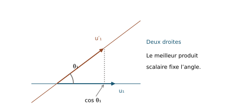
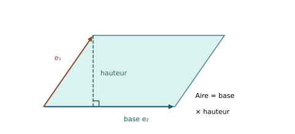
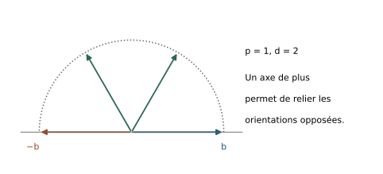

# X-ENS MP — Mathématiques A 2022 · Corrigé brut

*Corrigé rédigé par IA, non officiel. Signalez toute erreur.*

**Rédaction** · modèle exact non renseigné (famille GPT-6) · effort non renseigné · vitesse non renseignée

**Révision** · modèle exact non renseigné (famille GPT-6) · effort non renseigné · vitesse non renseignée

**Révision (tour 2)** · GPT-6.2 Astra Ultra · vitesse non renseignée

**Révision (tour 3)** · GPT-6.2 Astra Ultra · vitesse non renseignée · 26 novembre 2026

## Notations

Dans l’espace euclidien réel $E$ de dimension $d$, pour deux familles $a,b$ de $p$ vecteurs, on écrit $\operatorname{Gram}(a,b)_{ij}=\langle a_i,b_j\rangle$ et $\Omega_p(a)(b)=\det\operatorname{Gram}(a,b)$. Le volume est $\operatorname{vol}_p(a)=\sqrt{\Omega_p(a)(a)}$. L’espace $\mathcal A_p(E,\mathbb R)$ est celui des formes réelles $p$-linéaires alternées. Les familles orthonormées de la partie I sont notées $u$ et $u'$.

## I — Angles entre deux sous-espaces

### Question 1a

Les sphères unités de $V$ et de $V'$ sont non vides puisque $p\geq1$. Dans ces sous-espaces de dimension finie, elles sont fermées et bornées, donc compactes. Le produit des deux sphères est compact. L’application $(a,a')\mapsto\langle a,a'\rangle$ y est continue et réelle ; elle atteint son maximum en un couple $(u_1,u'_1)$.

### Question 1b

Supposons choisis les $k-1$ premiers couples orthonormés dans leurs espaces respectifs. Les compléments orthogonaux, **pris à l’intérieur de** $V$ et de $V'$, des $k-1$ vecteurs déjà retenus ont la même dimension $p-k+1\geq1$. Appliquons Q1a à ces deux nouveaux espaces. Le couple obtenu réalise précisément le supremum sous les contraintes écrites au rang $k$ et prolonge les deux familles orthonormées. L’initialisation est Q1a ; la récurrence va jusqu’au rang $p$.

### Question 2

Posons $r=\dim(V\cap V')$. Tant que $k\leq r$, procédons par récurrence en supposant les $k-1$ couples antérieurs égaux. Le complément, dans l’intersection, de ces $k-1$ vecteurs a dimension $r-k+1\geq1$. Un vecteur unitaire $a$ de cet espace fournit le couple admissible $(a,a)$ et donc la valeur $1$, maximale par Cauchy–Schwarz. Les maximisateurs déjà fixés satisfont ainsi $\langle u_k,u'_k\rangle=1$. Comme ils sont unitaires, $\|u_k-u'_k\|^2=2-2=0$, donc $u_k=u'_k$.

### Question 3a

La famille $u$ est orthonormée, donc libre ; ses $p$ vecteurs appartiennent à $V$, de dimension $p$. Elle en est ainsi une base orthonormée. L’argument vaut aussi pour $u'$ dans $V'$.

### Question 3b

Fixons $l>k$. Pour tout réel $t$, $z(t)=(u_k+tu_l)/\sqrt{1+t^2}$ est unitaire, appartient à $V$ et reste orthogonal aux $u_1,\ldots,u_{k-1}$. Avec $u'_k$ maintenu fixe, $t\mapsto\langle z(t),u'_k\rangle$ a donc un maximum en $0$. Sa dérivée en $0$ est $\langle u_l,u'_k\rangle$, qui doit être nulle. La conclusion s’étend par linéarité à l’espace engendré par tous les $u_l$ avec $l>k$.

### Question 3c

Par orthonormalité interne $u_{k+1}$ est orthogonal aux $u_1,\ldots,u_k$. En appliquant Q3b au rang $j$ pour chaque $1\leq j\leq k$, il est aussi orthogonal à $u'_j$. Il est donc orthogonal à la somme des deux sous-espaces indiqués.

### Question 3d

Pour $i<j$, on a $\langle u_i,u_j\rangle=\langle u'_i,u'_j\rangle=0$ et Q3b donne $\langle u'_i,u_j\rangle=0$. Il reste la seconde orthogonalité croisée. La maximisation est symétrique entre $V$ et $V'$ ; on reprend Q3b en faisant varier cette fois $u'_i$ vers $u'_j$ et en gardant $u_i$ fixe. On obtient $\langle u_i,u'_j\rangle=0$. Les quatre produits mixtes sont nuls ; par bilinéarité, $W_i\perp W_j$.

### Question 4a

Notons $c_k=\langle u_k,u'_k\rangle$. Cauchy–Schwarz donne $c_k\leq1$ et le maximum est positif ou nul puisque les deux signes de tout vecteur admissible restent possibles. Les contraintes s’accumulent d’un rang au suivant, si bien que $c_1\geq\cdots\geq c_p\geq0$. Poser $\theta_k=\arccos c_k$ donne les angles demandés, car l’arccosinus décroît de $[0,1]$ vers $[0,\pi/2]$.

### Question 4b

D’après Q3d, les termes hors diagonale de $\operatorname{Gram}(u,u')$ sont nuls. La diagonale porte $c_1,\ldots,c_p$, donc son déterminant vaut $\prod_{k=1}^p\cos\theta_k$.

### Question 4c

Chaque facteur est dans $[0,1]$. Le produit est au plus $1$ et vaut $1$ seulement si tous valent $1$. Chaque paire est alors formée du même vecteur d’après l’identité de Q2. On obtient $V=V'$ par les deux bases. Réciproquement, si $V=V'$ alors Q2 donne cette égalité de toutes les paires et le produit vaut $1$.

## II — Déterminants de Gram et volumes

### Question 5a

Dans la base canonique de $\mathbb R^p$, le produit mixte est le déterminant de la matrice dont les colonnes sont les vecteurs. Le déterminant est linéaire en chacune de ses colonnes et un échange de colonnes en change le signe. Pour une permutation quelconque on obtient le facteur signature, ce qui établit l’alternance.

### Question 5b

À chaque place, la combinaison linéaire de deux vecteurs donne, par linéarité de $f$, la même combinaison dans la colonne correspondante du déterminant. Q5a donne la linéarité du résultat. Permuter les arguments permute les colonnes de leurs images, ce qui donne la signature attendue.

### Question 6a

À $e$ fixé, considérons $f(z)=(\langle e_1,z\rangle,\ldots,\langle e_p,z\rangle)^{\mathsf T}$, application linéaire de $E$ dans $\mathbb R^p$. Les $f(u_j)$ sont les colonnes de $\operatorname{Gram}(e,u)$. D’après Q5b, leur déterminant est une forme alternée $p$-linéaire en $u$.

### Question 6b

La symétrie du produit scalaire réel donne $\operatorname{Gram}(u,e)=\operatorname{Gram}(e,u)^{\mathsf T}$. Le déterminant est inchangé par transposition, d’où $\Omega_p(e)(u)=\Omega_p(u)(e)$.

### Question 6c

Par Q6a, l’application $\Omega_p$ prend bien ses valeurs dans $\mathcal A_p(E,\mathbb R)$. Pour vérifier une identité de linéarité ou d’alternance de **ces formes** en les variables $e_1,\ldots,e_p$, évaluons les deux membres en un $u$ quelconque. Q6b échange $e$ et $u$ ; Q6a donne alors l’identité voulue dans $\mathbb R$. Deux formes égales en tout $u$ sont égales.

### Question 7a

Les coordonnées sont ordonnées en lignes dans l’hypothèse : $\langle e'_i,u_k\rangle=\sum_j M_{ij}\langle e_j,u_k\rangle$. Donc $\operatorname{Gram}(e',u)=M\operatorname{Gram}(e,u)$. Prendre le déterminant pour tout $u$ donne $\Omega_p(e')=\det(M)\Omega_p(e)$, y compris lorsque $M$ est singulière.

### Question 7b

Si $e$ est liée, une même relation linéaire non triviale lie les lignes de $\operatorname{Gram}(e,u)$ pour tout $u$, donc la forme est nulle. Si $e$ est libre, la matrice réelle symétrique $G=\operatorname{Gram}(e,e)$ est définie positive car $t^{\mathsf T}Gt=\|\sum_i t_i e_i\|^2>0$ pour $t\ne0$. Son déterminant est strictement positif. L’évaluation en $e$ montre alors que la forme est non nulle.

### Question 7c

Pour une famille libre, Q7b donne un déterminant strictement positif. Pour une famille liée, la forme est nulle, donc son évaluation aussi. Dans les deux cas $\Omega_p(e)(e)\geq0$.

### Question 8a

La matrice de Gram d’une famille orthonormée est l’identité de taille $p$. Son déterminant et la racine carrée positive de celui-ci valent $1$.

### Question 8b

Décomposons $e_1=h+v$, où $h=\operatorname{pr}(e_1)$ et $v\in\operatorname{Vect}(e_2,\ldots,e_p)$. Enlever $v$ à $e_1$ revient à lui retrancher une combinaison des autres vecteurs. La matrice de cette opération sur les lignes a déterminant $1$. Par Q7a et Q6b, le déterminant de Gram de la famille avec elle-même ne change pas (le facteur intervient dans chacun des deux arguments). Pour $(h,e_2,\ldots,e_p)$, la matrice de Gram est diagonale par blocs, les blocs étant $\|h\|^2$ et $\operatorname{Gram}((e_2,\ldots,e_p),(e_2,\ldots,e_p))$. En prenant les racines positives, on obtient
$$\operatorname{vol}_p(e_1,\ldots,e_p)
=\|\operatorname{pr}(e_1)\|\,\operatorname{vol}_{p-1}(e_2,\ldots,e_p).$$ La preuve couvre aussi les familles liées et les projections nulles.

### Question 8c

Pour $p=1$, le volume du vecteur est sa norme. Pour $p\geq2$, Q8b et la récurrence donnent
$$\operatorname{vol}_p(e)=\|\operatorname{pr}(e_1)\|\operatorname{vol}_{p-1}(e_2,\ldots,e_p)\leq\|e_1\|\prod_{i=2}^p\|e_i\|.$$
Comme la famille est libre, les facteurs volumes et normes restent strictement positifs. L’égalité exige à la fois $\|\operatorname{pr}(e_1)\|=\|e_1\|$, donc $e_1$ orthogonal aux suivants par Pythagore, et l’égalité pour les $p-1$ suivants, équivalente à leur orthogonalité deux à deux. Ces conditions sont également suffisantes.

### Question 9a

Notons $P=P_b^e$ la matrice des colonnes $e_j$ dans la base orthonormée $b$. Alors $\operatorname{Gram}(e,e)=P^{\mathsf T}P$. Son déterminant vaut $(\det P)^2$, donc $\operatorname{vol}_p(e)=|\det P|$. Le signe de $\det P$ dépend du choix d’orientation, le volume reste positif.

### Question 9b

Si une famille est liée, la symétrie de Q6b et Q7b annulent le membre de gauche et un des volumes. Sinon, choisir pour les deux espaces engendrés les bases orthonormées principales $u,u'$ de la partie I. Par Q7a et Q6b, le déterminant mixte des deux familles est celui de ces deux bases multiplié par les deux déterminants des changements de base. Les modules de ces déterminants sont les volumes cherchés par Q9a. Reste $|\Omega_p(u)(u')|=\prod_k\cos\theta_k\leq1$, d’après Q4.
Ainsi, pour deux familles libres $e,e'$, le rapport
$$\frac{|\Omega_p(e)(e')|}{\operatorname{vol}_p(e)\operatorname{vol}_p(e')}=\prod_{k=1}^{p}\cos\theta_k$$
vaut $1$ exactement lorsque leurs sous-espaces engendrés coïncident (Q4c). Pour une famille liée, les deux membres de l’inégalité non divisée valent zéro. Cela couvre en particulier $p>d$, cas où toute famille de $p$ vecteurs de $E$ est liée.

## III — Produit scalaire sur les formes alternées

### Question 10a

Pour deux multi-indices croissants $\alpha,\beta$, $\Omega_p(e_\alpha)(e_\beta)=\delta_{\alpha\beta}$. En effet, si les listes diffèrent, un vecteur d’une liste est orthogonal à toute l’autre ; si elles coïncident, la matrice est l’identité. Ainsi la forme $\sum_\alpha\omega(e_\alpha)\Omega_p(e_\alpha)$ donne les mêmes valeurs que $\omega$ sur chaque $e_\beta$. L’alternance détermine leurs valeurs sur les listes permutées et annule les répétitions. Enfin la multilinéarité détermine les formes sur tous les vecteurs par développement dans la base de $E$.
Plus explicitement, si $v_j=\sum_{i=1}^d x_{ij}e_i$, les termes d’indices répétés s’annulent et chaque liste croissante $i_1<\cdots<i_p$ regroupe les $p!$ permutations de ses indices. La signature de chacune vient de l’alternance. Leur somme donne
$$\omega(v_1,\ldots,v_p)=\sum_{i_1<\cdots<i_p}\omega(e_{i_1},\ldots,e_{i_p})\det(x_{i_k j})_{1\le k,j\le p}.$$
Ce mineur est précisément $\Omega_p(e_{i_1},\ldots,e_{i_p})(v_1,\ldots,v_p)$.

### Question 10b

Q10a et l’évaluation sur les $e_\beta$ montrent que les $\Omega_p(e_\alpha)$ forment une base. L’expression du sujet est le produit scalaire usuel des coordonnées dans cette base : elle est donc bilinéaire, symétrique, définie positive et rend cette base orthonormée. Il y a $\binom dp$ choix d’une liste croissante de longueur $p$, donc c’est la dimension de $\mathcal A_p(E,\mathbb R)$.

### Question 10c

Ici $p=d-1\geq1$. Pour $1\leq i\leq d$, soit $\widehat i$ la liste croissante des indices sauf $i$. Les $\Omega_{d-1}(e_{\widehat i})$ forment une base orthonormée de l’espace de départ. Définissons l’application linéaire par $\Omega_{d-1}(e_{\widehat i})\mapsto e_i$. Ses images forment une base orthonormée de $E$ ; c’est une isométrie surjective. L’énoncé demande une construction, et celle-ci dépend de la base choisie.

### Question 11

Évaluons le développement de Q10a au $p$-uplet $v$ pour $\omega=\Omega_p(u)$. Il donne $\Omega_p(u)(v)=\sum_\alpha\Omega_p(u)(e_\alpha)\Omega_p(e_\alpha)(v)$. Le second facteur vaut $\Omega_p(v)(e_\alpha)$ par Q6b. La somme est donc $\langle\Omega_p(u),\Omega_p(v)\rangle$.

### Question 12

Avec deux bases orthonormées possibles de $E$, Q11 impose la même valeur aux deux produits scalaires sur chaque couple $(\Omega_p(u),\Omega_p(v))$ : il s’agit du déterminant de leurs produits scalaires dans $E$. Il n’apparaît dans cette quantité aucun choix de base. Ces formes engendrent $\mathcal A_p(E,\mathbb R)$ par Q10a. La bilinéarité prolonge l’égalité des deux produits scalaires à tout l’espace.

## IV — Sous-espaces orientés

### Question 13a

Si les deux familles libres engendrent le même espace, une matrice inversible relie leurs vecteurs : Q7a rend les deux formes colinéaires. Pour la réciproque, à une forme $\omega$ associons l’espace des $z$ tels que $\omega(z,v_2,\ldots,v_p)=0$ pour tous les $v_2,\ldots,v_p$. Pour $\omega=\Omega_p(e)$ et $V=\operatorname{Vect}(e)$, cet espace est exactement $V^\perp$. D’une part la première colonne de Gram est nulle pour $z\in V^\perp$. D’autre part, si la projection de $z$ sur $V$ est non nulle, complétons-la en une base $(\operatorname{proj}_V z,v_2,\ldots,v_p)$ de $V$. La matrice de produit mixte avec $e$ est inversible (en coordonnées dans une base orthonormée de $V$, c’est un produit de deux matrices inversibles). Remplacer $\operatorname{proj}_V z$ par $z$ n’en change aucune entrée. Donc $z$ n’appartient pas à l’espace d’annulation. Deux formes non nulles colinéaires ont le même espace d’annulation, donc les deux sous-espaces engendrés ont même orthogonal et sont égaux.

### Question 13b

Choisissons une base orthonormée $b$ de $V$ dans l’orientation $C$ ; changer au besoin le signe de son premier vecteur permet de choisir cette orientation. Pour toute base $a\in C$, $P_b^a$ a un déterminant strictement positif. Par Q7a et Q9a, $\Omega_p(a)=\det(P_b^a)\Omega_p(b)=\operatorname{vol}_p(a)\Omega_p(b)$. On doit donc prendre $\Psi(V,C)=\Omega_p(b)$. L’égalité appliquée à $a=b$, de volume $1$, établit l’unicité et donc l’indépendance du choix de $b$.

### Question 14a

Avec la base $b$ précédente, Q11 donne $\|\Psi(V,C)\|^2=\Omega_p(b)(b)=1$. Si deux formes $\Psi$ coïncident pour des bases orthonormées $b,b'$, Q13a montre que les sous-espaces engendrés coïncident. Puis Q7a donne $\Omega_p(b')=\det(P_b^{b'})\Omega_p(b)$. L’égalité des deux formes non nulles impose $\det(P_b^{b'})=1$, si bien que les orientations sont identiques. L’application est injective.

### Question 14b

L’ensemble $\mathcal F$ des familles orthonormées de $p$ vecteurs est compact. C’est le fermé défini par les équations continues $\langle b_i,b_j\rangle=\delta_{ij}$ dans le produit compact des $p$ sphères unités. L’application $b\mapsto\Omega_p(b)$ est continue, ses coordonnées de Q10a étant des déterminants polynomiaux des coordonnées des $b_i$. Son image est exactement l’image de $\Psi$ par Q13b. Cette image continue d’un compact est compacte.

### Question 15

Si $p=d$, le seul sous-espace est $E$. Ses deux orientations donnent deux points opposés distincts sur la sphère des formes, à distance $2$ par Q14a. Chacun est donc isolé dans cette image à deux points. Une application continue de l’intervalle connexe $[0,1]$ à valeurs dans ces deux points est constante, ce qui exclut un chemin de l’un à l’autre.

Supposons $p<d$. Pour relier $(V,C)$ à $(V',C')$, prenons les bases principales $(u_i)$ et $(u'_i)$ de Q3. En changeant simultanément le signe des deux premiers vecteurs $u_1,u'_1$ au besoin, on place $(u_i)$ dans $C$ tout en conservant les produits scalaires. Dans chaque $W_i=\operatorname{Vect}(u_i,u'_i)$, construisons un arc $b_i(t)$, pour $0\leq t\leq1$. Si $\theta_i=0$, les deux vecteurs sont égaux et l’arc est constant. Sinon, posons
$$n_i=\frac{u'_i-\cos(\theta_i)u_i}{\sin(\theta_i)},\qquad
b_i(t)=\cos(t\theta_i)u_i+\sin(t\theta_i)n_i.$$
Le vecteur $n_i$ est unitaire et orthogonal à $u_i$. L’arc va donc de $u_i$ à $u'_i$ sur le cercle unité de $W_i$. Les $W_i$ étant deux à deux orthogonaux par Q3d, la famille $(b_i(t))$ est orthonormée à chaque instant. Par Q13b et Q14b, $t\mapsto\Omega_p(b_1(t),\ldots,b_p(t))$ est un chemin continu dans l’image de $\Psi$.

Si la base d’arrivée appartient à $C'$, le chemin est complet. Sinon, choisissons un vecteur unitaire $w\in (V')^\perp$, disponible puisque $p<d$. Un seul demi-tour suffit : remplaçons $u'_1$ par $\cos(\pi t)u'_1+\sin(\pi t)w$ en gardant $u'_2,\ldots,u'_p$ fixes. La famille reste orthonormée et aboutit à $(-u'_1,u'_2,\ldots,u'_p)$, qui représente $C'$. La concaténation donne le chemin voulu. En particulier, elle relie aussi les deux orientations d’un même sous-espace lorsque sa codimension est positive.

