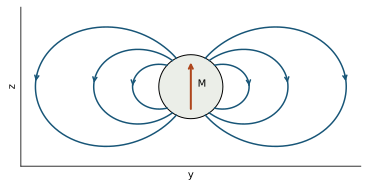
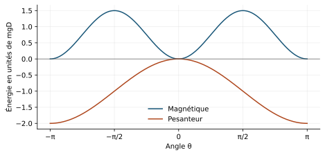
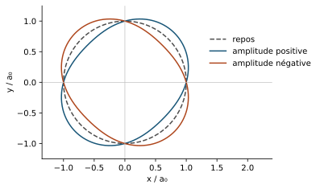

# X-ENS MP 2022 — Physique · Corrigé brut

*Corrigé rédigé par IA, non officiel. Signalez toute erreur.*

**Lecture du rapport du jury** · GPT-6.2 Astra Ultra · vitesse non renseignée

**Rédaction** · GPT-6.2 Astra Ultra · vitesse non renseignée

## Flexion et flambage de systèmes mécaniques

## I.1 — Champ d’une bille aimantée

### Question 1 — Lignes du champ d’un dipôle

Le champ possède la symétrie de révolution autour de $Oz$. Les lignes sortent de la bille du côté du moment $\vec M_0$, se recourbent puis rentrent de l’autre côté. Le champ est orienté vers $+z$ sur les deux demi-axes extérieurs et vers $-z$ dans le plan équatorial. Dans une coupe méridienne, $dr/(r\,d\theta)=B_r/B_\theta=2\cot\theta$, d’où $r=C\sin^2\theta$ hors de la bille.

### Question 2 — Champ aux quatre points

Posons $B_*=\mu_0M/(4\pi D^3)$. Sur l’axe au nord, $\vec e_r=\vec e_z$ et $\cos\theta=1$. Au sud, les deux signes s’inversent. Ainsi $\vec B_0(P_1)=\vec B_0(P_3)=2B_*\vec e_z$. Aux deux points équatoriaux $\cos\theta=0$ et $\sin\theta\,\vec e_\theta=-\vec e_z$, donc $\vec B_0(P_2)=\vec B_0(P_4)=-B_*\vec e_z$.

### Question 3 — Valeur du champ axial

La magnétisation volumique donne $M=M_v\pi D^3/6$. À la distance $D$, $B_z(P_1)=\mu_0 M_v/12\simeq9{,}4\times10^{-2}\,\mathrm T$. C’est environ deux mille fois le champ magnétique terrestre, de l’ordre de $5\times10^{-5}\,\mathrm T$.

## I.2 — Roulement de deux billes

### Question 4 — Cinématique de roulement

Les arcs balayés sur les deux billes depuis leur contact initial sont égaux en l’absence de glissement. Sur la bille fixe l’arc vaut $(D/2)\theta$. Sur la bille mobile le rayon de contact a déjà tourné de $\theta$ dans l’espace, d’où un arc matériel $(D/2)(\theta_1-\theta)$. Il en résulte $\theta_1=2\theta$.

### Question 5 — Actions sur la bille supérieure

La Terre exerce le poids $m\vec g$ au centre de masse. La bille fixe exerce une action magnétique comportant une force et un couple, ainsi qu’une action de contact avec composante normale et frottement statique tangentiel. Le roulement sans glissement est compatible avec cette dernière composante.

### Question 6 — Conservation de l’énergie mécanique

La pesanteur et l’interaction des dipôles permanents admettent des énergies potentielles. Les points d’application des actions du support sont fixes. Au contact entre billes, les vitesses matérielles sont égales et nulles, donc même la composante tangentielle ne fournit aucune puissance. En l’absence de dissipation, $E_c+E_g+E_B$ reste constant.

### Question 7 — Moment dans la base polaire

La direction du rayon joignant les centres fait l’angle $\theta$ avec $Oz$ et celle du moment fait l’angle $2\theta$. Le moment est donc incliné de $\theta$ vers $\vec e_\theta$ par rapport à $\vec e_r$, soit $\vec M_1=M(\cos\theta\,\vec e_r+\sin\theta\,\vec e_\theta)$.

### Question 8 — Énergie magnétique de flexion

L’interaction vaut $-\vec M_1\cdot\vec B_0=-C(2\cos^2\theta+\sin^2\theta)$ avec $C=\mu_0M^2/(4\pi D^3)$. Sa valeur à $\theta=0$ est $-2C$. L’énergie référencée vaut donc $E_B=C\sin^2\theta=(K/2)\sin^2\theta$, où
$$
K=\frac{\mu_0M^2}{2\pi D^3}=\frac{\pi\mu_0M_v^2D^3}{72}.
$$
$K$ a la dimension d’une énergie.

### Question 9 — Énergie cinétique de la bille

Le centre $O_1$ se déplace à la vitesse $D|\dot\theta|$. Le théorème de König ajoute à l’énergie de translation celle de rotation autour de l’axe passant par $O_1$, soit $E_{c1}=\tfrac12 mD^2\dot\theta^2+\tfrac12 J\dot\theta_1^2$.

### Question 10 — Inertie du seul degré de liberté

Avec $\dot\theta_1=2\dot\theta$ et $J=mD^2/10$, le facteur de $\dot\theta^2/2$ est $J'=mD^2+4J=(7/5)mD^2$. Cette inertie contient les deux contributions du mouvement.

### Question 11 — Énergie de pesanteur

L’altitude du centre varie de $D$ à $D\cos\theta$. L’énergie comptée à partir de la verticale vaut $E_{g1}=mgD(\cos\theta-1)$. Pour tout petit écart non nul, le centre descend et cette variation est négative.

### Question 12 — Deux potentiels en compétition

Le potentiel magnétique est pair, nul en $0,\pm\pi$ et maximal en $\pm\pi/2$. Le potentiel de pesanteur est également pair, maximal en zéro et minimal en $\pm\pi$, où il vaut $-2mgD$. Les deux courbes ont une tangente horizontale à l’origine. Pour une faible inclinaison, le magnétisme rappelle la bille vers le haut, alors que la pesanteur favorise la chute.

### Question 13 — Équation du mouvement

La coordonnée $\theta$ a l’inertie constante $J'$. Le théorème de l’énergie mécanique donne $J'\ddot\theta=-d(E_B+E_{g1})/d\theta$. Ainsi
$$
J'\ddot\theta+\sin\theta\,(K\cos\theta-mgD)=0 .
$$
La relation vaut également aux points de rebroussement par continuité.

### Question 14 — Condition de stabilité locale

La verticale annule la dérivée première. La courbure du potentiel total en zéro est $K-mgD$. La verticale est donc un minimum local pour $S=K/(mgD)>1$ et instable pour $S<1$. À $S=1$, $E_p=-(mgD/2)(1-\cos\theta)^2$, donc elle reste instable. Le rapport $S$ compare la raideur magnétique stabilisante et la raideur gravitationnelle déstabilisante.

### Question 15 — Nature du minimum vertical

Avec $S\sim100$, la courbure en zéro est positive. De petites perturbations entraînent des oscillations. Globalement la position renversée a une énergie inférieure de $2mgD$ dans le modèle sans support, d’où un minimum local, ou métastable.

### Question 16 — Fréquence du maillon

Linéarisée en zéro, l’équation est celle d’un oscillateur de pulsation
$$
\omega_1=\sqrt{\frac{K-mgD}{J'}}=\sqrt{\frac{5g}{7D}(S-1)}
\simeq\sqrt{\frac{5gS}{7D}}.
$$
Avec $D=0{,}013\,\mathrm m$, $g=10\,\mathrm{m\,s^{-2}}$ et $S\simeq100$, on trouve $\omega_1\simeq2{,}3\times10^2\,\mathrm{s^{-1}}$, soit $f_1=\omega_1/(2\pi)\simeq37\,\mathrm{Hz}$.

## I.3 — Stabilité d’une chaîne

### Question 17 — Courbure uniforme

Un seul angle $\alpha(t)$ impose à tous les maillons une flexion coordonnée et de même courbure. Une onde se propageant le long de la chaîne, une forme en S ou un mode présentant plusieurs zones de courbures opposées nécessite des angles locaux différents.

### Question 18 — Voisins dominants

À éloignement $r$, l’énergie dipôle–dipôle est proportionnelle à $r^{-3}$. Près de la chaîne droite, à orientation comparable, la deuxième voisine apporte un terme environ huit fois plus petit que la première. La décroissance rapide motive la troncature proposée. Elle reste une approximation quantitative.

### Question 19 — Énergie de la chaîne

Dans le modèle de flexion à maillons identiques, on attribue à chacun des $N$ contacts l’énergie de la question 8 pour l’angle commun $\alpha$. Chaque paire est comptée une fois, d’où
$$
E_{BN}=\tfrac12 NK\sin^2\alpha\simeq\tfrac12 NK\alpha^2 .
$$
C’est la loi de maillon effective utilisée aux questions 24 et 25. Elle donne une énergie proportionnelle au carré de la courbure puisque $1/R$ est proportionnel à $\alpha$ aux petits angles.

**Précision sur le roulement.** Si l’on impose littéralement les vitesses de contact aux deux solides mobiles, l’inclinaison $j\alpha$ du segment $O_{j-1}O_j$ sur la figure 4 et les rotations absolues $\beta_j$ vérifient $\dot\beta_j+\dot\beta_{j-1}=2j\dot\alpha$. Avec $\beta_0=0$, cela donne $\beta_1=2\alpha,\ \beta_2=2\alpha,\ \beta_3=4\alpha$. Un contact sur deux reste aligné, les autres coûtent $(K/2)\sin^2\alpha$. Cette lecture cinématique donne $(K/2)\lceil N/2\rceil\sin^2\alpha$ et conserve le même ordre de grandeur pour le seuil. Elle distingue l’angle de deux segments de la rotation relative de deux billes.

### Question 20 — Altitude de la première bille

La première corde de longueur $D$ fait l’angle $\alpha$ avec la verticale sur la figure 4. Ainsi $\Delta z_1=D(\cos\alpha-1)\simeq-D\alpha^2/2$. Le premier ordre linéaire s’annule.

### Question 21 — Altitude de la deuxième bille

Les deux cordes font respectivement les angles $\alpha$ et $2\alpha$ avec la verticale. On obtient $\Delta z_2=D(\cos\alpha+\cos2\alpha-2)\simeq-(D\alpha^2/2)(1^2+2^2)=-5D\alpha^2/2$.

### Question 22 — Altitude du rang quelconque

Pour atteindre la bille $n$, on parcourt $n$ segments. L’hypothèse $|N\alpha|\ll1$ permet de développer chaque projection. Ainsi
$$
\Delta z_n=D\sum_{j=1}^n(\cos j\alpha-1)
\simeq-\frac{D\alpha^2}{2}\sum_{j=1}^n j^2
=-\frac{D\alpha^2}{12}n(n+1)(2n+1).
$$

### Question 23 — Somme des énergies de pesanteur

Chaque bille mobile contribue $mg\Delta z_n$. En remplaçant d’abord $\sum_{j=1}^n j^2$ par $n^3/3$, puis $\sum_{n=1}^N n^3$ par $N^4/4$, on trouve $E_{gN}\simeq-mgD\alpha^2N^4/24$. Le calcul discret au même ordre en angle donnerait $-mgD\alpha^2N(N+1)^2(N+2)/24$, qui retrouve le terme dominant en $N$.

### Question 24 — Condition de stabilité de l’édifice

Dans la loi de maillon de la question 19, le coefficient de $\alpha^2/2$ dans $E_p$ vaut $NK-mgD N^4/12$. Un minimum exige $N^3<12S$. Au seuil le développement quadratique cesse de décider de la stabilité. Le remplacement des sommes par des intégrales exige $N\gg1$ et n’est donc précis près du seuil que pour $12S\gg1$. En conservant strictement le roulement décrit en précision à la question 19, on remplace $N$ par $\lceil N/2\rceil$ dans le seul terme magnétique, d’où à grand $N$ le critère $N^3<6S$.

### Question 25 — Nombre critique

Pour $S\simeq100$, le modèle de maillons identiques donne $N_c\simeq(1200)^{1/3}\simeq11$, soit une dizaine de billes mobiles au-dessus du support. La valeur non arrondie est $10{,}6$, de sorte que l’inégalité approchée admet $N=10$. La lecture à roulement individuel donne environ $8$ à $9$ billes avec les mêmes intégrales. Les simplifications de somme, de forme et d’interaction ne permettent pas de garantir un seuil expérimental à une bille près.

## II.1 — Déformation longitudinale

### Question 26 — Domaine de Hooke

La déformation longitudinale relative doit être faible, $|u|/a\ll1$, dans le domaine élastique linéaire du matériau. La force est alors proportionnelle à l’allongement et le module $Y$ est constant.

### Question 27 — Énergie du barreau

Pour un allongement intermédiaire $u'$, l’effort extérieur vaut $YSu'/a$. Le travail réversible emmagasiné entre $0$ et $u$ est $E_{Y,b}=\int_0^u(YS/a)u'\,du'=YSu^2/(2a)$. Cette expression positive s’applique aussi à une petite compression.

## II.2 — Flambage d’une lame

### Question 28 — Énergie élastique de la lame

La fibre neutre garde $L=R\theta$. Une fibre initialement à la distance signée $h$ a une longueur $(R+h)\theta$, donc $u=h\theta$. La bande de section $b\,dh$ emmagasine $dE_Y=Yb\,dh\,(h\theta)^2/(2L)$. Comme $\int_{-e/2}^{e/2}h^2\,dh=e^3/12$,
$$
E_Y=\frac{Ybe^3}{24L}\theta^2=\frac{Ybe^3 L}{24R^2}.
$$

### Question 29 — Petitesse de la déformation en flexion

Sur une fibre $u/L=h/R$. Sa valeur absolue est maximale au bord, à $|h|=e/2$. On impose donc $e/(2|R|)\ll1$, ce qui assure la petitesse de la déformation dans toute la section.

### Question 30 — Abaissement du centre de masse

À abscisse curviligne $s$ sur la fibre neutre, l’altitude devient $R\sin(s/R)$. Son écart à $s$ vaut $-s^3/(6R^2)$ au premier ordre non nul en courbure. Les contributions des excentrements $h$ se compensent par symétrie. Avec $dm=\rho be\,ds$,
$$
E_g=-\frac{\rho gbe}{6R^2}\int_0^L s^3\,ds
=-\frac{\rho gbe L^2}{24}\theta^2 .
$$

### Question 31 — Longueur critique

Le potentiel quadratique s’écrit $E_p=(be/24)(Ye^2/L-\rho gL^2)\theta^2$. Le changement de signe donne $L_c^3=Ye^2/(\rho g)$ et
$$
\frac{L_c}{e}=\left(\frac{Y}{\rho ge}\right)^{1/3}.
$$
Pour $L<L_c$ la lame est stable, pour $L>L_c$ elle flambe. Doubler sa largeur double dans la même proportion l’énergie élastique et celle de pesanteur, donc conserve leur seuil d’égalité.

### Question 32 — Ce que donnent les dimensions

$Y$ et $\rho ge$ sont deux pressions. Parmi $Y,\rho,g,e$ le seul groupe sans dimension indépendant est $Y/(\rho ge)$, comme on le vérifie en annulant les exposants de masse, longueur et temps dans un monôme. Ainsi $L_c/e=\Phi(Y/(\rho ge))$. Les dimensions laissent la fonction $\Phi$ arbitraire, y compris l’exposant si l’on cherche une loi de puissance. L’équilibre mécanique fait apparaître la racine cubique et son coefficient dans cette approximation de forme.

### Question 33 — Ordre de grandeur du module du papier

Un papier de grammage usuel $80\,\mathrm{g\,m^{-2}}$ et d’épaisseur $e=10^{-4}\,\mathrm m$ a une masse volumique estimée à $8\times10^2\,\mathrm{kg\,m^{-3}}$. Sur la photo, la partie libre représente grossièrement les deux tiers de la longueur de $0{,}297\,\mathrm m$, soit $L_c\sim0{,}2\,\mathrm m$. On en tire $Y\sim\rho gL_c^3/e^2\sim6\times10^9\,\mathrm{Pa}$, de l’ordre de quelques gigapascals. L’estimation photographique de $L_c$ intervient au cube.

### Question 34 — Déplacement horizontal

Le rayon de la fibre neutre tournant de l’angle $z/R$, l’ordonnée de la section est $\delta(z)=R[\cos(z/R)-1]$. Au premier ordre non nul en $\theta=L/R$, $\delta(z)\simeq-z^2\theta/(2L)$. Pour $\theta>0$ le déplacement est bien dirigé vers les $y$ négatifs sur la figure 7.

### Question 35 — Énergie de translation des tranches

La vitesse d’une tranche a pour composante $\dot\delta=-z^2\dot\theta/(2L)$. On somme $\tfrac12\rho be\,dz\,\dot\delta^2$ de $0$ à $L$, ce qui donne $E_{ct}=\rho beL^3\dot\theta^2/40$. Les tranches les plus hautes contribuent le plus en raison du facteur $z^4$.

### Question 36 — Rotation des tranches

Le rapport des deux énergies cinétiques vaut $E_{cr}/E_{ct}=(40/72)(e/L)^2=(5/9)(e/L)^2$. Pour une lame mince devant sa longueur, $e/L\ll1$, la translation des tranches domine.

### Question 37 — Oscillation d’une lame courte

L’inertie associée à $\theta$ est $I_\theta=\rho beL^3/20$ et la raideur vaut $k_\theta=(be/12)(Ye^2/L-\rho gL^2)$. Pour $q=L/L_c<1$, la conservation de l’énergie donne $I_\theta\ddot\theta+k_\theta\theta=0$, donc
$$
\omega=\sqrt{\frac{5g}{3L}\left(q^{-3}-1\right)} .
$$
La fréquence tend vers zéro à l’approche du flambage. Pour $L\ll L_c$, la flexion élastique domine et $\omega$ varie comme $L^{-2}$ à matériau et épaisseur fixés.

### Question 38 — Temps de déstabilisation

Pour $q>1$ la raideur devient négative. L’équation s’écrit $\ddot\theta-\theta/\tau^2=0$ et contient un mode croissant $e^{t/\tau}$, avec
$$
\tau=\sqrt{\frac{3L}{5g(1-q^{-3})}} .
$$
Tout près du seuil par valeurs supérieures, le temps diverge. Pour $q\gg1$, il est de l’ordre de $\sqrt{L/g}$. Cette loi décrit le début de la chute tant que la déformation reste faible.

## III — Modes d’une flûte à champagne

### Question 39 — Modes admissibles du verre

La forme et sa tangente doivent se raccorder après un tour, donc $\sin(k(\theta+2\pi))=\sin(k\theta)$ pour tout $\theta$, d’où $k$ entier positif. Le mode $k=1$ représente au premier ordre un cercle translaté et ne change pas la courbure. Les modes de flexion sont $k=2,3,\ldots$. Le produit $\varepsilon(t)\sin(k\theta)$ a des nœuds fixes et décrit une onde stationnaire. Pour $k=2$, les diagonales se dilatent ou se contractent à tour de rôle au changement de signe de $\varepsilon$.

### Question 40 — Coût de courbure

La courbure au repos est $1/a_0$. Une variation de part et d’autre de cette valeur doit emmagasiner une énergie positive avec une dérivée première nulle au repos. Cela impose le choix (b), $F(R)=(1/R-1/a_0)^2$. L’expression (a) change de signe selon le sens de la flexion.

### Question 41 — Courbure locale

Posons $s_k=\sin(k\theta)$ et $r=a_0(1+\varepsilon s_k)$. Au premier ordre $r'^2$ est négligeable et $r''=-a_0k^2\varepsilon s_k$. Le numérateur de la formule du rayon vaut $a_0^3(1+3\varepsilon s_k)$ et le dénominateur $a_0^2[1+(2+k^2)\varepsilon s_k]$. En divisant,
$$
R=a_0[1+(1-k^2)\varepsilon\sin(k\theta)]+O(\varepsilon^2).
$$
On retrouve la courbure inchangée du mode $k=1$.

### Question 42 — Énergie élastique de la coque

La variation de courbure au premier ordre est $(k^2-1)\varepsilon\sin(k\theta)/a_0$. Son carré suffit pour calculer l’énergie à l’ordre deux. Pour $k$ entier non nul, $\int_0^{2\pi}\sin^2(k\theta)\,d\theta=\pi$. Ainsi
$$
E_Y=\frac{\pi Ybe^3}{24a_0}(k^2-1)^2\varepsilon^2 .
$$

### Question 43 — Énergie cinétique de la coque

Le secteur $d\theta$ a, à l’ordre utile, la masse $\rho bea_0\,d\theta$. Sa vitesse radiale vaut $a_0\dot\varepsilon\sin(k\theta)$. En intégrant le demi-produit masse–vitesse au carré, on obtient $E_c=(\pi/2)\rho bea_0^3\dot\varepsilon^2$.

### Question 44 — Pulsation propre

Le rapport de la raideur en $\varepsilon$ à l’inertie généralisée donne
$$
\omega_k^2=\frac{Ye^2(k^2-1)^2}{12\rho a_0^4},\qquad
\omega_k=\frac{(k^2-1)e}{a_0^2}\sqrt{\frac{Y}{12\rho}}.
$$
La hauteur $b$ multiplie l’inertie et la raideur de la même façon. La plus petite pulsation de flexion est celle de $k=2$.

### Question 45 — Fréquence observée et module du verre

Sur la figure 10, environ neuf intervalles entre maxima se succèdent en $5{,}9\,\mathrm{ms}$, soit $T\simeq0{,}65\,\mathrm{ms}$ et $f\simeq1{,}5\,\mathrm{kHz}$. Avec $k=2$, $e=1{,}4\,\mathrm{mm}$, $a_0=26\,\mathrm{mm}$ et $\rho=3000\,\mathrm{kg\,m^{-3}}$, on obtient
$$
Y=12\rho\left[\frac{2\pi f a_0^2}{3e}\right]^2\simeq9\times10^{10}\,\mathrm{Pa}.
$$
La coque idéalisée peut fléchir de façon identique à toute hauteur. Dans le verre réel, le fond et le pied contraignent la base et tendent à raidir le mode. Pour un même matériau ils tendent donc à augmenter la fréquence. Attribuer cette augmentation au seul module dans le modèle libre conduit à le surestimer, sous cette hypothèse dominante.
