# X-ENS — PC, Chimie A 2022 · Corrigé brut

*Corrigé rédigé par IA, non officiel.*

**Rédaction** · GPT-6.2 Astra Ultra · vitesse non renseignée

**Couverture partielle.** Les 64 questions sont traitées. La différence de descripteur en Q3, les deux comptages en Q5, le caractère approché des lectures spectrales et la distinction entre induction chirale et réduction en Q50 sont explicités.

## Quinine et quinidine. Configuration

### Question 1 — Sens du pouvoir rotatoire

La (−)-quinine est lévogyre. Sa solution fait tourner le plan de polarisation vers la gauche pour un observateur qui regarde vers la source. L’annexe donne un pouvoir rotatoire spécifique négatif. Le signe de cette mesure ne détermine pas à lui seul un descripteur R ou S.

### Question 2 — Parent du nom systématique

Le parent est **méthanol**. Deux des H du carbone du méthanol sont remplacés par un groupe 6-méthoxyquinolin-4-yle et un groupe 8-vinylquinuclidin-2-yle stéréodéfini. On a donc un alcool secondaire Ar–CH(OH)–Qcl, où Qcl est le fragment quinuclidinyle.

### Question 3 — Localisation des quatre carbones

Le R initial désigne le carbone carbinolique reliant les deux hétérocycles, C12 de la figure 4. Le C2 de la quinuclidine, noté 2S, est le C14 voisin de N15 et du carbinol. Le C4 est le carbone de tête de pont opposé à N15, C19 de la figure 4. Le C8 noté 8R porte le vinyle, c’est C21. L’énoncé de la Q3 écrit **4R** alors que le nom de la (−)-quinine en annexe 1 indique **4S**. La localisation du centre demandé est la même dans les deux cas.

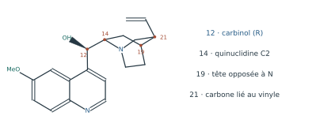

### Question 4 — Priorités au carbinol

L’oxygène de OH est premier et H dernier. Au C14 du groupe quinuclidine on rencontre N,C,H, tandis que le carbone ipso quinolinique présente C,C,C en comptant la duplication aromatique. N précède C. L’ordre est OH, quinuclidinyle, quinolinyle, H. Avec H dirigé vers l’arrière, 1 → 2 → 3 est horaire, d’où **R** pour la quinine.

### Question 5 — Nombre de configurations

Les quatre carbones stéréogènes fournissent **2⁴ = 16** configurations carbonées. Les bras substitués différents rendent aussi le N pyramidal dissymétrique. Si ses deux configurations étaient comptées indépendamment, la borne formelle monterait à 2⁵ = 32. La cage quinuclidinique fixe le sens du N par celui du carbone de tête de pont opposé. Retourner ce N seul supposerait de faire passer les trois ponts à travers la cage. Il reste donc **16 stéréoisomères configuratifs** possibles pour ce squelette. Aucun doublement E/Z ne vient du vinyle terminal.

### Question 6 — Pseudo-énantiomérie

Le carbinol et le C2 de la quinuclidine ont des configurations opposées, tandis que celles des deux autres centres sont conservées. Les molécules sont diastéréoisomères. Leur pouvoir rotatoire a des signes opposés et leurs propriétés physiques sont proches, notamment les domaines de fusion et log P = 3,44. L’amplitude des pouvoirs rotatoires, −178 et +230, diffère ainsi que certains paramètres spectroscopiques. La ressemblance avec un couple d’énantiomères est donc partielle.

## Conformations, cristal et spectres

### Question 7 — Conformations QA à QF

Les six représentations conservent toutes les liaisons et le même sens aux centres stéréogènes. Des rotations autour de liaisons simples, notamment C10–C12, C12–C14, C12–O13 et Ar–OMe, modifient les angles dièdres et l’énergie. Ce sont des conformères de la même espèce configurative.

### Question 8 — Géométrie du pont hydrogène

Un H lié à un atome électronégatif X interagit avec un doublet de l’accepteur Y. L’attraction est directionnelle et comporte une composante électrostatique et une interaction donneur–accepteur. À distances comparables, un angle X–H···Y proche de 180° favorise un pont fort. Si la distance H···Y augmente, la stabilisation décroît. Aux distances trop courtes les répulsions limitent le rapprochement.

### Question 9 — Effet sur la bande O–H

La liaison O–H engagée dans un pont s’allonge et sa constante de raideur effective diminue. À masse réduite fixée, le nombre d’onde, proportionnel à √k, diminue. Un ensemble de géométries de pont peut également élargir la bande.

### Question 10 — Conformères à liaison interne

Le donneur est O13–H13 et l’accepteur N15 de la quinuclidine. Dans **QA, QC, QD et QF**, H13 peut pointer vers N15, en accord avec les nombres d’onde calculés autour de 3507–3545 cm⁻¹ pour les familles 2 et 3. Dans QB et QE, OH pointe à l’opposé et la liaison O–H est presque libre, vers 3766 cm⁻¹.

### Question 11 — Attribuer les six modèles

Les méthoxyles de QA, QB et QD sont orientés vers la cage (c), ceux de QC, QE et QF à l’opposé (t). Les dessins sans pont OH···N correspondent à la famille 1. Les familles 1 et 2 ont presque le même angle C9–C10–C12–C14, voisin de +100°, alors que la famille 3 présente environ −82°, un retournement relatif de près de 180°. En orientant le squelette aromatique de la même façon, le groupe OH projeté à gauche dans QB et QE demeure de ce côté dans QA et QC, et se retrouve à droite dans QD et QF.

| Famille | c | t |
|---|---|---|
| 1 | QB | QE |
| 2 | QA | QC |
| 3 | QD | QF |

Le changement de famille 1 → 2 ramène le H de OH vers la cage par rotation sur la chaîne latérale.

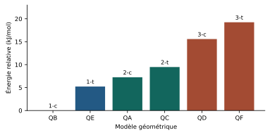

### Question 12 — Projection de la forme la plus stable

La forme de plus basse énergie est Q-1-c. C10–C12–C14–N15 vaut environ 154°. Avec le carbone avant portant C10 vers le bas, H en haut à gauche et OH en haut à droite, le N arrière doit donc être presque anti à C10. Les projections I et IV présentent cet angle. Sur le C14 arrière, l’ordre N15, C12, C17, H doit donner la configuration 2S. Il faut C17 à droite et H en bas à gauche, ce qui sélectionne la **projection I**.

### Question 13 — Projection de la quinidine

Dans la même vue C12 → C14, mettre C10 à 6 h sur le carbone avant. Échanger OH et H de l’avant pour obtenir OH vers 10 h et H vers 2 h. Au carbone arrière, mettre N15 à 12 h, strictement anti à C10, H vers 4 h et C17 vers 8 h. L’ordre cyclique des groupes arrière est inversé par rapport à celui de la quinine, conformément au changement en C2.

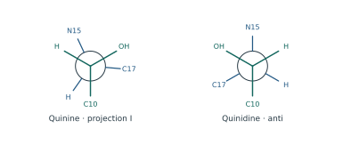

### Question 14 — Cohésion du cristal

C’est un cristal moléculaire. Des liaisons hydrogène intermoléculaires peuvent unir les donneurs OH aux accepteurs N ou O voisins. S’y ajoutent les interactions entre dipôles et les forces de dispersion, notamment entre parties aromatiques. Les liaisons covalentes structurent chaque molécule individuellement.

### Question 15 — Nombre de molécules dans la maille

Avec V = 2596,83 ų = 2,59683 × 10⁻²¹ cm³, ρ ≃ 1,2 g/cm³ et M = 324 g/mol, Z = ρVNₐ/M ≃ **5,79**, compatible avec **6 molécules par maille**. Avec Z = 6 on prédirait ρ ≃ 1,24 g/cm³, qui s’arrondit à 1,2. Les molécules débordant du parallélépipède se comptent à partir de six positions moléculaires de référence distinctes, en identifiant les traductions d’une maille à l’autre.

### Question 16 — Différence principale en IR

La bande O–H passe de 3295 cm⁻¹ pour la quinine à 3180 cm⁻¹ pour la quinidine. L’abaissement pour la quinidine traduit une liaison O–H plus perturbée, donc des interactions hydrogène plus fortes dans les conditions de mesure. L’inversion du carbinol et du centre voisin modifie l’orientation de OH et l’organisation des voisins dans le cristal. Les deux bandes, nettement sous la valeur calculée de OH libre dans le vide, incluent les interactions du milieu. Les bandes du squelette aromatique et de l’éther restent voisines.

### Question 17 — Signal de H12 et angle de Karplus

Le CH lié à OH et voisin de la quinoline donne le doublet à **5,75 ppm, J = 2,4 Hz** pour la quinine et à **5,56 ppm, J = 3,4 Hz** pour la quinidine. Le partenaire vicinal est H14. Dans la projection I le dièdre H12–C12–C14–H14 est proche d’un angle droit. La relation de Karplus prévoit un faible couplage. Dans la quinidine il est plus proche de 60°, d’où un couplage un peu plus élevé. En solution, la valeur observée est une moyenne sur les conformations.

## Partage et propriétés acido-basiques

### Question 18 — Interprétation de log P

P = [E]octanol/[E]eau est positif. Si log₁₀P > 0, l’espèce préfère l’octanol, avec un caractère lipophile d’autant plus marqué que log P augmente. Une valeur négative traduit une préférence pour l’eau, et zéro une répartition égale dans cette convention.

### Question 19 — Comparer les deux alcaloïdes

log P = 3,44 correspond à P ≃ 2,75 × 10³. La quinine neutre est fortement lipophile, malgré son alcool et ses azotes, car son squelette est étendu et en partie aromatique. La quinidine a dans l’annexe la même valeur à la précision donnée. Les groupes polaires, la composition et la surface hydrocarbonée sont analogues.

### Question 20 — Domaines acido-basiques

Sur le squelette intégral de la figure 1, les seules modifications entre les trois structures sont l’addition de H⁺ sur les deux N. En dessous de 4,4, **QH₂²⁺** porte N7–H⁺ sur la quinoline et N15–H⁺ sur la quinuclidine. Entre 4,4 et 8,4, **QH⁺** ne porte que N15–H⁺, l’amine aliphatique étant la plus basique. Au-dessus de 8,4, **Q** possède les deux doublets libres. OH et OMe sont conservés. À chaque pKa les deux formes adjacentes ont des activités égales.

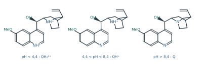

### Question 21 — Pourquoi un seul pKa diffère

Le couple QH₂²⁺/QH⁺ concerne le N quinolinique éloigné des deux stéréocentres inversés. Son environnement est assez semblable pour donner pKa₁ = 4,4 dans les deux cas. Le second couple QH⁺/Q concerne N15, voisin du carbinol. Les projections montrent une disposition spatiale différente de N et OH. Les stabilités relatives de la base et de l’ammonium (liaison hydrogène, solvatation) changent. pKa₂ = 8,8 pour la quinidine contre 8,4 pour la quinine : l’ammonium de la première est moins acide, et sa base neutre légèrement plus forte.

### Question 22 — Effet des charges sur le partage

À squelette fixé, l’hydratation ion–dipôle augmente avec le nombre de charges. On attend **log P(Q) > log P(QH⁺) > log P(QH₂²⁺)** pour le partage des espèces individuelles à contre-ions et force ionique comparables. Le coefficient de distribution total d’un échantillon varie donc avec le pH.

## Fluorescence stationnaire et déclin

### Question 23 — Flux d’absorption et d’émission

Avec G = QH₂²⁺ fondamental et G* son état électronique excité, Iabs = kabs[G] pour l’excitation fixée et If = k₂[G*] pour la désexcitation radiative. Les intensités sont ici des flux molaires de photons par unité de volume, pas des puissances en watts.

### Question 24 — Appliquer l’AEQS

Après un bref transitoire, un intermédiaire peu peuplé formé et consommé rapidement voit sa concentration varier très peu. On pose d[G*]/dt ≃ 0 tout en conservant les flux de formation et de disparition. Ici l’excitation stationnaire est faible et la relaxation de S₁ a lieu en quelques dizaines de nanosecondes, bien avant la lecture du signal.

### Question 25 — Population de S₁

d[G*]/dt = kabs[G] − (k₁+k₂+k₃)[G*]. À l’état stationnaire, [G*] = kabs[G]/(k₁+k₂+k₃). La probabilité de fluorescence par excitation est Φf = k₂/(k₁+k₂+k₃).

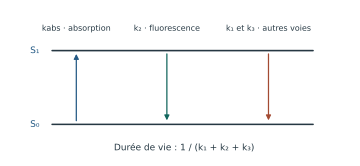

### Question 26 — Intensité en fonction de l’absorbance

Par définition A = log₁₀(I₀/It), donc Iabs = I₀−It = I₀(1−10⁻ᴬ). Puisque If/Iabs = Φf, **If = Φf I₀(1−10⁻ᴬ)** à la longueur d’onde d’excitation. Les unités de I₀ et If correspondent ici au même comptage de photons avec la même normalisation géométrique.

### Question 27 — Comparer les rendements quantiques

L’absorbance étant presque identique à 333 nm, les flux absorbés sont comparables. La hauteur normalisée au maximum d’émission vaut environ 1 pour QH₂²⁺ et 0,90–0,91 pour QH⁺. Leur rapport, environ 1,10, concorde avec 0,55/0,50. Une mesure rigoureuse du rendement utilise les spectres corrigés intégrés en nombre de photons. La comparaison de hauteurs donne ici l’estimation graphique demandée pour les deux bandes de largeur analogue.

### Question 28 — Vie moyenne de fluorescence

Après l’impulsion, d[G*]/dt = −kΣ[G*] avec kΣ = k₁+k₂+k₃. Donc If(t) = k₂[G*]₀ exp(−t/τ), τ = 1/kΣ. La figure donne, par exemple, ln If ≃ 8,35 à 0 ns et 4,4 à 78 ns : pente ≃ −0,051 ns⁻¹, **τ ≃ 20 ns**. Avec Φf = 0,55, **k₂ = Φf/τ ≃ 2,8 × 10⁷ s⁻¹**.

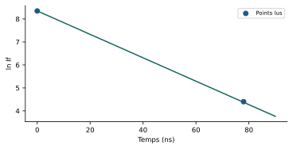

## Dosage de la quinine et de la riboflavine

### Question 29 — Linéarité de la calibration

Pour A < 0,1, 1−10⁻ᴬ ≃ (ln 10) A. Comme A = εℓc, If ≃ Φf I₀(ln 10) εℓc. À géométrie, acidité, excitation et λ d’observation fixes, le signal est proportionnel à la concentration. Le blanc et le fond instrumental expliquent une ordonnée à l’origine éventuellement non nulle.

### Question 30 — Choix de l’excitation et du milieu

H₂SO₄ à 0,05 mol/L impose un pH très inférieur à 4,4 et convertit quantitativement le dosage en celui de QH₂²⁺ de rendement 0,55. L’excitation à 345 nm est proche du maximum de sa première bande d’absorption, l’émission à 445 nm proche du sommet de sa fluorescence. Ce choix augmente le contraste et évite la superposition directe au faisceau excitateur.

### Question 31 — Diluer la boisson

Une boisson à (1,5–2,5) × 10⁻⁴ mol/L entre, après dilution au centième, dans la gamme 0,1–9 µmol/L. Son absorbance devient faible et les effets de matrice, d’écran interne ou de réabsorption sont atténués. Employer l’acide sulfurique aqueux à 0,05 mol/L, utilisé pour les étalons. Contrôler le pH final et effectuer la dilution en verrerie jaugée.

### Question 32 — Une durée de vie peut-elle doser seule la quinine ?

À faible concentration et dans le même milieu, τ = 1/(k₁+k₂+k₃) est indépendant de la quantité initiale de quinine. Des concentrations différentes donnent des amplitudes différentes mais la même pente de ln If. La durée de vie seule ne fournit donc pas de droite d’étalonnage de la concentration dans ce régime.

### Question 33 — Concentration de la boisson

La droite donne cdil = (318−18)/(1,37 × 10⁸) = 2,19 × 10⁻⁶ mol/L. La boisson contient **2,19 × 10⁻⁴ mol/L**, soit environ 71 mg/L avec M = 324 g/mol. Cette valeur se situe entre 1,5 et 2,5 × 10⁻⁴ mol/L annoncés.

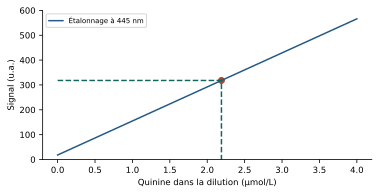

### Question 34 — Constante de l’association

QH₂²⁺ + n RF ⇌ QRF. Avec C° = 1 mol/L, **Kf° = ([QRF]/C°)/{([QH₂²⁺]/C°)([RF]/C°)ⁿ}** = ([QRF]/[QH₂²⁺])(C°/[RF])ⁿ. Toutes les concentrations sont celles des espèces libres ou complexées à l’équilibre.

### Question 35 — Droite d’inhibition

À faible absorbance, IfRF = α[QH₂²⁺] et If0 = α[QH₂²⁺]₀. La conservation de la quinine donne [QRF] = [QH₂²⁺]₀ − [QH₂²⁺]. Donc (If0−IfRF)/IfRF = [QRF]/[QH₂²⁺] = Kf°([RF]/C°)ⁿ. Les logarithmes décimaux donnent **y = n x + log Kf°**, x = log([RF]/C°). La pente mesure la stœchiométrie et l’ordonnée à l’origine le logarithme de la constante.

### Question 36 — Lire la droite à 307 K

Pour la série à triangles de 307 K, les lectures sont environ (−5,7 ; −1,15) et (−4,8 ; −0,24). La pente vaut environ 1, donc **n = 1**. Avec y−x ≃ 4,55, **Kf° ≃ 3,5 × 10⁴**. Les points et les traits se superposent près de −4,8, si bien que davantage de chiffres ne sont pas justifiés.

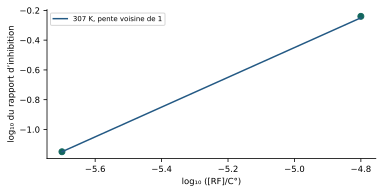

### Question 37 — Tracer une droite de van ’t Hoff

En négligeant les variations de ΔrH° et ΔrS° sur l’intervalle, ln Kf° = −ΔrH°/(RT) + ΔrS°/R. Tracer ln Kf° en fonction de 1/T, puis multiplier la pente par −R et l’ordonnée à l’origine par R. Pour un logarithme décimal, il faut aussi le facteur ln 10.

### Question 38 — Sens des grandeurs thermodynamiques

ΔrH° = −131 kJ/mol indique une association exothermique. ΔrS° = −340 J mol⁻¹ K⁻¹ traduit une perte importante de liberté translationnelle et d’orientation lors de la formation du complexe, à laquelle peut contribuer la réorganisation du solvant. L’enthalpie observée correspond à une interaction globale forte, compatible avec plusieurs contacts de liaison hydrogène, électrostatiques ou d’empilement. Cette valeur globale n’identifie pas à elle seule une liaison covalente.

### Question 39 — Température et constante

La régression de chaque droite fournit log Kf° par son intercept. Les pentes expérimentales apparentes sont plus fortes aux basses températures. En extrapolant à x = 0, l’intercept de 294 K est plus grand que celui de 314 K. Kf° diminue donc quand T augmente, conformément à d ln K/dT = ΔrH°/(RT²) < 0. Comparer seulement l’ordonnée à x ≃ −5,5 confondrait la variation de pente et celle de l’intercept. L’extrapolation est sensible aux incertitudes des régressions.

### Question 40 — Doser la riboflavine d’un comprimé

Dissoudre quantitativement le comprimé dans une fiole de volume V, séparer les excipients insolubles et diluer une aliquote. À température fixée, préparer un blanc quinine et une gamme de RF de concentrations connues dans H₂SO₄ 0,05 mol/L, avec la même concentration initiale de quinine et le même volume total. Mesurer If0 puis IfRF à 450 nm à excitation identique pour la gamme et l’inconnue. Étalonner le rapport (If0−IfRF)/IfRF contre la RF ajoutée dans ces conditions, ou ajuster l’équilibre si la fraction complexée est significative. Interpoler l’inconnue et corriger les dilutions. La quantité par comprimé vaut csolution V ; la masse s’en déduit avec M(RF). Un blanc de matrice contrôle un fond éventuel du comprimé.

## Des deux alcènes au dialdéhyde

### Question 41 — Double alkylation de la benzylamine

En notant Bn = PhCH₂ et U = CH₂CH₂CH=CH₂, **AB = Bn–N(U)₂**. Le doublet de BnNH₂ attaque par l’arrière le CH₂Br primaire de Br–U et C–Br se rompt vers Br⁻. CO₃²⁻ déprotone BnNH₂U⁺ en BnNHU. Une seconde substitution avec Br–U donne BnNHU₂⁺, déprotoné en amine tertiaire AB. Les deux terminaux vinyles sont conservés. Le carbonate sert à neutraliser les ammoniums formés.

### Question 42 — Place de l’osmium

La valence 5d⁶6s² donne huit électrons dans le bloc d, donc **groupe 8**. Le nombre quantique principal externe 6 indique la **période 6**.

### Question 43 — Lewis et géométrie des deux espèces d’Os

OsO₄ s’écrit avec quatre liaisons Os=O, chaque O terminal ayant deux doublets libres, sans doublet sur Os dans ce schéma limite. Les quatre directions de liaison donnent un tétraèdre. Dans [OsO₂(OH)₄]²⁻, dessiner deux oxo et quatre hydroxyls liés par O, soit six directions dans un octaèdre légèrement déformable. Une écriture à liaisons multiples met un doublet d métallique sur Os(VI), les O de OH ayant deux doublets. Ce doublet représente des électrons d et ne constitue pas une septième position de ligand. On peut dessiner les deux oxo trans dans une représentation octaédrique compatible avec la formule.

### Question 44 — Nombres d’oxydation

Dans OsO₄, x − 8 = 0 donc Os(VIII). Dans le complexe, x−4−4 = −2 donc Os(VI). Le premier correspond à la mobilisation des huit électrons de valence 5d⁶6s², avec un compte formel d⁰. Les fortes liaisons aux oxygènes stabilisent cet état élevé.

### Question 45 — Régénérer le catalyseur

[Fe(CN)₆]³⁻ + e⁻ ⇌ [Fe(CN)₆]⁴⁻. Deux ferricyanures acceptent les deux électrons rendus lorsqu’Os(VI) est réoxydé en Os(VIII). Cela régénère l’espèce active de dihydroxylation. L’osmium peut intervenir en quantité catalytique et le ferricyanure comme co-oxydant stœchiométrique.

### Question 46 — Potentiel du couple hexacyanoferrate

Pour le complexe de valence j, Kd,j = aFe,j aCN⁶/acompl,j. Alors aFe(III)/aFe(II) = (Kd,III/Kd,II)(acompl,III/acompl,II). En identifiant les intercepts de Nernst, E°compl = E°libre + (RT/F) ln(Kd,III/Kd,II) = 0,77 + 0,06(35−42) ≃ **0,35 V**. La complexation plus forte de Fe(III) abaisse le potentiel par rapport au couple aquo. Le ferricyanure est un oxydant modéré, adapté à une régénération sélective, en comparaison des couples periodate et peroxyde donnés dans l’annexe. Pour quantifier la force motrice d’un cycle particulier il faudrait aussi le potentiel du couple Os sous ces conditions.

### Question 47 — Stéréoisomères du double diol

**C = CbzN[CH₂CH₂CH(OH)CH₂OH]₂.** Sur chaque extrémité l’addition est syn, mais le CH₂OH terminal est achiral. Pour les deux CHOH, les configurations (R,R) et (S,S) donnent une paire d’énantiomères. (R,S) et (S,R) représentent la même constitution stéréochimique par échange des deux bras, forme méso achirale. Celle-ci est diastéréoisomère de chacun des deux premiers. Les conditions achirales ne privilégient aucun membre de la paire énantiomère.

### Question 48 — Bilan de B à D

Dihydroxylation puis coupure au periodate transforment chaque –CH=CH₂ en un CHO porté par la chaîne et une molécule de HCHO. Le bilan s’apparente à une **ozonolyse à traitement réducteur** des deux doubles liaisons. **D = CbzN(CH₂CH₂CHO)₂**.

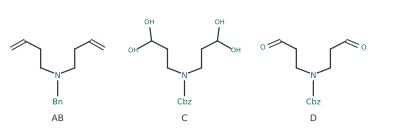

## Cycloaldolisation et oléfination

### Question 49 — Cycloaldolisation du dialdéhyde

Dans un modèle basique, un doublet de la base prend le Hα d’un des CHO de D. La liaison C–H forme l’énolate, avec délocalisation sur O. Le carbone α attaque le C=O de l’autre bras. La liaison π de cet aldéhyde remonte sur O, et la nouvelle liaison ferme le cycle N–CH₂–CH(CHO)–CH(O⁻)–CH₂–CH₂. Protonation de O⁻ par le milieu donne le β-hydroxyaldéhyde **E** et régénère la base. La proline peut réaliser la nucléophilie équivalente par une énamine chirale qui oriente la fermeture.

### Question 50 — Les deux aldols et leur réduction

Les deux **E** sont des N-Cbz-3-formyl-4-hydroxypipéridines. Dans la projection de F, le CHO de C3 est hachuré pour les deux produits de la série sélectionnée. Dans E-cis, OH de C4 est aussi hachuré. Dans E-trans il est en coin plein. Ils sont diastéréoisomères. La réduction par NaBH₄ change CHO en CH₂OH sans créer de nouveau centre à ce carbone. L’énantiosélection visible dans F, où une seule face du substituant en C3 est représentée, provient de la cycloaldolisation catalysée par la proline chirale. Le OH ondulé de F signale que les deux configurations en C4 restent possibles.

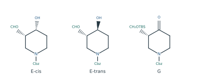

### Question 51 — Protéger l’alcool primaire

TBSCl/imidazole convertit préférentiellement le CH₂OH primaire en éther silylé –CH₂OTBS. Le périodinane de Dess–Martin oxyde ensuite le CHOH secondaire libre en cétone. **G** est la 3-(hydroxyméthyl protégé)-4-pipéridone N-Cbz. Les deux configurations initiales du OH en C4 convergent vers le même carbonyle plan.

### Question 52 — Oléfination de Peterson

LDA forme Me₃Si–CH⁻–CO₂Et. L’attaque sur la cétone G, puis l’élimination du silanolate selon la figure 9, remplacent C4=O par **C4=CH–CO₂Et**. Le reste du cycle et le CH₂OTBS de C3 sont conservés. En C4 le chemin par C3 substitué précède celui par C5. Sur le carbone externe CO₂Et précède H. **H-E** a le chemin C3 et CO₂Et de part et d’autre de C=C, **H-Z** les a du même côté. Ils sont diastéréoisomères.

### Question 53 — Intermédiaire HI après hydrogénation

**HI** est la pipéridine secondaire à N–H portant en C3 –CH₂OTBS et en C4 –CH₂CO₂Et, tous deux hachurés dans la projection de I, donc cis. Le groupe –CH₂CO₂Et s’est formé par saturation de =CHCO₂Et. BzCl le transforme ensuite en N-benzamide I.

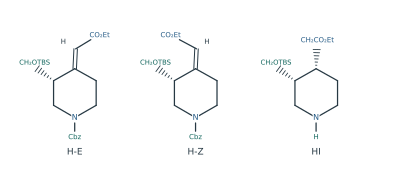

### Question 54 — Deux effets de H₂ sur palladium

L’hydrogénation réduit la double liaison exocyclique et fixe la configuration de C4. L’hydrogénolyse du carbamate Cbz rompt aussi la liaison benzylique, puis le carbamate libère CO₂ et l’amine secondaire. Le traitement suivant peut ainsi benzoyler ce N.

## Former l’alcène E et le diol

### Question 55 — Suivi IR de J à K

En notant Ar = 6-méthoxyquinolin-4-yle, le segment réactif de J est cycle–CH₂–CO–CH₂–Ar.

| Étape | Transformation locale | Évolution IR attendue |
|---|---|---|
| 1, NaBH₄ | cétone → alcool secondaire | C=O cétonique vers 1650–1730 cm⁻¹ disparaît, OH large vers 3200–3600 cm⁻¹ apparaît |
| 2, MsCl/pyridine | alcool → mésylate, activation du départ | disparition de OH, apparition des deux fortes bandes SO₂ autour de 1350 et 1170 cm⁻¹ |
| 3, tBuOK | β-élimination → alcène conjugué | perte des bandes du mésylate, apparition d’une contribution C=C vers 1625–1680 cm⁻¹ et C–H vinylique vers 3000–3100 cm⁻¹ |

Le C=O de l’amide reste présent dans les trois spectres. La preuve de formation de l’alcène gagne donc à être complétée par la RMN.

### Question 56 — Structure de K majoritaire

Dans **K-E**, l’azote de la pipéridine porte Bz, le C3 conserve CH₂OTBS hachuré et le C4 porte, sur la même face, –CH₂–CH=CH–Ar. À la double liaison, le groupe CH₂–cycle et Ar sont sur des côtés opposés, chaque C éthylénique portant un H. Le rapport annoncé 29:1 traduit la préférence pour cet isomère E.

### Question 57 — Deux H vinyliques diagnostiques

Le H de Ar–CH= donne le doublet à 7,19 ppm, J = 15,6 Hz. Le H de =CH–CH₂ donne le doublet de triplets à 6,48 ppm. Il est couplé au premier H par 15,6 Hz et aux deux H voisins du CH₂ par environ 7,6 Hz. Le grand couplage vinylique indique deux H trans. Pour l’isomère Z, les mêmes connexions donnent un couplage cis plus faible, typiquement 6–12 Hz, avec des déplacements éventuellement différents.

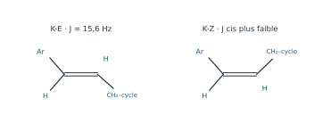

## Fermeture de la cage et configurations finales

### Question 58 — Débenzoyler l’époxyde

Dans **MO**, prendre M et remplacer le groupe N–COPh par N–H. Le DIBAL à −78 °C permet ici la débenzoylation réductrice de l’amide dans les conditions de l’annexe. L’époxyde portant Ar et le groupe CH₂OTBS restent intacts avec leurs liaisons stéréochimiques. Cet intermédiaire possède le doublet nucléophile nécessaire à la fermeture du troisième pont.

### Question 59 — Formation intramoléculaire de la quinuclidine

Le doublet de l’amine secondaire de MO attaque par l’arrière le carbone époxydique proximal au CH₂ du bras pipéridinique. La liaison de ce carbone vers O se rompt vers O. Cette substitution intramoléculaire avec inversion au site attaqué ferme un pont –CH₂–CH– de la cage bicyclique. L’oxygène reste sur le carbone distal lié à Ar. Transfert de proton du N⁺–H à l’alcoolate donne la quinuclidine tertiaire **O** et l’alcool benzylique avec l’orientation indiquée. Aucun carbocation libre n’est requis.

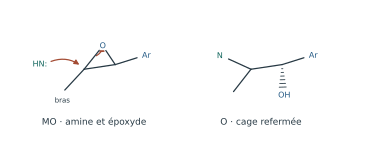

### Question 60 — Distinguer les deux oxygènes de P

**P** a la cage et les centres de O. Le carbinol secondaire Ar–CH(OH)–cage devient **Ar–CH(OAc)–cage**, configuration conservée. Le bras –CH₂OTBS est devenu **–CH₂OH**. Les autres fonctions, dont le méthoxy aromatique, sont conservées.

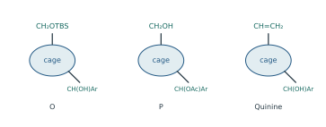

### Question 61 — Deux protections complémentaires

Ac₂O, Et₃N et DMAP acétylent le OH secondaire en acétate et le protègent de l’oxydation. HCl méthanolique clive ensuite l’éther silylé et libère l’alcool primaire. C’est la sélectivité de ces deux opérations qui permet d’oxyder le bras terminal en présence du carbinol masqué.

### Question 62 — S’arrêter à l’aldéhyde

Une oxydation de Swern convient. Activer DMSO par le chlorure d’oxalyle dans CH₂Cl₂ froid (environ −78 °C), ajouter P puis Et₃N et laisser remonter la température. Le bras –CH₂OH devient –CHO. L’acétate du carbinol et le noyau quinolinique sont conservés. Un réactif de Dess–Martin en milieu anhydre à température modérée constitue une autre possibilité.

### Question 63 — Installer le groupe vinyle

C’est une **oléfination de Wittig**. tBuOK forme l’ylure Ph₃P=CH₂, qui transforme R–CHO en R–CH=CH₂ avec formation de Ph₃P=O. L’hydrolyse douce de l’acétate à l’étape suivante restitue l’alcool secondaire.

### Question 64 — Origine des centres et passage à la quinidine

La cycloaldolisation **D → E** dirigée par la proline fixe la configuration du carbone de la pipéridine portant CHO, futur C8 porteur du vinyle. Le OH créé simultanément en C4 de la pipéridine est effacé par F → G. **H → HI**, lors de l’hydrogénation diastéréosélective, fixe le carbone voisin qui deviendra la tête de pont carbonée (C4 de la quinuclidine). **K → L**, dihydroxylation asymétrique, fixe les deux centres qui deviendront le carbinol et le C2 voisin de N. Les ouvertures et fermetures L → M → O imposent ensuite des inversions déterminées aux carbones attaqués. Pour obtenir la quinidine, changer le seul inducteur de K → L : employer **AD-mix-α** au lieu de AD-mix-β sur le même alcène E. Le diol de face opposée conduit, par les mêmes opérations, aux deux configurations inversées, tandis que celles établies avant K sont conservées.
