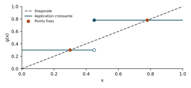
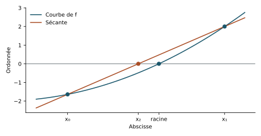

# X-ENS PC — Mathématiques 2022 · Corrigé guidé

*Corrigé rédigé par IA, non officiel. Signalez toute erreur.*

**Rédaction** · GPT-6.2 Astra Ultra · vitesse non renseignée

La composition de quatre heures du 25 avril 2022 mène des points fixes à la méthode de la sécante. Les trois premières parties sont indépendantes. La quatrième utilise la dérivée mixte de la fonction construite dans la troisième. Les références I à IV distinguent les numéros répétés du sujet. [Sujet officiel](https://www.polytechnique.edu/admission-cycle-ingenieur/sites/admission/files/content/2022%20PC%20SUJET%20ECRIT%20DE%20MATHEMATIQUES%20(XEULS).pdf) · [Rapport du jury](https://www.polytechnique.edu/admission-cycle-ingenieur/sites/admission/files/content/2022%20PC%20RAPPORT%20ECRIT%20MATHEMATIQUES%20(XEULS).pdf)

## I. Points fixes

### Question I.1

> [!INDICATION]
> Comparer la fonction à la diagonale aux deux extrémités.

#### Solution

La fonction continue $u(x)=\varphi(x)-x$ vérifie $u(a)\ge0$ et $u(b)\le0$ puisque les images restent dans $[a,b]$. Si l’une de ces valeurs est nulle, l’extrémité est fixe. Sinon le théorème des valeurs intermédiaires donne $u(c)=0$ dans $]a,b[$. Si $a=b$, l’unique point est fixe.

### Question I.2

> [!INDICATION]
> Minorer la dérivée de la différence avec l’identité.

#### Solution

Écrivons $k=\sup_{\mathbb R}|\varphi'|<1$ et $v(x)=x-\varphi(x)$. Sa dérivée vérifie $v'\ge1-k>0$. Par les accroissements finis, $v(x)\ge v(0)+(1-k)x$ pour $x\ge0$ et $v(x)\le v(0)+(1-k)x$ pour $x\le0$. La fonction prend donc les deux signes, et sa continuité lui donne un zéro. Sa stricte croissance en donne l’unicité.

### Question I.3

> [!INDICATION]
> Comparer la dérivée à un puis la fonction à son argument.

#### Solution

Pour $\psi(x)=\sqrt{1+x^2}$, on a $|\psi'(x)|=|x|/\sqrt{1+x^2}<1$ pour tout réel, avec supremum un. Or $\sqrt{1+x^2}>|x|\ge x$. La fonction n’a donc aucun point fixe. La distinction entre la borne uniforme de I.2 et les inégalités point par point affecte bien l’existence.

### Question I.4a

> [!INDICATION]
> Écrire une différence comme somme télescopique.

#### Solution

Pour $m>n$, l’inégalité triangulaire donne $\|v_m-v_n\|\le\sum_{j=n}^{m-1}\|v_{j+1}-v_j\|$. Cette borne est au plus le reste d’une série convergente à termes positifs et devient arbitrairement petite pour $n$ grand. La suite est donc de Cauchy dans $\mathbb R^\ell$, espace complet, et converge.

### Question I.4b

> [!INDICATION]
> Faire tendre la dernière borne du télescopage vers l’infini.

#### Solution

Dans l’inégalité de I.4a, la continuité de la norme donne, pour $n$ fixé et $m\to\infty$,
$$\|v_n-v^*\|\le\sum_{j=n}^{\infty}\|v_{j+1}-v_j\|.$$

### Question I.5a

> [!INDICATION]
> Contrôler les différences successives par une série géométrique.

#### Solution

On dispose d’un point initial $x_0$ de $F$, donc $F$ est non vide. La stabilité $\varphi(F)\subset F$ définit tous les itérés dans $F$ par récurrence. En appliquant l’inégalité de contraction aux couples successifs, on obtient $\|x_{n+1}-x_n\|\le k^n\|x_1-x_0\|$. Cette majoration est sommable car $0\le k<1$. La question I.4a donne la convergence dans $\mathbb R^\ell$, et la fermeture de $F$ place la limite dans $F$.

### Question I.5b

> [!INDICATION]
> Passer à la limite puis comparer deux points fixes possibles.

#### Solution

La contraction est lipschitzienne donc continue sur $F$. En passant à la limite dans $x_{n+1}=\varphi(x_n)$, on obtient $x^*=\varphi(x^*)$. Si $y^*$ est un second point fixe, $\|x^*-y^*\|\le k\|x^*-y^*\|$. Comme $1-k>0$, la distance est nulle.

### Question I.5c

> [!INDICATION]
> Itérer l’inégalité en gardant le point fixe comme deuxième argument.

#### Solution

Pour chaque $j$, $\|x_{j+1}-x^*\|\le k\|x_j-x^*\|$. Au rang zéro la majoration vaut avec égalité. En multipliant la borne du rang $j$ par $k$ au rang suivant, on obtient pour tout $n$ la majoration $\|x_n-x^*\|\le k^n\|x_0-x^*\|$.

### Question I.5d

> [!INDICATION]
> Appliquer la commutation des itérées au point fixe de la puissance.

#### Solution

Soit $x^*$ l’unique point fixe de $\varphi=\theta^m$. Comme $\theta^m\theta=\theta\theta^m$, on a $\varphi(\theta(x^*))=\theta(x^*)$. L’unicité pour $\varphi$ donne $\theta(x^*)=x^*$, d’où l’existence. Tout point fixe de $\theta$ est fixe par $\theta^m$, ce qui donne aussi l’unicité.

### Question I.6

> [!INDICATION]
> Exploiter deux fois la croissance à partir de la borne supérieure.

#### Solution

L’ensemble $E=\{x\in[0,1]:x\le g(x)\}$ contient zéro et est majoré par un. Soit $a=\sup E\in[0,1]$. Pour $x\in E$, la croissance donne $x\le g(x)\le g(a)$. Ainsi $a\le g(a)$. Par croissance à nouveau, $g(a)\le g(g(a))$, donc $g(a)\in E$. Il en résulte $g(a)\le a$, d’où $g(a)=a$. Cette démonstration ne demande aucune continuité de $g$.

## II. Matrices contractantes et normes adaptées

### Question II.1

> [!INDICATION]
> Séparer le cas des deux valeurs diagonales égales.

#### Solution

Pour $n\ge1$, la diagonale de $T^n$ est $(\lambda^n,\mu^n)$ et le coefficient inférieur gauche vaut zéro. Le coefficient supérieur droit vaut
$$aS_n,\qquad S_n=\sum_{j=0}^{n-1}\lambda^{n-1-j}\mu^j.$$
La multiplication par $T$ donne $S_{n+1}=\lambda^n+\mu S_n$ et vérifie la formule par récurrence. Pour $\lambda\ne\mu$, $S_n=(\lambda^n-\mu^n)/(\lambda-\mu)$. Pour $\lambda=\mu$, $S_n=n\lambda^{n-1}$, avec $S_1=1$ aussi si $\lambda=0$.

### Question II.2a

> [!INDICATION]
> Triangulariser et absorber le facteur polynomial dans une puissance légèrement plus grande.

#### Solution

Sur $\mathbb C$, écrivons $A=PTP^{-1}$ avec $T$ comme en II.1 et $\rho=\max(|\lambda|,|\mu|)$. Chaque terme de $S_n$ est majoré en module par $\rho^{n-1}$, et le binôme donne $\varepsilon n\rho^{n-1}\le(\rho+\varepsilon)^n$ pour $n\ge1$ (au rang un, le produit sans facteur vaut un). Les coefficients diagonaux sont majorés par $\rho^n$. Ainsi les coefficients de $T^n$ sont majorés par $\max(1,|a|/\varepsilon)(\rho+\varepsilon)^n$. Ceux de $A^n=PT^nP^{-1}$ sont des combinaisons linéaires fixes des précédents. Prendre le maximum sur leurs quatre sommes de valeurs absolues des coefficients donne une constante $\alpha>0$, augmentée au besoin pour $n=0$.

### Question II.2b

> [!INDICATION]
> Majoriser les coordonnées puis revenir à la norme euclidienne.

#### Solution

Avec $r=\rho+\varepsilon$, chaque coordonnée de $A^nx$ est de module au plus $\alpha r^n(|x_1|+|x_2|)\le\sqrt2\,\alpha r^n\|x\|$. En faisant la somme des carrés des deux coordonnées, $\|A^nx\|\le2\alpha r^n\|x\|$. On peut prendre $\beta=2\alpha$.

### Question II.3a

> [!INDICATION]
> Utiliser une marge strictement plus petite que celle du dénominateur.

#### Solution

Prenons $\varepsilon=\eta/2$ dans II.2b. Alors
$$0\le(\rho+\eta)^{-n}\|A^nx\|\le\beta q^n\|x\|,\qquad q=\frac{\rho+\eta/2}{\rho+\eta}<1.$$
La série géométrique converge, d’où la convergence de la série définissant $N(x)$.

### Question II.3b

> [!INDICATION]
> Garder le terme d’indice zéro et réindexer la série appliquée à Ax.

#### Solution

Les termes sont non négatifs et le premier est $\|x\|$, donc $N(x)=0$ impose $x=0$. La réciproque, l’homogénéité complexe $N(ax)=|a|N(x)$ et l’inégalité triangulaire suivent terme à terme de celles de la norme euclidienne. Enfin, avec $r=\rho+\eta$,
$$N(Ax)=r\sum_{m\ge1}r^{-m}\|A^mx\|=r\bigl(N(x)-\|x\|\bigr)\le rN(x).$$

### Question II.3c

> [!INDICATION]
> Sommer la majoration géométrique uniforme en x.

#### Solution

Le terme d’indice zéro donne $N(x)\ge\|x\|$. Avec $\beta$ éventuellement augmentée à un au minimum, II.3a s’applique aussi à $n=0$ et donne $N(x)\le\beta(1-q)^{-1}\|x\|$. Cette constante est indépendante de $x$.

### Question II.4a

> [!INDICATION]
> Mesurer le vecteur dans une base propre.

#### Solution

Écrivons $B=PDP^{-1}$ où $D$ est diagonale. Posons $\|x\|_B=\|P^{-1}x\|$. Cette fonction est une norme puisque $P^{-1}$ est linéaire injective et que la norme euclidienne est une norme. Si $y=P^{-1}x$, alors $\|Bx\|_B^2=\|Dy\|^2=\sum_j|D_{jj}|^2|y_j|^2\le\rho(B)^2\|y\|^2$. La racine carrée donne la conclusion.

### Question II.4b

> [!INDICATION]
> Chercher une matrice non nulle à rayon spectral nul.

#### Solution

Prenons $C=\bigl(\begin{smallmatrix}0&1\\0&0\end{smallmatrix}\bigr)$. Son carré est nul, donc $\rho(C)=0$. Pour toute norme $N$, avec $y=(0,1)$, $N(Cy)=N((1,0))>0=\rho(C)N(y)$. Le même vecteur convient à toutes les normes.

### Question II.5

> [!INDICATION]
> Choisir une norme rendant la partie linéaire contractante puis absorber le reste quadratique.

#### Solution

Choisissons $\eta>0$ avec $r=\rho(A)+\eta<1$, et restreignons à $\mathbb R^2$ la norme de II.3. Pour $u=x-x^*$, l’hypothèse et $\|u\|\le N(u)\le C\|u\|$ donnent
$$N(\varphi(x)-x^*)\le rN(u)+CMN(u)^2.$$
Choisissons $d>0$ avec $q=r+CMd<1$. Si $N(u)\le d$, le membre de droite est au plus $qN(u)$. La boule fermée de rayon $d$ en norme $N$ est donc stable, et les erreurs y décroissent géométriquement. Pour $\|x_0-x^*\|<d/C$, on a $N(x_0-x^*)<d$ et par récurrence $\|x_n-x^*\|\le q^nN(x_0-x^*)\to0$.

## III. Différences mixtes et prolongement de la fonction sécante

### Question III.1a

> [!INDICATION]
> Intégrer deux fois le théorème fondamental.

#### Solution

Comme $h$ est $C^2$, les dérivées mixtes coïncident. Intégrer en $s_2$ donne $\widehat h(s_1)=\partial_1 h(s_1,d)-\partial_1h(s_1,c)$. En intégrant en $s_1$ de $a$ à $b$, on obtient $h(b,d)-h(a,d)-h(b,c)+h(a,c)$, comme demandé.

### Question III.1b

> [!INDICATION]
> Appliquer deux fois le théorème de la moyenne pour les intégrales.

#### Solution

La fonction $\widehat h$ est continue car l’intégrande est continu sur le rectangle compact. Le théorème de la moyenne fournit $\bar s_1\in[a,b]$ tel que l’intégrale de III.1a vaille $(b-a)\widehat h(\bar s_1)$. En fixant $s_1=\bar s_1$ et en appliquant le même théorème en $s_2$, on obtient $\widehat h(\bar s_1)=(d-c)\partial_{12}h(\bar s_1,\bar s_2)$. Le produit donne la seconde égalité. Si un intervalle est réduit à un point, l’identité où il fournit un facteur nul est automatique et l’autre moyenne, lorsqu’elle est nécessaire, subsiste.

### Question III.2

> [!INDICATION]
> Utiliser la croissance stricte puis différencier l’identité inverse.

#### Solution

Comme $f'>0$, les accroissements finis impliquent la stricte croissance. La continuité donne pour image l’intervalle compris entre les deux limites aux extrémités de $I$, éventuellement infinies. Aucune extrémité finie n’est atteinte car tout point de l’intervalle ouvert a un voisin de chaque côté et $f$ est strictement croissante. Ainsi $f$ est bijective sur l’intervalle ouvert $f(I)$. Le théorème d’inversion donne $g\in C^3$ et $g'(f(x))=1/f'(x)$. Différencier puis diviser par $f'(x)$ donne $g''(f(x))=-f''(x)/f'(x)^3$.

### Question III.3a

> [!INDICATION]
> Écrire le taux d’accroissement de la fonction réciproque comme une intégrale.

#### Solution

Pour $x\ne y$, $H_f(x,y)=x-f(x)(x-y)/(f(x)-f(y))$. Le quotient des différences vaut $(g(f(x))-g(f(y)))/(f(x)-f(y))$. Par le théorème fondamental appliqué au chemin affine de $f(y)$ à $f(x)$, il est égal à
$$\int_0^1g'\bigl(\lambda f(x)+(1-\lambda)f(y)\bigr)\,d\lambda.$$
On obtient la formule du sujet quelle que soit la position relative de $x$ et $y$.

### Question III.3b

> [!INDICATION]
> Conserver la formule intégrale sur la diagonale.

#### Solution

Dans III.3a, la combinaison convexe des deux valeurs de $f$ reste dans l’intervalle $f(I)$. L’expression intégrale a donc un sens pour tout $(x,y)\in I^2$. Au voisinage d’un couple fixé, prenons deux petits intervalles fermés dans $I$. Pour ces paramètres et $0\le\lambda\le1$, l’argument de $g'$ reste dans un compact de $f(I)$. La continuité uniforme de l’intégrande sur le produit compact donne la continuité de l’intégrale. Cette expression définit le prolongement recherché et la densité de l’ensemble $x\ne y$ en impose l’unicité.

### Question III.3c

> [!INDICATION]
> Justifier localement la dérivation sous le signe intégral.

#### Solution

Sur les mêmes compacts, l’intégrande et toutes ses dérivées en $(x,y)$ jusqu’à l’ordre deux sont continues, par $f,g\in C^3$. Ces dérivées sont bornées uniformément en $\lambda$, donc dominées sur $[0,1]$ par des constantes intégrables. Le théorème de dérivation des intégrales à paramètres donne un prolongement $H_f$ de classe $C^2$ sur tout $I^2$.

### Question III.3d

> [!INDICATION]
> Évaluer directement l’intégrale lorsque les deux arguments coïncident.

#### Solution

Pour $y=x$, l’intégrande est constante et vaut $g'(f(x))=1/f'(x)$. On obtient $H_f(x,x)=x-f(x)/f'(x)$, abscisse où la tangente coupe l’axe horizontal.

### Question III.4a

> [!INDICATION]
> Évaluer la différence mixte sur le rectangle construit à partir de la racine.

#### Solution

Comme $f(x^*)=0$, la formule de III.3a et sa symétrie donnent $H_f(x,x^*)=H_f(x^*,y)=x^*$, y compris en $(x^*,x^*)$. Ainsi $H_f(x,y)-x^*$ est la différence des quatre valeurs de $H_f$ sur le rectangle d’extrémités $x^*,x$ et $x^*,y$. Si $x$ et $y$ sont différents de $x^*$, appliquons III.1b avec les extrémités en ordre croissant. Chaque inversion d’une des deux paires change à la fois le signe de la différence et celui du facteur correspondant. On obtient donc, dans tous les ordres, $(x-x^*)(y-x^*)\partial_{12}H_f(\bar x,\bar y)$ avec $(\bar x,\bar y)\in I_x\times I_y$. Si un facteur est nul, les deux membres sont déjà nuls.

### Question III.4b

> [!INDICATION]
> Dériver d’abord en y et observer quels termes disparaissent à la racine.

#### Solution

Posons $u=\lambda f(x)+(1-\lambda)f(y)$. La dérivée en $y$ vaut $-f(x)f'(y)\int_0^1(1-\lambda)g''(u)\,d\lambda$. Lorsqu’on dérive en $x$ puis qu’on prend $x=y=x^*$, le terme où la dérivée porte sur l’intégrale est multiplié par $f(x^*)=0$. Il reste
$$\partial_{12}H_f(x^*,x^*)=-\tfrac12 f'(x^*)^2 g''(0)=\frac{f''(x^*)}{2f'(x^*)}.$$
Le facteur $1/2$ est l’intégrale de $1-\lambda$ sur $[0,1]$.

## IV. Méthode de la sécante

### Question IV.1

> [!INDICATION]
> Calculer l’abscisse de l’intersection de la sécante avec l’axe.

#### Solution

Si $x=x_{n-1}\ne y=x_n$, la droite a pour pente $(f(y)-f(x))/(y-x)$. Pour $f'>0$, cette pente est positive et l’intersection avec l’axe des abscisses a pour abscisse $x-f(x)(y-x)/(f(y)-f(x))=H_f(x,y)$. Pour $x=y$, la tangente de pente $f'(x)>0$ donne le même résultat par III.3d. Ainsi le candidat à l’itération est $x_{n+1}=H_f(x_{n-1},x_n)$, à condition que cette abscisse appartienne à $I$.

### Question IV.2a

> [!INDICATION]
> Décrire les points plus proches de la racine supérieure que de la racine inférieure.

#### Solution

Pour $x\ne\beta$, $|h(x)|<1$ équivaut à $(x-\alpha)^2<(x-\beta)^2$. Leur différence vaut $(\alpha-\beta)(\alpha+\beta-2x)$, négative exactement lorsque $x>(\alpha+\beta)/2$. Pour $x=\beta$, les deux assertions sont fausses. Cela prouve l’équivalence.

### Question IV.2b

> [!INDICATION]
> Factoriser la différence entre la nouvelle abscisse et chacune des deux racines.

#### Solution

Pour $x,y\in I$, la pente de la sécante vaut $x+y-\alpha-\beta>0$, valable aussi sur la diagonale pour la tangente. Posons $t=(xy-\alpha\beta)/(x+y-\alpha-\beta)$, abscisse d’intersection. Alors
$$t-\alpha=\frac{(x-\alpha)(y-\alpha)}{x+y-\alpha-\beta},\qquad
t-\beta=\frac{(x-\beta)(y-\beta)}{x+y-\alpha-\beta}>0.$$
D’où $h(t)=h(x)h(y)$. Par IV.2a, $|h(t)|<1$ donc $t\in I$. Une récurrence montre que tous les itérés existent dans $I$ et que $u_{n+1}=u_{n-1}u_n$ pour $n\ge1$.

### Question IV.2c

> [!INDICATION]
> Itérer la relation multiplicative et inverser le changement de variable.

#### Solution

Soient $F_0=0,F_1=1$ et $F_{n+1}=F_n+F_{n-1}$. Si $u_0,u_1$ sont non nuls, la récurrence de IV.2b donne $u_n=u_0^{F_{n-1}}u_1^{F_n}$ pour $n\ge1$. Pour $q=\max(|u_0|,|u_1|)<1$, on a $|u_n|\le q^{F_{n+1}}\to0$. Si l’un des deux termes initiaux est nul, tous les termes à partir de $u_2$ sont nuls. Enfin $x_n=(\alpha-\beta u_n)/(1-u_n)\to\alpha$.

### Question IV.2d

> [!INDICATION]
> Comparer la croissance des exposants de Fibonacci à la puissance du nombre d’or.

#### Solution

Si l’un des termes initiaux est nul, l’erreur est nulle dès le rang deux et tout $s<0$ convient. Sinon $0<q<1$ et la formule de Binet, avec $\phi=(1+\sqrt5)/2$, donne
$$F_{n+1}=\frac{\phi^{n+1}-(-1/\phi)^{n+1}}{\sqrt5}\ge c\,\phi^n$$
pour tout $n$ assez grand et une constante $c>0$. En écrivant $x_n-\alpha=(\alpha-\beta)u_n/(1-u_n)$ on obtient alors $|x_n-\alpha|=O(\exp(c\log(q)\,\phi^n))$. Le réel $s=c\log q$ est strictement négatif.

### Question IV.3a

> [!INDICATION]
> Choisir un segment sur lequel la dérivée conserve le signe qu’elle a à la racine.

#### Solution

Puisque $I$ est ouvert, il contient un petit segment centré en $x^*$. Par continuité de $f'$ et $f'(x^*)>0$, on peut choisir $\varepsilon>0$ assez petit pour que $f'>0$ sur ce segment et même dans un voisinage. La partie III fournit $H_f$ de classe $C^2$ sur un voisinage du carré correspondant. La continuité de $|\partial_{12}H_f|$ y donne un maximum fini $M$ sur le carré compact.

### Question IV.3b

> [!INDICATION]
> Appliquer la différence mixte au candidat fourni par la sécante.

#### Solution

Pour $x=x_{n-1}$ et $y=x_n$ dans le segment, III.4a donne, puisque $I_x\times I_y$ est contenu dans le carré,
$$|H_f(x,y)-x^*|\le M|x-x^*|\,|y-x^*|.$$
C’est la majoration de $|x_{n+1}-x^*|$ dès que le candidat est admis. La convention d’arrêt de l’énoncé exige aussi que son abscisse soit dans $I$. Ce point sera garanti en IV.3c pour les conditions initiales indiquées. Sur un segment plus large, il peut effectivement sortir de $I$. Pour $f(t)=e^t-1$ sur $I=(-3,3)$, $x^*=0$, $\varepsilon=2$ et $x=y=-2$, la tangente coupe l’axe en $e^2-3>3$.

### Question IV.3c

> [!INDICATION]
> Prouver simultanément que le prochain point existe et que son erreur décroît.

#### Solution

Posons $q=M\varepsilon'<1$ et $e_j=|x_j-x^*|$. Si $e_{n-1},e_n\le\varepsilon'$, l’abscisse candidate de IV.3b est à distance au plus $Me_{n-1}e_n\le q e_n\le\varepsilon'$ de la racine. Elle appartient donc au segment autorisé, inclus dans $I$, et devient $x_{n+1}$. L’hypothèse initiale permet la récurrence pour tous les rangs. On en déduit $e_n\le q^{n-1}e_1$ pour $n\ge1$ (si $q=0$, l’erreur s’annule dès le rang deux). Ainsi $x_n\to x^*$.
