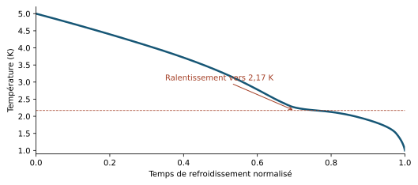
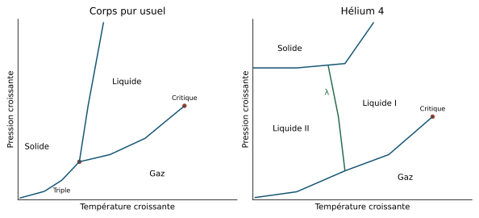
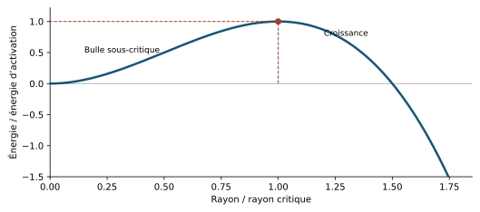
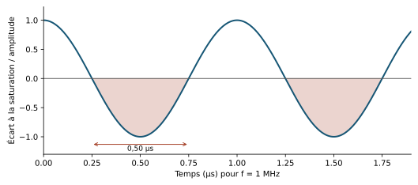
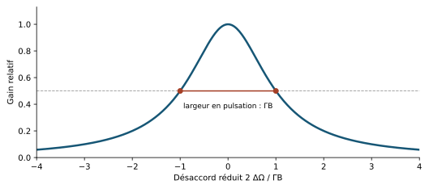

# X-ENS PC 2022 — Physique B · Corrigé brut

*Corrigé rédigé par IA, non officiel. Signalez toute erreur.*

**Lecture du rapport du jury** · GPT-6.2 Astra Ultra · vitesse non renseignée

**Rédaction** · GPT-6.2 Astra Ultra · vitesse non renseignée

## Étude de l’hélium superfluide métastable

## I — L’hélium liquide à basse température

### Question 1 — Refroidissement isobare

À pression constante, avec le seul travail des forces de pression, la puissance thermique reçue par l'échantillon est $dH/dt=P_{\rm th}$. Pour un liquide homogène, $dH=mc_p(T)\,dT$. Ainsi
$$\dot T=\frac{P_{\rm th}}{mc_p(T)}<0,\qquad t(T)=\frac{m}{|P_{\rm th}|}\int_T^{5\,{\rm K}}c_p(u)\,du.$$
En prenant la figure 1a comme allure de $c_p$ pour le refroidissement, la chute de température s'accélère d'abord en allant vers le minimum de $c_p$ au-dessus de $T_\lambda$, puis ralentit fortement au voisinage de $2{,}17$ K. Sous la transition elle s'accélère de nouveau. Le pic étroit donne une tangente presque horizontale ; une transformation à chaleur latente donnerait un palier de durée finie. La figure de l'énoncé mesure $c_p$ à saturation et s'arrête avant 5 K, aussi ne fixe-t-elle pas une loi temporelle chiffrée sur tout l'intervalle.

### Question 2 — Coexistences et refroidissement

Sur le diagramme usuel, les lignes solide–gaz, liquide–gaz et solide–liquide se rencontrent au point triple. La courbe liquide–gaz finit au point critique ; la pente de fusion est généralement positive, le liquide occupant un volume molaire supérieur à celui du solide. En refroidissant le long de la frontière de la phase gazeuse, on passe de la coexistence liquide–gaz à la coexistence solide–gaz au point triple.
Pour l'hélium, la courbe de saturation rencontre la ligne $\lambda$ : le liquide I devient liquide II et reste liquide à saturation lorsque $T$ tend vers zéro. Le solide nécessite une pression élevée, de l'ordre de $2{,}5$ MPa à basse température sur la figure 2. L'agitation quantique de point zéro compte même à très basse température.

### Question 3 — Écoulement parfait

Les transferts dissipatifs de quantité de mouvement par viscosité et de chaleur par conduction sont négligés. La contrainte intérieure se réduit à la pression et la loi locale s'écrit $\rho D\mathbf u/Dt=-\nabla p+\rho\mathbf g$ pour la seule pesanteur. À une paroi imperméable fixe, la vitesse normale s'annule, un glissement tangent reste possible. La compressibilité et l'existence d'un tourbillon sont des questions distinctes. Dans la limite d'un écoulement régulier et adiabatique, l'entropie est conservée le long d'une trajectoire.

### Question 4 — Température d'apparition des effets quantiques

La figure 1b donne $\rho\simeq145\ {\rm kg\,m^{-3}}$ dans la phase II. Le volume disponible par atome vaut $m_{\rm He}/\rho$ ; une longueur interatomique typique est donc $a=(m_{\rm He}/\rho)^{1/3}\simeq3{,}6\times10^{-10}$ m. Avec l'estimation imposée $p_{\rm at}^2/(2m_{\rm He})\sim3k_BT$,
$$\Lambda=\frac{h}{p_{\rm at}}\sim\frac{h}{\sqrt{6m_{\rm He}k_BT}}\propto T^{-1/2},\qquad T_{\rm q}\sim\frac{h^2}{6m_{\rm He}k_Ba^2}\simeq6\ {\rm K}.$$
Le recouvrement des ondes de matière commence à l'échelle du kelvin, compatible en ordre de grandeur avec les $2{,}17$ K observés. Le critère $\Lambda\sim a$ ne calcule pas précisément la température de transition collective.

## II.1 — Métastabilité et cavitation

### Question 5 — Barrière pour la première bulle

Créer l'interface de surface $4\pi r^2$ coûte $\gamma$ joules par mètre carré. Le volume gazeux, lui, procure un gain pour $\Delta p=p_{\rm sat}-p>0$. On obtient
$$\frac{d\Delta E}{dr}=4\pi r(2\gamma-\Delta p\,r),\quad r_c=\frac{2\gamma}{\Delta p},\quad \Delta E^*=\frac{16\pi\gamma^3}{3\Delta p^2}.$$
Partant de zéro, l'énergie monte, atteint ce maximum et redescend, s'annulant pour $r=3\gamma/\Delta p$. Une bulle sous-critique tend à se résorber, une bulle qui a dépassé $r_c$ peut croître spontanément. L'énergie d'activation à apporter par fluctuation est $\Delta E^*$.

### Question 6 — Taux de nucléation

La fraction des fluctuations thermiques qui franchissent la barrière est pondérée par le facteur de Boltzmann. Le modèle d'activation donne $\Gamma=\Gamma_0\exp[-\Delta E^*/(k_BT)]$. Le préfacteur $\Gamma_0$ compte les tentatives par unité de volume et de temps, en $\rm m^{-3}\,s^{-1}$.

### Question 7 — Intérêt d'un liquide froid et pur

Une impureté facilite la nucléation hétérogène : une baisse de $\Delta E^*$ **augmente** $\Gamma$ à température donnée. À quelques kelvins, les impuretés se solidifient sur les parois ou se déposent ; leur élimination laisse un liquide très pur. La barrière y reste haute et le faible $k_BT$ réduit encore la fréquence des fluctuations capables de la franchir. L'état liquide peut donc subsister bien en dessous de $p_{\rm sat}$. Le commentaire de la Q7 dans le rapport inverse le premier effet : le signe découle directement de la Q6 et de l'hypothèse écrite dans le sujet.

### Question 8 — Probabilité de première cavitation

Pour voir la première bulle entre $t$ et $t+dt$, le système doit avoir survécu jusqu'à $t$ (probabilité $1-\Sigma$), puis nucléer dans $dt$ (probabilité conditionnelle $\Gamma V\,dt+o(dt)$). À température, pression et volume constants,
$$\dot\Sigma=\Gamma V(1-\Sigma),\qquad \Sigma(0)=0,\qquad \Sigma(t)=1-e^{-\Gamma Vt}.$$
Le produit $\Gamma Vt$ est sans dimension ; la probabilité croît de zéro à un.

### Question 9 — Pression de cavitation à mi-probabilité

L'égalité $\Sigma(\tau)=1/2$ impose $\Gamma V\tau=\ln2$, donc $\Delta E^*=k_BT\ln(\Gamma_0V\tau/\ln2)$. La branche correspondant au liquide en tension est
$$p_c=p_{\rm sat}-\sqrt{\frac{16\pi\gamma^3}{3 k_BT\ln(\Gamma_0V\tau/\ln2)}}.$$
Il faut $\Gamma_0V\tau>\ln2$. À paramètres fixés, le modèle thermique donne un écart à saturation croissant comme $T^{-1/2}$ et prévoit une pression absolue négative aux très basses températures. Sa divergence formelle n'est pas réalisable : la stabilité mécanique du liquide et les mécanismes quantiques limitent l'extrapolation. Pour atteindre une tension plus forte à probabilité fixée, prendre un volume sondé et une durée plus petits, tout en gardant le logarithme positif.

## II.2 — Pression négative

### Question 10 — Pression cinétique

Les collisions contre une paroi lui transfèrent de la quantité de mouvement normale. Pour une distribution isotrope, le flux donne $p=(N/V)m\langle v_x^2\rangle=(N/V)m\langle v^2\rangle/3=Nk_BT/V$. En l'absence d'attractions, les chocs poussent la paroi : la pression absolue est positive pour un gaz parfait à température positive.

### Question 11 — Seuil de température de van der Waals

Posons $u=V/N>b$. L'équation (2) donne $p=k_BT/(u-b)-a/u^2$. Le terme attractif, indépendant de $T$ dans ce modèle, peut l'emporter sur la pression d'agitation. À $u$ fixé, la condition est $k_BT<a(u-b)/u^2$. La dérivée de $(u-b)/u^2$ vaut $(2b-u)/u^3$. Le maximum sur $u>b$ est $1/(4b)$ et se situe à $2b$. Une pression négative est ainsi possible pour $T<T^*=a/(4bk_B)$ ; à l'égalité la pression minimale touche zéro.

### Question 12 — Sève en tension

La pression de la sève décroît selon $dp/dz=-\rho g$ si la colonne est assimilée à un liquide au repos, homogène. Avec $p(0)=p_0$, $p(z)=p_0-\rho gz$. La pression absolue devient négative au-dessus de $p_0/(\rho g)\simeq10^5/(10^3\times9{,}8)\simeq10$ m, si la colonne demeure continue.

## III — Étude expérimentale au foyer acoustique

### Question 13 — Durée et étendue du foyer en tension

Choisissons $p(t)=p_{\rm sat}+\delta p\cos(2\pi f t)$. Sur chaque période, $1/4<ft\bmod 1<3/4$ donne $p<p_{\rm sat}$. La durée est $1/(2f)=0{,}50\ \mu{\rm s}$. La coquille couvre un grand angle : la diffraction donne une largeur focale de l'ordre de $\lambda_{\rm a}=v/f\simeq2\,10^{-4}$ m, à un facteur géométrique près. Si $\delta p>p_{\rm sat}$, une portion de l'alternance atteint une pression absolue négative. Le sujet suppose que le liquide ne cavite pas durant l'observation.

## III.1 — Interférométrie de Jamin

### Question 14 — Variation d'indice et variation de masse volumique

Écrivons $n=1+\epsilon$. Au premier ordre, $(n^2-1)/(n^2+2)\simeq2\epsilon/3$, si bien que $n-1\simeq2\pi\alpha\rho/m_{\rm He}$. La polarisabilité étant fixée, la différentiation logarithmique donne $\delta n/(n-1)=\delta\rho/\rho$. Il faut conserver le petit excès d'indice du liquide au repos pour ce calcul.

### Question 15 — Séparation des deux faisceaux

Le même rayon incident fournit deux amplitudes par réflexion partielle à l'avant et réflexion sur le miroir arrière de la première lame. Le Jamin fonctionne donc par division d'amplitude. La seconde lame recombine les deux trajets.

### Question 16 — Distance perpendiculaire entre les bras

Soit $r$ l'angle réfracté dans le verre, avec $n_v\sin r=\sin\theta_i$. Entre l'entrée et la sortie du rayon qui fait l'aller-retour dans la lame, le déplacement le long de la face est $2e\tan r$. La séparation entre les rayons parallèles est sa projection perpendiculaire à leur direction :
$$d=2e\tan r\cos\theta_i=e\,\frac{\sin 2\theta_i}{\sqrt{n_v^2-\sin^2\theta_i}}.$$
Elle s'annule à incidence normale, comme sur le dessin des deux trajets.

### Question 17 — Différence de marche des lames

L'aller-retour interne a pour chemin optique $2n_ve/\cos r$. Pour comparer les phases sur un même plan d'onde en sortie, retrancher $2e\tan r\sin\theta_i$ parcouru par l'autre onde. Snell donne la différence $2n_ve\cos r$. Ainsi
$$\Phi(\theta_i)=\frac{4\pi e}{\lambda}\sqrt{n_v^2-\sin^2\theta_i}+\Phi_{\rm refl}.$$
Le terme constant de réflexion dépend de la convention des amplitudes. À la recombinaison, chaque bras a fait un aller-retour dans une seule lame. Les lames identiques et parallèles échangent leurs rôles ; la différence totale est $\delta\varphi=0\bmod 2\pi$ en l'absence d'onde sonore et de déséquilibre supplémentaire.

### Question 18 — Défaut de parallélisme

Une différence d'incidence $\delta\theta$ change le déphasage d'une lame de
$$\Phi'(\theta_i)\,\delta\theta=-\frac{2\pi e}{\lambda}\frac{\sin2\theta_i}{\sqrt{n_v^2-\sin^2\theta_i}}\delta\theta=-\frac{2\pi}{\lambda}d\,\delta\theta.$$
Cette expression correspond au choix $\Phi(\theta_i+\delta\theta)-\Phi(\theta_i)$ ; échanger l'ordre des deux bras change le signe mesuré.

### Question 19 — Projection du profil radial

Choisissons $y$ le long du rayon, $x$ sa distance transversale signée à l'axe et $r^2=x^2+y^2$ à hauteur $z$. La différence de phase (bras perturbé moins référence) est $(2\pi/\lambda)\int\delta n\,dy$. Pour $|x|<R$, en additionnant les deux moitiés de la corde,
$$\delta\varphi(x,z)=\frac{2\pi}{\lambda}\int_{-\sqrt{R^2-x^2}}^{+\sqrt{R^2-x^2}}\delta n(\sqrt{x^2+y^2},z)\,dy
=\frac{4\pi}{\lambda}\int_{|x|}^R\frac{\delta n(r,z)\,r\,dr}{\sqrt{r^2-x^2}}.$$
Pour $|x|\ge R$ elle est nulle. Enregistrer les phases pour les différentes cordes permet d'inverser la projection d'Abel à chaque hauteur, puis d'appliquer la Q14.

## III.2 — Diffusion Brillouin spontanée et stimulée

### Question 20 — Taille et profondeur du foyer optique

**a)** Pour un mode gaussien de divergence faible, au rayon de champ à $1/e$, $\theta_o\simeq\lambda/(\pi n w_{\min})$. Avec $n\simeq1$, $\lambda=1\ \mu{\rm m}$ et $\theta_o=0{,}07$ rad, on obtient $w_{\min}\simeq4{,}5\ \mu{\rm m}$. Même le diamètre, environ $9\ \mu{\rm m}$, reste bien inférieur à la taille acoustique de l'ordre de $200\ \mu{\rm m}$.
**b)** À $w=3w_{\min}\simeq14\ \mu{\rm m}$, $z_R=\pi n w^2/\lambda\simeq0{,}58$ mm. Au sein du foyer acoustique, l'enveloppe $w(z)=w\sqrt{1+(z/z_R)^2}$ varie peu ; on y approxime le faisceau par une onde localement plane, de section pratiquement constante.

### Question 21 — Choc photon–phonon et décalage de fréquence

**a)** À l'échelle du décalage étudié, $k_i=n\omega_i/c$ pour la lumière et $\Omega_B=v|\mathbf q_B|$ pour le son.
**b)** L'annihilation d'un phonon correspond à $\hbar\mathbf k_1+\hbar\mathbf q_B=\hbar\mathbf k_2$ et $\hbar\omega_1+\hbar\Omega_B=\hbar\omega_2$. Le photon diffusé gagne de l'énergie (branche anti-Stokes de cette question).
**c)** Avec $\omega_1\simeq\omega_2=\omega$, le triangle donne $q_B^2\simeq2k^2(1-\cos\theta)$, soit $\Omega_B=2n\omega(v/c)\sin(\theta/2)$. Pour $n\simeq1$ on retrouve (6). À angle droit $f_B=\sqrt2\,nv/\lambda\simeq2{,}8\,10^8$ Hz. La fréquence optique $c/\lambda\simeq3\,10^{14}$ Hz est environ un million de fois plus élevée, ce qui valide l'approximation.

### Question 22 — Dispersion et atténuation du son

En remplaçant $\partial_t$ par $i\Omega_B$ et $\Delta$ par $-Q^2$ dans l'équation homogène (7),
$$-\Omega_B^2+i\Gamma'\Omega_B Q^2+v^2Q^2=0,\qquad
Q=\frac{\Omega_B}{v}\left(1+i\frac{\Gamma'\Omega_B}{v^2}\right)^{-1/2}.$$
Pour $\Gamma'\Omega_B/v^2\ll1$, la branche qui se propage vers les $z$ croissants est $Q\simeq a-ib$, avec $a=\Omega_B/v$, $b=\Gamma'\Omega_B^2/(2v^3)>0$. Avec la convention du sujet, $\exp[-iQz]$ a pour module $\exp(-bz)$.

### Question 23 — Force d'électrostriction

La pression strictive $p_{\rm st}=-\epsilon_0\gamma_e E^2/2$ est plus basse là où le champ est intense. Sa force par unité de volume est $\mathbf f=-\nabla p_{\rm st}=(\epsilon_0\gamma_e/2)\nabla E^2$, dirigée vers les régions de champ fort. Le fluide s'y accumule et s'y comprime jusqu'à ce que la pression mécanique compense l'effet ; un champ uniforme n'exerce aucune force de volume dans le milieu homogène.

### Question 24 — Moyenne sur les périodes optiques

Le champ réel vaut $(\mathbf E_{1,0}e^{i\phi}+\mathbf E_{1,0}^*e^{-i\phi})/2$. Les termes à $2\omega_1$ du carré s'annulent en moyenne. On obtient $\langle\mathbf E_1\cdot\mathbf E_1\rangle=|\mathbf E_{1,0}|^2/2$ et $p_{\rm st}=-\epsilon_0\gamma_e|\mathbf E_{1,0}|^2/4$.

### Question 25 — Battement des ondes opposées

Posons $C=\mathbf E_{1,0}\cdot\mathbf E_{2,0}^*$, $\psi=\Omega t-qz$, $\Omega=\omega_1-\omega_2$, $q=k_1+k_2$. La durée de moyenne conserve le battement et élimine les sommes de pulsations :
$$\langle E^2\rangle=\tfrac12(|\mathbf E_{1,0}|^2+|\mathbf E_{2,0}|^2)+\Re(Ce^{i\psi}).$$
La force complète vaut $(\epsilon_0\gamma_e/2)\mathbf e_z\,\partial_z\langle E^2\rangle$. Si les enveloppes sont uniformes sur une période spatiale, son terme dominant est $(\epsilon_0\gamma_e/2)\mathbf e_z\Re[-iqCe^{i\psi}]$. Il disparaît pour des polarisations orthogonales.

### Question 26 — Divergence de la force

La divergence demande une seconde dérivée en $z$ de l'intensité moyennée. Les termes en dérivées d'enveloppe étant petits devant ceux en $q$, il reste le battement :
$$\nabla\cdot\mathbf f=\frac{\epsilon_0\gamma_e}{2}\Re[(-iq)^2Ce^{i\psi}]=-\frac{\epsilon_0\gamma_e q^2}{2}\Re[Ce^{i\psi}].$$
La modulation de densité est ainsi forcée au vecteur d'onde $q$ et à la pulsation $\Omega$.

### Question 27 — Réponse acoustique forcée et convention de signe

Avec **le signe imprimé dans (7)**, le membre de gauche a pour amplitude $(\Omega_B^2-\Omega^2+i\Omega\Gamma_B)\delta\rho$, où $\Omega_B=qv$ et $\Gamma_B=q^2\Gamma'$. L'amplitude du membre de droite est $-\epsilon_0\gamma_e q^2 C/2$. Ainsi l'équation (8) donne
$$\eta_{\rm imp}(q,\Omega)=\frac{q^2}{\Omega^2-\Omega_B^2-i\Omega\Gamma_B}.$$
Pour $\Omega>0$, $\Im\eta_{\rm imp}>0$. Cette propriété permet de contrôler le signe du transfert d'intensité dans la question suivante.

### Question 28 — Profil de résonance et signe du gain

Avec la polarisation commune, (10) donne $E_2'=i\omega_2\gamma_e E_1\delta\rho^*/(4c\rho_0)$. La dérivée $I_2'=\epsilon_0c\Re(E_2^*E_2')$ est donc
$$I_2'=K I_1 I_2\Im\eta,\qquad K=\frac{\omega_2\gamma_e^2}{2\rho_0c^2}>0.$$
En effet $\Re(i\eta^*)=\Im\eta$. Or (7) et (8), prises à la lettre, donnent
$$\Im\eta_{\rm imp}=\frac{q^2\Omega\Gamma_B}{(\Omega^2-\Omega_B^2)^2+\Omega^2\Gamma_B^2}
\simeq\frac{q^2}{\Omega_B\Gamma_B}\frac{(\Gamma_B/2)^2}{(\Gamma_B/2)^2+\Delta\Omega^2}.$$
La forme lorentzienne demandée est obtenue, mais le signe de $I_2'$ est alors positif. Les équations imprimées sont incompatibles avec le signe de (11). La correction physique s'identifie en écrivant la continuité $\partial_t\rho_1=-\rho_0\nabla\cdot\mathbf u$ et Euler $\rho_0\partial_t\mathbf u=-\nabla p_1+\mathbf f$ : le terme de force dans l'équation d'onde de densité est **$-\nabla\cdot\mathbf f$**. Avec ce signe dans (7), $\eta=-\eta_{\rm imp}$. On retrouve (11),
$$\frac{dI_2}{dz}=-g(\Delta\Omega)I_1 I_2,\quad
g=g_\infty\frac{(\Gamma_B/2)^2}{(\Gamma_B/2)^2+\Delta\Omega^2},\quad g_\infty=\frac{Kq^2}{\Omega_B\Gamma_B}>0.$$
Le signe correspond bien à l'amplification de l'onde 2 qui chemine vers les $z$ décroissants.

### Question 29 — Mesure de la pulsation Brillouin

Prenons le faisceau 2 entrant en $z=L$ et sortant en $z=0$. À $I_1$ constant, (11) s'intègre en $I_2(z)=I_2(L)\exp[g(\Delta\Omega)I_1(L-z)]$. À résonance, le gain logarithmique en sortie est maximal et vaut $g_\infty I_1L$. Loin de la résonance il tend vers zéro et l'intensité de sortie rejoint l'intensité incidente. À pompe $\omega_1$ fixe, balayer $\omega_2$, mesurer $\ln[I_2(0)/I_2(L)]$ et ajuster la lorentzienne. Son centre donne $\Omega_B=\omega_1-\omega_{2,\rm pic}$, sa largeur totale à mi-hauteur est $\Gamma_B$ en pulsation (dans le régime idéal).

### Question 30 — Intensité de pompe

Pour $L=10^{-5}$ m, le facteur $1{,}01=\exp(g_\infty I_1 L)$ impose $I_1=\ln(1{,}01)/(g_\infty L)\simeq10^{12}\ {\rm W\,m^{-2}}$, soit $10^8\ {\rm W\,cm^{-2}}$. L'intensité de crête est très élevée pour un gain de seulement un pour cent : le gain Brillouin est faible et la région sondée courte. Un faisceau focalisé et impulsionnel permet d'obtenir cette intensité pendant le passage de l'onde acoustique.

### Question 31 — Compromis temporel et spectral

Synchroniser l'impulsion avec le creux de pression et prendre $\tau_l$ au plus de l'ordre de la demi-période, $0{,}5\ \mu{\rm s}$, voire plus courte pour isoler une pression presque constante. Une impulsion de durée finie a une largeur spectrale de l'ordre de $1/\tau_l$ (le coefficient dépend du profil et de la définition de la largeur). L'ordre de grandeur de la meilleure résolution est donc le mégahertz, environ $2$ MHz pour $1/(0{,}5\ \mu{\rm s})$ ; raccourcir l'impulsion dégrade cette résolution. Les largeurs intrinsèques et instrumentales contribuent aussi à la raie mesurée.

### Question 32 — De la fréquence mesurée à l'équation d'état

La définition de $\chi_S$ donne $(\partial p/\partial\rho)_S=v^2$. Dans l'expérience stimulée, les deux faisceaux sont opposés : $\theta=\pi$, $q\simeq4\pi n/\lambda$, donc $f_B=qv/(2\pi)\simeq2nv/\lambda$. Pour chaque masse volumique (retrouvée par interférométrie), la mesure de $f_B$ fournit la pente isentropique. En intégrant depuis l'état de saturation sur l'isentrope sondée,
$$p(\rho)=p_{\rm sat}+\frac{\lambda^2}{4}\int_{\rho_{\rm sat}}^\rho\frac{f_B(u)^2}{n(u)^2}\,du
\simeq p_{\rm sat}+\frac{\lambda^2}{4}\int_{\rho_{\rm sat}}^\rho f_B(u)^2\,du.$$
Le dernier passage utilise $n\simeq1$. Si $\rho<\rho_{\rm sat}$, l'intégrale est négative, comme attendu pour le liquide en dépression. Une famille d'isothermes complètes demanderait des informations thermodynamiques supplémentaires.
