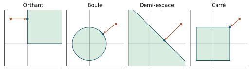
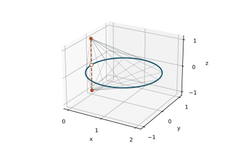
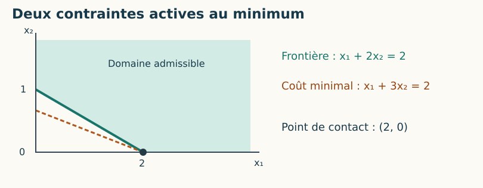
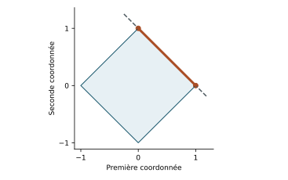

# X-ENS PSI — Mathématiques 2022 · Corrigé brut

*Corrigé rédigé par IA, non officiel. Signalez toute erreur.*

**Rédaction** · GPT-6.2 Astra Ultra · vitesse non renseignée

**Révision (tour 1)** · GPT-6.2 Astra Ultra · vitesse non renseignée · 26 novembre 2026

La garde porte les noms des Écoles normales supérieures et de l’École polytechnique. Les sept pages numérotées du sujet suivent la garde dans le PDF de huit pages. Les questions portent sur la projection, les points extrémaux, les cônes polaires et les solutions parcimonieuses. Durée de l’épreuve, quatre heures.

La composition du 25 avril 2022 part de la projection euclidienne et aboutit à la construction de solutions peu denses d’un système linéaire. Les 26 numéros donnent ici 32 réponses en séparant les quatre projections de la question 4 et les subdivisions des questions 9 et 20. [Sujet officiel](https://ens-paris-saclay.fr/sites/default/files/CONCOURS/ANNALES_1C/1C_PSI/2022_Sujet_Ecrit_PSI_Math%C3%A9matiques.pdf) · [Rapport du jury](https://ens-paris-saclay.fr/sites/default/files/CONCOURS/ANNALES_1C/1C_PSI/2022_Rapport_Ecrit_PSI_Maths.pdf)

## I. Projection et séparation

### Question 1

Fixons $y_0\in C$. La recherche peut être restreinte à $C\cap\overline B(x,\|x-y_0\|)$ puisque les points extérieurs ont une distance strictement supérieure à celle de $y_0$. Cette partie non vide est compacte en dimension finie, donc la distance continue y atteint son minimum. Pour deux minimiseurs $y,z$ de distance $r$, le milieu est admissible et
$$\left\|x-\frac{y+z}{2}\right\|^2=r^2-\tfrac14\|y-z\|^2.$$
La minimalité impose $y=z$. Si $x\in C$, la distance minimale est zéro et sa projection est $x$. Réciproquement, une projection appartient toujours à $C$.

### Question 2

Si $y=\operatorname{proj}_C x$ et $z\in C$, la fonction $t\mapsto\|x-y-t(z-y)\|^2$ atteint en zéro son minimum sur $[0,1]$ car $C$ est convexe. Sa dérivée à droite y est $-2(x-y)\cdot(z-y)\ge0$. Réciproquement, si $y\in C$ vérifie la condition, alors
$$\|x-z\|^2=\|x-y\|^2-2(x-y)\cdot(z-y)+\|z-y\|^2\ge\|x-y\|^2$$
pour chaque $z\in C$. C’est bien l’unique projeté.

### Question 3

Posons $y_j=\operatorname{proj}_C x_j$. La question 2 donne $(x_1-y_1)\cdot(y_1-y_2)\ge0$ et $(x_2-y_2)\cdot(y_1-y_2)\le0$. En soustrayant, $(x_1-x_2)\cdot(y_1-y_2)\ge\|y_1-y_2\|^2$. Par Cauchy–Schwarz, si $y_1\ne y_2$ on peut diviser par $\|y_1-y_2\|$ et obtenir $\|y_1-y_2\|\le\|x_1-x_2\|$. Si les projetés coïncident, cette dernière inégalité reste vraie. La projection est lipschitzienne, donc continue.

### Question 4i

Sur l’orthant positif, la distance au carré est la somme des $(x_i-y_i)^2$ avec des contraintes indépendantes $y_i\ge0$. Le minimum de la composante $i$ est atteint en $x_i$ si $x_i\ge0$, et en zéro sinon. Ainsi $(\operatorname{proj}_Cx)_i=\max(x_i,0)$.

### Question 4ii

Pour $\|x\|\le1$ la projection est $x$. Si $\|x\|>1$, tout $y$ de la boule vérifie $\|x-y\|\ge\|x\|-\|y\|\ge\|x\|-1$. L’égalité est atteinte pour $y=x/\|x\|$. Cela donne la projection.

### Question 4iii

Avec $e=(1,\ldots,1)$ et $s=e\cdot x$, le point est fixé si $s\le1$. Sinon posons $y=x-[(s-1)/d]e$. Alors $e\cdot y=1$ et pour tout $z\in C$, $(x-y)\cdot(z-y)=[(s-1)/d](e\cdot z-1)\le0$. Par 2, la formule générale est $\operatorname{proj}_C x=x-\max(s-1,0)e/d$.

Par exemple, en dimension deux, $(3,0)$ se projette en $(2,-1)$. Les deux coordonnées ont subi le même déplacement et leur somme vaut un. La correction agit donc aussi sur une coordonnée initialement nulle.

### Question 4iv

La somme des carrés se minimise indépendamment en chaque coordonnée. Sur $[-1,1]$, le nombre le plus proche de $x_i$ est $-1$ pour $x_i<-1$, $x_i$ pour $|x_i|\le1$ et $1$ pour $x_i>1$. Ainsi $(\operatorname{proj}_Cx)_i=\max(-1,\min(x_i,1))$.

### Question 5

Pour $u_j=y_j-x_j$ avec $y_j\in D,x_j\in C$, une combinaison convexe des deux différences est la différence des mêmes combinaisons convexes dans $D$ et dans $C$. Ainsi $D-C$ est convexe. Si $y_n-x_n\to u$, la compacité de $C$ permet d’extraire $x_{n_j}\to x\in C$. Alors $y_{n_j}\to u+x\in D$ par fermeture de $D$, d’où $u\in D-C$. L’ensemble est fermé. Enfin $0\in D-C$ équivaudrait à une intersection non vide de $C,D$.

### Question 6

Soit $p=\operatorname{proj}_{D-C}(0)$. Par 5, ce vecteur existe et n’est pas nul. La question 2 impose $(-p)\cdot(z-p)\le0$, donc $p\cdot z\ge\|p\|^2$ pour tout $z\in D-C$. En prenant $z=y-x$ on obtient $p\cdot x\le p\cdot y-\varepsilon$, avec $\varepsilon=\|p\|^2>0$.

### Question 7

Tout $x\in C$ satisfait les inégalités par définition du supremum. Soit $x\notin C$ et posons $y=\operatorname{proj}_C x$, $p=x-y\ne0$. Pour $z\in C$, la question 2 donne $p\cdot z\le p\cdot y$, donc $\sigma_C(p)=p\cdot y$ est finie et atteinte. Mais $p\cdot x=p\cdot y+\|p\|^2>\sigma_C(p)$. Ce point extérieur échoue au test de la normale $p$. Les directions où $\sigma_C=+\infty$ ne restreignent pas l’intersection.

### Question 8

Notons $C=\overline A$, convexe puisque les combinaisons convexes passent à la limite. Si $x\notin C$, la question 2 avec $z=\operatorname{proj}_Cx$ donne $p=z-x\ne0$ et $p\cdot y\ge p\cdot z>p\cdot x$ pour $y\in A$.

Si $x\in C\setminus A$, montrons qu’il est au bord de $C$. S’il était intérieur, on pourrait placer dans une boule de $C$ autour de $x$ un simplexe de dimension $d$ dont $x$ est le barycentre, par exemple en prenant pour directions $e_1,\ldots,e_d,-\sum_i e_i$ à la même petite échelle. Approchons chacun de ses sommets par des points de $A$. Les poids barycentriques de $x$ restent strictement positifs pour une approximation assez fine, car ils s’obtiennent en inversant une matrice non singulière dépendant continûment des sommets. La convexité donnerait alors $x\in A$. Cette contradiction exclut l’intérieur et couvre aussi le cas où $C$ est contenu dans un sous-espace affine propre.

Prenons donc $x_n\notin C$ tendant vers $x$ et $z_n=\operatorname{proj}_Cx_n$. Puisque $x\in C$, $\|z_n-x_n\|\le\|x_n-x\|$, d’où $z_n\to x$. Les vecteurs unitaires $p_n=(z_n-x_n)/\|z_n-x_n\|$ ont une sous-suite convergente de limite $p$ unitaire. Pour tout $y\in C$, $p_n\cdot(y-z_n)\ge0$ par 2. Le passage à la limite donne $p\cdot x\le p\cdot y$ pour tout $y\in A$.

Dans le cas de dimension affine strictement inférieure à $d$, on peut raccourcir le passage à la limite. Si $x\in\overline A$, il appartient à l’enveloppe affine de $A$, qui est fermée. Un vecteur unitaire orthogonal à sa direction vérifie alors $p\cdot x=p\cdot y$ pour tout $y\in A$. Cet exemple explique pourquoi le signe large figure dans la conclusion.

## II. Points extrémaux

### Question 9a

Les poids nuls peuvent être supprimés. Avec un seul poids restant, le résultat est immédiat. Pour $I\ge2$ poids positifs, $1-\lambda_I>0$ et le barycentre des $I-1$ premiers points avec poids $\lambda_i/(1-\lambda_I)$ est dans $A$ par récurrence. La combinaison de ce point et de $x_I$ avec poids $1-\lambda_I,\lambda_I$ appartient à $A$ par convexité.

### Question 9b

Si $\lambda_i=1$, le barycentre est $x_i$. Pour $0<\lambda_i<1$, le barycentre $z$ des autres points renormalisés est dans $A$ par 9a. Alors $x=\lambda_i x_i+(1-\lambda_i)z$. L’extrémalité force $x_i=z$ puis $x_i=x$, comme annoncé.

### Question 10

Toute combinaison convexe de deux combinaisons convexes finies de points de $E$ est encore de cette forme, en multipliant les deux listes de poids et en les concaténant. Donc $\operatorname{co}(E)$ est convexe et contient $E$ par les combinaisons à un point. Tout convexe contenant $E$ contient ses combinaisons finies par 9a. L’enveloppe est donc minimale. Si $x$ est extrémal dans cette enveloppe, dans l’une de ses représentations finies au moins un poids est positif et le point de $E$ correspondant est $x$ par 9b. Pour $E$ vide, l’enveloppe et ses points extrémaux sont vides.

### Question 11

Les sommets $(0,0,\pm1)$ sont les uniques maximiseurs de $\pm z$ sur $A$, donc sont extrémaux. Sur le cercle, fixons $v_\theta=(1+\cos\theta,\sin\theta,0)$ et $p=(\cos\theta,\sin\theta,0)$. Pour $v_t$ du cercle, $p\cdot v_t=\cos\theta+\cos(t-\theta)$, maximal seulement en $v_\theta$. Si $v_\theta\ne0$, ce maximum $1+\cos\theta$ est strictement positif et dépasse la valeur nulle aux deux sommets. Le maximum est donc unique aussi sur l’enveloppe convexe, ce qui expose $v_\theta$ et assure son extrémalité. L’origine est le milieu des deux sommets, donc n’est pas extrémale. Par 10, il n’y a pas d’autre point extrémal. Le cercle privé de son point de tangence avec l’axe vertical contient une suite convergeant vers l’origine. L’ensemble des points extrémaux est donc non vide et non fermé.

### Question 12

Le polyèdre $A$ est une intersection finie de demi-espaces fermés convexes. Si les normales actives en $x$ n’engendrent pas $\mathbb R^d$, choisissons $h\ne0$ orthogonal à toutes. Pour les indices actifs, $p_i\cdot(x\pm th)=b_i$. Pour les autres, il y a une marge strictement positive $b_i-p_i\cdot x$ et leur nombre est fini. Ainsi, pour $t>0$ assez petit, $t|p_i\cdot h|$ est inférieur à toutes les marges correspondantes. Les deux points distincts $x\pm th$ sont admissibles et ont $x$ pour milieu.

Réciproquement, si $x=(1-\lambda)y+\lambda z$ pour $0<\lambda<1$ et $y,z\in A$, toute contrainte active en $x$ est active en $y$ et $z$ car les deux valeurs sont au plus $b_i$ et leur moyenne pondérée vaut $b_i$. Si les normales actives engendrent tout l’espace, $y-z$, orthogonal à chacune, est nul. C’est bien l’équivalence. Enfin, si deux points extrémaux ont la même liste active, leur différence est également orthogonale à un système de rang $d$, donc ils coïncident. L’injection dans les parties de $\{1,\ldots,k\}$ fournit la borne $2^k$.

Pour rendre le pas commun explicite, soit $H$ l’ensemble des contraintes inactives dont la normale a un produit non nul avec $h$. Si $H$ est non vide, choisir $t=\tfrac12\min_{i\in H}(b_i-p_i\cdot x)/|p_i\cdot h|$. Si $H$ est vide, prendre $t=1$. Cela traite aussi le polyèdre entier lorsque toutes les normales sont nulles.

### Question 13

La fonction $x\mapsto p\cdot x$ continue atteint son minimum $m$ sur le compact non vide $K$. L’ensemble $K_p=K\cap\{x:p\cdot x=m\}$ est non vide, fermé et convexe. Si $x\in K_p$ est un barycentre strict de $y,z\in K$, les valeurs en $y,z$ sont toutes deux au moins $m$ et leur moyenne vaut $m$. Elles valent donc $m$ et les deux points appartiennent à $K_p$. Si $x$ est extrémal dans $K_p$, ils doivent coïncider. Ainsi $x$ est extrémal dans $K$.

### Question 14

La fonction $x\mapsto\|x\|^2$ atteint son maximum sur $K$ en un point $v$. Si $v=(1-\lambda)y+\lambda z$ avec $0<\lambda<1$ et $y\ne z$, alors
$$\|v\|^2=(1-\lambda)\|y\|^2+\lambda\|z\|^2-\lambda(1-\lambda)\|y-z\|^2<\|v\|^2,$$
où la dernière comparaison utilise la maximalité aux deux points. Une telle représentation est impossible. Donc $v\in\operatorname{Ext}(K)$.

### Question 15

L’inclusion $\operatorname{co}(\operatorname{Ext}K)\subset K$ vient de la convexité. Pour l’autre sens, raisonnons par récurrence sur la dimension affine $m$ de $K$, en munissant son enveloppe affine de la métrique euclidienne induite. Pour $m=0$, $K$ est un singleton. Pour $m>0$, soit $x$ un point de son bord relatif. Approchons $x$ par des points de l’enveloppe affine extérieurs à $K$. Comme dans la preuve de 8, les directions unitaires vers leurs projetés ont une sous-suite convergeant vers une normale unitaire $p$ dans l’espace directeur. On a $p\cdot(y-x)\ge0$ pour tout $y\in K$. La face $K_p$ contient donc $x$ et est de dimension au plus $m-1$, car elle est contenue dans un hyperplan propre de l’enveloppe affine. Par récurrence, puis par 13, $x$ est combinaison convexe de points extrémaux de $K_p$, donc de $K$.

Si $x$ est intérieur relativement, une droite de l’enveloppe affine passant par $x$ coupe $K$ suivant un segment fermé borné dont $x$ est intérieur. Les deux extrémités sont au bord relatif et ont déjà la représentation voulue. Leur barycentre $x$ l’a donc aussi, sans aucune prise d’adhérence.

Le choix d’une normale dans la direction de l’enveloppe affine est décisif. Si elle était constante sur tout $K$, elle serait orthogonale à tous les $y-x$ pour $y\in K$, donc au sous-espace qu’ils engendrent. Comme elle appartient à ce sous-espace et y est unitaire, c’est impossible. La face retenue est donc propre et la récurrence descend effectivement.

## III. Cônes polaires et dualité linéaire

### Question 16

Pour chaque $x\in E$, $\{p:p\cdot x\ge0\}$ est un cône convexe fermé. Leur intersection $E^+$ conserve ces trois propriétés et contient zéro. Appliqué à $E^+$, le même argument les donne pour $E^{++}$. Si $x\in E$, chaque $p\in E^+$ satisfait $x\cdot p\ge0$ par définition, donc $x\in E^{++}$.

### Question 17

Si $E=E^{++}$, la question 16 conclut. Supposons $E$ cône convexe fermé non vide et $x\notin E$. Soit $y=\operatorname{proj}_E x$ et $p=y-x\ne0$. La question 2 donne $p\cdot(z-y)\ge0$ pour $z\in E$. En prenant $z=0$ puis $z=2y$, admissibles dans le cône, on obtient $p\cdot y=0$. D’où $p\cdot z\ge0$ pour tout $z\in E$, mais $p\cdot x=p\cdot(y-p)=-\|p\|^2<0$. Ainsi $p\in E^+$ et $x\notin E^{++}$. Avec 16 cela démontre l’égalité.

### Question 18

Le cône $F$ est stable par addition et multiplication par un scalaire positif ou nul, donc convexe. Dans une représentation $v=\sum_i\lambda_i\xi_i$, supprimons les poids nuls. Si les générateurs restants sont liés, prenons une relation $\sum_i a_i\xi_i=0$ dont un coefficient est positif, quitte à changer tous les signes. Pour $t=\min_{a_i>0}\lambda_i/a_i$, les coefficients $\lambda_i-ta_i$ restent positifs ou nuls et l’un d’eux devient nul. La somme reste $v$. Après un nombre fini d’étapes, chaque élément de $F$ s’écrit donc sur une sous-famille indépendante, la famille vide donnant zéro.

Pour une telle sous-famille, l’application des coordonnées vers son espace engendré est un isomorphisme. Elle envoie l’orthant fermé sur un ensemble fermé de cet espace, lequel est fermé dans $\mathbb R^d$. Le cône $F$ est réunion d’un nombre fini de ces cônes fermés, donc fermé. Son polaire est exactement $\{x:\xi_i\cdot x\ge0\ \forall i\}$, comme on le vérifie sur les générateurs puis leurs combinaisons positives. Par 17, $F=F^{++}$, ce qui est l’équivalence demandée.

On peut aussi lire la fermeture sur une suite convergente $v_n$. Après réduction des supports et extraction, un même support libre $S$ convient pour tous les $v_n$. La matrice $B$ de ses colonnes a $B^{\mathsf T}B$ inversible. Les coefficients sont $(B^{\mathsf T}B)^{-1}B^{\mathsf T}v_n$ et convergent donc vers des coefficients positifs ou nuls. Lorsque $S$ est vide sur la sous-suite, sa limite vaut zéro. L’argument évite de supposer bornés les coefficients d’une représentation quelconque.

### Question 19

Pour $x\ge0$, $Mx\le b$, $q\le0$ et $M^{\mathsf T}q\le p$, on a $p\cdot x\ge (M^{\mathsf T}q)\cdot x=q\cdot Mx\ge q\cdot b$. Passer à l’infimum en $x$ puis au supremum en $q$ donne $\alpha\ge\beta$. Si l’un des ensembles admissibles est vide, la conclusion suit aussi avec les conventions données.

### Question 20a

Soit $z$ satisfaisant les conditions indiquées. Pour $j\in J$, $x_j+tz_j\ge0$ lorsque $t\ge0$. Pour $i\in I$, $M_i\cdot(x+tz)\le b_i$. Aux autres indices, les contraintes ont une marge stricte. Leur nombre étant fini, on peut prendre un même $t>0$ assez petit pour conserver toutes ces marges, y compris la positivité des coordonnées initialement strictement positives. La minimalité donne $p\cdot(x+tz)\ge p\cdot x$, donc $p\cdot z\ge0$.

On peut prendre pour majorants de $t$ les rapports $x_j/(-z_j)$ lorsque $x_j>0$ et $z_j<0$, puis $(b_i-M_i\cdot x)/(M_i\cdot z)$ lorsque $i\notin I$ et $M_i\cdot z>0$. Chacun est strictement positif. Choisir la moitié du minimum de ces rapports et de $1$ suffit dans tous les cas.

### Question 20b

Les directions de 20a forment le polaire du cône engendré par $e_j$ pour $j\in J$ et $-M_i$ pour $i\in I$. D’après 18, $p$ appartient à ce cône. Écrivons
$$p=\sum_{j\in J}s_je_j-\sum_{i\in I}t_i M_i,\qquad s_j,t_i\ge0.$$
La formule subsiste avec des sommes vides, le cône sans générateur étant $\{0\}$. Posons $q_i=-t_i$ sur $I$ et $q_i=0$ ailleurs. Alors $q\le0$ et $p-M^{\mathsf T}q$ est le vecteur positif formé par les $s_j$, nul hors de $J$. Son produit avec $x$ vaut donc zéro. De même $q\cdot(Mx-b)=0$ puisque $Mx-b$ est nul sur $I$. Toutes les conditions de complémentarité sont obtenues.

### Question 20c

La seconde complémentarité donne $p\cdot x=q\cdot Mx$ et la première donne $q\cdot Mx=q\cdot b$. Comme $x$ réalise $\alpha$ et $q$ est admissible au dual, $\alpha=b\cdot q\le\beta$. La borne opposée vient de 19, d’où $b\cdot q=\alpha=\beta$, avec maximum dual atteint.

Vérifions les signes sur la contrainte $-x_1-2x_2\le-2$, avec $x\ge0$ et $p=(1,3)$. Tout point admissible vérifie $x_1+3x_2=(x_1+2x_2)+x_2\ge2$. Au point $x=(2,0)$, le multiplicateur $q=-1$ donne $M^{\mathsf T}q=(1,2)$ et $p-M^{\mathsf T}q=(0,1)$. Les deux produits de complémentarité sont nuls et $bq=2$.

## IV. Minimisation de la norme ℓ¹ et nombre de coordonnées non nulles

### Question 21

Pour $\|y\|_\infty\le1$, $x\cdot y\le\sum_i|x_i|=\|x\|_1$. L’égalité est atteinte pour $y_i=\operatorname{sgn}(x_i)$, en posant le signe de zéro égal à zéro. Pour $\|y\|_1\le1$, $x\cdot y\le\|x\|_\infty\sum_i|y_i|\le\|x\|_\infty$. Si $x\ne0$, prendre $y=\operatorname{sgn}(x_j)e_j$ avec $|x_j|=\|x\|_\infty$ donne l’égalité. Pour $x=0$, $y=0$ suffit.

### Question 22

Le rang $k$ rend $M$ surjective, donc $L=\{x:Mx=b\}$ est un espace affine fermé non vide et l’infimum $r$ est fini. Prenons une suite de $L$ dont les normes tendent vers $r$. Elle est bornée, admet une sous-suite convergente, et la limite appartient à $L$ et a norme $r$ par continuité. Ainsi $C$ est non vide. Par minimalité, $C=L\cap\{x:\|x\|_1\le r\}$, intersection fermée convexe bornée. Enfin $r>0$, car un minimiseur de norme nulle serait zéro alors que $b\ne0$.

### Question 23

Notons $B=\{v:\|v\|_1<r\}$ et $L=\{z:Mz=b\}$. Le convexe $L-B$ est non vide et ne contient pas zéro, par minimalité de $r$. La question 8 fournit $q\ne0$ tel que $q\cdot z\ge q\cdot v$ pour tous $z\in L,v\in B$. Pour $z=x+th$, $h\in\ker M$, l’inégalité vaut pour tout $t\in\mathbb R$, donc $q\cdot h=0$. En prenant le supremum sur la boule ouverte, égal à $r\|q\|_\infty$ par 21 et par approximation des points du bord, on obtient
$$q\cdot x\ge r\|q\|_\infty=\|x\|_1\|q\|_\infty\ge q\cdot x.$$
Chaque écart $\|q\|_\infty|x_i|-q_ix_i$ est non négatif. Leur somme étant nulle, ils sont tous nuls, comme demandé.

Pour préciser l’extraction d’un vecteur de la boule ouverte, choisir $j$ tel que $|q_j|=\|q\|_\infty$ et $v_\delta=(1-\delta)r\,\operatorname{sgn}(q_j)e_j$, où $0<\delta<1$. Son produit avec $q$ tend vers $r\|q\|_\infty$. La séparation reste valable dans la limite, alors même que la boule ouverte ne contient pas ce point de contact.

### Question 24

Par 23, $x$ satisfait les conditions et appartient à $K$. Pour $y\in K$, toute coordonnée $y_i\ne0$ implique $x_i\ne0$, donc $|q_i|=\|q\|_\infty$ par 23. En outre $q_i y_i\ge0$. Ainsi $q\cdot y=\|q\|_\infty\|y\|_1$. Comme $M(y-x)=0$ et que $q\perp\ker M$, $q\cdot y=q\cdot x=\|q\|_\infty r$. En divisant par $\|q\|_\infty>0$, on trouve $\|y\|_1=r$, d’où $K\subset C$.

### Question 25

Supposons $Mh=0$ et $h_i=0$ lorsque $y_i=0$. Pour tout $i$ où $h_i\ne0$, $y_i\ne0$. Prenons un même $t>0$ assez petit pour que $t|h_i|<|y_i|$ sur cet ensemble fini (tout $t>0$ convient si $h=0$). Alors $y\pm th$ ont les mêmes signes que $y$ et s’annulent sur $I_0(y)$, qui contient $I_0(x)$. Les égalités affines $M(y\pm th)=b$ subsistent. Les deux points sont dans $K$ et leur milieu est $y$. L’extrémalité impose leur égalité, donc $h=0$.

### Question 26

Soit $S=I_+(y)\cup I_-(y)$. La question 25 dit que la restriction de $M$ au sous-espace $V_S$ des vecteurs nuls hors de $S$ est injective. Ainsi $|S|=\dim V_S\le\operatorname{rg} M=k$. Il reste à vérifier que l’on dispose d’un tel $y$. L’ensemble $K$ est fermé convexe par ses contraintes affines et ses demi-espaces. Il est non vide et borné par 24 et 22. La question 14 lui donne un point extrémal. Celui-ci résout $My=b$, minimise la norme $\ell^1$ et a au plus $k$ coordonnées non nulles.

En termes de colonnes, toute relation entre les $M e_i$ pour $i\in S$ se prolonge par zéro en un vecteur $h$ comme en 25. Ces colonnes sont donc indépendantes. Par exemple, dans le dessin, les minimiseurs intérieurs du segment ont deux coordonnées strictement positives pour une seule équation. Ce sont les deux extrémités qui atteignent la borne de support.
