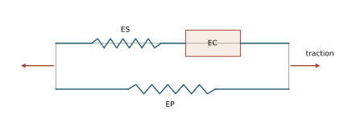
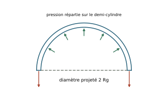
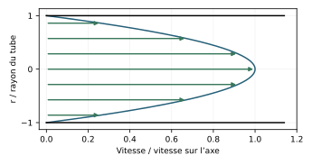
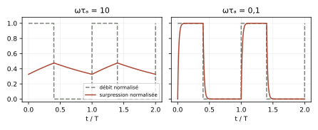
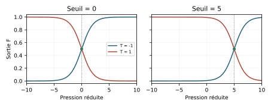
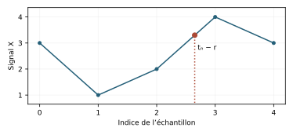

# X-ENS PSI · Modélisation 2022 · Corrigé guidé

*Corrigé rédigé par IA, non officiel. Signalez toute erreur.*

**Rédaction** · GPT-6.2 Astra Ultra · vitesse non renseignée · 24 novembre 2026

**Révision** · GPT-6.2 Astra Ultra · vitesse non renseignée · 25 novembre 2026

**Révision (tour 2)** · GPT-6.2 Astra Ultra · vitesse non renseignée · 26 novembre 2026

## Repères de résolution

En biomécanique, identifier la grandeur imposée avant de déduire le signe des variations de contrainte. En hydraulique, fixer le sens positif du débit et utiliser le rayon donné. Dans la partie numérique, le pas est exprimé en secondes, les échantillons antérieurs au début du signal sont nuls et les sorties se calculent dans l’ordre des flèches de la figure 23.

## Partie 1 · Présentation de l’étude

### Question 1 · Quels usages pour un modèle cardiaque ?

**Indication.** Distinguer une aide au diagnostic d’une comparaison de prises en charge.

#### Solution

Un modèle ajusté à l’imagerie peut, par exemple, relier une anomalie du mouvement de la paroi à une diminution de la fraction d’éjection. Un second usage est de comparer virtuellement deux configurations d’une prothèse valvulaire et leur effet sur le débit et les gradients de pression. Le premier exemple interprète des observations, le second étudie les conséquences d’une intervention avant sa réalisation.

### Question 2 · Fréquence et pulsation

**Indication.** Convertir les battements par minute en cycles par seconde avant de multiplier par $2\pi$.

#### Solution

Les extrêmes de fréquence sont $40/60=0,667\ \mathrm{Hz}$ et $180/60=3,00\ \mathrm{Hz}$. Comme $\omega=2\pi f$, la pulsation varie de $4,19$ à $18,8\ \mathrm{rad/s}$ à trois chiffres significatifs. La suite du sujet utilise l’intervalle arrondi de 4 à 20 rad/s.

## Partie 2 · Modélisation du myocarde

### Question 3 · Sarcomères en série

**Indication.** Additionner les longueurs et diviser l’allongement total par la longueur totale au repos.

#### Solution

Les $N$ sarcomères identiques donnent $l_c=Ns$ et $l_{c0}=Ns_0$. Donc $\varepsilon_c=(l_c-l_{c0})/l_{c0}=(s-s_0)/s_0$. La déformation relative d’un sarcomère est celle de tout l’élément en série.

### Question 4 · Contractions pendant l’expérience

**Indication.** Examiner ce que fixe la butée avant et après le soulèvement.

#### Solution

En phase 4, la butée impose encore la longueur du muscle tandis que sa traction monte jusqu’à équilibrer les deux poids. La contraction est isométrique. En phase 5, la butée ne porte plus la charge, le mouvement est lent et la traction équilibre des poids constants alors que le muscle se raccourcit. La contraction est isotonique.

### Question 5 · Contraintes dans le montage de Hill

**Indication.** L’effort est le même en série et les efforts s’ajoutent en parallèle.

#### Solution

Pour une même section de référence $S_f$ et en négligeant l’inertie, l’équilibre de la jonction en série donne $\sigma_s=\sigma_c$. Les deux branches parallèles transmettent ensemble $\sigma=\sigma_c+\sigma_p$. Les contraintes sont comptées positives en traction.

### Question 6 · Compatibilité des déformations

**Indication.** Les longueurs s’ajoutent en série, mais les déformations sont pondérées par les longueurs au repos.

#### Solution

Les branches parallèles ont la même longueur $l=l_p=l_s+l_c$ et $l_{p0}=l_{s0}+l_{c0}$. Avec $a=l_{c0}/l_{p0}$, l’égalité des allongements donne $\varepsilon=\varepsilon_p=(1-a)\varepsilon_s+a\varepsilon_c$. Ainsi $\varepsilon_s=(\varepsilon_p-a\varepsilon_c)/(1-a)$, avec $0<a<1$.



### Question 7 · Évolution de l’élément actif

**Indication.** Utiliser les signes des variations de la tension du ressort parallèle puis la compatibilité des longueurs.

#### Solution

En contraction isométrique, la longueur globale est fixe. La tension parallèle reste fixe, tandis que la tension totale augmente. Donc $\sigma_c=\sigma_s$ augmente, le ressort série s’allonge et $l_c$ diminue. En contraction isotonique, la longueur globale décroît à tension totale constante. Le ressort parallèle se détend, donc $\sigma_p$ diminue, $\sigma_c=\sigma-\sigma_p$ augmente et le ressort série s’allonge. L’élément contractile raccourcit d’autant plus que sa longueur doit compenser cet allongement.

### Question 8 · Borne sur le taux de raccourcissement

**Indication.** Dans la phase isométrique active, $\dot\sigma_c\ge0$ et $\dot\varepsilon_c\le0$.

#### Solution

En posant $v=|\dot\varepsilon_c|$, la loi de la page 7 donne $\dot\sigma_c=k_cu-(\lambda_c\sigma_c+\nu_c)v$. Pour des constantes positives et une traction positive,

$$
0\le v\le\frac{k_cu}{\lambda_c\sigma_c+\nu_c}\le\frac{k_cu_{\max}}{\nu_c}.
$$

La première borne supérieure est celle correspondant à l’état instantané. La dernière est le maximum permis par le modèle sur toute la phase, approché pour une faible traction et une activation maximale. Une contrainte initiale non nulle peut diminuer le maximum effectivement atteint.

### Question 9 · Relaxation isotonique

**Indication.** Lors de l’allongement global, le ressort parallèle prend davantage de charge et l’élément contractile se décharge.

#### Solution

La tension totale reste constante. Alors $\dot\sigma_p>0$, $\dot\sigma_c<0$, le ressort série se détend et $v=\dot\varepsilon_c>0$. La loi active devient $\dot\sigma_c=(\nu_c-\lambda_c\sigma_c)v+k_cu$. L’inégalité de relaxation impose

$$
\sigma_c>\frac{\nu_c+k_cu/v}{\lambda_c}.
$$

L’égalité marque la limite où la décroissance de contrainte s’arrête. Sur le plateau $u=-u_{\min}$, la borne inférieure est $(\nu_c-k_cu_{\min}/v)/\lambda_c$. Pour que cette borne soit positive, il faut $k_cu_{\min}<\nu_c v$ pendant la phase considérée. Sa valeur dépend de la vitesse d’allongement. La figure 8 seule ne fixe donc aucune valeur numérique unique de la contrainte minimale.

### Question 10 · Loi élastique linéaire

**Indication.** Remplacer chacune des deux contraintes passives par son module multiplié par sa déformation.

#### Solution

On a $\sigma_p=E_p\varepsilon$ et $\sigma_s=E_s(\varepsilon-a\varepsilon_c)/(1-a)$. Leur somme donne

$$
\sigma=\left(E_p+\frac{E_s}{1-a}\right)\varepsilon-\frac{aE_s}{1-a}\varepsilon_c .
$$

Ainsi $K=E_p+E_s/(1-a)$ et $K_c=-aE_s/(1-a)$. Pour une longueur globale fixe, un raccourcissement de l’élément actif augmente bien la tension.

### Question 11 · Loi élastique non linéaire

**Indication.** Intégrer l’équation en prenant la déformation comme variable indépendante.

#### Solution

La condition $\sigma_p(0)=0$ et $\mathrm d\sigma_p/\mathrm d\varepsilon_p=\lambda_p\sigma_p+E_p$ donnent

$$
\sigma_p=\frac{E_p}{\lambda_p}\bigl(e^{\lambda_p\varepsilon_p}-1\bigr),\qquad
\sigma=\sigma_c+\frac{E_p}{\lambda_p}\bigl(e^{\lambda_p\varepsilon}-1\bigr).
$$

Lorsque $\lambda_p\to0$, la limite est $E_p\varepsilon_p$, ce qui retrouve la loi linéaire.

### Question 12 · Actions sur la masse

**Indication.** Orienter l’axe vers la gauche comme sur la figure 9.

#### Solution

Le ressort série tire la masse vers la gauche avec $+S_f\sigma_s$. L’élément contractile tire vers la droite avec $-S_f\sigma_c$. L’action visqueuse du sang vaut $-\eta S_f\dot x$ suivant cet axe. La pesanteur est négligée par hypothèse. La branche parallèle relie les deux extrémités sans agir directement sur la masse de la jonction.

### Question 13 · Équation du mouvement de la fibre

**Indication.** Exprimer l’abscisse de la masse par sa longueur de repos et sa déformation.

#### Solution

En projection, $m\ddot x=S_f(\sigma_s-\sigma_c)-\eta S_f\dot x$. Avec $x=l_c=l_{c0}(1+\varepsilon_c)$, on obtient

$$
\frac{m l_{c0}}{S_f}\ddot\varepsilon_c+\eta l_{c0}\dot\varepsilon_c=\sigma_s-\sigma_c .
$$

L’incompressibilité permet d’exprimer la masse totale de la fibre à partir du volume au repos $S_f l_{p0}$, avec la section de référence utilisée dans ce modèle.

### Question 14 · Identification des paramètres dynamiques

**Indication.** Substituer la contrainte du ressort série dans le bilan précédent puis diviser par le coefficient d’inertie.

#### Solution

Posons $M=m l_{c0}/S_f=\rho_m l_{c0}^2/a$. Avec $\sigma_s=E_s(\varepsilon-a\varepsilon_c)/(1-a)$,

$$
\ddot\varepsilon_c+\frac{\eta l_{c0}}M\dot\varepsilon_c+
\frac{aE_s}{(1-a)M}\varepsilon_c
=\frac{E_s}{(1-a)M}\varepsilon-\frac{\sigma_c}M.
$$

L’identification donne $\omega^2=a^2E_s/[(1-a)\rho_m l_{c0}^2]$, $\xi=\eta a/(2\omega\rho_m l_{c0})$, $\alpha=1/a$ et $\beta=-a/(\rho_m l_{c0}^2)$. Le signe négatif de $\beta$ correspond au sens de traction de l’élément actif sur la masse.

### Question 15 · Volumes du sang et de la paroi

**Indication.** Soustraire deux cylindres de même hauteur pour obtenir le volume de muscle.

#### Solution

Le rayon intérieur est $R_g$ et le rayon extérieur $R_g+e$. Le volume musculaire vaut $V_m=\pi H_g(2R_ge+e^2)\simeq2\pi H_gR_ge$ pour $e\ll R_g$. Le volume de sang est $V_g=\pi H_gR_g^2$.

### Question 16 · Incompressibilité de la paroi

**Indication.** Conserver le volume de muscle et distinguer relation exacte et paroi mince.

#### Solution

La hauteur étant fixe, $2R_ge+e^2=2R_{g0}e_0+e_0^2$. On en tire $e=\sqrt{R_g^2+2R_{g0}e_0+e_0^2}-R_g$. Au premier ordre en épaisseur, $eR_g=e_0R_{g0}$, donc $e\simeq e_0R_{g0}/R_g$.

### Question 17 · Déformation et débit ventriculaire

**Indication.** Une fibre circulaire a pour longueur $2\pi R_g$ à l’approximation de paroi mince.

#### Solution

Ainsi $\varepsilon=(R_g-R_{g0})/R_{g0}$ et $V_g=V_{g0}(1+\varepsilon)^2$. La variation du volume est $\dot V_g=2V_{g0}(1+\varepsilon)\dot\varepsilon$. Pendant l’éjection, le débit sortant compté positif vaut $Q_g=-\dot V_g$. Avec la convention d’un débit entrant positif, on obtient le signe opposé. Hors d’une phase à valve d’entrée ou de sortie fermée, la variation de volume ne donne que le débit net.

### Question 18 · Pression et tension de paroi

**Indication.** Intégrer la résultante de pression sur la surface projetée d’un demi-cylindre.

#### Solution

La poussée intérieure sur le demi-cylindre vaut $p\,2R_gH_g$. Les tractions sur les deux bords coupés valent ensemble $2\sigma eH_g$. L’équilibre donne $\sigma=pR_g/e$. En utilisant l’incompressibilité en paroi mince,

$$
K_o=\frac{\sigma}{p}\simeq\frac{R_{g0}}{e_0}(1+\varepsilon)^2.
$$

La pression est ici celle relative à l’extérieur.



### Question 19 · Relier l’activation à la pression et au débit

**Indication.** Assembler une équation d’activation, la dynamique de la masse, la loi de paroi et la géométrie du ventricule.

#### Solution

La loi active est $\dot\sigma_c=-\lambda_c\sigma_c|\dot\varepsilon_c|+\nu_c\dot\varepsilon_c+k_cu$. Elle se couple à l’équation de la question 14 pour $\varepsilon_c$. À l’extrémité reliée au ressort série, $\sigma=\sigma_s+\sigma_p$, avec $\sigma_s=E_s(\varepsilon-a\varepsilon_c)/(1-a)$ et la loi parallèle linéaire ou exponentielle de la question 11. Si l’inertie est maintenue, la différence $\sigma_s-\sigma_c$ est précisément celle de la question 13. À l’autre extrémité la traction est $\sigma_c+\sigma_p$. À l’équilibre quasi statique, $\sigma_s=\sigma_c$ et les deux expressions coïncident.

Les sorties s’obtiennent par $p=\sigma/K_o(\varepsilon)$ et $Q_g=-2V_{g0}(1+\varepsilon)\dot\varepsilon$ pour l’éjection. Ces relations constituent un modèle de couplage. Pour déterminer simultanément $p$ et $Q_g$ pour une activation prescrite, il faut aussi des conditions initiales et une relation de charge extérieure, par exemple entre la pression aortique et le débit à travers la valve. Une longueur imposée ou une pression imposée fermerait également le système.

## Partie 3 · Circulation sanguine

### Question 20 · Débits et vitesses aux deux échelles

**Indication.** Convertir les litres par minute en mètres cubes par seconde puis diviser par le nombre de conduites en parallèle.

#### Solution

Le débit aortique moyen est $5,7\,10^{-3}/60=9,5\,10^{-5}\ \mathrm{m^3/s}$. Avec $r_a=5$ mm, la vitesse moyenne est $Q_a/(\pi r_a^2)\simeq1,21\ \mathrm{m/s}$. Pour un milliard de capillaires supposés identiques et également irrigués, $Q_c=9,5\,10^{-14}\ \mathrm{m^3/s}$ par capillaire. Avec $r_c=4\ \mu\mathrm m$, on trouve $v_c\simeq1,89\,10^{-3}\ \mathrm{m/s}$, environ 1,9 mm/s.

### Question 21 · Nombre de Reynolds

**Indication.** Employer la vitesse moyenne dans un capillaire et son diamètre, avec les propriétés du fluide données.

#### Solution

$\mathrm{Re}=\rho_s v_c(2r_c)/\mu_s=10^3(1,89\,10^{-3})(8\,10^{-6})/10^{-3}\simeq1,51\,10^{-2}$. Ce très faible nombre caractérise un écoulement laminaire dominé par les effets visqueux, dans le modèle continu et newtonien proposé.

### Question 22 · Champ de vitesse pleinement développé

**Indication.** Séparer les conséquences de la stationnarité, de l’axisymétrie et du développement longitudinal.

#### Solution

Le tube est rectiligne et circulaire. L’écoulement stationnaire est indépendant du temps, axisymétrique et entraîné par une différence de pression axiale. Il ne présente ni rotation imposée ni traversée de la paroi. En régime établi loin de l’entrée, le profil ne dépend plus de $x$. On obtient $\vec v=v(r)\vec e_x$, avec $v(r_c)=0$ par adhérence et une pente nulle sur l’axe par symétrie.

### Question 23 · Forces sur un cylindre de liquide

**Indication.** Inclure les pressions sur les deux bases et le cisaillement sur la surface latérale.

#### Solution

Les pressions d’entrée et de sortie donnent une résultante axiale $\pi r^2(p_a-p_v)\vec e_x$. Les pressions normales de la surface latérale se compensent par symétrie. La force visqueuse axiale sur cette surface vaut $2\pi r L_c\mu_s v'(r)\vec e_x$, opposée au mouvement puisque $v'(r)<0$. Le poids est négligé.

### Question 24 · Profil de Poiseuille

**Indication.** En régime établi, la quantité de mouvement entrante égale la quantité sortante sur la tranche cylindrique.

#### Solution

L’équilibre axial donne $\pi r^2(p_a-p_v)+2\pi r L_c\mu_s v'(r)=0$. Ainsi

$$
\frac{\mathrm dv}{\mathrm dr}=-\frac{r(p_a-p_v)}{2\mu_s L_c}.
$$

Le coefficient $\lambda$ de la forme imprimée $v'=\lambda(p_a-p_v)r$ est donc négatif, $\lambda=-1/(2\mu_s L_c)$. En intégrant à partir de la paroi où la vitesse s’annule, $v(r)=(p_a-p_v)(r_c^2-r^2)/(4\mu_s L_c)$.



### Question 25 · Débit et résistance hydraulique

**Indication.** L’élément de section annulaire vaut $2\pi r\,\mathrm dr$.

#### Solution

L’intégration du profil donne

$$
Q=\int_0^{r_c}2\pi r v(r)\,\mathrm dr=\frac{\pi r_c^4}{8\mu_s L_c}(p_a-p_v),\qquad R_c=\frac{p_a-p_v}{Q}=\frac{8\mu_sL_c}{\pi r_c^4}.
$$

L’unité de résistance est $\mathrm{Pa\,s/m^3}$. Le quatrième pouvoir du rayon explique la grande sensibilité de cette résistance à la taille du vaisseau.

### Question 26 · Deux contributions à la puissance

**Indication.** Multiplier la perte de pression par le débit et le coût métabolique volumique par le volume.

#### Solution

Pour un capillaire, $P_t=(p_a-p_v)Q=8\mu_sL_cQ^2/(\pi r_c^4)$ et $P_m=\lambda_m\pi r_c^2L_c$. La puissance totale est leur somme. À débit fixé, le premier terme décroît avec le rayon tandis que l’entretien du volume de sang augmente.

### Question 27 · Rayon minimisant la puissance

**Indication.** Dériver la puissance par rapport au rayon en maintenant le débit et la longueur fixes.

#### Solution

En posant $P=A/r^4+Br^2$ avec $A=8\mu_s L_cQ^2/\pi$ et $B=\lambda_m\pi L_c$, la stationnarité impose $Br^6=2A$. Pour un débit positif,

$$
Q=K_Qr_c^3,\qquad K_Q=\frac{\pi}{4}\sqrt{\frac{\lambda_m}{\mu_s}}.
$$

Les deux termes de $P$ sont positifs, $P''=20A/r^6+2B>0$, et le point critique réalise le minimum unique. À ce point $P_m=2P_t$.

### Question 28 · Rayons dans une ramification

**Indication.** Appliquer la conservation du débit à toutes les branches filles, en conservant le même coefficient métabolique.

#### Solution

La loi de la question 27 donne $r_{\rm mère}^3=\sum_j r_{{\rm fille},j}^3$. L’aorte a un cube de rayon de $5^3=125\ \mathrm{mm^3}$. Les 40 grandes artères du tableau donnent $40\times1,5^3=135\ \mathrm{mm^3}$. L’écart est de 8 % du premier nombre. La loi est approximativement vérifiée à la précision de ces données anatomiques.

### Question 29 · Bilan du réservoir

**Indication.** Le liquide est incompressible mais le volume disponible varie avec la pression.

#### Solution

Le bilan sur une durée $\mathrm dt$ donne $\mathrm dV^*/\mathrm dt=Q_e-Q_s$. Un débit entrant supérieur au débit sortant dilate la chambre. Cette différence est donc possible même si la densité du fluide demeure constante.

### Question 30 · Équation de Windkessel

**Indication.** Écrire séparément la loi du réservoir et la perte de charge dans la résistance en sortie.

#### Solution

Avec $C_a=\mathrm dV^*/\mathrm dp^*$ et $Q_s=(p^*-p_s)/R_a$, la question 29 donne

$$
R_a C_a\,\dot p^*+p^*=p_s+R_a Q_e .
$$

La constante de temps est $\tau_a=R_aC_a$. Lorsque le clapet se ferme, on prend $Q_e=0$ et la surpression décroît exponentiellement.

### Question 31 · Réponse aux créneaux

**Indication.** Comparer la durée d’une période à la constante de temps, puis placer les asymptotes de chaque phase.

#### Solution

Pour un plateau de durée $T_h$ dans une période $T$, $Q_{\rm moy}=Q_{\max}T_h/T$. En régime périodique, $\langle p^*\rangle=p_s+R_aQ_{\rm moy}$. Durant le plateau, la pression tend exponentiellement vers $p_s+R_aQ_{\max}$ et, pendant la diastole, vers $p_s$, toujours avec la constante $\tau_a$.

À $\omega_1=10/\tau_a$, la période est $0,628\tau_a$ et la pression ondule autour de sa moyenne sans suivre entièrement les créneaux. À $\omega_2=1/(10\tau_a)$, la période est $62,8\tau_a$ et les deux plateaux deviennent presque accessibles si la fraction de systole est du même ordre que celle de la figure. On peut vérifier graphiquement les niveaux en résolvant le raccord aux deux commutations. Posons $a=e^{-T_h/\tau_a}$, $b=e^{-(T-T_h)/\tau_a}$ et $z=(p^*-p_s)/(R_aQ_{\max})$. Le plateau haut mène de $z_{\min}$ à $z_{\max}=1-a+az_{\min}$, puis le plateau bas ramène à $z_{\min}=bz_{\max}$. On obtient $z_{\max}=(1-a)/(1-ab)$ et $z_{\min}=b(1-a)/(1-ab)$. L’ordonnée moyenne vaut toujours $T_h/T$ par intégration du bilan sur une période.

Le tracé ci-dessous fixe $T_h/T=0,4$ pour illustrer les deux allures sur une phase normalisée.



### Question 32 · Impédance à quatre éléments

**Indication.** La figure 18 est une mise en série de deux dipôles parallèles.

#### Solution

En notant $s$ la variable de Laplace pour éviter la confusion avec la pression, le premier dipôle vaut $R_s L_s s/(R_s+L_s s)$ et le second $R_a/(1+R_a C_a s)$. En régime linéaire,

$$
Z(s)=\frac{R_sL_s s}{R_s+L_s s}+\frac{R_a}{1+R_a C_a s},\qquad p(s)=Z(s)Q_e(s).
$$

La pression de référence se mesure à la sortie. À fréquence nulle, $Z(0)=R_a$, et à très haute fréquence $Z\to R_s$.

### Question 33 · Effet de l’inertie sur la pression

**Indication.** Lire le creux de gain et les changements de phase dans la bande de 4 à 20 rad/s.

#### Solution

Sur la figure 19, le gain présente un minimum vers 6 à 7 rad/s, de l’ordre de 141 dB contre environ 160 dB aux extrémités du diagramme. Autour de cette pulsation une oscillation de débit engendre donc une composante de pression environ neuf à dix fois plus petite qu’au plateau de référence. Le déphasage est négatif avant le creux et positif après. Les différentes harmoniques du débit pulsé sont ainsi atténuées et décalées différemment. La forme du pouls de pression et le décalage de ses extrema changent avec la fréquence cardiaque.

## Partie 4 · Système nerveux autonome

### Question 34 · Échantillonnage temporel

**Indication.** Passer des battements par minute aux hertz avant d’appliquer le critère spectral.

#### Solution

$F_e=1/\Delta T$. Pour 250 battements/min, la fondamentale maximale est $250/60\simeq4,17$ Hz. Le théorème d’échantillonnage de Nyquist–Shannon impose $F_e>2f_{\max}\simeq8,33$ Hz, soit $\Delta T<0,120$ s. La valeur de 0,120 s en est la borne, l’égalité pouvant rendre une sinusoïde indiscernable pour certaines phases. La résolution des harmoniques réelles d’un ECG demande une période plus courte.

### Question 35 · Récurrence du second ordre

**Indication.** Appliquer la différence arrière deux fois au même indice pour la dérivée seconde.

#### Solution

Pour $h=\Delta T$, on emploie $\dot y_n\simeq(Y_n-Y_{n-1})/h$ et $\ddot y_n\simeq(Y_n-2Y_{n-1}+Y_{n-2})/h^2$. L’équation $\ddot y+a\dot y+by=x$ donne, pour $n\ge2$,

$$
Y_n=\frac{h^2X_n+(2+ah)Y_{n-1}-Y_{n-2}}{1+ah+bh^2}.
$$

Les conditions initiales fournissent les deux premières valeurs et le dénominateur doit être non nul.

### Question 36 · Filtre barométrique continu

**Indication.** Repasser dans le temps après avoir multiplié par le dénominateur du transfert.

#### Solution

La figure 22 donne $H(j\omega)=K_b/(1+j\omega\tau_b)$. La pression barométrique perçue obéit à $\tau_b\dot p_b(t)+p_b(t)=K_bp_a(t)$. Le gain statique est $K_b$ et la constante de temps est $\tau_b$.

### Question 37 · Récurrence du filtre barométrique

**Indication.** Évaluer l’équation continue au pas courant avec la différence arrière.

#### Solution

La substitution $\dot p_b(t_n)\simeq(Pb_n-Pb_{n-1})/h$ donne

$$
Pb_n=\frac{\tau_b Pb_{n-1}+hK_b Pa_n}{\tau_b+h}.
$$

Le filtre est causal puisqu’il utilise l’entrée présente et la sortie précédente. Pour $\tau_b>0$, le poids de la valeur passée reste compris entre zéro et un.

### Question 38 · Procédure de filtrage

**Indication.** Écrire uniquement dans la case demandée et traiter le passé nul avant le début du signal.

#### Solution

```python
import math
import numpy as np

def passe_bas_gain(n, Pa, Pb, tau, K, DT):
    precedent = Pb[n - 1] if n > 0 else 0.0
    Pb[n] = (tau * precedent + DT * K * Pa[n]) / (tau + DT)
```
Avec la convention d’une sortie initiale imposée à zéro, on appelle la procédure à partir de $n=1$. Le branchement rend aussi possible un calcul au pas 0 avec une préhistoire nulle.

### Question 39 · Deux sigmoïdes centrées en zéro

**Indication.** La valeur du dénominateur est 2 au centre, quel que soit le signe de la pente.

#### Solution

Avec $a_x=0$, $b_x=1$, $P_x^0=0$, on a $F_T(P)=1/(1+\exp(TP))$. Pour $T=-1$, la courbe croît de 0 à 1. Pour $T=1$, elle décroît de 1 à 0. Les deux courbes sont symétriques par rapport à la droite $F=1/2$ et passent par $(0,1/2)$. Les pentes à l’origine valent respectivement $+1/4$ et $-1/4$. Ces limites sont rapidement atteintes sur l’intervalle $[-10,10]$ du sujet.

### Question 40 · Seuil et sens des deux voies

**Indication.** Remplacer $P$ par $P-5$ et observer le signe de la dérivée en ce point.

#### Solution

Pour $P_x^0=5$, les deux courbes de la question 39 sont translatées de 5 vers la droite. $P_x^0$ a la dimension d’une pression. Il fixe la demi-réponse et le point d’inflexion, où $F=a_x+b_x/2$ et $F'=-b_xT_x/4$. Avec $b_x>0$, le signe de $T_x$ sélectionne une réponse croissante ou décroissante, sa valeur absolue règle la sensibilité locale. La saturation à basse et haute pression borne chaque sortie. La figure 23 et les paramètres du sujet donnent ainsi deux commandes de sens opposés à partir de la même pression.



### Question 41 · Calcul stable de la sigmoïde

**Indication.** Calculer une exponentielle à argument négatif pour les deux signes de la grandeur réduite.

#### Solution

```python
def sigmoide(n, Pb, Fx, ax, bx, Tx, P0x):
    z = Tx * (Pb[n] - P0x)
    e = math.exp(-abs(z))
    f = e / (1.0 + e) if z >= 0.0 else 1.0 / (1.0 + e)
    Fx[n] = ax + bx * f
```
Les deux écritures représentent $1/(1+e^z)$ et évitent le débordement numérique quand $z$ est très positif. Pour $T_x=0$, le résultat est exactement le milieu des deux asymptotes.

### Question 42 · Retard d’un nombre entier de pas

**Indication.** Arrondir le nombre de pas puis distinguer la mémoire disponible du passé nul.

#### Solution

```python
def retard_discret(n, X, Y, rt, DT):
    retard = math.floor(rt / DT + 0.5)
    j = n - retard
    Y[n] = X[j] if j >= 0 else 0.0
```
Cette convention départage un demi-pas par arrondi vers le retard supérieur. Pour un retard nul, l’entrée courante est copiée. Le test d’indice évite de lire la fin du tableau à travers un indice Python négatif.

### Question 43 · Interpolation d’un échantillon intermédiaire

**Indication.** Utiliser le barycentre des deux points de la figure 24.

#### Solution

Pour $0\le\alpha<1$, $T_{i+\alpha}=T_i+\alpha\Delta T$ et $V_{i+\alpha}=(1-\alpha)V_i+\alpha V_{i+1}$. Une droite de pente constante est ainsi reproduite exactement.

### Question 44 · Retard de durée fractionnaire

**Indication.** Décomposer le retard en nombre entier de pas et en fraction de pas, en repérant l’ordre des deux échantillons antérieurs.

#### Solution

```python
def retard_lin(n, X, Y, rt, DT):
    retard = rt / DT
    k = math.floor(retard)
    f = retard - k
    j = n - k
    if j < 0 or (j == 0 and f > 0):
        Y[n] = 0.0
    elif f == 0.0:
        Y[n] = X[j]
    else:
        Y[n] = (1.0 - f) * X[j] + f * X[j - 1]
```
Le temps demandé est $(j-f)\Delta T$. Il est entre les indices $j-1$ et $j$ lorsque $f>0$. La préhistoire du sujet est nulle à tout temps strictement négatif. Le calcul utilise seulement des cases déjà connues, y compris $X[n]$ si le retard est inférieur à un pas.



### Question 45 · Générateur d’impulsions IPFM

**Indication.** Accumuler l’aire du rectangle du pas courant et tester le franchissement du seuil, même en cas de dépassement.

#### Solution

```python
DT = 1e-3

def IPFM(n, X, PulseC, It, R, DT=DT):
    integrale = It + DT * X[n]
    if integrale >= R:
        PulseC[n] = 1.0
        return 0.0
    PulseC[n] = 0.0
    return integrale
```
Le seuil $R$ est strictement positif. Le rectangle à droite utilise $X[n]$ et le bloc de la figure 25 réinitialise l’intégrale à zéro après une impulsion. Le paramètre optionnel de pas conserve l’appel à cinq arguments du sujet, qui définit aussi un pas global. Le signal binaire suppose un pas assez bref pour distinguer deux battements successifs.

### Question 46 · Paramètres du modèle numérique

**Indication.** Suivre les deux branches de la figure 23 et prévoir leurs non-linéarités, retards, filtres, puis le seuil commun.

#### Solution

```python
class ParametresSNA:
    def __init__(self):
        self.tau_b = 0.0  # constante de temps du barorécepteur
        self.K_b = 0.0    # gain pression artérielle -> pression perçue
        self.a_v = self.b_v = self.T_v = self.P0_v = 0.0
        self.a_s = self.b_s = self.T_s = self.P0_s = 0.0
        # a, b : niveau de base et amplitude de la sigmoïde
        # T : pente réduite ; P0 : pression de demi-réponse
        self.R_v = self.R_s = 0.0      # retards en secondes
        self.tau_v = self.tau_s = 0.0  # constantes de temps en secondes
        self.K_v = self.K_s = 0.0      # gains des filtres des voies
        self.R = 0.0                  # seuil de l'intégrateur IPFM
```
Les suffixes $v$ et $s$ désignent respectivement les voies vagale et sympathique. Les zéros sont les valeurs d’initialisation demandées. Les paramètres du jeu étudié, notamment le seuil positif et les retards, doivent être renseignés avant la simulation.

### Question 47 · Mise à jour du SNA

**Indication.** À chaque indice, calculer dans l’ordre le barorécepteur, les sigmoïdes, les retards, les filtres puis l’impulsion.

#### Solution

On peut reprendre la classe de signaux donnée avec son nom et ses attributs.
```python
class SignauxSNA:
    def __init__(self, DT, N):
        self.DT, self.N = DT, N
        self.T = np.linspace(0.0, N * DT, N + 1)
        for nom in ("Pa", "Pb", "Sfv", "Srv", "Sv", "Sfs", "Srs",
                    "Ss", "Sc", "PulseC"):
            setattr(self, nom, np.zeros(N + 1))
        self.It = 0.0

def SNA(n, s, p):
    # Le capteur reçoit la pression imposée au pas courant.
    passe_bas_gain(n, s.Pa, s.Pb, p.tau_b, p.K_b, s.DT)
    # Chaque voie possède ses propres pente, retard et gain.
    sigmoide(n, s.Pb, s.Sfv, p.a_v, p.b_v, p.T_v, p.P0_v)
    sigmoide(n, s.Pb, s.Sfs, p.a_s, p.b_s, p.T_s, p.P0_s)
    retard_lin(n, s.Sfv, s.Srv, p.R_v, s.DT)
    retard_lin(n, s.Sfs, s.Srs, p.R_s, s.DT)
    passe_bas_gain(n, s.Srv, s.Sv, p.tau_v, p.K_v, s.DT)
    passe_bas_gain(n, s.Srs, s.Ss, p.tau_s, p.K_s, s.DT)
    # Les deux signes du sommateur de la figure 23 sont positifs.
    s.Sc[n] = s.Sv[n] + s.Ss[n]
    s.It = IPFM(n, s.Sc, s.PulseC, s.It, p.R, s.DT)
```
Le pas appartient aux signaux, ce qui permet de réutiliser les mêmes paramètres avec une autre discrétisation. Les mises à jour se font aux indices successifs et l’intégrale est reportée au pas suivant.

### Question 48 · Amplitude transmise par le barorécepteur

**Indication.** Extraire la moyenne et la demi-amplitude de la pression, puis évaluer le module du filtre.

#### Solution

Les deux extrêmes donnent $P_M=(120+80)/2=100$ mmHg et $\Delta P=(120-80)/2=20$ mmHg. Pour $K_b=1$, $\tau_b=2$ s, la sortie permanente est de moyenne 100 mmHg et d’amplitude

$$
A_b(\omega)=\frac{20}{\sqrt{1+4\omega^2}}\ \mathrm{mmHg}.
$$

Elle décroît de $2,48$ mmHg à $\omega=4$ rad/s à $0,500$ mmHg à $\omega=20$ rad/s. Le filtre atténue donc fortement l’oscillation battement par battement tout en conservant la composante moyenne. Le déphasage est $-\arctan(2\omega)$.

### Question 49 · Identification des sept courbes

**Indication.** Repérer d’abord la somme et les sorties lissées, puis utiliser les retards propres aux deux voies pour départager les courbes voisines.

#### Solution

Les lettres de la légende de la figure 27(d) se lisent ainsi.

| Courbe | Signal | Indice sur le tracé |
|---|---|---|
| A | $S_v$ | Sortie lissée de la voie rapide, en tirets bleus, de niveau initial voisin de 0,23. |
| B | $S_c$ | Somme $S_v+S_s$, voisine de 1 au début, qui dépasse ensuite 1,3. |
| C | $S_s^f$ | Sortie verte de la sigmoïde sympathique, première à réagir dans cette branche. |
| D | $S_v^r$ | Pointillé rouge décalé de 0,2 s par rapport à G. |
| E | $S_s$ | Sortie violette lissée, lente, avec $\tau_s=10$ s. |
| F | $S_s^r$ | Sortie ponctuée brune obtenue en retardant C de 3 s. |
| G | $S_v^f$ | Courbe rose non retardée, en avance sur D dans les fronts de la voie vagale. |

Les paramètres indiqués donnent $T_v>0$ et $T_s<0$. Quand la pression mesurée augmente, la sigmoïde vagale diminue et la sympathique augmente dans ce modèle. Le faible retard de 0,2 s rend G et D presque superposées. Leurs petites ondulations décalées permettent de les distinguer, alors que les trois secondes de la branche sympathique sont visibles à l’échelle de la figure. La somme des deux sorties filtrées rend compte du rythme obtenu.

### Question 50 · Identification sur une cohorte

**Indication.** Distinguer les paramètres à estimer, les signaux effectivement observés et l’évaluation sur des patients indépendants.

#### Solution

Extraire les dates des pics R de l’ECG et les intervalles entre battements. Vérifier la synchronisation avec la pression artérielle et repérer les séquences utilisables. Pour un jeu de paramètres, fournir la pression mesurée au modèle et comparer ses dates de pulsation, ses intervalles ou sa fréquence à ceux de l’ECG. Estimer les paramètres par minimisation d’un écart sur plusieurs séquences, avec des contraintes telles que des retards et des constantes de temps positifs. Tester plusieurs initialisations et examiner les paramètres que ces observations distinguent mal. Valider sur des patients et des périodes laissés de côté et comparer séparément les cas où la réponse est mal reproduite.

Un modèle d’apprentissage supervisé de séries temporelles, par exemple un réseau neuronal récurrent, pourrait prédire les intervalles cardiaques à partir d’une histoire de pression. Sa dépendance aux données d’apprentissage, son interprétation physiologique plus difficile et la possibilité d’échecs sur de nouvelles populations expliquent les réserves médicales. Une validation indépendante et la quantification des erreurs conditionnent la portée d’un tel modèle.
