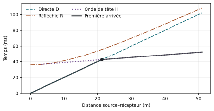
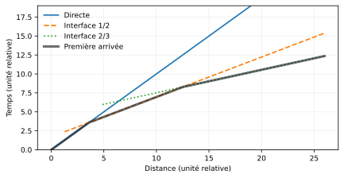
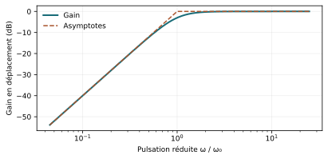
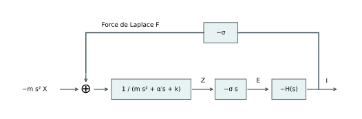
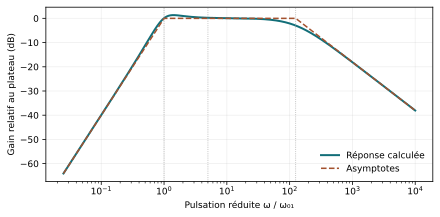

# X–ENS PSI 2022 — Physique (XSR) · Corrigé guidé

*Corrigé rédigé par IA, non officiel. Signalez toute erreur.*

**Lecture du rapport du jury** · GPT-6.2 Astra Ultra · vitesse non renseignée

**Rédaction** · GPT-6.2 Astra Ultra · vitesse non renseignée

## Étude et mesure des séismes

## I. Ondes de compression dans un solide

### Question 1 — Unité du module d’Young

**Indication.** Le rapport d’un allongement à une longueur est sans dimension.

Dans $\sigma=E\Delta L/L$, $E$ a la dimension d’une contrainte. Son unité est le pascal, $1\ \mathrm{Pa}=1\ \mathrm{N\,m^{-2}}$.

### Question 2 — Limite rigide

**Indication.** Fixer une contrainte finie et examiner la déformation.

La déformation vaut $\sigma/E$. Dans la limite idéale où toute contrainte finie laisse la longueur inchangée, $E\to+\infty$.

### Question 3 — Déformation locale

**Indication.** Calculer la distance entre les positions déplacées des deux faces.

La longueur devient $dx+u(x+dx,t)-u(x,t)$. Son accroissement relatif tend vers $\partial_xu(x,t)$, qui est sans dimension.

### Question 4 — Gradient de force

**Indication.** Appliquer la loi de Hooke à la tranche plutôt qu’à toute la barre.

La force de traction vérifie $F/S=E\partial_xu$. À $E$ et $S$ constants, $S^{-1}\partial_xF=E\partial_x^2u$.

### Question 5 — Équation de propagation

**Indication.** Les forces sur les deux faces ont des signes opposés.

La résultante longitudinale est $F(x+dx)-F(x)\simeq SE\partial_x^2u\,dx$. Avec la masse $\rho Sdx$, on obtient $\partial_x^2u-c_p^{-2}\partial_t^2u=0$, où $c_p=\sqrt{E/\rho}$. C’est l’équation de d’Alembert dans ce modèle de barre unidimensionnel.

### Question 6 — Valeur pour le granite

**Indication.** Convertir les gigapascals et prendre la racine du rapport.

Le modèle donne $c_p=\sqrt{70\times10^9/2500}\simeq5{,}3\times10^3\ \mathrm{m\,s^{-1}}$, soit environ $5{,}3\ \mathrm{km\,s^{-1}}$.

### Question 7 — Polarisation

**Indication.** Comparer la direction du déplacement à celle de la propagation.

Une onde longitudinale fait osciller la matière parallèlement à sa propagation, une onde transversale perpendiculairement. Ici $\mathbf u=u\mathbf e_x$ et le mouvement de l’onde se fait le long de $x$, donc la polarisation est longitudinale.

### Question 8 — Énergie et flux

**Indication.** Multiplier $\rho u_{tt}=Eu_{xx}$ par la vitesse locale.

Le premier membre devient $\partial_t(\rho u_t^2/2)$. À droite $Eu_{xx}u_t=\partial_x(Eu_xu_t)-\partial_t(Eu_x^2/2)$. Donc $\partial_t w+\partial_x\Pi_x=0$ avec $w=\rho u_t^2/2+Eu_x^2/2$ (cinétique et élastique) et $\boldsymbol\Pi=-Eu_xu_t\mathbf e_x$. Pour $u=f(x-c_pt)$ le flux est positif vers $+x$, ce qui contrôle son signe.

## II. Couche cisaillée et progression de la zone glissante

### Question 9 — Forces sur une tranche

**Indication.** Distinguer faces latérales d’aire $hH$ et faces horizontales d’aire $Hdx$.

Sur les deux faces normales à $x$, la résultante est $hH[\sigma(x+dx)-\sigma(x)]\mathbf e_x$. En haut agissent $(\tau_c\mathbf e_x-\sigma_N\mathbf e_z)Hdx$, en bas $(-\tau_f\mathbf e_x+\sigma_R\mathbf e_z)Hdx$. Les contraintes normales se compensent dans le modèle sans mouvement vertical et sans poids pris en compte.

### Question 10 — Équation forcée de la couche

**Indication.** Diviser le bilan horizontal par le volume et utiliser la loi locale de Hooke.

La dynamique s’écrit $\rho u_{tt}=Eu_{xx}+(\tau_c-\tau_f)/h$. On en déduit $u_{xx}-c_p^{-2}u_{tt}=-(\tau_c-\tau_f)/(Eh)$, avec $A=1/(Eh)$.

### Question 11 — Puissance des efforts aux interfaces

**Indication.** Reprendre le produit du bilan de quantité de mouvement par $u_t$.

La nouvelle conservation est $\partial_t w+\partial_x\Pi_x=(\tau_c-\tau_f)u_t/h$. Le terme $\tau_cu_t/h$ est la puissance volumique fournie par le chargement. Pour un mouvement positif, $-\tau_fu_t/h$ enlève de l’énergie mécanique par frottement et peut se traduire par un échauffement de l’interface.

### Question 12 — Mise à l’échelle quasi statique

**Indication.** Introduire $u=u_0\tilde u$, $x=\ell\tilde x$, $t=T\tilde t$ et $\tau=\tau_0\tilde\tau$.

La substitution donne $[\ell^2/(T^2c_p^2)]\tilde u_{\tilde t\tilde t}=\tilde u_{\tilde x\tilde x}+\mathcal A(\tilde\tau_c-\tilde\tau_f)$ avec $\mathcal A=\tau_0\ell^2/(Ehu_0)$. Pour $\ell/T\ll c_p$ et des dérivées réduites d’ordre un, le terme inertiel est négligeable et la somme du membre droit est nulle.

### Question 13 — Interprétation du rapport

**Indication.** Évaluer indépendamment les deux forces sur une portion de longueur $\ell$.

L’effort de cisaillement appliqué sur une face horizontale est d’ordre $\tau_0H\ell$. L’effort élastique axial est d’ordre $E(u_0/\ell)Hh$. Leur quotient vaut $\mathcal A$ et compare le chargement de l’interface au rappel longitudinal.

### Question 14 — Frottement en glissement

**Indication.** Prêter attention à la convention où $\tau_f>0$ représente une force vers $-x$.

La réaction normale équilibre $\sigma_N$ dans le modèle. La loi de Coulomb impose une force surfacique tangentielle $-f\sigma_N\operatorname{sgn}(u_t)\mathbf e_x$. Ainsi $\tau_f=\tau_r\operatorname{sgn}(u_t)$, avec $\tau_r=f\sigma_N$. La zone glissant vers $+x$ a $\tau_f=\tau_r$.

### Question 15 — Région collée

**Indication.** Le non-glissement y impose d’abord une condition sur la vitesse.

Il faut $u_t=0$ sur le substrat immobile. Si cette zone n’a jamais glissé et que l’on choisit l’état initial comme référence, $u=0$ et $u_{xx}=0$ à l’intérieur de cette région. L’équilibre quasi statique donne alors $\tau_f=\tau_c$, dans les limites de l’adhérence.

### Question 16 — Profil de déplacement

**Indication.** Intégrer la courbure constante puis imposer les déplacements aux deux fronts.

Notons $D=\tau_c-\tau_r$. À l’intérieur de $[-\ell_g,\ell_g]$ on a $u''=-D/(Eh)$. Avec $u(\pm\ell_g)=0$, $u(x)=D(\ell_g^2-x^2)/(2Eh)$. À l’extérieur la couche initialement collée reste à $u=0$. Le modèle idéalise le changement de contrainte au front.

### Question 17 — Énergie élastique de la couche

**Indication.** Intégrer la densité $E(u')^2/2$ sur la section et la longueur réellement déformée.

À l’intérieur $u'=-Dx/(Eh)$ et ailleurs $u'=0$. Ainsi $E_e=hH\int_{-\ell_g}^{\ell_g}E(u')^2dx/2=HD^2\ell_g^3/(3Eh)$. L’état sans glissement du modèle n’a pas de déformation longitudinale. Le terme calculé représente donc un gain d’énergie élastique stockée.

### Question 18 — Travail de cisaillement

**Indication.** Les deux tractions tangentielles travaillent avec des signes opposés sur le même déplacement.

Pour des tractions uniformes fixées, le travail net est $W_{\rm cis}=H\int_{-\ell_g}^{\ell_g}(\tau_c-\tau_r)u(x)dx=2HD^2\ell_g^3/(3Eh)$. Il est ici double de l’énergie élastique finale. Les forces sont surfaciques, d’où le facteur d’aire $Hdx$.

### Question 19 — Énergie disponible au front

**Indication.** Dériver par rapport à la longueur totale $2\ell_g$.

Comme $d/d(2\ell_g)=\tfrac12d/d\ell_g$, $dW_{\rm cis}/d(2\ell_g)=HD^2\ell_g^2/(Eh)$ et $dE_e/d(2\ell_g)=HD^2\ell_g^2/(2Eh)$. La première variation dépasse la seconde, laissant une énergie disponible pour faire avancer la zone.

### Question 20 — Taux de restitution

**Indication.** Diviser le surplus par l’aire nouvellement parcourue par le front.

Il vient $G=(1/H)d(W_{\rm cis}-E_e)/d(2\ell_g)=D^2\ell_g^2/(2Eh)$, en $\mathrm{J\,m^{-2}}$. Cette énergie peut rompre les microcontacts de l’interface. Un excès au-delà du coût de fracture peut aussi alimenter le mouvement et les ondes.

### Question 21 — Critère de propagation

**Indication.** Comparer pour la même aire le surplus disponible et le coût des microcontacts.

Si $G<G_c$, l’énergie libérée ne suffit pas à créer la nouvelle aire glissante. L’égalité est le seuil quasi statique et $G>G_c$ rend la progression énergétiquement favorable.

### Question 22 — Longueur et contrainte critiques

**Indication.** Résoudre l’égalité de Griffith en gardant ou bien la contrainte, ou bien la longueur constante.

Pour $\tau_c>\tau_r$, la longueur critique totale est $L_c=2\sqrt{2EhG_c}/(\tau_c-\tau_r)$. À longueur $2\ell_g$ donnée, $\tau_{c,\rm lim}=\tau_r+\sqrt{2EhG_c}/\ell_g$. Une zone plus courte ou un chargement inférieur au seuil ne progresse pas dans ce modèle.

### Question 23 — Stabilité du front

**Indication.** Examiner ce qui arrive à $G-G_c$ après une petite avancée à chargement imposé.

À $\tau_c$ fixé, $dG/d(2\ell_g)=D^2\ell_g/(2Eh)>0$. Une avancée au seuil augmente donc le surplus et le front est instable. Lorsque $G>G_c$, il accélère et une partie de l’énergie devient cinétique et se propage. La limite quasi statique ne prédit plus la vitesse d’une telle rupture.

## III. Réfraction et temps d’arrivée

### Question 24 — Lois de Snell–Descartes

**Indication.** Relier la composante tangentielle de chaque vecteur d’onde à la lenteur du milieu.

Le plan d’incidence est engendré par la normale et le vecteur incident. Les rayons réfléchi et transmis sont dans ce plan. La composante commune vaut $k_x=(\omega/c_{p1})\sin i_1=(\omega/c_{p1})\sin r=(\omega/c_{p2})\sin i_2$. Ainsi $r=i_1$ et $\sin i_1/c_{p1}=\sin i_2/c_{p2}$.

### Question 25 — Incidence critique

**Indication.** Imposer que la composante tangentielle ne dépasse pas le nombre d’onde transmis.

Quand $c_{p2}>c_{p1}$, $\sin i_2=(c_{p2}/c_{p1})\sin i_1$. Le rayon transmis devient rasant à $i_\ell=\arcsin(c_{p1}/c_{p2})$. Au-delà il n’existe plus de vecteur d’onde transmis réel avec cette composante tangentielle.

### Question 26 — Onde évanescente

**Indication.** Choisir la racine complexe décroissante dans $z>0$ avec la convention $e^{j(\omega t-\mathbf k\cdot\mathbf r)}$.

Le vecteur réfléchi vaut $(\omega/c_{p1})(\sin i_1\mathbf e_x-\cos i_1\mathbf e_z)$. Dans le second milieu $k_{tz}^2=(\omega/c_{p2})^2-k_x^2<0$, donc $k_{tz}=-j/\delta$ avec $\delta=(c_{p2}/\omega)/\sqrt{(\sin i_1/\sin i_\ell)^2-1}$, une longueur. La polarisation admise donne $\mathbf u_t=U_{t0}e^{-z/\delta}e^{j(\omega t-k_xx)}\mathbf e_x$. L’onde est évanescente en profondeur et sa phase se propage vers $+x$ à $\omega/k_x=c_{p1}/\sin i_1$.

### Question 27 — Front de Mach à l’interface

**Indication.** Comparer, pendant le même temps, le rayon d’une ondelette à la distance parcourue par sa source.

Pendant $\Delta t$, le centre émetteur parcourt $c_{p2}\Delta t$ et le cercle dans le premier milieu a pour rayon $c_{p1}\Delta t$. La tangence impose $\sin\theta_c=c_{p1}/c_{p2}$. L’angle entre les normales au front et à l’interface égale celui entre le front et l’interface, donc l’onde réémise fait l’angle $i_\ell$ avec la normale.

### Question 28 — Onde directe

**Indication.** Le trajet horizontal reste entièrement dans la première couche.

À distance $x$ entre source et récepteur, $T_D=x/c_1$. Sa pente dans un diagramme temps-distance est la lenteur $1/c_1$.

### Question 29 — Onde réfléchie

**Indication.** Utiliser l’image de la source par rapport à l’interface plane.

La réflexion est à mi-distance, chaque jambe ayant longueur $\sqrt{h^2+(x/2)^2}$. Donc $T_R=\sqrt{x^2+4h^2}/c_1$, $T_R(0)=2h/c_1$ et $T_R=x/c_1+2h^2/(c_1x)+O(x^{-3})$ à grande distance. La courbe reste au-dessus de l’onde directe.

### Question 30 — Onde de tête

**Indication.** Additionner les deux trajets critiques dans la couche et le trajet sur l’interface rapide.

Le trajet rasant se propage à $c_2$ et réémet vers la surface à l’angle critique $i_\ell$. Il atteint le récepteur si $x\ge x_{\min}=2h\tan i_\ell$. Le temps vaut $2h/(c_1\cos i_\ell)+(x-2h\tan i_\ell)/c_2=x/c_2+\tau_1$, où $\tau_1=2h\cos i_\ell/c_1=2h\sqrt{c_1^{-2}-c_2^{-2}}$.

### Question 31 — Premières arrivées

**Indication.** Comparer les temps direct et réfracté, l’onde réfléchie étant toujours plus tardive que la directe.

L’intersection $x_d/c_1=x_d/c_2+\tau_1$ donne $x_d=2h\sqrt{(c_2+c_1)/(c_2-c_1)}$, au-delà de $x_{\min}$. Les premiers temps forment une ligne brisée continue, de pente $1/c_1$ jusqu’à $x_d$ (D), puis $1/c_2$ (H). L’onde R suit une hyperbole et ne fixe pas cette enveloppe.

### Question 32 — Lecture du sismogramme du Connecticut

**Indication.** Ajuster deux droites aux premiers départs, puis extrapoler la seconde à distance nulle.

Les premiers départs passent, à la lecture de la figure 11, d’environ $11\ \mathrm{ms}$ à $40\ \mathrm{ms}$ entre $5$ et $20\ \mathrm m$, puis autour de $46\ \mathrm{ms}$ vers $38\ \mathrm m$. Les pentes donnent $c_1\sim5\times10^2\ \mathrm{m\,s^{-1}}$ et $c_2\sim3\times10^3\ \mathrm{m\,s^{-1}}$. La rupture de pente est proche de $x_d\sim20\ \mathrm m$ et l’interception de la branche rapide proche de $34\ \mathrm{ms}$, d’où $h=\tau_1/[2\sqrt{c_1^{-2}-c_2^{-2}}]\sim9\ \mathrm m$. La portée et le rapport signal/bruit limitent les distances disponibles et donc la profondeur sondable. La pente rapide, faible, est particulièrement sensible à la lecture des flèches.

### Question 33 — Trois vitesses croissantes

**Indication.** Pour une onde de tête profonde, conserver la lenteur horizontale égale à $1/c_3$.

Outre les arrivées directes, réflexions et réfractions ordinaires, des ondes de tête peuvent suivre l’une ou l’autre interface. Pour celle de 2/3, $\sin\theta_1=c_1/c_3$ et $\sin\theta_2=c_2/c_3$, donc $\theta_2=i_{\ell(2/3)}$. Son temps est $T_{H3}=x/c_3+2h_1\sqrt{c_1^{-2}-c_3^{-2}}+2h_2\sqrt{c_2^{-2}-c_3^{-2}}$, valide pour $x\ge2h_1\tan\theta_1+2h_2\tan\theta_2$. La première onde de tête suit la droite de la question 30 avec $h_1$. L’enveloppe inférieure des droites peut fournir trois pentes, donc les vitesses, puis les épaisseurs par leurs ordonnées à l’origine. Une branche intermédiaire trop courte peut rester masquée.

### Question 34 — Couche lente cachée

**Indication.** Tester à chaque interface si l’incidence critique est accessible depuis le dessus.

Si $c_2<c_1$, aucune onde de tête ne longe l’interface 1/2 à la suite d’une incidence depuis la couche 1. Les rayons directs et réfléchis persistent, et une onde de tête profonde peut exister puisque $c_3>c_1,c_2$. Les premières arrivées peuvent donc ne montrer que les vitesses $c_1$ et $c_3$, sans individualiser la couche lente. Une faible épaisseur, un contraste insuffisant ou une ouverture de mesure limitée peuvent aussi masquer une couche.

## IV. Le géophone et la rétroaction

### Question 35 — Position de repos

**Indication.** L’axe est ascendant et l’ancrage du ressort est à l’altitude $L$.

Le ressort a pour longueur $L-z_{\rm eq}$ et exerce une force vers le haut $k(L-z_{\rm eq}-\ell_0)$. Son équilibre avec $mg$ impose $z_{\rm eq}=L-\ell_0-mg/k$.

### Question 36 — Mouvement dans les deux référentiels

**Indication.** Exprimer l’étirement et la vitesse dans l’amortisseur relativement au bâti.

On a $z_m=x+z$, et les forces variables après soustraction de l’équilibre sont $-k(z_m-x)-\alpha(\dot z_m-\dot x)$. Dans le référentiel terrestre $m\ddot z_m=-k(z_m-x)-\alpha(\dot z_m-\dot x)$. Pour le déplacement dans le bâti, $m\ddot z+\alpha\dot z+kz=-m\ddot x$, le membre droit étant la force d’entraînement.

### Question 37 — Transfert mécanique

**Indication.** Traduire l’accélération du bâti par $-\omega^2 X$ sous excitation harmonique.

Avec $v=\omega/\omega_0$, $H_{dm}=Z/X=v^2/(1-v^2+jv/Q)$. Pour $Q=1/\sqrt2$, $|H_{dm}|=v^2/\sqrt{1+v^4}$. À basse fréquence le gain monte de $40\ \mathrm{dB}$ par décade et $z\simeq-\ddot x/\omega_0^2$ mesure l’accélération. À haute fréquence le gain tend vers un et $z\simeq-x$ mesure le déplacement. Autour de la coupure c’est une transition, sans large plage de mesure de vitesse à ce facteur de qualité.

### Question 38 — Résolution basse fréquence

**Indication.** Dans ce régime l’élasticité équilibre presque instantanément la force d’inertie.

L’équation se réduit à $kz\simeq-m\ddot x$. Une résolution en déplacement $\Delta z$ conduit à $|a|_{\min}\simeq(k/m)\Delta z=\omega_0^2\Delta z$. Une masse plus grande ou un ressort plus souple diminue ce seuil dans la bande où $\omega\ll\omega_0$ reste vraie.

### Question 39 — Induction dans le circuit

**Indication.** Comparer la vitesse relative de la barre et du circuit fixe lié au bâti.

Le déplacement modifie l’aire du contour plongé dans le champ magnétique, donc le flux. Selon Faraday une f.é.m. $e=-d\Phi/dt$ apparaît et, dans le circuit fermé résistif, un courant $i=e/R$ circule. La force induite s’oppose au mouvement relatif (loi de Lenz).

### Question 40 — Équations électromécaniques

**Indication.** Orienter le courant suivant la figure 15, montant dans la branche droite.

Pour l’orientation imposée $\Phi=B_0\ell(\mathrm{constante}+z)$, donc $e=-\sigma\dot z=Ri$, avec $\sigma=\ell B_0$. Le courant parcourt la barre vers $-y$ et la force de Laplace vaut $+\sigma i\mathbf e_z$. Ainsi $m\ddot z+\alpha\dot z+kz=-m\ddot x+\sigma i$, ou $m\ddot z+(\alpha+\sigma^2/R)\dot z+kz=-m\ddot x$. La puissance mécanique du courant vaut $-Ri^2$.

### Question 41 — Amortissement critique

**Indication.** Modifier la charge électrique et observer la réponse libre à une petite perturbation.

Avec $\alpha'=\alpha+\sigma^2/R$, $\widetilde Q=m\omega_0/\alpha'$. La valeur critique $\widetilde Q=1/2$ impose $\alpha'=2\sqrt{mk}$, soit $R=\sigma^2/(2\sqrt{mk}-\alpha)$ si le dénominateur est positif. On ajuste la charge totale au retour le plus rapide sans oscillation après une petite impulsion. Si l’amortissement mécanique est déjà supérieur au critique, une résistance passive seule ne peut le réduire.

### Question 42 — Tension du géophone passif

**Indication.** Utiliser la dérivation de $z$ produite par l’induction.

La tension orientée $E=-j\omega\sigma Z$ vérifie $H_{de}=E/X=-j\sigma\omega v^2/(1-v^2+jv/\widetilde Q)$. À haute fréquence $E\simeq j\omega\sigma X$ mesure la vitesse du sol. À basse fréquence le signal est fortement atténué. La mesure est aussi limitée par le débattement, les résonances parasites et l’inductance négligée à haute fréquence.

### Question 43 — Boucle de force

**Indication.** Déterminer le sens de la force sur la seconde barre à partir du sens de $I$.

Avec les orientations de la figure 16, le courant dans la seconde barre est en sens opposé à celui de la première. La seconde force de Laplace vaut $F=-\sigma I$, d’où $m\ddot z+\alpha'\dot z+kz=-m\ddot x-\sigma I$. Les barres solidaires présentent le même déplacement.

### Question 44 — Blocs de rétroaction

**Indication.** Identifier séparément le transducteur de vitesse, la commande et l’actionneur.

Les blocs du trajet direct dans la figure 17 sont $E/Z=-j\omega\sigma$ et $I/E=-H(j\omega)$. Le retour est $F/I=-\sigma$. Au sommateur mécanique, on additionne $F$ à la force $-m\ddot x$ puis on applique la compliance dynamique $1/(k-m\omega^2+j\alpha'\omega)$ pour obtenir $Z$. Ces facteurs explicitent les unités du schéma simplifié.

### Question 45 — Transfert du système bouclé

**Indication.** Reporter $I=-HE$ puis $E=-j\omega\sigma Z$ dans la mécanique.

Avec $b=\alpha'/m$ et $a=\sigma^2/m$, $I=j\omega\sigma HZ$. On obtient $H_d=Z/X=\omega^2/[\omega_0^2-\omega^2+j\omega(b+aH(j\omega))]$. Le signe positif de la correction au dénominateur traduit le retour négatif en force.

### Question 46 — Commande à gain constant

**Indication.** Regrouper les termes en $j\omega$.

Pour $H=g_1$, la pulsation non amortie reste $\omega_0$, l’amortissement devient $b+ag_1$ et le facteur de qualité $\omega_0/(b+ag_1)$ diminue. Les oscillations sont davantage amorties, et un gain assez fort rend le régime apériodique.

### Question 47 — Correction intégrale

**Indication.** Un intégrateur dans la chaîne électrique compense la dérivation de l’induction.

Pour $H=g_2/(j\omega)$, $H_d=\omega^2/[\omega_0'^2-\omega^2+j\omega b]$ avec $\omega_0'^2=\omega_0^2+ag_2$. La pulsation réglable augmente et élargit la plage de mesure en accélération. La seconde force vaut $F=-\sigma^2g_2 H_d X$. À basse fréquence, $F(t)\simeq(\sigma^2g_2/\omega_0'^2)\ddot x(t)$. Pour $ag_2\gg\omega_0^2$, elle tend vers $+m\ddot x$ et compense la force d’entraînement. Le courant $I=-F/\sigma$, ou la tension $u=rI$ à la polarité orientée correspondante, donne un accéléromètre dans cette bande.

### Question 48 — Réglage à deux paramètres

**Indication.** Un terme proportionnel commande l’amortissement et un intégrateur règle la raideur effective.

Prendre $H=g_1+g_2/(j\omega)$. On obtient $\omega_n=\sqrt{\omega_0^2+ag_2}$ et $Q_{\rm eff}=\omega_n/(b+ag_1)$. Choisir $ag_2\gg\omega_0^2$ assure la compensation à basse fréquence, puis imposer $g_1=(2\omega_n-b)/a$ pour le régime critique, avec $g_2$ assez grand pour que ce gain soit positif.

### Question 49 — Réponse en vitesse à large bande

**Indication.** Multiplier le numérateur et le dénominateur du transfert par $s=j\omega$ avant de normaliser le polynôme cubique.

Posons $A=b+ag_1$, $B=\omega_0^2+ag_2$ et $C=ag_3$. Alors $H_v=Z/(sX)=-s^2/(s^3+As^2+Bs+C)$. Il vient $\omega_{02}=C^{1/3}$, $1/\omega_{01}^2=A/C$ et $1/(Q'\omega_{01})=B/C$. Ainsi $H_v=(\omega^2/\omega_{02}^3)/[1+j\omega/(Q'\omega_{01})-\omega^2/\omega_{01}^2-j\omega^3/\omega_{02}^3]$. Ici $b=\omega_0/\widetilde Q$ inclut l’amortissement passif. Pour des ruptures bien séparées et $Q'$ d’ordre un, le gain monte à $+40\ \mathrm{dB/décade}$, devient proche de $1/A$ lorsque $A\omega^2$ domine, puis tombe à $-20\ \mathrm{dB/décade}$ quand $\omega^3$ domine. Pour $\omega_{01}\ll\omega\ll\omega_{02}$, c’est un capteur de vitesse. Dans ce polynôme l’intersection du plateau et de l’asymptote haute est $\omega\sim A=\omega_{02}^3/\omega_{01}^2$. Un réglage stable demande $AB>C$.

