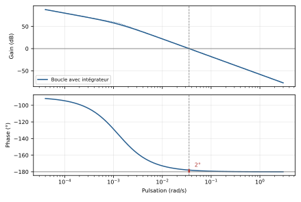
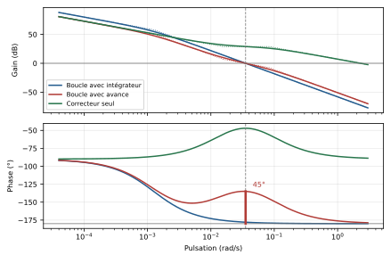
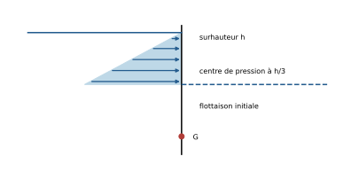
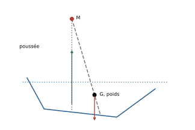
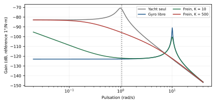
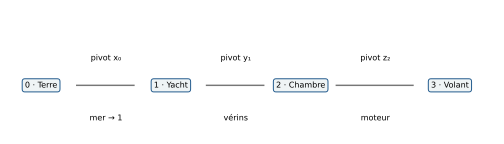

# X-ENS PSI · Sciences industrielles 2022 · Corrigé guidé

*Corrigé rédigé par IA, non officiel. Signalez toute erreur.*

**Rédaction** · GPT-6.2 Astra Ultra · vitesse non renseignée · 24 novembre 2026

## Repères de résolution

Le rotor emmagasine une énergie proportionnelle au carré de sa vitesse. Le couple gyroscopique dépend, lui, du moment cinétique et de la vitesse de précession. Garder cette distinction lors du passage du démarrage à la stabilisation. Prendre les angles en radians pour les calculs et en degrés pour la lecture des figures de roulis.

## Partie 1 · Comparaison des solutions

### Question 1 · Trois solutions de stabilisation

**Indication.** À quai, que devient la vitesse relative entre l’eau et un aileron fixe ?

#### Solution

Les foils orientables produisent en marche une portance réglable avec des appendices compacts et sans déplacer de lourdes masses dans la cale. Leur efficacité dépend de la vitesse d’avance dans le principe décrit, et ils augmentent la traînée et l’exposition aux chocs. Une masse mobile agit même à l’arrêt et son couple statique se règle directement par son déport. Elle alourdit le navire et exige une course transversale libre avec un mécanisme capable de l’accélérer. Le gyroscope agit lui aussi au mouillage et se monte à l’intérieur de la coque. Il demande une mise en vitesse longue et consomme de l’énergie pour entretenir la rotation et évacuer les pertes.

### Question 2 · Vulnérabilité au roulis

**Indication.** Comparer la largeur du bateau à sa longueur, puis les surfaces de flottaison vues suivant chaque axe.

#### Solution

Sur ce yacht long et relativement étroit, la raideur hydrostatique en tangage est nettement supérieure. Pour une flottaison rectangulaire de longueur $L$ et largeur $b$, le rapport des moments quadratiques correspondants est $(L/b)^2$. Le roulis peut donc atteindre des angles gênants, voire compromettre la stabilité transversale. Le mot « jamais » se comprend dans le cadre de ce produit et de cet usage. D’autres navires disposent de dispositifs d’atténuation du tangage.

## Partie 2 · Installation sur les longerons

### Question 3 · Gabarit de collage

**Indication.** Lire les faces latérales et la face supérieure de chacune des quatre pattes en U.

#### Solution

Avant prise, chaque patte impose trois appuis plans, deux sur les flancs et un au sommet. Chacun apporte trois contraintes idéales. Les douze surfaces parallèles ou orthogonales bloquent ensemble cinq mouvements du gabarit. La translation longitudinale reste libre. Avec un seul solide mobile, $h=12\times3-(6-1)=31$. Compter quatre glissières équivalentes ferait disparaître les redondances internes de chaque patte.

### Question 4 · Chapes sans boulons

**Indication.** Distinguer le nombre de solides mobiles de celui des pieds. Vérifier les trois mouvements dans le plan horizontal.

#### Solution

Les quatre chapes sont des solides distincts du châssis. Elles ont chacune un pivot horizontal avec lui et un appui plan avec le sol. On compte $4(5+3)=32$ inconnues d’action, cinq solides mobiles et trois mobilités globales, deux translations horizontales et le lacet. Les centres des pivots restent à hauteur fixe en plusieurs points non alignés, ce qui exclut le basculement global. Un pivot isolé ne peut tourner seul tout en gardant son appui plan. Ainsi $h=32-6\times5+3=5$.

### Question 5 · Modèle avec les 32 boulons

**Indication.** Un boulon peut tourner autour de sa propre ligne d’axe même si les pièces assemblées sont immobiles.

#### Solution

Chaque boulon apporte un solide, un pivot (cinq inconnues) et un pivot glissant (quatre). Les trous répartis immobilisent dans le plan les chapes et donc le châssis. Les 32 rotations propres des boulons subsistent. On a $N_s=32+32(5+4)=320$, $n=5+32=37$, $m=32$, d’où $h=320-6\times37+32=130$. Le degré caractérise ce modèle géométrique détaillé.

### Question 6 · Montage réel

**Indication.** Chercher à quel stade sont accommodées les dispersions de forme, de hauteur et de perçage.

#### Solution

La colle liquide remplit le jeu et les écarts entre la coque et les pattes. En durcissant, elle fixe les pattes dans la géométrie maintenue par le gabarit. Les faces d’appui des chapes se retrouvent ainsi coplanaires et dans les positions de l’appareil, les pivots facilitant leur orientation. Le gabarit positionne également les groupes de trous. Le jeu de passage des vis, les tolérances d’usinage et le serrage progressif permettent le montage et la mise en contact. Une fois serrées, les surfaces participent à la transmission des efforts par adhérence.

## Partie 3 · Rotation propre du volant

### Question 7 · Inertie polaire du volant

**Indication.** Pour un tube, soustraire deux cylindres de même hauteur et de même masse volumique.

#### Solution

Un cylindre plein donne $J_z=md^2/8$. Pour une couronne, l’intégration de $r^2\,dm$ donne $J_z=m(d_{\rm ext}^2+d_{\rm int}^2)/8$. Les trois axes sont confondus. Par additivité,

$$
 C_3=\tfrac18\left[m_a d_a^2+m_b(d_b^2+d_a^2)+m_c(d_c^2+d_b^2)\right].
$$

Les hauteurs sont déjà prises en compte dans les masses. Une même masse a davantage d’effet loin de l’axe.

### Question 8 · Énergie stockée à 5 000 tr/min

**Indication.** Convertir d’abord la fréquence de rotation en radians par seconde.

#### Solution

$\Omega_n=5000(2\pi/60)=523{,}6$ rad/s. Le rotor initialement immobile emmagasine $C_3\Omega_n^2/2=10{,}97$ MJ, soit $3{,}05$ kWh. Il s’agit de l’énergie mécanique minimale.

### Question 9 · Alimentation sur batteries

**Indication.** Une capacité en ampères-heures donne une énergie lorsqu’on la multiplie par la tension.

#### Solution

Les trois batteries contiennent nominalement $3\times12\times100=3600$ Wh. L’énergie mécanique représente déjà 85 % de cette réserve. Un démarrage idéal serait donc énergétiquement possible. Dans le bateau réel il faut un convertisseur adapté au moteur, un rendement global supérieur à 85 % même pour une décharge totale, et une puissance de plusieurs kilowatts, soit plusieurs centaines d’ampères sous 12 V. Cette manœuvre compromettrait les fonctions de sécurité et de démarrage. Le réseau à quai ou un groupe est la solution prévue.

### Question 10 · Échauffement au démarrage

**Indication.** Examiner à la fois la puissance dissipée et la durée de dissipation.

#### Solution

Les pertes Joule $RI^2$ dans les enroulements, les câbles et la source s’accumulent sous forme de chaleur. Un courant élevé durablement risque de dépasser le régime thermique admissible, de déclencher les protections, de faire chuter la tension du bord et de dégrader l’isolant ou la batterie. Une limitation de courant réduit le couple disponible et allonge le lancement.

### Question 11 · Temps de lancement

**Indication.** À couple constant, intégrer l’accélération. À puissance constante, intégrer la variation d’énergie.

#### Solution

Au quai, en négligeant les résistances, $C_3\dot\Omega=T_m$. Pour la caractéristique **maximale** annoncée, on prend 12 N·m jusqu’à $\Omega_d=314{,}2$ rad/s, puis 5 kW jusqu’à $\Omega_n$. Les durées sont $t_1=C_3\Omega_d/12=2094$ s et $t_2=C_3(\Omega_n^2-\Omega_d^2)/(2P)=1404$ s, soit environ **58 min**. La courbe chiffrée présente un raccord imparfait ($12\Omega_d=3{,}77$ kW). Si les deux plafonds doivent être respectés partout, le raccord est à $P/12=417$ rad/s et le calcul donne environ 60 min. La réduction volontaire du couple évoquée dans le texte allonge le temps réel, dont la valeur exacte dépend de la loi de commande. La rampe de Q20 conduit à environ 73 min.

### Question 12 · Deux entrées du moteur

**Indication.** Écrire une relation électrique et une mécanique, en conservant le signe du couple perturbateur.

#### Solution

Posons $D_0=R_b f+2K_iK_e$ et $D(p)=D_0+(R_b C_3+L_b f)p+L_b C_3p^2$. En éliminant $I$ entre $2(R_b+L_bp)I=U-2K_e\Omega$ et $(C_3p+f)\Omega=2K_iI-C_p$, on obtient

$$
 H_1=\frac{K_i/D_0}{1+\frac{R_b C_3+L_b f}{D_0}p+\frac{L_b C_3}{D_0}p^2},\qquad
 H_2=\frac{-(R_b/D_0)(1+L_bp/R_b)}{1+\frac{R_b C_3+L_b f}{D_0}p+\frac{L_b C_3}{D_0}p^2}.
$$

Un couple résistant positif réduit bien la vitesse.

### Question 13 · Frottement visqueux

**Indication.** Comparer les termes qui s’ajoutent dans chaque coefficient du dénominateur.

#### Solution

$R_b f=5\times10^{-5}$ devant $2K_iK_e=0{,}5$, et $L_b f=5\times10^{-7}$ devant $R_b C_3=400$. Les corrections relatives sont au plus de l’ordre de $10^{-4}$. À 5000 tr/min, le couple visqueux ne représente que $5{,}2\times10^{-3}$ N·m.

### Question 14 · Pôle dominant

**Indication.** Comparer les constantes de temps électrique et électromécanique dans la bande étudiée.

#### Solution

Pour $f=0$, le dénominateur normalisé vaut $1+800p+8p^2$. Ses constantes de temps ont pour somme 800 s et pour produit 8 s², soit environ 800 s et 0,010 s. Leurs pôles sont proches de $-0{,}00125$ et $-100$ s⁻¹. Aux pulsations très inférieures à 100 rad/s, le pôle rapide et le zéro électrique éventuel sont négligeables. Ainsi $H_1\simeq1/(1+800p)$, $H_2\simeq-10/(1+800p)$.

### Question 15 · Précision en boucle fermée

**Indication.** Calculer d’abord les gains continus du moteur et de son retour.

#### Solution

Pour $C_1=K_{vit}=1$, $\Omega=[\Omega_c-10C_p]/(2+800p)$. Un échelon de consigne $\omega_0$ seul laisse un écart statique $\omega_0/2$ (50 %). La sensibilité à un couple résistant est $\Omega/C_p=-10/(2+800p)$, de gain statique $-5$ (rad/s)/(N·m). Une perturbation constante de 5 N·m abaisse ainsi la vitesse de 25 rad/s.

### Question 16 · Marges de l’intégrateur

**Indication.** Le gain à 0 dB et le point de phase −180° se cherchent sur la boucle ouverte.

#### Solution

$L_2(p)=1/[p(1+800p)]$. Le gain asymptotique descend de 20 puis de 40 dB/décade, rupture à $1/800$ rad/s. La phase exacte vaut $-90°-\arctan(800\omega)$ et le gain $-20\log_{10}\omega-10\log_{10}(1+800^2\omega^2)$. Le module vaut un pour $\omega_c\simeq0{,}03534$ rad/s. La marge de phase vaut environ $2{,}0°$. La phase n’atteint $-180°$ qu’à l’infini, d’où une marge de gain infinie dans ce modèle.

### Question 17 · Utiliser la position du rotor

**Indication.** Que mesure l’intégrale de la différence entre deux vitesses ?

#### Solution

L’effet intégral élimine l’écart permanent dû à une consigne ou à un couple constant. L’intégrale de l’écart de vitesse est l’écart de position entre la consigne de position, obtenue en intégrant la consigne de vitesse, et la position réelle déroulée. Un codeur du rotor fournit directement cette information. La position électrique est par ailleurs utile à la commutation du moteur synchrone autopiloté.

### Question 18 · Avance de phase sans déplacer la coupure

**Indication.** Centrer l’avance maximale sur la coupure obtenue en Q16 puis compenser le gain de cette avance.

#### Solution

Pour $C_3=K(1+aTp)/[p(1+Tp)]$, ajouter $\phi=45°-2°=43°$. On choisit $a=(1+\sin\phi)/(1-\sin\phi)\simeq5{,}28$, $T=1/(\omega_c\sqrt a)\simeq12{,}3$ s et $K=1/\sqrt a\simeq0{,}435$. Au centre de l’avance, le réseau a un module $\sqrt a$ et le gain total à la coupure reste un. Les ruptures du réseau sont $1/(aT)\simeq0{,}0154$ et $1/T\simeq0{,}0813$ rad/s. Le tracé présente en rouge la boucle corrigée et en vert le correcteur seul. Pour une spécification strictement supérieure à 45°, on peut viser 46° ou prendre l’approximation de 45° d’avance, qui conduit à environ 47° de marge.

### Question 19 · Temps de réponse et saturation

**Indication.** Tracer les limites 497 et 549 rad/s et retenir la dernière entrée dans la bande.

#### Solution

La courbe entre définitivement dans la bande vers **160 s** (lecture approchée, avant la perturbation). Le premier maximum est voisin de 680 rad/s après 80 s. Atteindre ne serait-ce que 523 rad/s en 160 s exigerait en moyenne $80\times523/160\simeq262$ N·m, contre un plafond de 12 N·m. La simulation linéaire ignore les saturations de couple, puissance et courant au démarrage.

### Question 20 · Rampe et rejet de la perturbation

**Indication.** Comparer les excursions du zoom à 5,23 rad/s dans le voisinage du régime nominal.

#### Solution

À 0,12 rad/s², le rotor demande environ $80\times0{,}12=9{,}6$ N·m et atteint la consigne en 4360 s environ. Autour de 523 rad/s, le maximum avoisine 525,7 et le minimum après perturbation 521,4 rad/s. Les écarts relatifs sont environ 0,52 % et 0,31 %, puis l’écart s’annule. L’exigence de précision est satisfaite dans cet essai. Le réglage exact de Q18 atteint la frontière de 45°, un léger supplément d’avance réalise l’inégalité stricte. La rampe nominale demande à sa fin environ 5,0 kW.

## Partie 4 · Pertes énergétiques

### Question 21 · Charges radiales et axiales des paliers

**Indication.** Prendre le moment en A pour déterminer la réaction opposée au couple, puis sommer les forces.

#### Solution

Le rotor vertical est soumis à son poids, aux deux forces de palier et au couple imposé de 100 kN·m. Avec $\overrightarrow{AB}=l\mathbf z_3$, la projection du moment en A sur $\mathbf x_2$ donne $|F_{RB}|=C_{dyn}/l=100$ kN. La résultante radiale nulle impose $\mathbf F_{RA}=-\mathbf F_{RB}$, de même norme. La précharge applique en haut une force vers le bas de $|F_{aB}|=1{,}14|F_{RB}|=114$ kN. Le palier inférieur équilibre cette compression et le poids, soit $|F_{aA}|=114+9{,}81\simeq124$ kN vers le haut.

### Question 22 · Rotor seul en rotation

**Indication.** La précharge a été réglée au montage. Que devient-elle après suppression du couple dynamique ?

#### Solution

La disparition du couple enlève le couple de forces radiales, donc $F'_{RA}=F'_{RB}=0$. En gardant le réglage axial de montage et le rotor vertical, les forces axiales restent de 114 kN en haut et environ 124 kN en bas. La relation de choix de la précharge en conditions extrêmes ne se réapplique pas à une force radiale instantanément nulle.

### Question 23 · Charge sur une bille

**Indication.** Projeter les neuf réactions identiques sur l’axe du palier.

#### Solution

Les composantes radiales se compensent par symétrie. Sur l’axe du roulement, $9F_{bille}\sin\alpha=|F_a|$, donc $F_{bille}=|F_a|/(9\sin\alpha)$. Une petite inclinaison fait croître fortement la charge normale requise pour reprendre une poussée donnée.

### Question 24 · Couple de résistance au roulement

**Indication.** Seule la composante circonférentielle de la réaction produit un moment axial.

#### Solution

La projection en plan radial de la force de contact vaut $F_{bille}\cos\alpha$. Son inclinaison azimutale $\beta$ crée une composante $F_t=F_{bille}\cos\alpha\sin\beta$. Avec le rayon intérieur $r_3=d_3/2$, le module du couple d’une bille est $r_3F_t$ et celui d’un roulement est $C_r=9r_3F_{bille}\cos\alpha\sin\beta$. Son signe est opposé à celui de la rotation.

### Question 25 · Puissance dissipée dans les deux paliers

**Indication.** Dans les approximations trigonométriques, introduire les angles en radians.

#### Solution

En multipliant la somme des couples par la vitesse on trouve

$$
 P_r=\Omega_n\frac{d_3}{2}(|F_{aA}|+|F_{aB}|)\frac{\sin\beta}{\tan\alpha}.
$$

Avec les valeurs arrondies de l’énoncé, $d_3=0{,}085$ m, $\alpha=0{,}1745$ rad, $\beta=2{,}62\times10^{-5}$ rad, on obtient environ **0,8 kW** pour les deux, soit environ 1,5 N·m sur l’arbre.

### Question 26 · Vitesse du centre d’une bille

**Indication.** Le centre est le milieu des contacts. Le champ des vitesses d’un solide est affine.

#### Solution

Au contact extérieur $I_2$, la vitesse de la bille par rapport au bâti est nulle. Au contact intérieur $I_1$, elle est $(d_3/2)\dot\theta_3\,\mathbf y_c$. La vitesse au milieu est la moyenne, soit $\mathbf V_{C\in4/2}=(d_3/4)\dot\theta_3\,\mathbf y_c$. Sa norme vaut **11,1 m/s**.

### Question 27 · Traînée des dix-huit billes

**Indication.** Utiliser la surface frontale d’une sphère et multiplier la force par la vitesse.

#### Solution

$Re=70000Vd_4\simeq2{,}65\times10^4$. Le graphe donne $C_x\simeq0{,}45$ à cette abscisse. Par bille, $P_b=\frac12\rho(\pi d_4^2/4)C_x V^3\simeq0{,}34$ W. Les deux roulements totalisent environ **6 W** quand l’air est supposé immobile. Pendant $t$ secondes, l’énergie dissipée est $18P_bt$. La perte est petite face aux quelque 800 W de roulement.

### Question 28 · Balourd accidentel

**Indication.** L’accélération en rotation uniforme est proportionnelle au déport et au carré de la vitesse.

#### Solution

Un déport de 3 mm d’une masse de 1000 kg produit une force tournante d’amplitude $m_3 e\Omega_n^2\simeq8{,}2\times10^5$ N, à 83,3 Hz. Le bâti et les paliers subissent de fortes vibrations. Une chambre ajustée limite l’excursion géométrique lors d’une défaillance et contribue au confinement. Elle ne supprime pas le balourd et le contact à grande vitesse serait lui-même un incident.

### Question 29 · Couple de cisaillement sur la jante

**Indication.** Écrire le gradient de Couette entre la jante mobile et la paroi immobile puis intégrer sur le cylindre latéral.

#### Solution

Pour $R=D/2$ et $e\ll R$, la vitesse passe de $R\Omega$ à zéro sur $e$. Le module de la contrainte est $\eta R|\Omega|/e$, l’aire latérale $2\pi RH$ et le bras de levier $R$. Le couple axial signé vaut $C_{air}=-(2\pi\eta HR^3/e)\Omega$.

### Question 30 · Puissance sur la jante

**Indication.** Prendre le produit du couple résistant par la vitesse et exprimer la perte positivement.

#### Solution

$P_{air}=2\pi\eta HR^3\Omega_n^2/e$. Avec $\eta=18{,}1\times10^{-6}$ Pa·s, $H=0{,}40$ m, $R=0{,}50$ m et $e=0{,}003$ m, on trouve environ **520 W** dans le modèle imposé.

### Question 31 · Autres surfaces du rotor

**Indication.** Quels facteurs rendent le cisaillement et le bras de levier maximaux sur la couronne ?

#### Solution

La périphérie réunit le plus grand rayon, la vitesse tangentielle maximale et le plus faible entrefer sur une grande aire. Sur l’arbre ou vers le centre des flancs, vitesse et bras de levier diminuent. Les flancs en retrait sont aussi plus éloignés de la chambre. Leurs pertes sont négligées dans cette estimation. Des flasques séparés par un entrefer très mince sur tout leur disque exigeraient en revanche une intégration propre.

### Question 32 · Mise sous vide

**Indication.** Quelles pertes vues précédemment exigent la présence d’air ?

#### Solution

Dans l’idéal sous vide, la traînée des billes et le cisaillement de l’air disparaissent, soit environ $6+520=526$ W économisés. Les 0,8 kW de roulement subsistent. Sur les trois postes calculés le gain est d’environ 40 %, soit 0,53 kWh par heure de fonctionnement. Parmi les avantages annexes figurent la réduction du bruit aérodynamique et la protection du rotor contre l’humidité saline. La chambre doit être étanche et résister à la pression extérieure, avec surveillance du vide. L’évacuation thermique du rotor devient plus délicate en l’absence de convection interne.

## Partie 5 · Maîtrise de la précession

### Question 33 · Moment des vérins et fermeture géométrique

**Indication.** Écrire le moment en C de chaque effort, puis projeter la boucle C–A–B suivant la normale au vérin.

#### Solution

Notons $s_i=+1$ en B et $-1$ en B′, $\overrightarrow{CB_i}=s_iR_f\mathbf z_2$, et $\mathbf F_i=f_i\mathbf x_{v_i}$ avec $f_i$ signé. Le couple sur $\mathbf y_1$ vaut $\sum_i s_iR_f f_i\cos(\theta_2-\theta_{v_i})$. Les forces des vérins opposés sont de sens opposés et leurs moments se renforcent. Au milieu, le module peut atteindre $4R_f F_{max}$.
Pour expliciter la loi d’angle, posons $\overrightarrow{CA_i}=a_i\mathbf x_1+c_i\mathbf z_1$ et $\overrightarrow{A_i B_i}=L_i\mathbf x_{v_i}$. Alors $L_i\cos\theta_{v_i}=s_i R_f\sin\theta_2-a_i$, $-L_i\sin\theta_{v_i}=s_i R_f\cos\theta_2-c_i$. Ces deux projections fixent l’angle (par les deux composantes) et la longueur. Les constantes sont fixées par $\overrightarrow{CA_i}=s_iR_f\mathbf z_2(-\alpha)-L_0\mathbf x_{v_i}(-\alpha)$ en position médiane. L’égalité des angles à cet instant ne vaut pas sur toute la course.

### Question 34 · Distributeur du frein

**Indication.** Lire séparément le symbole de la bobine et le ressort côté opposé.

#### Solution

Le distributeur est commandé électriquement, avec rappel par ressort. Excité, il met les chambres en communication par les restrictions qui dosent le débit et donc le freinage. Hors excitation, sa position de repos ferme les voies et immobilise les vérins. Cela permet la commande à distance et le verrouillage au repos ou en cas de perte d’alimentation.

### Question 35 · Deux circuits hydrauliques

**Indication.** Observer les directions de travail et les distances instantanées aux axes d’articulation.

#### Solution

Les courses et débits instantanés des branches peuvent différer avec la géométrie. Une mise en commun risquerait de faire refouler un vérin dans un autre en court-circuitant une restriction, ou de provoquer des efforts parasites. Deux circuits permettent de contrôler localement les pertes de charge et limitent les conséquences d’une fuite d’un côté.

### Question 36 · Lieu de la dissipation

**Indication.** Suivre le travail du frein jusqu’à l’eau de refroidissement.

#### Solution

Dans les étranglements réglables, la puissance hydraulique $\Delta p\,Q$ se transforme en chaleur dans l’huile. Les pertes des conduites et du distributeur constituent des contributions secondaires. L’échangeur restitue la chaleur à l’eau de mer. Les accumulateurs stockent et restituent provisoirement une partie de l’énergie.

### Question 37 · Débit d’eau minimal

**Indication.** Additionner les puissances maximales avant de faire le bilan d’enthalpie de l’eau.

#### Solution

En majorant le bras de levier par $R_f=0{,}20$ m, $C_{frein,max}=4R_fF_{max}=800$ N·m. À 60 tr/min, $P_{frein,max}=800(2\pi)=5{,}03$ kW. Avec 2 kW de pertes du volant, $\dot m\,c_p(50-30)\ge7027$ W. Pour $c_p\simeq4180$ J/(kg·K), $\dot m\ge0{,}084$ kg/s, soit environ **5 L/min**. C’est un débit minimal idéal pour ces conditions simultanées.

### Question 38 · Accumulateurs à membrane

**Indication.** Enfermer un liquide presque incompressible dans une conduite de volume variable pose deux problèmes.

#### Solution

Le gaz compressible absorbe les pics de pression et amortit les transitoires à l’inversion du mouvement. Il restitue aussi un volume d’huile pour compenser les variations de contenance liées aux tiges, les dilatations ou les petites fuites et maintient une pression évitant la cavitation.

### Question 39 · Ordre de grandeur du couple de houle

**Indication.** Sur la bande émergée atteinte par la vague, dessiner le diagramme triangulaire de surpression.

#### Solution

On choisit une estimation quasi hydrostatique sur le flanc vertical de longueur $L=25$ m. La contribution retenue est la bande de hauteur $h=0{,}5$ m ajoutée au-dessus de la flottaison initiale. À la cote $y$ au-dessus de cette ligne, $p(y)=\rho g(h-y)$. En assimilant les autres contributions des deux bords à une compensation, la force horizontale vaut $F=\rho g Lh^2/2\simeq31$ kN. Son centre est à $h/3$ au-dessus de la flottaison, soit un bras $z_G+h/3=0{,}667$ m autour de G. Ainsi **$C_{mer,max}\simeq2{,}1\times10^4$ N·m**. Une modélisation de toute la carène demanderait les pressions et la géométrie immergées. La suite utilise 20 kN·m.

### Question 40 · Mesure de l’amortissement

**Indication.** Observer l’enveloppe d’oscillations libres dans des conditions où la houle et le gyro sont inactifs.

#### Solution

En eau calme, gyroscope bloqué, donner une petite gîte au yacht puis le relâcher. Mesurer au cours du temps l’angle par un inclinomètre, la période et la décroissance des maxima de même signe. Ajuster la réponse libre du second ordre aux mesures, ou utiliser le décrément logarithmique et la pseudo-période. La connaissance de $A_1$ donne alors $\mu$. On répète avec plusieurs petits angles initiaux pour contrôler le domaine linéaire.

### Question 41 · Raideur hydrostatique

**Indication.** À petite gîte, la verticale du centre de carène coupe approximativement l’axe du navire en un point fixe.

#### Solution

Le poids agit verticalement vers le bas au centre de gravité G. La poussée d’Archimède agit verticalement vers le haut au centre de carène déplacé. Pour de petits angles, sa droite d’action passe par le métacentre M. Si $GM=l>0$, le bras de redressement est $l\sin\theta_1$ et le couple $-M_{yacht}g l\sin\theta_1\simeq-k\theta_1$, avec $k=M_{yacht}g l$. Pour un essai d’inclinaison, déplacer transversalement une masse connue d’une distance mesurée, attendre l’équilibre et mesurer la petite gîte. Le rapport du couple appliqué à cet angle donne $k$. Des mesures dans les deux sens limitent l’effet d’une gîte initiale.

### Question 42 · Roulis du yacht seul

**Indication.** Comparer la période propre au domaine temporel de la houle.

#### Solution

Le bilan $A_1\ddot\theta_1+\mu\dot\theta_1+k\theta_1=C_{mer}$ donne

$$
 F_S(p)=\frac{K_S}{1+2\xi_S p/\omega_S+p^2/\omega_S^2},\quad K_S=1/k,\quad \omega_S=\sqrt{k/A_1},\quad \xi_S=\mu/(2\sqrt{kA_1}).
$$

Avec $g\simeq10$, on a $k=8\times10^5$ N·m/rad, $K_S=1{,}25\times10^{-6}$ rad/(N·m), $\omega_S=1$ rad/s et $\xi_S=0{,}125$. Pour 20 kN·m, la gîte statique vaut 0,025 rad, soit 1,43°. Le gain résonant est multiplié par $1/[2\xi_S\sqrt{1-\xi_S^2}]\simeq4{,}03$. Vers $\omega_r=\omega_S\sqrt{1-2\xi_S^2}=0{,}984$ rad/s (période 6,4 s, compatible avec la houle), on peut donc atteindre **5,8°**, ce qui justifie l’intérêt du dispositif.

### Question 43 · Boucle mécanique et asservissement

**Indication.** Chercher le capteur, une consigne et un comparateur commandant un actionneur.

#### Solution

Le gyroscope libre exerce une rétroaction physique sur le bateau. La vitesse de roulis engendre la précession, qui génère en retour un couple opposé. Le modèle de cette page ne comporte ni mesure comparée à une consigne de roulis, ni commande de l’actionneur en fonction d’une erreur. C’est une stabilisation passive par couplage. La boucle de vitesse propre du rotor appartient à un autre niveau de fonctionnement.

### Question 44 · Raideur apparente de l’ensemble

**Indication.** Suivre le retour de la vitesse de roulis jusqu’au couple anti-roulis.

#### Solution

Avec conditions initiales nulles, $\dot\theta_2=K_2K_3\theta_1$ puis $C_{anti}=K_2K_3^2\theta_1$. Si $b=K_2K_3^2=8\times10^7$ N·m/rad et $d=1+bK_S=101$, alors $F_E=1/(A_1p^2+\mu p+k+b)$. Sous la forme de Q42, $K_E=K_S/d\simeq1{,}24\times10^{-8}$ rad/(N·m), $\omega_E=\omega_S\sqrt d\simeq10{,}05$ rad/s et $\xi_E=\xi_S/\sqrt d\simeq0{,}0124$.

### Question 45 · Effets sur les périodes de houle

**Indication.** La nouvelle résonance est-elle accessible à une houle dont la période dépasse 2 s ?

#### Solution

Le modèle libre divise la réponse statique du roulis par 101, à environ 0,014° pour 20 kN·m, et déplace la résonance vers une période de 0,63 s, hors de la plage $T>2$ s. Dans la bande des vagues étudiées le gain est très réduit. Le faible amortissement relatif à la nouvelle résonance et la course de la chambre limitent l’interprétation pratique de ce résultat.

### Question 46 · Dérive de la chambre

**Indication.** Remonter d’une dérivation entre la vitesse de précession et l’angle de précession.

#### Solution

$\Theta_2/C_{mer}=(K_2K_3/p)F_E(p)$, avec $F_E$ de Q44. Le pôle intégrateur donne une dérive pour un couple constant. À terme, $\dot\theta_2=K_2K_3K_E C_0$, soit environ 0,495 rad/s pour 20 kN·m. L’angle atteindrait en quelques secondes l’ordre de grandeur de la butée $70°=1{,}22$ rad. Le domaine de course réelle rend indispensable la maîtrise de la précession.

### Question 47 · Limites du frein passif

**Indication.** Pour un même angle, la chambre peut partir vers l’extérieur ou revenir au centre.

#### Solution

Un frein hydraulique doit retirer de l’énergie, $C_{\rm action}\dot\theta_2\le0$. Une même valeur d’angle peut correspondre aux deux signes de vitesse. Une loi de couple proportionnelle à l’angle seul exigerait parfois que le frein fournisse du travail pour rappeler la chambre. Il faut alors commuter suivant le sens du mouvement et limiter le couple disponible. Le signe, les saturations et les zones de fonctionnement rendent le modèle global non linéaire et impropre à une transmittance unique.

### Question 48 · Fonction de transfert avec frein

**Indication.** Réduire d’abord la boucle interne entre le couple sur la chambre et sa vitesse.

#### Solution

Posons $a=K_2K_{Ass}$ et $b=K_2K_3^2$. La vitesse de précession vérifie $(p+a)p\Theta_2=K_2K_3p\Theta_1$. Le retour ajoute donc une raideur dépendant de la fréquence, $bp/(p+a)$. Pour $a>0$, en posant $u=2\xi_S/\omega_S$, $v=1/\omega_S^2$,

$$
 F_{Ass}(p)=\frac{K_S(1+p/a)}{1+[u+(1+bK_S)/a]p+[v+u/a]p^2+(v/a)p^3}.
$$

Le numérateur correspond au zéro $-a$. Une autre écriture directement vérifiable est $(p+a)/[(p+a)(A_1p^2+\mu p+k)+bp]$.

### Question 49 · Effet d’un couple permanent

**Indication.** Prendre le gain à fréquence nulle en distinguant le gyro libre du gyro freiné.

#### Solution

Pour $K_{Ass}>0$, $F_{Ass}(0)=1/k=F_S(0)$. Sous un échelon $C_0$, les deux navires ont donc la même gîte finale $C_0/k$. Quand le roulis et la précession cessent de varier, la vitesse de précession s’annule sous l’effet du frein et le couple gyroscopique aussi. La poussée d’Archimède et le poids équilibrent alors seuls le couple permanent.

### Question 50 · Roulis pour une période de 6 s

**Indication.** Le gain est gradué en degrés par N·m. Convertir les décibels avant d’appliquer le couple.

#### Solution

À $\omega=2\pi/6\simeq1{,}05$ rad/s et $K_{Ass}=10$, on lit près de $-122$ dB. Le module vaut $10^{-122/20}\simeq7{,}9\times10^{-7}$ degré/(N·m). Avec 20 000 N·m, l’amplitude est environ **0,016°**, de l’ordre de deux centièmes de degré selon la précision de lecture.

### Question 51 · Choisir le freinage

**Indication.** Lire le maximum de précession de chaque essai avant de comparer les gains de roulis.

#### Solution

Avec 10, la précession dépasse 80° et reste longtemps décentrée. Avec 100, le pic approche encore 80°. Le premier réglage testé qui reste nettement sous 70° est **$K_{Ass}=500$**, avec un maximum voisin de 58° et un retour vers zéro. Des valeurs 1000 ou 5000 réduisent davantage la course, mais le freinage plus marqué laisse davantage passer le roulis dans la bande visée. Le choix de 500 est un compromis parmi les valeurs testées.

### Question 52 · Interpréter les 95 % annoncés

**Indication.** Comparer les amplitudes des deux enveloppes au même instant.

#### Solution

Vers le maximum de résonance du bateau seul, la courbe rouge atteint environ 5,5 à 5,8° d’amplitude. La bleue reste voisine de 0,2 à 0,3°. La réduction $1-A_{avec}/A_{sans}$ est de l’ordre de **95 %** dans cette plage. Vers les oscillations très lentes, les courbes sont plus proches et la réduction est modeste, conformément à l’égalité des gains statiques. La figure montre des cycles qui se resserrent avec le temps, malgré la formulation ambiguë sur le balayage de « période ».

### Question 53 · Séquence de mise en service

**Indication.** Relier le passage du roulis par zéro à la courbe dont la précession tient entre les butées.

#### Solution

Le volant a déjà été lancé au port. Après la demande, la commande vérifie son régime, conserve la chambre freinée au milieu et surveille l’angle de roulis fourni par le capteur. Elle attend le passage de $\theta_1$ près de zéro, vers 77 s sur la figure. Elle excite alors les électrodistributeurs pour libérer progressivement les vérins et applique la loi de restriction de débit. La précession devient possible et son couple s’oppose au roulis pendant que le moteur maintient la vitesse du volant. Une libération à forte gîte provoque sur les exemples des pointes de précession dépassant les butées.

### Question 54 · Conditions initiales de l’essai

**Indication.** Au passage d’un oscillateur par sa position médiane, que vaut en général sa vitesse ?

#### Solution

Même si $\theta_1(t_0)=0$, $\dot\theta_1(t_0)$ peut être maximale. Le rotor est déjà en rotation et d’autres états peuvent aussi être non nuls. On peut utiliser un modèle d’état initialisé aux angles et vitesses mesurés, puis superposer réponse libre et réponse forcée pour la partie linéaire. La transformation unilatérale de Laplace avec les termes de conditions initiales donne la même démarche. Pour les vitesses du rotor on travaille utilement en écart au régime nominal.

## Partie 6 · Équations gyroscopiques

### Question 55 · Isolements emboîtés

**Indication.** Choisir les axes qui éliminent le moment inconnu de chaque pivot parfait.

#### Solution

Le graphe est une chaîne de trois pivots concourants en I. Le couple de la mer agit sur 1 depuis l’extérieur, celui des vérins entre 1 et 2, et le couple moteur entre 2 et 3. Appliquer le théorème du moment dynamique en I, référentiel terrestre supposé galiléen. Isoler successivement $\{1,2,3\}$ et projeter sur $\mathbf x_0$ pour le roulis, $\{2,3\}$ sur $\mathbf y_1$ pour la précession, puis $\{3\}$ sur $\mathbf z_2$ pour la giration. Les efforts internes à chaque ensemble disparaissent et les moments des pivots parfaits ont projection nulle sur leur axe.

### Question 56 · Portée des hypothèses

**Indication.** Distinguer une moyenne sur une rotation rapide d’une égalité trigonométrique instantanée.

#### Solution

1. La faible gîte autorise une linéarisation autour de la verticale, mais une précession qui approche 70° sort de ce voisinage.
2. La grande inertie et la régulation de vitesse rendent $\dot\theta_3$ presque constante près de 5000 tr/min.
3. Les pièces tournantes sont équilibrées autour de I. Confondre aussi le centre de gravité du yacht avec I est une approximation d’installation.
4. Des axes principaux passant par le centre de masse rendent les matrices diagonales. La symétrie de révolution du volant donne en outre $A_3=B_3$.
5. $\sin\theta_3$ et $\cos\theta_3$ ne peuvent être simultanément nuls. On doit comprendre que la phase de la rotation rapide disparaît par axisymétrie, ou que ses termes linéaires ont une moyenne nulle sur un tour. Les carrés ont alors une moyenne de $1/2$.

Les hypothèses géométriques 1 (surtout la précession) et 3 (surtout le yacht) sont les moins assurées une fois le point 5 interprété correctement.

### Question 57 · Équations gyro­sco­piques

**Indication.** Dériver le moment cinétique axial rapide dans le référentiel fixe avant d’effectuer la projection.

#### Solution

Posons $J_x=A_1+A_2+A_3$, $J_y=B_2+B_3$, $H=C_3\dot\theta_3$. À l’ordre linéaire en roulis et en précession, la rotation lente s’écrit $\dot\theta_1\mathbf x_0+\dot\theta_2\mathbf y_1$. Le moment cinétique rapide du rotor est $H\mathbf z_2$. Sa dérivée due à l’orientation vaut $H(\dot\theta_2\mathbf x_0-\dot\theta_1\mathbf y_1)$. Les termes d’accélération lente proviennent des inerties des ensembles isolés en Q55. Avec $C_{frein}$ compté dans le sens résistant de la précession, on obtient

$$
 J_x\ddot\theta_1+H\dot\theta_2=C_{mer},\qquad
 J_y\ddot\theta_2-H\dot\theta_1=-C_{frein},\qquad
 C_3\ddot\theta_3=C_m.
$$

Dans la dernière équation, $C_m$ est le couple net dans le modèle idéal, sans les pertes de la partie III. En régime strictement uniforme il est nul, tandis que le moteur réel compense les pertes. Le terme de cinématique axiale exact serait $C_3\,d(\dot\theta_3+\dot\theta_1\sin\theta_2)/dt$. Sa correction est de second ordre en petits mouvements. Les deux termes croisés s’annulent dans le bilan des puissances. Les termes de rappel et d’amortissement de la mer peuvent être introduits dans le couple extérieur si l’on reprend le modèle de Q42.

## Partie 7 · Adaptation au semi-rigide

### Question 58 · Passage à un semi-rigide

**Indication.** Partir du couple à compenser et de la course admissible, puis revenir au rotor et à l’installation.

#### Solution

Mesurer ou estimer le roulis libre du petit bateau chargé, ses couples de houle et sa marge de stabilité. Un rotor de 1,8 t avec sa chambre aurait une masse comparable à celle de nombreuses embarcations visées. Dimensionner un moment cinétique $H$ plus faible à partir de $|C_{anti}|\simeq H|\dot\theta_2|$, de la course autorisée et des fréquences à amortir. Réduire la masse et le diamètre du volant diminue $C_3$, l’encombrement, les charges aux paliers et l’énergie de lancement à vitesse donnée. Augmenter la vitesse pour récupérer $H$ augmenterait au contraire l’énergie à $H$ fixé et les sollicitations centrifuges. Vérifier la capacité électrique de bord, le refroidissement, la tenue des roulements et le confinement. Recalculer le frein, les réglages et les seuils de mise en service. Fixer l’ensemble bas, centré et repris sur la structure rigide en contrôlant trim, charge utile, étanchéité et résistance locale.
