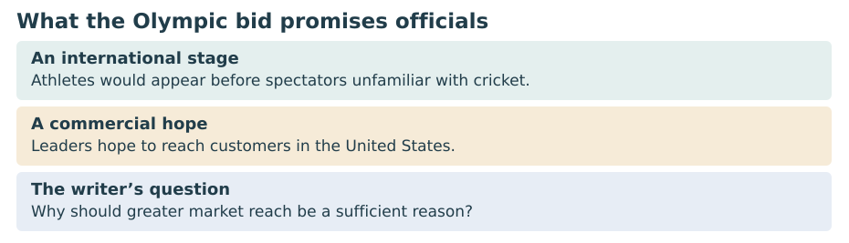

# École polytechnique FUI-FF, session 1 — Anglais 2022 · Corrigé guidé

*Corrigé rédigé par IA, non officiel.*

**Rédaction** · modèle exact non renseigné (famille GPT-6) · effort non renseigné · vitesse non renseignée

**Révision** · modèle exact non renseigné (famille GPT-6) · effort non renseigné · vitesse non renseignée

**Révision** · GPT-6.2 Astra Ultra · vitesse non renseignée

**Révision** · GPT-6.2 Astra Ultra · vitesse non renseignée

**Révision (tour 4)** · GPT-6.2 Astra Ultra · vitesse non renseignée

L’épreuve dure deux heures. Le sujet demande au moins 50 mots par réponse de compréhension et un essai de 405 à 495 mots, avec une barre tous les 50 mots. Les renvois aux pages du PDF identifient les idées reprises de l’article.

[Sujet officiel](https://www.polytechnique.edu/admission-cycle-ingenieur/sites/admission/files/content/2022%20FUI-FF%20S1%20SUJET%20ANGLAIS_0.pdf)

## Reading comprehension

### 1. Olympic admission as an apparently obvious choice

> [!INDICATION]
> Situer la candidature olympique au moment de l’article, en 2021. Expliquer le public et le marché visés puis identifier le point de vue de la journaliste.

Cricket officials portray Olympic admission as such an obvious opportunity that debate seems unnecessary. The article describes an Olympic bid aimed at 2028. Competing there could introduce unfamiliar spectators to the game, particularly Americans whose attention is commercially valuable. It would also give cricket visibility outside places historically connected with Britain. John reports this sales argument with some scepticism, asking why attracting fresh customers should count as an unquestionable good. (John, p. 2).

### 2. Why growth pressures bear on rugby and cricket

> [!INDICATION]
> Les investisseurs de rugby sont présents dans le championnat anglais et auprès de l’équipe de Nouvelle-Zélande. Pour le cricket, John reconnaît que certaines activités doivent être subventionnées par d’autres. Elle conteste que le sport entier soit pour autant menacé de disparition.

British rugby and cricket operate in football’s shadow, which John thinks makes their leaders unusually eager to prove commercial success. Private investment creates a further incentive in rugby, where investors now have interests ranging from the English Premiership to New Zealand. Cricket administrators defend growth by suggesting the sport might otherwise disappear. John accepts that some competitions need cross-subsidy but disputes that wider claim. (John, pp. 2–3).

### 3. How senior bonuses are defended

> [!INDICATION]
> Identifier qui toucherait effectivement la prime, puis comparer la justification du dirigeant et le jugement de John.

The board’s chairman says comparable employers, including other sporting organisations, regularly use such payments to attract and retain senior staff. John herself connects that assumption with the executives’ previous careers in finance or business. John questions the priorities revealed by a proposed bonus pool worth £2.1 million for just a few administrators when cuts had already left sixty-two employees jobless and cricketers facing lower wages. (John, p. 2).

### 4. What expansion can cost

> [!INDICATION]
> Nommez The Hundred pour la saturation du calendrier et Ben Stokes pour la limite de la rotation. La chronique ne fournit pas de diagnostic individuel sur son absence. Sa présence dans l’argument sert à discuter l’effet de la réponse choisie par les dirigeants.

The Hundred added fixtures despite opposition from many existing supporters. Organisers responded to tired players by selecting larger squads and rotating people rather than cutting matches. John mentions Ben Stokes’s absence at the height of the season as evidence that this response had not solved the problem. If organisers focus on finding new customers, they can damage both players’ working conditions and the recreation current spectators value. (John, pp. 2–3).

Dans la troisième question, attribuer à Ian Watmore la comparaison avec les pratiques d’autres employeurs. Le rapprochement avec le monde bancaire et la mise en regard des licenciements sont des éléments du récit critique d’Emma John.

## Essay

> [!INDICATION]
> Éprouver les deux perspectives à partir d’un club imaginaire. Quelles recettes peuvent faire vivre le sport, et que laisseraient-elles dans l’ombre si l’on jugeait la saison sur ce seul critère ?

At our imaginary town cricket ground, a child sits beside her grandfather and asks why everyone has stopped for tea. During the break she meets the bowler whose last delivery she admired. The afternoon will never feature in a television audience survey, yet that conversation might bring her back for / years. A sporting organisation that measures its achievements only through broadcasting contracts risks overlooking the experiences on which its future depends.

I share the writer’s concern about managers who treat every unoccupied weekend as a business opportunity. Adding a tournament may create space for another sponsor but remove time for / injury recovery or for visiting relatives. Spectators also have crowded calendars. Someone who can afford six afternoons each season gains little when organisers offer twelve fixtures and double the price of the six that matter most. Keeping an event worth attending can require considerable skill even when its audience remains / roughly the same size.

Nevertheless, money buys things that an amateur club needs. Replacing a damaged roof, hiring a qualified coach and providing accessible toilets all cost more than committee members can usually donate. A broadcast agreement might pay for those improvements, and an evening competition could welcome nurses who / work while traditional daytime fixtures are taking place. Dismissing every commercial proposal would leave existing members comfortably in charge of deciding who can afford to participate. A welcome newcomer might experience a reform quite differently from an established supporter.

I would therefore ask management to explain each proposal through the / experience of particular people. If an additional match is expected to cover the roof repairs, publish the expected income alongside the cost and show where players will recover the day they lose. Ask young members, volunteers and visiting teams whether the new schedule works for them. Later, count cancelled sessions / and injuries alongside ticket sales. That information might eventually support a second event. It might equally persuade the committee to give the weekend back to ordinary practice.

The deeper issue concerns who is entitled to describe a good season. A broadcaster might remember a dramatic final, a groundskeeper the first / spring without flooding, and a teenager the first ball she managed to hit cleanly. A club owes all three an opportunity to speak, even though only one can offer a large cheque. For the child beside her grandfather, an unhurried interval belonged to cricket itself. Before shortening that interval to / sell another advertising slot, the committee should listen to what happened there and consider what a quicker afternoon might quietly take away from everyone.

*424 words.*

## Vérification des longueurs

Les quatre réponses de compréhension comptent respectivement 70, 64, 65 et 67 mots hors références. Dans l’essai, un groupe relié par un trait d’union compte pour un seul mot.
