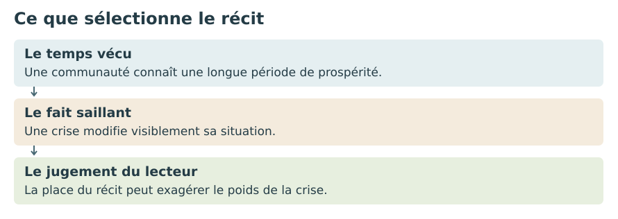

# École polytechnique FUI-FF, session 1 — Français 2022 · Corrigé brut

*Corrigé rédigé par IA, non officiel.*

**Rédaction** · modèle exact non renseigné (famille GPT-6) · effort non renseigné · vitesse non renseignée

**Révision** · modèle exact non renseigné (famille GPT-6) · effort non renseigné · vitesse non renseignée

**Révision** · GPT-6.2 Astra Ultra · vitesse non renseignée

Cette épreuve de la filière universitaire internationale de formation francophone dure deux heures. Le texte vient du livre IV d’Émile ou De l’éducation de Jean-Jacques Rousseau (1762). Le sujet appelle une réponse d’ensemble, deux explications et un essai bref de forme libre sans limite de mots.

## A1 · La double portée de l’histoire

Rousseau fait de l’histoire un moyen de connaître les êtres humains et signale aussitôt le danger que cette connaissance comporte. Le récit des actes permet de confronter les paroles par lesquelles chacun se présente à ce qu’il a effectivement fait. Mais le récit retient surtout les bouleversements. Une longue période de prospérité paisible lui fournit moins de matière qu’une guerre ou qu’une catastrophe. L’histoire instruit donc à condition de tenir compte de la sélection qui s’opère entre tous les faits possibles. À la lire comme une peinture complète de l’humanité, on risque de trouver les hommes plus mauvais qu’ils ne sont.

## A2a · Observer les hommes en action

Un homme peut choisir l’image qu’il donne de lui dans une conversation. Ses décisions, en particulier lorsque sa réputation ou ses intérêts sont en jeu, mettent ses principes à l’épreuve. Lire qu’il promettait de partager une charge ne suffit pas. Apprendre qui l’a effectivement supportée permet de juger sa promesse. La parole garde donc une utilité : c’est en la rapprochant de l’acte qu’on aperçoit la distance entre le personnage que l’homme composait et la conduite qu’il a tenue.

## A2b · Le choix des faits racontés

Un récit cherche volontiers le moment où la situation change. Les années pendant lesquelles une population cultive ses terres, élève ses enfants et prospère paisiblement passent presque inaperçues. C’est lorsque le peuple ne peut plus se suffire à lui-même, intervient chez ses voisins ou les laisse intervenir chez lui que l’historien commence, selon Rousseau, à lui faire une place. Le défaut porte sur les proportions de la peinture. Ce qui occupe presque tout le récit n’a pas nécessairement occupé presque toute la vie du peuple. Le paradoxe final de Rousseau suggère même qu’un peuple devient célèbre précisément quand le temps de son indépendance heureuse s’achève.

## B · Pourquoi comprendre le passé ?

Ce que l’histoire m’apporte de plus précieux est la possibilité de poser une question au présent sans supposer qu’il a toujours eu la même forme. Devant un bureau de vote, par exemple, le geste de prendre une enveloppe peut paraître aussi ordinaire que celui de faire la queue. Savoir que les Françaises ont voté pour la première fois lors des élections municipales de 1945 change mon regard. Deux personnes qui accomplissent aujourd’hui le même geste auraient pu, au début de la vie de leurs grands-parents, se trouver de deux côtés opposés de la porte.

Rousseau m’incite cependant à demander ce que laisse de côté le récit d’une première fois. Une date tient sur la plaque d’une mairie. Les discussions familiales, les trajets pour rejoindre le bureau, l’apprentissage des formalités et la fierté ou l’indifférence des électrices y tiennent moins facilement. Une photographie de la file ou le journal d’une habitante feraient surgir d’autres questions. Il faudrait encore comparer ces traces et se demander de quelle ville, de quelle famille et de quelle élection elles témoignent. Une expérience singulière ne parle pas pour toutes.

Comprendre le passé me semble important pour cette double raison. L’histoire établit qu’une règle dont nous héritons a pu être transformée. Elle nous apprend aussi à distinguer ce que nous avons de bonnes raisons d’affirmer de ce que les archives laissent dans l’ombre. Je ne demande donc pas au passé une solution toute prête pour le prochain scrutin. J’y trouve une raison de prendre au sérieux les conditions concrètes qui permettent à chacun de participer au présent.
