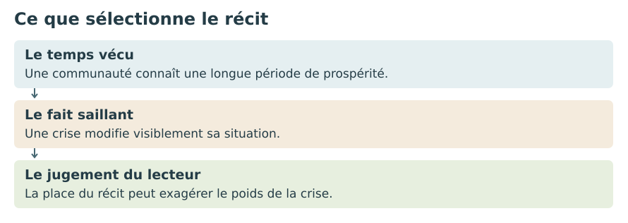
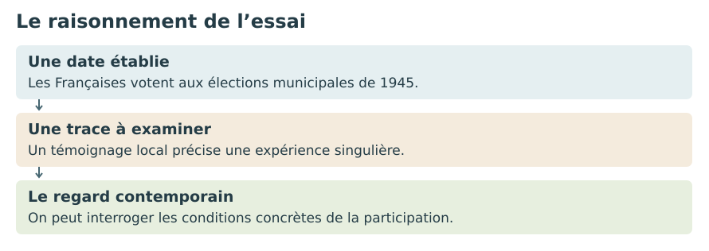

# École polytechnique FUI-FF, session 1 — Français 2022 · Corrigé guidé

*Corrigé rédigé par IA, non officiel.*

**Rédaction** · modèle exact non renseigné (famille GPT-6) · effort non renseigné · vitesse non renseignée

**Révision** · modèle exact non renseigné (famille GPT-6) · effort non renseigné · vitesse non renseignée

**Révision** · GPT-6.2 Astra Ultra · vitesse non renseignée

**Révision (tour 3)** · GPT-6.2 Astra Ultra · vitesse non renseignée

L’épreuve n° 2 du concours 2022 a eu lieu le samedi 18 septembre 2021, de 13 h 30 à 15 h 30. Dans « L’Histoire », extrait du livre IV d’*Émile ou De l’éducation* (1762), Jean-Jacques Rousseau s’interroge sur les conditions d’un jugement équitable. Le sujet demande trois réponses de compréhension, puis un bref essai de forme libre, sans limite de mots. Le sujet interdit les dictionnaires et traducteurs électroniques.

[Sujet officiel de la session 1](https://www.polytechnique.edu/admission-cycle-ingenieur/sites/admission/files/content/2022%20FUI-FF%20S1%20SUJET%20DE%20FRANCAIS.pdf)

## A1 · La double portée de l’histoire

> [!INDICATION]
> Reconstituer le mouvement qui conduit de la connaissance des actes au risque d’un jugement inéquitable.

Rousseau fait de l’histoire un moyen de connaître les êtres humains et signale aussitôt le danger que cette connaissance comporte. Le récit des actes permet de confronter les paroles par lesquelles chacun se présente à ce qu’il a effectivement fait. Mais le récit retient surtout les bouleversements. Une longue période de prospérité paisible lui fournit moins de matière qu’une guerre ou qu’une catastrophe. L’histoire instruit donc à condition de tenir compte de la sélection qui s’opère entre tous les faits possibles. À la lire comme une peinture complète de l’humanité, on risque de trouver les hommes plus mauvais qu’ils ne sont.

## A2a · Observer les hommes en action

> [!INDICATION]
> Quel usage Rousseau conserve-t-il à la parole dès lors qu’on dispose aussi des actes ?

Un homme peut choisir l’image qu’il donne de lui dans une conversation. Ses décisions, en particulier lorsque sa réputation ou ses intérêts sont en jeu, mettent ses principes à l’épreuve. Supposons qu’un magistrat se dise impartial, puis accorde une faveur à un proche. Rapprochée de la décision, sa déclaration nous apprend encore quelque chose sur lui. Il tenait à paraître juste. Rousseau explique ainsi le paradoxe du déguisement qui révèle celui qui le porte.

## A2b · Le choix des faits racontés

> [!INDICATION]
> Comparer la durée de la vie paisible à la place qu’elle occupe dans un récit attiré par les catastrophes.

Un récit cherche volontiers le moment où la situation change. Les années pendant lesquelles une population cultive ses terres, élève ses enfants et prospère paisiblement passent presque inaperçues. C’est lorsque le peuple ne peut plus se suffire à lui-même, intervient chez ses voisins ou les laisse intervenir chez lui que l’historien commence, selon Rousseau, à lui faire une place. Le défaut porte sur les proportions de la peinture. Ce qui occupe presque tout le récit n’a pas nécessairement occupé presque toute la vie du peuple. Le paradoxe final de Rousseau suggère même qu’un peuple devient célèbre précisément quand le temps de son indépendance heureuse s’achève.

## B · Pourquoi comprendre le passé ?

> [!INDICATION]
> Choisir un droit ou une habitude dont on peut montrer l’histoire, puis examiner ce que la première date laisse dans l’ombre.

Ce que l’histoire m’apporte de plus précieux est la possibilité de poser une question au présent sans supposer qu’il a toujours eu la même forme. Devant un bureau de vote, par exemple, le geste de prendre une enveloppe peut paraître aussi ordinaire que celui de faire la queue. L’ordonnance du 21 avril 1944 reconnaît aux femmes le droit de voter et de se présenter aux élections dans les mêmes conditions que les hommes. Un an plus tard, le 29 avril 1945, des électrices entrent dans les bureaux de vote pour le premier tour des municipales. Il a donc fallu une décision politique puis une élection pour que deux personnes, hier séparées par la loi, puissent accomplir le même geste.

Rousseau m’incite cependant à demander ce que laisse de côté le récit d’une première fois. Une date tient sur la plaque d’une mairie. Les discussions familiales, les trajets pour rejoindre le bureau, l’apprentissage des formalités et la fierté ou l’indifférence des électrices y tiennent moins facilement. Une photographie de la file ou le journal d’une habitante feraient surgir d’autres questions. Il faudrait encore comparer ces traces et se demander de quelle ville, de quelle famille et de quelle élection elles témoignent. Une expérience singulière ne parle pas pour toutes. Le scrutin du 21 octobre 1945 soulève encore une autre question. Trente-trois femmes entrent à l’Assemblée constituante. Pour apprécier ce que l’éligibilité change dans la vie publique, j’aimerais lire aussi les débats auxquels elles ont pris part.

Comprendre le passé me semble important pour cette double raison. L’histoire établit qu’une règle dont nous héritons a pu être transformée. Elle nous apprend aussi à distinguer ce que nous avons de bonnes raisons d’affirmer de ce que les archives laissent dans l’ombre. Je ne demande donc pas au passé une solution toute prête pour le prochain scrutin. J’y trouve une raison de prendre au sérieux les conditions concrètes qui permettent à chacun de participer au présent.

> [!METHODE]
> Pour expliquer la dernière phrase de Rousseau, distinguez deux chronologies. Dans la vie du peuple, la prospérité précède le déclin. Dans le récit que critique Rousseau, le déclin fournit la première scène digne d’être racontée.

> [!METHODE]
> Le sujet demande le regard de Rousseau sur l’histoire. Son reproche porte sur la sélection des faits racontés. La disproportion entre le calme et les catastrophes dans un récit n’établit pas que les sociétés aient toujours été agitées.
