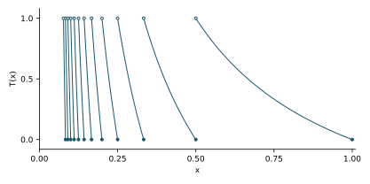

# X FUI-FF, session 1 — Mathématiques 2022 · Corrigé brut

*Corrigé rédigé par IA, non officiel. Signalez toute erreur.*

**Rédaction** · GPT-6.2 Astra Ultra · vitesse non renseignée

**Révision** · GPT-6.2 Astra Ultra · vitesse non renseignée

Le concours 2022 désigne cette composition comme sa session d’automne, tenue le 18 septembre 2021. On note $r_n=p_n/q_n$ la réduite d’ordre $n$.

## 1. Convergence des fractions continues

### Question 1

Posons $p_{-1}=1,q_{-1}=0,p_0=a_0,q_0=1$. La multiplication à droite donne $p_{n+1}=a_{n+1}p_n+p_{n-1}$ et $q_{n+1}=a_{n+1}q_n+q_{n-1}$, la seconde colonne étant la première ancienne. L’induction donne le produit annoncé avec des entiers et $q_n\ge1$ pour $n\ge0$. Pour $n\ge1$, $q_{n+1}\ge q_n+q_{n-1}>q_n$. Le premier pas peut être une égalité : $q_1=a_1=q_0$ si $a_1=1$. La croissance stricte demandée vaut donc à partir de $q_1$ et $q_n\to\infty$.

### Question 2

La matrice $M(a)=\left(\begin{smallmatrix}a&1\\1&0\end{smallmatrix}\right)$ représente $z\mapsto a+1/z$. Le produit $M(a_0)\cdots M(a_n)$ appliqué à $z=1/\alpha$ donne donc $[a_0;\ldots,a_n+\alpha]=(p_n+\alpha p_{n-1})/(q_n+\alpha q_{n-1})$. Faire $\alpha\downarrow0$ donne $p_n/q_n$ (tous les dénominateurs de la fraction imbriquée restent positifs).

### Question 3

Chaque facteur a déterminant $-1$, d’où $p_nq_{n-1}-p_{n-1}q_n=(-1)^{n+1}$. Pour $n\ge1$, on peut diviser par $q_n q_{n-1}>0$. Ainsi $r_n-r_{n-1}=(-1)^{n+1}/(q_nq_{n-1})$.

### Question 4

Posons $r_n=p_n/q_n$. La récurrence et la question 3 donnent $r_{n+2}-r_n=(-1)^n a_{n+2}/(q_{n+2}q_n)$. Donc les termes pairs croissent strictement et les impairs décroissent strictement. De plus $r_{2n+1}-r_{2n}=1/(q_{2n}q_{2n+1})>0$ tend vers zéro. Ces deux suites adjacentes ont la même limite $x$, strictement comprise entre deux réduites consécutives.

### Question 5

On a $0<|x-p_n/q_n|<1/(q_nq_{n+1})\le1/q_n^2$. Les entiers $q_n$ tendent vers l’infini, ce qui fournit une infinité de couples deux à deux distincts.

### Question 6

Si $x=A/B$ avec $B\ge1$, l’entier non nul $Aq_n-Bp_n$ donne $|x-p_n/q_n|\ge1/(Bq_n)$. Pour $q_n>B$, cela contredit la question 5. La limite est irrationnelle.

### Question 7

Toutes les fractions tronquées à un chiffre de moins tendent aussi vers $x$, et elles sont positives, au moins $1$. Passant à la limite dans $r_{n+1}=1+1/r_n$, on obtient $x^2-x-1=0$. Sa seule racine positive est $(1+\sqrt5)/2$. On peut aussi lire $r_n=F_{n+2}/F_{n+1}$ dans les puissances de $M(1)$.

## 2. Développement d’un irrationnel

### Question 8

Sur $0<x<1$, le graphe de la partie fractionnaire de $1/x$ se décrit branche par branche. Pour $1/(k+1)<x\le1/k$, on a $T(x)=1/x-k$. La branche décroît de la limite $1$ au bord gauche à $0$ au bord droit. Ce zéro est atteint en $1/k$ pour $k\ge2$. Sur la première branche, $x$ tend vers $1$ sans l’atteindre. La figure représente la formule sur $]0,1[$. Pour le développement d’un irrationnel, on en conserve les seules abscisses irrationnelles.

### Question 9

Pour $y\in]0,1[\setminus\mathbb Q$, $1/y$ est irrationnel et sa partie fractionnaire appartient à $]0,1[\setminus\mathbb Q$. Aucune division par zéro ne survient donc dans les itérations.

### Question 10

Comme $1/T^{j-1}x>1$, $a_j$ est un entier au moins égal à $1$. L’identité $1/T^{j-1}x=a_j+T^jx$ itérée donne $x=[0;a_1,\ldots,a_n+T^nx]$. Par 2 et 3, en posant $t=T^nx>0$, on a $x-r_n=(-1)^n t/[q_n(q_n+tq_{n-1})]$. Ainsi $r_{2p}<x<r_{2p-1}$, ce qui implique les inégalités demandées.

### Question 11

La question 4 appliquée aux chiffres ainsi obtenus donne la même limite aux deux bornes de 10. Le théorème d’encadrement identifie cette limite à $x$. Pour un irrationnel quelconque on rétablit sa partie entière en tête du développement.

### Question 12a

La division donne $x^6-4x^5+5x^4-4x^2+4-4/(1+x^2)$. Son intégrale de zéro à un vaut $1/7-2/3+1-4/3+4-4\arctan(1)=22/7-\pi$.

### Question 12b

Sur $]0,1[$, l’intégrande est strictement positif et $x(1-x)\le1/4$. Ainsi $0<x^4(1-x)^4/(1+x^2)<1/256$ à l’intérieur. En intégrant, $0<22/7-\pi<1/256$.

## 3. Fractions continues périodiques

### Question 13

Si $A\alpha^2+B\alpha+C=0$, alors $C\ne0$ puisque $\alpha$ est irrationnel. Son inverse annule $CX^2+BX+A$ et reste irrationnel. Pour $r\in\mathbb Q^*$, $s\in\mathbb Q$, $r\alpha+s$ annule $A(X-s)^2+Br(X-s)+Cr^2$, de degré deux à coefficients rationnels, et une valeur rationnelle rendrait $\alpha$ rationnel.

### Question 14a

Si la période est $p$, la queue repart de $a_0$ ; par périodicité ce chiffre est aussi au moins $1$. La limite $x$ est donc fixe par la transformation de matrice $M(a_0)\cdots M(a_{p-1})=\left(\begin{smallmatrix}A&B\\C&D\end{smallmatrix}\right)$. Ceci suit en passant à la limite dans les tronquées après une période. On a $C=q_{p-1}>0$, même si $p=1$. Ainsi $Cx^2+(D-A)x-B=0$, et $x$ est irrationnel par 6. Il est quadratique.

### Question 14b

La queue périodique est quadratique par 14a. Chaque chiffre antérieur transforme la queue $y$ en $a+1/y$, qui reste quadratique par 13. En un nombre fini d’étapes, on obtient la limite initiale.

### Question 15a

Pour $m=a+b\ge2$, $m^2<m^2+4<(m+1)^2$ puisque $2m+1\ge5$. Aucun entier ne peut avoir pour carré $m^2+4$.

### Question 15b

Le discriminant est $(a+b)^2+4>0$. Sa racine carrée est irrationnelle par 15a (la racine rationnelle d’un entier est entière). Les racines $(a-b\pm\sqrt{(a+b)^2+4})/2$ sont irrationnelles de signes opposés, car leur produit vaut $-ab-1<0$. La positive est celle du signe $+$.

### Question 15c

L’équation est $(x_0-a)(x_0+b)=1$. Avec $y=x_0+b>1$ on a $x_0=a+1/y$ et $y=a+b+1/y$. Puisque $0<1/y<1$, les parties entières de $x_0$ et de $y$ sont respectivement $a$ et $a+b$. La répétition donne $x_0=[a;\overline{a+b}]$.

## 4. Approximation diophantienne

### Question 16

Énumérons les rationnels $r_j$, $j\ge1$. Les intervalles ouverts centrés en $r_j$ de longueur $\varepsilon 2^{-j-1}$ les couvrent pour un coût total inférieur à $\varepsilon$. Si les irrationnels étaient aussi négligeables, les deux recouvrements choisis pour $\varepsilon/2$ rendraient $\mathbb R$ négligeable, en contradiction avec l’hypothèse sur les ouverts non vides.

### Question 17a

Pour chaque $q$, l’inégalité et $x\in[0,1]$ bornent $p$. Une infinité de couples impose donc des dénominateurs arbitrairement grands. Réciproquement de tels dénominateurs fournissent une infinité de couples. Ainsi $\mathcal L=\bigcap_{N\ge1}\bigcup_{q\ge N}\mathcal L_q$.

### Question 17b

Pour $q$ assez grand, $C/q^{1+\delta}<1$, donc les seuls numérateurs possibles sont $0,\ldots,q$. Couvrons les intervalles fermés utiles par les intervalles ouverts de mêmes centres et de rayon $2C/q^{2+\delta}$. Pour $q\ge N$, le coût total est au plus $4C\sum_{q\ge N}(q+1)/q^{2+\delta}$, queue de série convergente. Elle devient inférieure à tout $\varepsilon>0$. La question 17a donne la négligeabilité.
