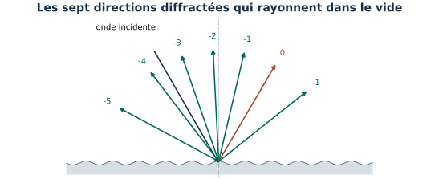
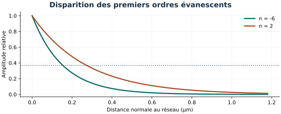
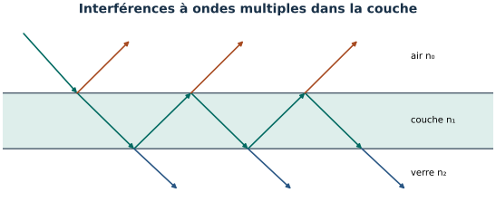
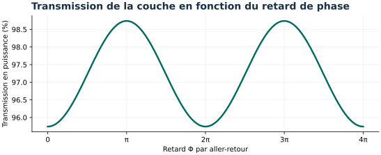
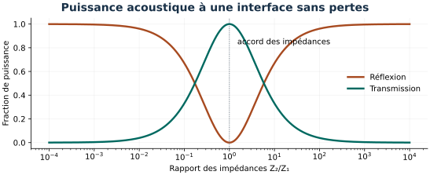

# École polytechnique, FUI-FF session 1 — Physique 2022 · Corrigé brut

*Corrigé rédigé par IA, non officiel. Signalez toute erreur.*

**Rédaction** · modèle exact non renseigné (famille GPT-6) · effort non renseigné · vitesse non renseignée

**Révision** · modèle exact non renseigné (famille GPT-6) · effort non renseigné · vitesse non renseignée · 24 novembre 2026

**Révision (tour 2)** · GPT-6.2 Astra Ultra · vitesse non renseignée · 24 novembre 2026

**Révision (tour 3)** · GPT-6.2 Astra Ultra · vitesse non renseignée · 26 novembre 2026

Formation francophone, session 1 (automne), trois heures sans calculatrice.

## Exercice 1 — Diffraction par un réseau métallique

### Question 1a

En l’absence de charge et de courant,
$$\nabla\cdot\mathbf E_T=0,\quad\nabla\cdot\mathbf B_T=0,\quad\nabla\times\mathbf E_T=-\partial_t\mathbf B_T,\quad\nabla\times\mathbf B_T=c^{-2}\partial_t\mathbf E_T.$$

### Question 1b

L’identité $\nabla\times(\nabla\times\mathbf E_T)=\nabla(\nabla\cdot\mathbf E_T)-\Delta\mathbf E_T$ et Ampère-Maxwell donnent
$$\Delta\mathbf E_T-c^{-2}\partial_t^2\mathbf E_T=\mathbf0.$$

### Question 1c

À la surface d’un conducteur parfait, la composante tangentielle du champ électrique total est nulle. Puisque la polarisation est selon $\mathbf e_z$, $\mathbf E_T(x,f(x),z,t)=\mathbf0$. Le champ diffracté doit y compenser le champ incident.

### Question 2

Avec $\mathbf E_i\propto e^{j(\mathbf k\cdot\mathbf r-\omega t)}$, on obtient $-k^2+\omega^2/c^2=0$. Le module positif est $k=\omega/c=2\pi/\lambda$.

### Question 3a

La loi $\nabla\cdot\mathbf E_D=0$ résulte par soustraction des lois de Gauss pour les champs total et incident. Pour $\mathbf E_D=E(x,y,z)e^{-j\omega t}\mathbf e_z$, elle se réduit à $\partial_zE=0$. L’amplitude dépend donc seulement de $x,y$.

### Question 3b

L’équation d’onde s’applique aussi au champ diffracté par linéarité. À la fréquence $\omega$, son amplitude vérifie l’équation de Helmholtz
$$\partial_x^2E+\partial_y^2E+k^2E=0.$$

### Question 3c

La figure donne $k_x=k\sin\theta_0$ et $k_y=-k\cos\theta_0$. Sur le métal, $E(x,f(x))=-E_0e^{j(k_xx+k_yf(x))}$. Comme $f(x+a)=f(x)$,
$$E(x+a,f(x))=e^{jka\sin\theta_0}E(x,f(x)).$$

### Question 4a

Une onde $Ae^{j(\alpha x+\beta y)}$ exige $\alpha^2+\beta^2=k^2$. La relation de translation impose $e^{j\alpha a}=e^{jka\sin\theta_0}$, donc
$$\alpha=k\sin\theta_0+nK,\quad K=2\pi/a,\quad n\in\mathbb Z.$$
La surface ne fixe ainsi la composante tangentielle qu’à un multiple de $K$ près.

### Question 4b

On a $-1\le\sin\theta_0+n\lambda/a\le1$. Les ordres permis vont de $-N_1$ à $N_2$, où $N_1=\lfloor(a/\lambda)(1+\sin\theta_0)\rfloor$ et $N_2=\lfloor(a/\lambda)(1-\sin\theta_0)\rfloor$. Pour eux,
$$\sin\theta_n=\sin\theta_0+n\lambda/a,\qquad\beta_n=+k\cos\theta_n,$$
avec $-\pi/2\le\theta_n\le\pi/2$. Ce sont des ondes planes progressives qui s’éloignent du réseau, ou le longent dans le cas rasant. Ici $a=1/(500\,\mathrm{mm}^{-1})=2{,}0\,\mu\mathrm m$, $\lambda/a=0{,}275$, $\sin\theta_0=0{,}5$. On trouve **$N_1=5$ et $N_2=1$**, soit sept ordres.

### Question 4c

Pour $|\alpha_n|>k$, $\beta_n=j\kappa_n$ avec $\kappa_n=\sqrt{\alpha_n^2-k^2}>0$. Le champ varie comme $e^{j\alpha_nx}e^{-\kappa_n y}$ : il oscille parallèlement au réseau et s’atténue exponentiellement à la normale avec la longueur d’amplitude $1/\kappa_n$. Pour $n=-6$, $\alpha_n/k=-1{,}15$, soit $1/\kappa_n\simeq0{,}154\,\mu\mathrm m$. Pour $n=2$, $\alpha_n/k=1{,}05$, soit $1/\kappa_n\simeq0{,}273\,\mu\mathrm m$.

### Question 4d

Il faudrait $Ae^{j[\alpha x+\beta f(x)]}=-E_0e^{j[k_xx+k_yf(x)]}$ pour tout $x$. La phase $(\alpha-k_x)x+(\beta-k_y)f(x)$ devrait donc être constante modulo $2\pi$. Pour un relief périodique non plat, cela imposerait en général $\alpha=k_x$ et $\beta=k_y<0$, soit une onde qui revient vers le réseau. Une seule onde sortante ne satisfait donc pas la condition de surface point par point. Une somme d’ordres peut la satisfaire.

### Question 5a

Les ordres à $\beta_n$ réel ne subissent pas d’atténuation en $y$ dans ce modèle d’ondes planes. Les ordres évanescents sont multipliés par $e^{-\kappa_n y}$ ; suffisamment loin du réseau, ils deviennent négligeables. Le champ lointain se réduit aux ordres $-N_1\le n\le N_2$, avec les amplitudes fixées par le profil.

### Question 5b

Dans une direction sortante $\theta_n$, la différence de phase entre deux motifs voisins est $ka(\sin\theta_0-\sin\theta_n)$. L’interférence constructive exige qu’elle soit un multiple entier de $2\pi$. Avec la convention d’ordre déjà choisie, la formule du réseau en réflexion est
$$a(\sin\theta_n-\sin\theta_0)=n\lambda=\frac{2\pi nc}{\omega}.$$
Pour $n=0$, on retrouve la réflexion spéculaire.

## Exercice 2 — Couche mince diélectrique

### Question 1

Pour des milieux transparents non magnétiques, la continuité de $E$ tangentiel donne $1+r_{ij}=t_{ij}$. Celle de $H$ tangentiel donne $n_i(1-r_{ij})=n_jt_{ij}$ car le champ magnétique réfléchi change de sens. Donc $r_{ij}=(n_i-n_j)/(n_i+n_j)$ et $t_{ij}=2n_i/(n_i+n_j)$ pour les amplitudes du champ électrique.

### Question 2

Les deux interfaces divisent l’amplitude à chaque rencontre. Les faisceaux émergents cohérents se superposent par **interférences à ondes multiples**, en réflexion comme en transmission.

### Question 3

Avec une onde incidente d’amplitude unité, le premier reflet direct est $u_1=r_{01}$. Le deuxième subit la transmission $t_{01}$, la réflexion $r_{12}$, la transmission $t_{10}$ et un aller-retour dans la couche. Le retard de phase de propagation par aller-retour est $\Phi=4\pi n_1 e/\lambda$ pour la longueur d’onde dans le vide $\lambda$. Avec la convention du sujet, pour $p\ge2$,
$$u_p=t_{01}(r_{12})^{p-1}(r_{10})^{p-2}t_{10}e^{-i(p-1)\Phi}.$$
Le retard de propagation du rayon $p$ par rapport au premier est $(p-1)\Phi$ ; d’éventuelles inversions de phase aux réflexions sont déjà contenues dans les $r_{ij}$ signés.

### Question 4

À partir de $u_2=t_{01}r_{12}t_{10}e^{-i\Phi}$, chaque rayon est multiplié par $q=r_{10}r_{12}e^{-i\Phi}$. Comme $|q|<1$,
$$U_R=r_{01}+\frac{t_{01}t_{10}r_{12}e^{-i\Phi}}{1-r_{10}r_{12}e^{-i\Phi}}.$$

### Question 5

En utilisant $r_{10}=-r_{01}$ et $t_{01}t_{10}=1-r_{01}^2$, les termes en $r_{01}^2r_{12}$ s’annulent au numérateur. D’où
$$U_R=\frac{r_{01}+r_{12}e^{-i\Phi}}{1+r_{01}r_{12}e^{-i\Phi}}.$$

### Question 6

En prenant la phase du premier rayon transmis comme référence, $v_1=t_{01}t_{12}$. Le rayon transmis de rang $p\ge1$ subit $p-1$ allers-retours supplémentaires. Ainsi
$$v_p=t_{01}t_{12}(r_{10}r_{12}e^{-i\Phi})^{p-1},\qquad U_T=\frac{t_{01}t_{12}}{1+r_{01}r_{12}e^{-i\Phi}}.$$
L’autre choix de référence ajouterait au champ transmis une phase commune d’un simple trajet.

### Question 7

Notons $r=r_{01}$, $s=r_{12}$ et $D=1+r^2s^2+2rs\cos\Phi$. Les résultats sont
$$R=\frac{r^2+s^2+2rs\cos\Phi}{D},\qquad T=\frac{(1-r^2)(1-s^2)}{D}.$$
Le facteur de puissance $n_2/n_0$ a été utilisé grâce à $(n_j/n_i)t_{ij}^2=1-r_{ij}^2$. La somme des numérateurs vaut $D$, donc **$R+T=1$** : les milieux sont sans pertes.

### Question 8

Pour $n_0<n_1<n_2$, $r<0$, $s<0$ et $rs>0$. Le facteur $T$ est périodique de période $2\pi$, minimal pour $\Phi=2m\pi$ et maximal pour $\Phi=(2m+1)\pi$. Il croît entre $0$ et $\pi$ puis décroît entre $\pi$ et $2\pi$. Les valeurs aux extrema s’obtiennent en remplaçant $D$ par $(1+rs)^2$ au minimum et $(1-rs)^2$ au maximum.

### Question 9

Le minimum de $R$ est atteint pour $\Phi=(2m+1)\pi$, soit $e=(2m+1)\lambda/(4n_1)$, $m\ge0$. C’est l’épaisseur optique quart d’onde à un multiple de demi-onde près. La réflectance minimale vaut $[(n_0n_2-n_1^2)/(n_0n_2+n_1^2)]^2$ et s’annule pour $n_1=\sqrt{n_0n_2}$.

### Question 10

Le verre étant semi-infini et $n_0\simeq1$, $R_0=[(1-1{,}52)/(1+1{,}52)]^2\simeq0{,}04258$, soit **$4{,}26\,\%$**. À indices fixés, ce résultat est indépendant de la longueur d’onde.

### Question 11

Pour les données littérales, $e=996\times10^{-10}\,\mathrm m=99{,}6\,\mathrm{nm}$, $n_1=1{,}38$ et $\lambda=0{,}55\,\mathrm{mm}$. Ainsi $\Phi=4\pi n_1e/\lambda\simeq0{,}00314$. La formule générale de la question 7 donne **$R\simeq0{,}0425799$**, donc pratiquement $R_0$.

La couche est quart d’onde pour $\lambda_\star=4n_1e\simeq0{,}550\,\mu\mathrm m$, dans le visible. Si c’est cette longueur d’onde qui était visée, on a
$$R\simeq R_{\min}=\left(\frac{n_0n_2-n_1^2}{n_0n_2+n_1^2}\right)^2\simeq0{,}0126,$$
soit **$1{,}26\,\%$**. L’application est le traitement antireflet des surfaces optiques à la longueur d’onde de conception.

L’épaisseur de la couche peut aussi se contrôler par deux limites. Pour $e\to0$, les deux interfaces se confondent et $U_R=(r_{01}+r_{12})/(1+r_{01}r_{12})=(n_0-n_2)/(n_0+n_2)$. À la phase opposée, $e=\lambda/(4n_1)$, on obtient $U_R=(n_0n_2-n_1^2)/(n_0n_2+n_1^2)$. Le premier résultat explique pourquoi les données imprimées en millimètres restituent presque la réflexion du verre nu.

## Exercice 3 — Propagation d’ondes acoustiques

### Question 1

La masse initiale est $\rho_0 S\,dx$. Les pressions totales $P_0+p$ sur ses deux faces donnent la force $-S\partial_xp\,dx$ le long de $x$. Évaluer les pressions aux abscisses de repos suffit au premier ordre. Le principe fondamental de la dynamique donne
$$\rho_0\partial_t^2\psi=-\partial_xp.$$

### Question 2

Le passage de l’onde est rapide devant les échanges thermiques, et les dissipations sont négligées. À faible amplitude, l’évolution d’une tranche est donc adiabatique réversible, soit isentropique. Comme $\delta V/V=\partial_x\psi$ et $\chi_s=-(1/V)(\partial V/\partial P)_s$, on a
$$p=-\frac{1}{\chi_s}\partial_x\psi.$$
Une compression ($\partial_x\psi<0$) donne une surpression positive.

### Question 3

On trouve $\partial_t^2\psi=c^2\partial_x^2\psi$ avec $c=(\rho_0\chi_s)^{-1/2}$. En posant $w=x-ct$, $v=x+ct$, on a $\partial_x=\partial_w+\partial_v$ et $\partial_t=c(-\partial_w+\partial_v)$. Après simplification, $\partial_w\partial_v\psi=0$. Une intégration par rapport à chaque variable donne
$$\psi(x,t)=F(x-ct)+G(x+ct).$$
Les deux profils se propagent sans déformation, à la célérité $c$, respectivement vers les $x$ croissants et décroissants.

### Question 4

Comme $u=\partial_t\psi$ et $p=-\partial_x\psi/\chi_s$, dériver l’équation d’onde en temps ou en espace donne $\partial_t^2u=c^2\partial_x^2u$ et $\partial_t^2p=c^2\partial_x^2p$.

### Question 5

Pour l’air assimilé à un gaz parfait diatomique où les vibrations sont gelées, $C_{V,m}=5R_g/2$, $C_{P,m}=7R_g/2$, donc $\gamma=7/5$. La loi isentropique donne $\chi_s=1/(\gamma P_0)$ et le gaz parfait $P_0/\rho_0=R_gT_0/M$. D’où $c=\sqrt{\gamma R_gT_0/M}\simeq343\,\mathrm{m\,s^{-1}}$ pour $T_0=293\,\mathrm K$, $M=0{,}029\,\mathrm{kg\,mol^{-1}}$.

### Question 6

Pour $\omega t-kx$ constant, $x$ croît avec $t$. L’onde se propage vers **$+x$**. La dispersion donne $k=\omega/c=2\pi f/c$. Pour $f=1\,\mathrm{kHz}$ dans l’air, $k\simeq18{,}3\,\mathrm{rad\,m^{-1}}$.

### Question 7

Pour $\underline\psi_1=A_1e^{i(\omega t-kx)}$, on a
$$\underline p_1=\frac{ik}{\chi_s}A_1e^{i(\omega t-kx)},\qquad \underline u_1=i\omega A_1e^{i(\omega t-kx)}.$$

### Question 8

Le rapport pour une onde vers $+x$ est
$$\underline p_1/\underline u_1=1/(c\chi_s)=\rho_0c=R.$$
La résistivité acoustique spécifique $R$ a l’unité $\mathrm{Pa\,s\,m^{-1}}$.

### Question 9

Pour $\underline\psi'_1=A'_1 e^{i(\omega t+kx)}$, $\underline p'_1=-ik\underline\psi'_1/\chi_s$ et $\underline u'_1=i\omega\underline\psi'_1$. Ainsi $\underline p'_1/\underline u'_1=-R$. À l’interface de deux fluides sans masse surfacique ni tension de surface, l’équilibre normal impose la continuité de pression. Le contact matériel et la conservation du volume déplacé imposent la continuité du débit $Su$ dans le modèle unidimensionnel.

### Question 10

Dans ce problème linéaire stationnaire, les composantes de pulsations différentes sont indépendantes. À $x=0$, les continuités en pression et en débit doivent être satisfaites à tout $t$. Une onde incidente monochromatique produit donc, en régime forcé, des ondes réfléchie et transmise de la même pulsation $\omega$.

### Question 11

Avec $k_i=\omega/c_i>0$, la pression réfléchie est $\underline p'_1=p'_{01}e^{i(\omega t+k_1x)}$ dans $x<0$. La pression transmise est $\underline p_2=p_{02}e^{i(\omega t-k_2x)}$ dans $x>0$. Leurs vitesses acoustiques respectives sont $-\underline p'_1/R_1$ et $+\underline p_2/R_2$.

### Question 12

À section commune, $p_{01}+p'_{01}=p_{02}$ et $(p_{01}-p'_{01})/R_1=p_{02}/R_2$. Avec les rapports définis dans le sujet, on trouve
$$r_{12}=\frac{R_2-R_1}{R_2+R_1},\qquad t_{12}=\frac{2R_2}{R_2+R_1}=1+r_{12}.$$

### Question 13

L’intensité moyenne orientée est $\langle pu\rangle=\operatorname{Re}(\underline p\,\underline u^*)/2$. Elle est positive pour une onde directe et négative pour une onde réfléchie. Les coefficients de puissance comparent leurs valeurs absolues. Pour une onde sinusoïdale isolée, le module de la puissance moyenne est $S|p_0|^2/(2R_i)$ pour une amplitude crête. Ainsi
$$\mathcal R=|r_{12}|^2=\frac{(R_2-R_1)^2}{(R_2+R_1)^2},\qquad \mathcal T=\frac{R_1}{R_2}|t_{12}|^2=\frac{4R_1R_2}{(R_1+R_2)^2}.$$
Leur somme vaut 1, ce qui exprime la conservation de l’énergie acoustique à l’interface sans pertes.

### Question 14

Pour $R_1=4{,}5\times10^2$ (air) et $R_2=1{,}4\times10^6$ (eau) en unités SI, $R_1/R_2\simeq3{,}21\times10^{-4}$. On obtient $\mathcal T\simeq1{,}28\times10^{-3}$ et $\mathcal R\simeq0{,}9987$. Environ $0{,}13\,\%$ de la puissance passe dans l’eau, malgré une amplitude de pression transmise proche du double de l’incidente.

### Question 15

Dans une portion de section $S_i$, le rapport de la pression au débit $S_iu$ est $+Z_i$ pour l’onde directe et $-Z_i$ pour l’onde inverse, avec $Z_i=R_i/S_i$. On raccorde la pression et le débit, ce qui donne
$$r_{12}=\frac{Z_2-Z_1}{Z_2+Z_1},\qquad t_{12}=\frac{2Z_2}{Z_2+Z_1}.$$
Ces relations portent sur les amplitudes de **pression**.

### Question 16

Le module de la puissance moyenne vaut $|p_0|^2/(2Z_i)$. On en déduit
$$\mathcal R=\frac{(Z_2-Z_1)^2}{(Z_2+Z_1)^2},\qquad \mathcal T=\frac{4Z_1Z_2}{(Z_1+Z_2)^2}=1-\mathcal R.$$

### Question 17

Si $R_1=R_2$ mais $S_1\ne S_2$, il y a réflexion et
$$r_{12}=\frac{S_1-S_2}{S_1+S_2},\qquad t_{12}=\frac{2S_1}{S_1+S_2}.$$
Pour un élargissement ($S_2>S_1$), la pression réfléchie est en opposition de phase ; pour un rétrécissement, elle est en phase avec l’incidente. La pression transmise est en phase dans les deux cas. Si $S_1=S_2$, la réflexion disparaît.

### Question 18

Pour $S_1=S_2=S$, $Z_2/Z_1=R_2/R_1$. Le facteur $1/S$ se simplifie dans les quatre coefficients. On retrouve donc exactement les résultats en pression et en puissance des questions 12 et 13 pour les milieux de natures différentes.

L’adaptation en pression impose $Z_1=Z_2$. Avec deux fluides différents elle exige donc $S_2/S_1=R_2/R_1$. Pour une même section, on peut contrôler le calcul air-eau en écrivant $\mathcal T=4q/(1+q)^2$ avec $q=R_1/R_2$. Le premier terme $4q$ donne déjà $1{,}29\times10^{-3}$ et la prochaine correction relative est $-2q$, inférieure à un millième.
