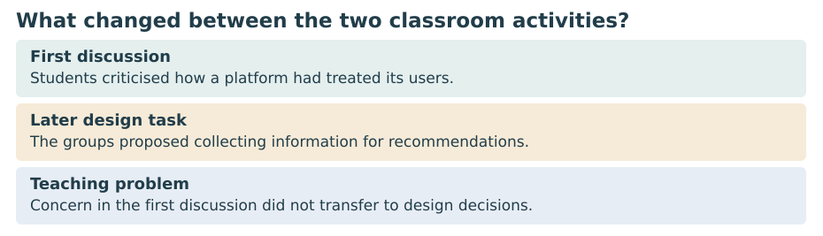
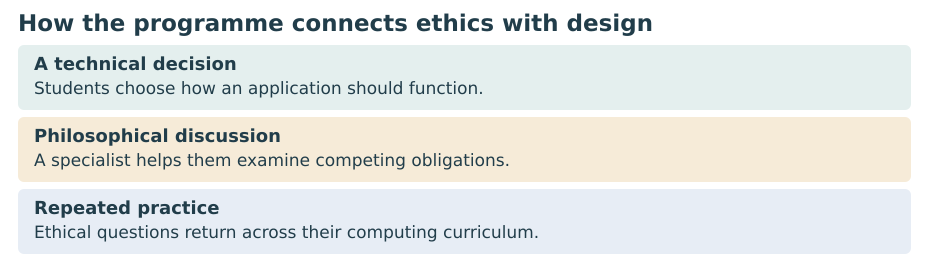
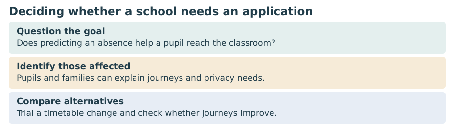

# École polytechnique FUI-FF, session 2 — Anglais 2022 · Corrigé guidé

*Corrigé rédigé par IA, non officiel.*

**Rédaction** · modèle exact non renseigné (famille GPT-6) · effort non renseigné · vitesse non renseignée

**Révision** · modèle exact non renseigné (famille GPT-6) · effort non renseigné · vitesse non renseignée

**Révision** · GPT-6.2 Astra Ultra · vitesse non renseignée

**Révision** · GPT-6.2 Astra Ultra · vitesse non renseignée

**Révision (tour 4)** · GPT-6.2 Astra Ultra · vitesse non renseignée

L’épreuve dure deux heures. Le sujet demande au moins 50 mots par réponse de compréhension et un essai de 405 à 495 mots, avec une barre tous les 50 mots. Les renvois aux pages du PDF identifient les idées reprises de l’article.

[Sujet officiel](https://www.polytechnique.edu/admission-cycle-ingenieur/sites/admission/files/content/2022%20FUI-FF%20Session%20Printemps%20SUJET%20ANGLAIS.pdf)

## Reading comprehension

### 1. The special difficulty of moral reasoning

> [!INDICATION]
> Opposer les critères d’une preuve technique aux désaccords qui peuvent subsister même lorsque tous admettent les faits.

Many computing assignments reward students for demonstrating that a particular answer works. Moral judgement asks them to consider competing claims, imagine alternative outcomes and explain which obligations matter most. Discussion can reveal a clearer problem without producing a unique solution. Someone whose calculation is flawless must still consider whether the proposed action treats those affected fairly. (Pazzanese, p. 4).

### 2. What the Facebook discussion revealed

> [!INDICATION]
> Le fait Facebook remonte à 2014. La tâche fictive intervient deux jours après la discussion en classe. Quand Grosz a redonné le cours, une étudiante a dit avoir compris la question éthique sans la croire pertinente. Ce témoignage appartient à une autre occurrence du cours.

One class protested when it learnt that Facebook had changed users’ feeds without telling them to investigate emotional effects. Two days afterwards no group raised privacy or consent while choosing customer data for an imaginary fashion business. When Grosz repeated the course, one student recalled noticing the issue but dismissing its relevance. These distinct observations explain why the teacher wanted reflection to accompany design decisions. (Pazzanese, p. 3).

### 3. What ethical reasoning involves

> [!INDICATION]
> Distinguer l’identification des personnes touchées, la comparaison des choix et la justification publique.

It means identifying who could be affected by a decision, examining their interests and rights, and giving reasons for a choice that others can challenge. One must consider what might happen under alternative arrangements, including choosing to abandon a proposal. Listening to people with different priorities may change the judgement even when all participants agree about the technical facts. (Pazzanese, pp. 2–4).

### 4. The distinctive teaching model

> [!INDICATION]
> Distinguez trois repères de la page 2, lancement au printemps 2017, plus de trente cours concernés au printemps 2019 et environ 2 750 étudiants inscrits depuis le lancement. Une personne formée en philosophie anime un module ancré dans la difficulté technique du cours.

In 2017 Barbara Grosz launched this Harvard initiative with Alison Simmons. Researchers trained in philosophy teach discussions linked to specific technical tasks within computing classes. This gives a student repeated practice in deciding which data to collect while the design is still open to change. More than thirty courses took part during the 2019 spring term. The broader enrolment figure, roughly 2,750, counts students since the programme began. (Pazzanese, pp. 2–3).

L’expérience de Facebook et la tâche sur le fabricant de vêtements ne sont pas deux expériences réelles. La première a eu lieu en 2014 ; la deuxième a été proposée en classe pour observer ce que les étudiants pensent à vérifier lorsqu’ils conçoivent eux-mêmes un service.

## Essay

> [!INDICATION]
> Essayer la double question du sujet sur un projet concret. Dans quel but le système serait-il construit, qui en supporterait les erreurs et que pourrait-on essayer à sa place ?

Imagine a school commissioning an application that predicts which pupils might miss their next lesson. A programmer can probably build a working demonstration. The harder question is what the demonstration would count as success. An office might welcome an accurate warning, while a teenager already struggling with a difficult journey / might dread being questioned every morning. Both perspectives matter before anyone chooses what information the program should use.

There are good reasons to explore the idea. A counsellor who knows that several pupils arrive late after taking the same bus could investigate a timetable change. A simple message asking whether / someone needs help might prevent a student from dropping a subject. Yet neither benefit follows automatically from predicting an absence. If the application merely produces a list for disciplinary staff, the same accurate forecast could increase punishment without removing a single obstacle to attendance.

Asking whether to build the application / therefore requires listening to people who seldom attend a software planning meeting. A parent may explain that siblings share one telephone. A pupil may occasionally turn that telephone off to avoid messages from someone who frightens her. Treating silence as evidence of poor motivation would transform circumstances invisible to the / programmer into a judgement carrying the school’s authority. Giving pupils a chance to correct information would help, but only if corrections reached the teacher before any decision was made.

There could also be a better response requiring very little technology. The school might ask its transport provider to review the / timetable and offer a confidential route for seeking assistance. A short trial could compare that arrangement with the proposed application. Teachers could record how quickly practical problems were resolved, while pupils could report whether they felt able to ask for help. Either approach might prove disappointing. Agreeing beforehand to stop / an unsuccessful trial would make the investigation more honest.

I would still expect future programmers to master calculation, testing and the patient work of finding mistakes. Their technical skills give them unusual power to question a brief: they can tell the school when cheaper information would answer its actual question, / or when collecting more would expose children unnecessarily. They should also explain uncertainty clearly enough for families to challenge an official conclusion. Refusing a commission is sometimes a responsible professional decision, but redesigning it with the people most affected can offer something better. The best outcome in this example would / be a pupil reaching class more easily, whether or not the original application ever appears on a screen.

*418 words.*

## Vérification des longueurs

Les quatre réponses de compréhension comptent respectivement 56, 65, 59 et 68 mots hors références. Dans l’essai, un groupe relié par un trait d’union compte pour un seul mot.
