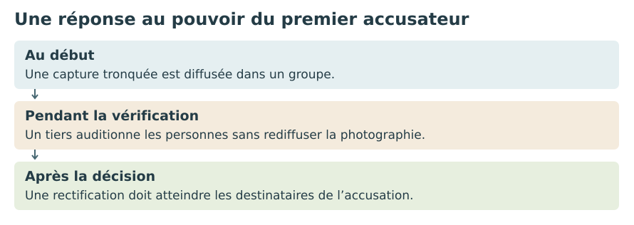

# École polytechnique FUI-FF, session 2 — Français 2022 · Corrigé guidé

*Corrigé rédigé par IA, non officiel.*

**Rédaction** · modèle exact non renseigné (famille GPT-6) · effort non renseigné · vitesse non renseignée

**Révision** · modèle exact non renseigné (famille GPT-6) · effort non renseigné · vitesse non renseignée

**Révision** · GPT-6.2 Astra Ultra · vitesse non renseignée

**Révision (tour 3)** · GPT-6.2 Astra Ultra · vitesse non renseignée

La session de printemps du concours 2022 consacre deux heures à l’épreuve n° 2. La première partie, sur « Le Loup et l’Agneau » de Jean de La Fontaine (*Fables*, I, 10, 1668), vaut dix points. Les dix autres points reviennent à un court essai de forme libre, sans limite de mots, sur la morale de l’apologue dans la société contemporaine. Le sujet interdit les dictionnaires et traducteurs électroniques.

[Sujet officiel de la session 2](https://www.polytechnique.edu/admission-cycle-ingenieur/sites/admission/files/content/2022%20FUI-FF%20Session%20Printemps%20SUJET%20FRANCAIS.pdf)

## A1 · Idée principale et récit de la rencontre

> [!INDICATION]
> Résumer l’action en conservant la faim initiale, les accusations et le dénouement.

Le loup a faim et entend donner à sa proie l’apparence d’un coupable. L’histoire montre ce qui arrive quand le même animal peut porter l’accusation, trancher le litige et exécuter la sentence. Un agneau boit en aval d’un loup affamé. Le loup l’accuse d’abord de salir son eau. Quand l’agneau montre pourquoi c’est impossible, le loup lui attribue une offense commise avant sa naissance. Il reporte ensuite la faute sur un frère inexistant, puis sur tous les siens. Il emporte finalement l’agneau dans la forêt et le dévore. La faim explique dès le début une issue que les accusations prétendaient justifier.

## A2 · Les arguments de chacun

> [!INDICATION]
> Suivre les changements d’accusation et nommer les faits que l’agneau oppose à chacun.

Le loup change d’accusation chaque fois qu’un fait le contredit. La première accusation se heurte au sens du courant : l’agneau boit plus de vingt pas en aval du loup. La deuxième se heurte à l’âge de l’accusé, la troisième à l’absence de frère. Le grief change alors de nature. Du « tu » adressé à l’agneau, le loup passe au « vous » qui englobe les siens, les bergers et les chiens. L’accusé devrait répondre de tout un groupe sur la foi d’une rumeur anonyme. Aux trois premières attaques, l’agneau répond par des raisons précises. Le dernier reproche collectif et l’appel à une rumeur ne lui laissent plus de tour de parole. Sa politesse à l’égard de « Votre Majesté » cherche à rendre ce raisonnement audible auprès d’un juge déjà en colère.

## A3 · Qualifier les deux attitudes

> [!INDICATION]
> Justifier chaque adjectif par un comportement ou une parole du texte.

Le loup est impérieux, agressif et de mauvaise foi. Il annonce le châtiment avant même d’avoir entendu la réponse et refuse de reconnaître le moindre démenti. L’agneau est déférent, lucide et sans défense. Tant que le loup lui laisse la parole, il garde la précision nécessaire pour réfuter des accusations successives. En disant « Sire », il reconnaît le rang que s’arroge son interlocuteur. Jusque dans sa façon de s’adresser à lui, on entend le risque qu’il prend en osant le contredire.

## A4 · Expliquer la morale

> [!INDICATION]
> Pourquoi les meilleures raisons au sens logique ne suffisent-elles pas à sauver celui qui les donne ?

La « raison » peut désigner le bon argument ou le motif qu’un puissant fait accepter parce qu’il peut imposer sa décision. La formule initiale joue sur cet écart. L’agneau a de meilleures raisons, mais seul le loup a le pouvoir de décider quelle raison aura des effets. La morale placée en tête invite le lecteur à observer comment se fabrique cette apparence de justice. Le mot « meilleure » est ironique. Le succès du loup mesure sa puissance. Le lecteur, qui a entendu les deux parties, peut juger l’injustice du verdict.

## B · La loi du plus fort aujourd’hui

> [!INDICATION]
> Construire un cas concret de pouvoir inégal et examiner ce qui pourrait en modifier le dénouement.

Dans un groupe de discussion d’une classe, un élève accuse un camarade absent d’avoir diffusé une photographie sans permission. Il produit une capture d’écran coupée juste au-dessus du nom de l’expéditeur. Plusieurs personnes relaient la capture et une moquerie l’accompagne bientôt. Quand le camarade se connecte, il s’aperçoit que sa réputation s’est décidée sans lui. Cette situation imaginaire ressemble au ruisseau de La Fontaine. Le pouvoir du premier accusateur tient ici au nombre de lecteurs qu’il a pu atteindre avant toute réponse.

Je trouve la formule du fabuliste vraie chaque fois que celui qui accuse peut aussi choisir la preuve, écarter les objections et exécuter la sanction. Elle me semble en revanche appeler une réponse pratique. Dans la classe imaginée, un délégué peut demander l’interruption des transferts, faire entendre séparément les personnes concernées et prévoir le retrait de l’accusation auprès du même groupe si elle se révèle fausse. Un message de rectification lu par trois personnes aurait peu d’effet après une accusation relayée à trente. Le nombre et le lieu des destinataires font partie de la réparation.

Un litige réel montre ce qui change quand un tiers a le pouvoir de trancher. En 2020, la Cour de cassation a confirmé qu’un chauffeur présenté comme indépendant travaillait en réalité, dans son cas, comme salarié d’Uber. Qui fixait le tarif de la course ? Qui pouvait suspendre l’accès à l’application ? Devant les juges, le chauffeur a pu faire examiner ces faits. La plateforme, si puissante dans la relation quotidienne, a dû se soumettre à une qualification qu’elle contestait.

Le « toujours » de La Fontaine me paraît donc décrire un monde où la victime ne dispose d’aucun recours. Que le plus faible puisse saisir un tiers et obtenir une réponse qui s’impose au plus fort, et le dénouement de l’apologue cesse d’être une fatalité.

> [!METHODE]
> Pour passer de la morale à l’essai, reprenez le mot « toujours ». Dans la discussion de classe, qui pourrait rendre la rectification aussi visible que l’accusation ? Dans le procès du chauffeur, qui peut faire produire un effet à l’objection du plus faible ?

> [!METHODE]
> En repérant les tours de parole, on voit où finit l’échange : après la dénégation concernant le frère, l’agneau ne parle plus. La morale de tête se vérifie aussi par ce silence imposé.
