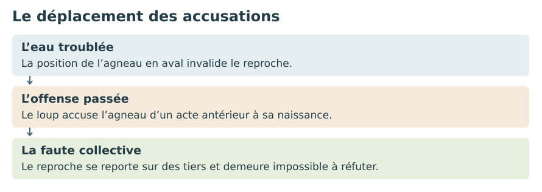

# École polytechnique FUI-FF, session 2 — Français 2022 · Corrigé guidé

*Corrigé rédigé par IA, non officiel.*

**Rédaction** · modèle exact non renseigné (famille GPT-6) · effort non renseigné · vitesse non renseignée

**Révision** · modèle exact non renseigné (famille GPT-6) · effort non renseigné · vitesse non renseignée

Cette épreuve de la filière universitaire internationale de formation francophone dure deux heures. Le sujet porte sur « Le Loup et l’Agneau » de Jean de La Fontaine (Fables, I, 10, 1668). La compréhension et l’essai valent chacun dix points. La copie traite les quatre demandes de lecture et un essai libre sans limite de mots.

[Sujet officiel de la session 2](https://www.polytechnique.edu/admission-cycle-ingenieur/sites/admission/files/content/2022%20FUI-FF%20Session%20Printemps%20SUJET%20FRANCAIS.pdf)

## A1 · Idée principale et récit de la rencontre

> [!INDICATION]
> Résumer l’action en conservant la faim initiale, les accusations et le dénouement.

La force permet au coupable de se faire juge et de transformer en procès la recherche d’un prétexte. Un agneau boit en aval d’un loup affamé. Le loup l’accuse d’abord de salir son eau. Quand l’agneau montre pourquoi c’est impossible, le loup lui attribue une offense commise avant sa naissance. Il reporte ensuite la faute sur un frère inexistant, puis sur tous les siens. Il emporte finalement l’agneau dans la forêt et le dévore. La faim explique dès le début une issue que les accusations prétendaient justifier.

## A2 · Les arguments de chacun

> [!INDICATION]
> Suivre les changements d’accusation et nommer les faits que l’agneau oppose à chacun.

Le loup change d’accusation chaque fois qu’un fait le contredit. La première accusation se heurte au sens du courant, la deuxième à l’âge de l’accusé, la troisième à l’absence de frère. Le loup en vient alors à un reproche collectif et à un témoignage anonyme dont personne ne peut vérifier l’origine. L’agneau répond au contraire à chaque grief par une raison précise et vérifiable. Sa politesse à l’égard de « Votre Majesté » cherche à rendre ce raisonnement audible auprès d’un juge déjà en colère.

## A3 · Qualifier les deux attitudes

> [!INDICATION]
> Justifier chaque adjectif par un comportement ou une parole du texte.

Le loup est impérieux, agressif et de mauvaise foi. Il annonce le châtiment avant même d’avoir entendu la réponse et refuse de reconnaître le moindre démenti. L’agneau est déférent, lucide et sans défense. Il trouve la réplique pertinente à chaque accusation. Sa vulnérabilité physique donne tout son prix à son calme ; une réponse plus insolente l’exposerait davantage, sans lui procurer le pouvoir de faire respecter les faits.

## A4 · Expliquer la morale

> [!INDICATION]
> Pourquoi les meilleures raisons au sens logique ne suffisent-elles pas à sauver celui qui les donne ?

La « raison » peut désigner le bon argument ou le motif qu’un puissant fait accepter parce qu’il peut imposer sa décision. La formule initiale joue sur cet écart. L’agneau a de meilleures raisons, mais seul le loup a le pouvoir de décider quelle raison aura des effets. La morale placée en tête invite le lecteur à observer comment se fabrique cette apparence de justice. La fin, « Sans autre forme de procès », révèle ce qu’aura valu la prétendue délibération pour l’accusé.

## B · La morale devant une situation contemporaine

> [!INDICATION]
> Construire un cas concret de pouvoir inégal et examiner ce qui pourrait en modifier le dénouement.

Dans un groupe de discussion d’une classe, un élève accuse un camarade absent d’avoir diffusé une photographie sans permission. Il produit une capture d’écran coupée juste au-dessus du nom de l’expéditeur. Plusieurs personnes relaient la capture et une moquerie l’accompagne bientôt. Quand le camarade se connecte, il s’aperçoit que sa réputation s’est décidée sans lui. Cette situation imaginaire ressemble au ruisseau de La Fontaine. Le pouvoir du premier accusateur tient ici au nombre de lecteurs qu’il a pu atteindre avant toute réponse.

Je trouve la formule du fabuliste vraie chaque fois que celui qui accuse peut aussi choisir la preuve, écarter les objections et exécuter la sanction. Elle me semble en revanche appeler une réponse pratique. Dans la classe imaginée, un délégué peut demander l’interruption des transferts, faire entendre séparément les personnes concernées et prévoir le retrait de l’accusation auprès du même groupe si elle se révèle fausse. Un message de rectification lu par trois personnes aurait peu d’effet après une accusation relayée à trente. Le nombre et le lieu des destinataires font partie de la réparation.

Tous les faits ne seront pas faciles à établir. La photographie touche peut-être à la vie privée de la personne représentée et il serait absurde de la faire circuler davantage pour défendre l’élève mis en cause. Un tiers de confiance peut examiner l’échange sans l’exposer de nouveau. Le dénouement de la fable m’apprend ainsi le prix d’un pouvoir dont personne ne peut contrôler l’usage. Une communauté entrevoit une autre issue dès qu’elle donne au plus faible du temps pour répondre et un interlocuteur capable d’agir sur ce que les autres entendent.

> [!METHODE]
> Pour terminer, relier la portée de l’exemple à la question posée. La conclusion personnelle doit pouvoir être comprise par quelqu’un qui découvre cet exemple.
